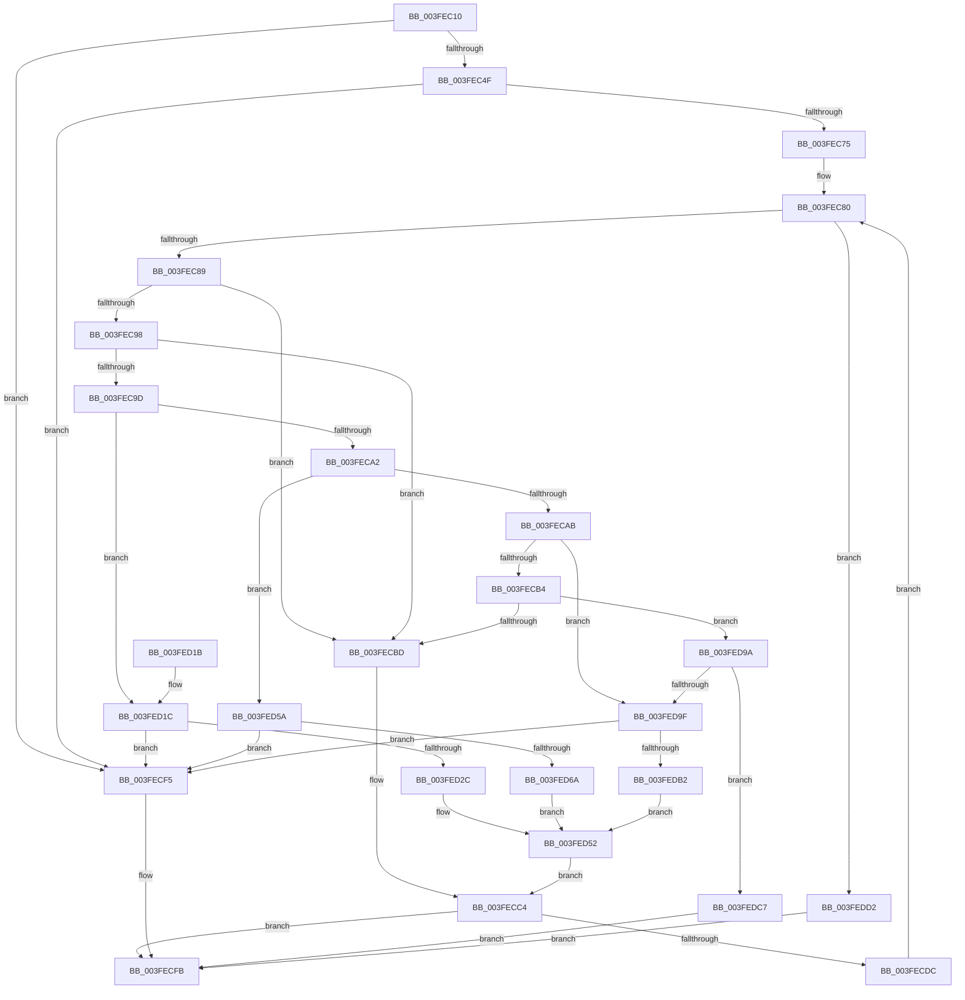

# AuthzBasepCopyoutInternalSecurityAttributeValues

- RVA: `0x003FEC10`–`0x003FEDE4` (길이 `468` bytes)
- VA: `0x00000001403FEC10`
- 실행 섹션: `.text`
- PDB 이름 있음: `예`; PDB Function 태그: `아니요`
- unwind 정보 RVA: `0x00099F40`
- 디코드: `127`개 명령, `468/468` bytes 표시
- 미해석 바이트: `0` (있으면 어셈블리에 `.byte`로 보존)

> 이 문서는 커널 이미지의 기계어와 PDB 기호를 분석해 생성했습니다. 4번과 5번은 함수 원형과 자료형을 바이너리 사용 방식에서 추정한 C 해석이며 원본 소스 복구 결과는 아닙니다.

## 1. Dependencies

- 직접 호출 지점: **4**; 고유 호출 대상: **3**
- 직접 호출자로 확인된 함수: **1**
- RIP 상대 이미지 참조: **0**

### Outgoing calls
- `0x003FECD0` → [AuthzBasepProbeAndInsertTailList](../../page/9E/AuthzBasepProbeAndInsertTailList_function_009EA448.md) (function, `0x009EA448`)
- `0x003FED43` → [RtlCopyUnicodeString](RtlCopyUnicodeString_function_003FEF30.md) (function, `0x003FEF30`)
- `0x003FED88` → [RtlCopyUnicodeString](RtlCopyUnicodeString_function_003FEF30.md) (function, `0x003FEF30`)
- `0x003FEDC0` → [memcpy](../6C/memcpy_function_006C6840.md) (function, `0x006C6840`)

### Direct callers
- [AuthzBasepCopyoutInternalSecurityAttributes](../../page/9E/AuthzBasepCopyoutInternalSecurityAttributes_function_009EA280.md) at `0x009EA3DC`

### Static image references
- 디코드된 RIP-relative 메모리 참조가 없습니다.

## 2. Other-region calls and transfers

- 다른 실행 섹션으로 향하는 call: **1**
  - `0x003FECD0` → [AuthzBasepProbeAndInsertTailList](../../page/9E/AuthzBasepProbeAndInsertTailList_function_009EA448.md) (`.text` → `PAGE`)
- 별도 외부 분기/꼬리 이동을 확인하지 못했습니다.

## 3. Assembly (complete function range)

```asm
003FEC10  48 8B C4                        mov rax, rsp
003FEC13  48 89 58 08                     mov qword ptr [rax + 8], rbx
003FEC17  48 89 68 18                     mov qword ptr [rax + 0x18], rbp
003FEC1B  48 89 70 20                     mov qword ptr [rax + 0x20], rsi
003FEC1F  48 89 50 10                     mov qword ptr [rax + 0x10], rdx
003FEC23  57                              push rdi
003FEC24  41 54                           push r12
003FEC26  41 55                           push r13
003FEC28  41 56                           push r14
003FEC2A  41 57                           push r15
003FEC2C  48 83 EC 30                     sub rsp, 0x30
003FEC30  41 8B E9                        mov ebp, r9d
003FEC33  45 33 D2                        xor r10d, r10d
003FEC36  49 03 E8                        add rbp, r8
003FEC39  0F 57 C0                        xorps xmm0, xmm0
003FEC3C  4D 8B F8                        mov r15, r8
003FEC3F  4C 8B E9                        mov r13, rcx
003FEC42  0F 11 40 C8                     movups xmmword ptr [rax - 0x38], xmm0
003FEC46  49 3B E8                        cmp rbp, r8
003FEC49  0F 82 A6 00 00 00               jb 0x1403fecf5
003FEC4F  41 8B 5D 3C                     mov ebx, dword ptr [r13 + 0x3c]
003FEC53  49 8D 70 07                     lea rsi, [r8 + 7]
003FEC57  48 8B 8C 24 80 00 00 00         mov rcx, qword ptr [rsp + 0x80]
003FEC5F  48 83 E6 F8                     and rsi, 0xfffffffffffffff8
003FEC63  C1 E3 06                        shl ebx, 6
003FEC66  48 03 DE                        add rbx, rsi
003FEC69  44 21 11                        and dword ptr [rcx], r10d
003FEC6C  48 3B DD                        cmp rbx, rbp
003FEC6F  0F 87 80 00 00 00               ja 0x1403fecf5
003FEC75  49 8D 45 48                     lea rax, [r13 + 0x48]
003FEC79  48 8B 38                        mov rdi, qword ptr [rax]
003FEC7C  4C 8D 76 28                     lea r14, [rsi + 0x28]
003FEC80  48 3B F8                        cmp rdi, rax
003FEC83  0F 84 49 01 00 00               je 0x1403fedd2
003FEC89  41 83 66 F8 00                  and dword ptr [r14 - 8], 0
003FEC8E  41 0F B7 55 30                  movzx edx, word ptr [r13 + 0x30]
003FEC93  83 EA 01                        sub edx, 1
003FEC96  74 25                           je 0x1403fecbd
003FEC98  83 EA 01                        sub edx, 1
003FEC9B  74 20                           je 0x1403fecbd
003FEC9D  83 EA 01                        sub edx, 1
003FECA0  74 7A                           je 0x1403fed1c
003FECA2  83 EA 01                        sub edx, 1
003FECA5  0F 84 AF 00 00 00               je 0x1403fed5a
003FECAB  83 EA 01                        sub edx, 1
003FECAE  0F 84 EB 00 00 00               je 0x1403fed9f
003FECB4  83 EA 01                        sub edx, 1
003FECB7  0F 85 DD 00 00 00               jne 0x1403fed9a
003FECBD  48 8B 47 28                     mov rax, qword ptr [rdi + 0x28]
003FECC1  49 89 06                        mov qword ptr [r14], rax
003FECC4  48 8B 4C 24 68                  mov rcx, qword ptr [rsp + 0x68]
003FECC9  48 8B D6                        mov rdx, rsi
003FECCC  48 83 C1 48                     add rcx, 0x48
003FECD0  E8 73 B7 5E 00                  call 0x1409ea448
003FECD5  44 8B D0                        mov r10d, eax
003FECD8  85 C0                           test eax, eax
003FECDA  78 1F                           js 0x1403fecfb
003FECDC  48 8B 54 24 68                  mov rdx, qword ptr [rsp + 0x68]
003FECE1  49 8D 45 48                     lea rax, [r13 + 0x48]
003FECE5  48 83 C6 40                     add rsi, 0x40
003FECE9  FF 42 3C                        inc dword ptr [rdx + 0x3c]
003FECEC  48 8B 3F                        mov rdi, qword ptr [rdi]
003FECEF  49 83 C6 40                     add r14, 0x40
003FECF3  EB 8B                           jmp 0x1403fec80
003FECF5  41 BA 05 00 00 80               mov r10d, 0x80000005
003FECFB  48 8B 5C 24 60                  mov rbx, qword ptr [rsp + 0x60]
003FED00  41 8B C2                        mov eax, r10d
003FED03  48 8B 6C 24 70                  mov rbp, qword ptr [rsp + 0x70]
003FED08  48 8B 74 24 78                  mov rsi, qword ptr [rsp + 0x78]
003FED0D  48 83 C4 30                     add rsp, 0x30
003FED11  41 5F                           pop r15
003FED13  41 5E                           pop r14
003FED15  41 5D                           pop r13
003FED17  41 5C                           pop r12
003FED19  5F                              pop rdi
003FED1A  C3                              ret
003FED1B  CC                              int3
003FED1C  48 8D 57 28                     lea rdx, [rdi + 0x28]
003FED20  0F B7 02                        movzx eax, word ptr [rdx]
003FED23  4C 8D 24 18                     lea r12, [rax + rbx]
003FED27  4C 3B E5                        cmp r12, rbp
003FED2A  77 C9                           ja 0x1403fecf5
003FED2C  0F 57 C0                        xorps xmm0, xmm0
003FED2F  48 8D 4C 24 20                  lea rcx, [rsp + 0x20]
003FED34  0F 11 44 24 20                  movups xmmword ptr [rsp + 0x20], xmm0
003FED39  66 89 44 24 22                  mov word ptr [rsp + 0x22], ax
003FED3E  48 89 5C 24 28                  mov qword ptr [rsp + 0x28], rbx
003FED43  E8 E8 01 00 00                  call 0x1403fef30
003FED48  0F 10 44 24 20                  movups xmm0, xmmword ptr [rsp + 0x20]
003FED4D  F3 41 0F 7F 06                  movdqu xmmword ptr [r14], xmm0
003FED52  49 8B DC                        mov rbx, r12
003FED55  E9 6A FF FF FF                  jmp 0x1403fecc4
003FED5A  48 8D 57 30                     lea rdx, [rdi + 0x30]
003FED5E  0F B7 0A                        movzx ecx, word ptr [rdx]
003FED61  4C 8D 24 19                     lea r12, [rcx + rbx]
003FED65  4C 3B E5                        cmp r12, rbp
003FED68  77 8B                           ja 0x1403fecf5
003FED6A  48 8B 47 28                     mov rax, qword ptr [rdi + 0x28]
003FED6E  0F 57 C0                        xorps xmm0, xmm0
003FED71  0F 11 44 24 20                  movups xmmword ptr [rsp + 0x20], xmm0
003FED76  66 89 4C 24 22                  mov word ptr [rsp + 0x22], cx
003FED7B  48 8D 4C 24 20                  lea rcx, [rsp + 0x20]
003FED80  49 89 06                        mov qword ptr [r14], rax
003FED83  48 89 5C 24 28                  mov qword ptr [rsp + 0x28], rbx
003FED88  E8 A3 01 00 00                  call 0x1403fef30
003FED8D  0F 10 44 24 20                  movups xmm0, xmmword ptr [rsp + 0x20]
003FED92  F3 41 0F 7F 46 08               movdqu xmmword ptr [r14 + 8], xmm0
003FED98  EB B8                           jmp 0x1403fed52
003FED9A  83 FA 0A                        cmp edx, 0xa
003FED9D  75 28                           jne 0x1403fedc7
003FED9F  8B 47 30                        mov eax, dword ptr [rdi + 0x30]
003FEDA2  44 8B C0                        mov r8d, eax
003FEDA5  4C 8D 24 18                     lea r12, [rax + rbx]
003FEDA9  4C 3B E5                        cmp r12, rbp
003FEDAC  0F 87 43 FF FF FF               ja 0x1403fecf5
003FEDB2  41 89 46 08                     mov dword ptr [r14 + 8], eax
003FEDB6  48 8B CB                        mov rcx, rbx
003FEDB9  49 89 1E                        mov qword ptr [r14], rbx
003FEDBC  48 8B 57 28                     mov rdx, qword ptr [rdi + 0x28]
003FEDC0  E8 7B 7A 2C 00                  call 0x1406c6840
003FEDC5  EB 8B                           jmp 0x1403fed52
003FEDC7  41 BA 0D 00 00 C0               mov r10d, 0xc000000d
003FEDCD  E9 29 FF FF FF                  jmp 0x1403fecfb
003FEDD2  48 8B 84 24 80 00 00 00         mov rax, qword ptr [rsp + 0x80]
003FEDDA  41 2B DF                        sub ebx, r15d
003FEDDD  89 18                           mov dword ptr [rax], ebx
003FEDDF  E9 17 FF FF FF                  jmp 0x1403fecfb
```

## 4. C-style interpretation (structured pseudocode)

```c
__int64 __fastcall AuthzBasepCopyoutInternalSecurityAttributeValues(__int64 a1, __int64 a2, __int64 a3, int a4, __int64 a5)
{
    __int64 result;
    __int64 v_r10;
    __int64 v_r14;
    __int64 v_rbp;
    __int64 v_rbx;
    __int64 v_rsi;
    __int64 v_rsp;
    unsigned __int64 v_stack_p10;
    unsigned __int64 v_stack_p18;
    unsigned __int64 v_stack_p20;
    unsigned __int16 v_stack_p22;
    unsigned __int64 v_stack_p28;
    unsigned __int64 v_stack_p8;

    *(unsigned __int64 *)(v_rsp + 8) = v_rbx;
    *(unsigned __int64 *)(v_rsp + 24) = v_rbp;
    *(unsigned __int64 *)(v_rsp + 32) = v_rsi;
    *(unsigned __int64 *)(v_rsp + 16) = a2;
    v_rsp = (v_rsp) - (48);
    v_r10 = 0;
    v_rbp = ((unsigned int)(a4)) + (a3);
    *(unsigned __int64 *)(v_rsp - 56) = v_xmm0;
    if (v_rbp < a3) goto loc_003FECF5;
    v_rsi = (a3 + 7) & (-8);
    v_rbx = (unsigned int)(((unsigned int)(*(unsigned int *)(a1 + 60))) << (6));
    v_rbx = (v_rbx) + (v_rsi);
    if (v_rbx > v_rbp) goto loc_003FECF5;
loc_003FEC80:
    if ((*(unsigned __int64 *)(a1 + 72)) == (a1 + 72)) goto loc_003FEDD2;
    a2 = (unsigned int)((*(unsigned __int16 *)(a1 + 48)) - (1));
    if (condition_is_equal) goto loc_003FECBD;
    a2 = (unsigned int)((a2) - (1));
    if (condition_is_equal) goto loc_003FECBD;
    a2 = (unsigned int)((a2) - (1));
    if (condition_is_equal) goto loc_003FED1C;
    a2 = (unsigned int)((a2) - (1));
    if (condition_is_equal) goto loc_003FED5A;
    a2 = (unsigned int)((a2) - (1));
    if (condition_is_equal) goto loc_003FED9F;
    a2 = (unsigned int)((a2) - (1));
    if (condition_is_not_equal) goto loc_003FED9A;
loc_003FECBD:
    *(unsigned __int64 *)(v_rsi + 40) = *(unsigned __int64 *)(*(unsigned __int64 *)(a1 + 72) + 40);
loc_003FECC4:
    a1 = (v_stack_p10) + (72);
    result = AuthzBasepProbeAndInsertTailList(a1, v_rsi, a3, a4);
    if (sign_flag) goto loc_003FECFB;
    v_rsi = (v_rsi) + (64);
    v_r14 = (v_rsi + 40) + (64);
    goto loc_003FEC80;
loc_003FECF5:
loc_003FECFB:
    v_rsp = (v_rsp) + (48);
    return (unsigned int)((unsigned int)((unsigned int)(0x80000005ULL)));
loc_003FED1C:
    if ((*(unsigned __int16 *)(*(unsigned __int64 *)(*(unsigned __int64 *)(a1 + 72)) + 40) + v_stack_p8 * 1) > v_stack_p18) goto loc_003FECF5;
    v_stack_p20 = v_xmm0;
    v_stack_p22 = (unsigned __int16)(*(unsigned __int16 *)(*(unsigned __int64 *)(*(unsigned __int64 *)(a1 + 72)) + 40));
    v_stack_p28 = v_stack_p8;
    result = RtlCopyUnicodeString(v_stack_p20, *(unsigned __int64 *)(*(unsigned __int64 *)(a1 + 72)) + 40, a3, a4);
    *(unsigned __int64 *)(v_r14) = v_xmm0;
loc_003FED52:
    goto loc_003FECC4;
loc_003FED5A:
    if ((*(unsigned __int16 *)(*(unsigned __int64 *)(*(unsigned __int64 *)(a1 + 72)) + 48) + *(unsigned __int16 *)(*(unsigned __int64 *)(*(unsigned __int64 *)(a1 + 72)) + 40) + v_stack_p8 * 1 * 1) > v_stack_p18) goto loc_003FECF5;
    v_stack_p20 = v_xmm0;
    v_stack_p22 = (unsigned __int16)(*(unsigned __int16 *)(*(unsigned __int64 *)(*(unsigned __int64 *)(a1 + 72)) + 48));
    *(unsigned __int64 *)(v_r14) = *(unsigned __int64 *)(*(unsigned __int64 *)(*(unsigned __int64 *)(a1 + 72)) + 40);
    v_stack_p28 = *(unsigned __int16 *)(*(unsigned __int64 *)(*(unsigned __int64 *)(a1 + 72)) + 40) + v_stack_p8 * 1;
    result = RtlCopyUnicodeString(v_stack_p20, *(unsigned __int64 *)(*(unsigned __int64 *)(a1 + 72)) + 48, a3, a4);
    *(unsigned __int64 *)(v_r14 + 8) = v_xmm0;
    goto loc_003FED52;
loc_003FED9A:
    if (((unsigned int)(*(unsigned __int64 *)(*(unsigned __int64 *)(a1 + 72)) + 48)) != 10) goto loc_003FEDC7;
loc_003FED9F:
    if (((unsigned int)(*(unsigned int *)(*(unsigned __int64 *)(*(unsigned __int64 *)(a1 + 72)) + 48)) + *(unsigned __int16 *)(*(unsigned __int64 *)(*(unsigned __int64 *)(a1 + 72)) + 40) + v_stack_p8 * 1 * 1) > v_stack_p18) goto loc_003FECF5;
    *(unsigned int *)(v_r14 + 8) = (unsigned int)((unsigned int)(*(unsigned int *)(*(unsigned __int64 *)(*(unsigned __int64 *)(a1 + 72)) + 48)));
    *(unsigned __int64 *)(v_r14) = *(unsigned __int16 *)(*(unsigned __int64 *)(*(unsigned __int64 *)(a1 + 72)) + 40) + v_stack_p8 * 1;
    result = memcpy(*(unsigned __int16 *)(*(unsigned __int64 *)(*(unsigned __int64 *)(a1 + 72)) + 40) + v_stack_p8 * 1, *(unsigned __int64 *)(*(unsigned __int64 *)(*(unsigned __int64 *)(a1 + 72)) + 40), (unsigned int)((unsigned int)((unsigned int)(*(unsigned int *)(*(unsigned __int64 *)(*(unsigned __int64 *)(a1 + 72)) + 48)))), a4);
    goto loc_003FED52;
loc_003FEDC7:
    goto loc_003FECFB;
loc_003FEDD2:
    v_rbx = (unsigned int)((*(unsigned __int16 *)(*(unsigned __int64 *)(*(unsigned __int64 *)(a1 + 72)) + 40) + v_stack_p8 * 1) - ((unsigned int)(a3)));
    *(unsigned int *)(a5) = (unsigned int)(v_rbx);
    goto loc_003FECFB;
}
```

## 5. (Beta) C Style

```c
int64_t AuthzBasepCopyoutInternalSecurityAttributeValues(void *Arg1, int64_t Arg2, void *Arg3, int32_t Arg4, void *Arg5)
{
    uint8_t *arg1 = (uint8_t *)Arg1;
    uint8_t *arg3 = (uint8_t *)Arg3;
    uint8_t *arg5 = (uint8_t *)Arg5;

    int64_t result;
    int64_t local_r10;
    int64_t local_r14;
    int64_t local_rbp;
    int64_t local_rbx;
    int64_t local_rsi;
    int64_t local_rsp;
    uint64_t v_stack_p10;
    uint64_t v_stack_p18;
    uint64_t v_stack_p20;
    uint16_t v_stack_p22;
    uint64_t v_stack_p28;
    uint64_t v_stack_p8;

    *(uint64_t *)(local_rsp + 0x8) = local_rbx;
    *(uint64_t *)(local_rsp + 0x18) = local_rbp;
    *(uint64_t *)(local_rsp + 0x20) = local_rsi;
    *(uint64_t *)(local_rsp + 0x10) = Arg2;
    local_rsp = (local_rsp) - (48);
    local_r10 = 0;
    local_rbp = ((uint32_t)(Arg4)) + (Arg3);
    *(uint64_t *)(local_rsp - 0x38) = v_xmm0;
    if (local_rbp < Arg3) goto loc_003FECF5;
    local_rsi = (Arg3 + 7) & (-8);
    local_rbx = (uint32_t)(((uint32_t)(*(uint32_t *)(arg1 + 0x3C))) << (6));
    local_rbx = (local_rbx) + (local_rsi);
    if (local_rbx > local_rbp) goto loc_003FECF5;
loc_003FEC80:
    if ((*(uint64_t *)(arg1 + 0x48)) == (Arg1 + 72)) goto loc_003FEDD2;
    Arg2 = (uint32_t)((*(uint16_t *)(arg1 + 0x30)) - (1));
    if (condition_is_equal) goto loc_003FECBD;
    Arg2 = (uint32_t)((Arg2) - (1));
    if (condition_is_equal) goto loc_003FECBD;
    Arg2 = (uint32_t)((Arg2) - (1));
    if (condition_is_equal) goto loc_003FED1C;
    Arg2 = (uint32_t)((Arg2) - (1));
    if (condition_is_equal) goto loc_003FED5A;
    Arg2 = (uint32_t)((Arg2) - (1));
    if (condition_is_equal) goto loc_003FED9F;
    Arg2 = (uint32_t)((Arg2) - (1));
    if (condition_is_not_equal) goto loc_003FED9A;
loc_003FECBD:
    *(uint64_t *)(local_rsi + 0x28) = *(uint64_t *)(*(uint64_t *)(arg1 + 0x48) + 0x28);
loc_003FECC4:
    Arg1 = (v_stack_p10) + (72);
    result = AuthzBasepProbeAndInsertTailList(Arg1, local_rsi, Arg3, Arg4);
    if (sign_flag) goto loc_003FECFB;
    local_rsi = (local_rsi) + (64);
    local_r14 = (local_rsi + 40) + (64);
    goto loc_003FEC80;
loc_003FECF5:
loc_003FECFB:
    local_rsp = (local_rsp) + (48);
    return (uint32_t)((uint32_t)((uint32_t)(0x80000005ULL)));
loc_003FED1C:
    if ((*(uint16_t *)(*(uint64_t *)(*(uint64_t *)(arg1 + 0x48)) + 0x28) + v_stack_p8 * 1) > v_stack_p18) goto loc_003FECF5;
    v_stack_p20 = v_xmm0;
    v_stack_p22 = (uint16_t)(*(uint16_t *)(*(uint64_t *)(*(uint64_t *)(arg1 + 0x48)) + 0x28));
    v_stack_p28 = v_stack_p8;
    result = RtlCopyUnicodeString(v_stack_p20, *(uint64_t *)(*(uint64_t *)(arg1 + 0x48)) + 40, Arg3, Arg4);
    *(uint64_t *)(local_r14) = v_xmm0;
loc_003FED52:
    goto loc_003FECC4;
loc_003FED5A:
    if ((*(uint16_t *)(*(uint64_t *)(*(uint64_t *)(arg1 + 0x48)) + 0x30) + *(uint16_t *)(*(uint64_t *)(*(uint64_t *)(arg1 + 0x48)) + 0x28) + v_stack_p8 * 1 * 1) > v_stack_p18) goto loc_003FECF5;
    v_stack_p20 = v_xmm0;
    v_stack_p22 = (uint16_t)(*(uint16_t *)(*(uint64_t *)(*(uint64_t *)(arg1 + 0x48)) + 0x30));
    *(uint64_t *)(local_r14) = *(uint64_t *)(*(uint64_t *)(*(uint64_t *)(arg1 + 0x48)) + 0x28);
    v_stack_p28 = *(uint16_t *)(*(uint64_t *)(*(uint64_t *)(arg1 + 0x48)) + 0x28) + v_stack_p8 * 1;
    result = RtlCopyUnicodeString(v_stack_p20, *(uint64_t *)(*(uint64_t *)(arg1 + 0x48)) + 48, Arg3, Arg4);
    *(uint64_t *)(local_r14 + 0x8) = v_xmm0;
    goto loc_003FED52;
loc_003FED9A:
    if (((uint32_t)(*(uint64_t *)(*(uint64_t *)(arg1 + 0x48)) + 48)) != 10) goto loc_003FEDC7;
loc_003FED9F:
    if (((uint32_t)(*(uint32_t *)(*(uint64_t *)(*(uint64_t *)(arg1 + 0x48)) + 0x30)) + *(uint16_t *)(*(uint64_t *)(*(uint64_t *)(arg1 + 0x48)) + 0x28) + v_stack_p8 * 1 * 1) > v_stack_p18) goto loc_003FECF5;
    *(uint32_t *)(local_r14 + 0x8) = (uint32_t)((uint32_t)(*(uint32_t *)(*(uint64_t *)(*(uint64_t *)(arg1 + 0x48)) + 0x30)));
    *(uint64_t *)(local_r14) = *(uint16_t *)(*(uint64_t *)(*(uint64_t *)(arg1 + 0x48)) + 0x28) + v_stack_p8 * 1;
    result = memcpy(*(uint16_t *)(*(uint64_t *)(*(uint64_t *)(arg1 + 0x48)) + 0x28) + v_stack_p8 * 1, *(uint64_t *)(*(uint64_t *)(*(uint64_t *)(arg1 + 0x48)) + 0x28), (uint32_t)((uint32_t)((uint32_t)(*(uint32_t *)(*(uint64_t *)(*(uint64_t *)(arg1 + 0x48)) + 0x30)))), Arg4);
    goto loc_003FED52;
loc_003FEDC7:
    goto loc_003FECFB;
loc_003FEDD2:
    local_rbx = (uint32_t)((*(uint16_t *)(*(uint64_t *)(*(uint64_t *)(arg1 + 0x48)) + 0x28) + v_stack_p8 * 1) - ((uint32_t)(Arg3)));
    *(uint32_t *)(arg5) = (uint32_t)(local_rbx);
    goto loc_003FECFB;
}
```

### 관측된 메모리 오프셋

구조체 형식이 확인되지 않은 접근은 인자 기준의 오프셋으로만 기록했습니다.

| 기준 인자 | 오프셋 표현 | 폭 (bit) | 접근 |
|---|---:|---:|---|
| `Arg1` | `+ 0x0` | `64` | `R` |
| `Arg1` | `+ 0x30` | `16` | `R` |
| `Arg1` | `+ 0x3C` | `32` | `R` |
| `Arg1` | `+ 0x48` | `64` | `R` |
| `Arg3` | `- 0x8` | `32` | `R/W` |
| `Arg3` | `+ 0x0` | `64` | `W` |
| `Arg3` | `+ 0x0` | `128` | `W` |
| `Arg3` | `+ 0x7` | `64` | `R` |
| `Arg3` | `+ 0x8` | `32` | `W` |
| `Arg3` | `+ 0x8` | `128` | `W` |
| `Arg3` | `+ 0x28` | `64` | `R` |
| `Arg5` | `+ 0x0` | `32` | `R/W` |
| `Arg5` | `+ 0x0` | `32` | `W` |

## 6. Execution-region graph

[열기: 2D/3D 그래프와 함수 탐색 컨트롤 패널](../../../control-panel.html?section=text&rva=0x003FEC10&view=graph)

- 2D 그래프는 위에서 아래로 흐르고, 3D 그래프는 빈 공간을 드래그해 회전합니다. Shift+드래그는 이동, 휠은 확대·축소, 함수 노드 선택은 대상 보고서 이동입니다.

### Static fallback


