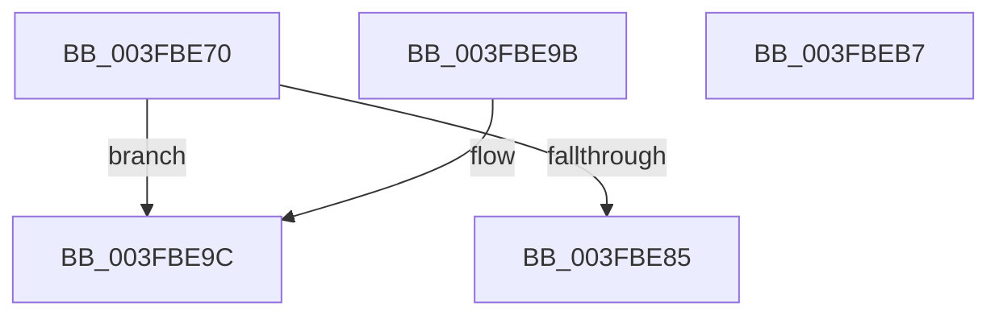

# CmpInitializeThreadInfo

- RVA: `0x003FBE70`–`0x003FBEB8` (길이 `72` bytes)
- VA: `0x00000001403FBE70`
- 실행 섹션: `.text`
- PDB 이름 있음: `예`; PDB Function 태그: `아니요`
- unwind 정보 RVA: `0x000DB714`
- 디코드: `19`개 명령, `72/72` bytes 표시
- 미해석 바이트: `0` (있으면 어셈블리에 `.byte`로 보존)

> 이 문서는 커널 이미지의 기계어와 PDB 기호를 분석해 생성했습니다. 4번과 5번은 함수 원형과 자료형을 바이너리 사용 방식에서 추정한 C 해석이며 원본 소스 복구 결과는 아닙니다.

## 1. Dependencies

- 직접 호출 지점: **0**; 고유 호출 대상: **0**
- 직접 호출자로 확인된 함수: **79**
- RIP 상대 이미지 참조: **0**

### Outgoing calls
- 직접 디코드된 call 명령이 없습니다.

### Direct callers
- [CmInitializeThreadInfo](../66/CmInitializeThreadInfo_function_0066AB44.md) at `0x0066AB48`
- [CmpLazyWriteWorker](../66/CmpLazyWriteWorker_function_0066ADF0.md) at `0x0066AE23`
- [CmpVolumeManagerCreateContextsForWellKnownVolumes](../../page/70/CmpVolumeManagerCreateContextsForWellKnownVolumes_function_007023B0.md) at `0x007023D2`
- [PspDeleteExternalServerSiloState](../../page/77/PspDeleteExternalServerSiloState_function_0077FB88.md) at `0x0077FBE6`
- [CmpFinishSystemHivesLoad](../../page/7D/CmpFinishSystemHivesLoad_function_007DA210.md) at `0x007DA27C`
- [CmpLoadHiveThread](../../page/7D/CmpLoadHiveThread_function_007DB040.md) at `0x007DB0B9`
- [CmOpenKeyForBugCheckRecovery](../../page/7D/CmOpenKeyForBugCheckRecovery_function_007DF3C0.md) at `0x007DF404`
- [NtCompactKeys](../../page/7D/NtCompactKeys_function_007DF730.md) at `0x007DF772`
- [NtCompressKey](../../page/7D/NtCompressKey_function_007DF9D0.md) at `0x007DFA1F`
- [NtFreezeRegistry](../../page/7D/NtFreezeRegistry_function_007DFBD0.md) at `0x007DFC0D`
- [NtInitializeRegistry](../../page/7D/NtInitializeRegistry_function_007DFC90.md) at `0x007DFCAC`
- [NtLockRegistryKey](../../page/7D/NtLockRegistryKey_function_007DFD60.md) at `0x007DFD81`
- [NtOpenRegistryTransaction](../../page/7D/NtOpenRegistryTransaction_function_007DFE40.md) at `0x007DFE78`
- [NtQueryOpenSubKeys](../../page/7D/NtQueryOpenSubKeys_function_007DFF80.md) at `0x007E000F`
- [NtQueryOpenSubKeysEx](../../page/7E/NtQueryOpenSubKeysEx_function_007E0190.md) at `0x007E023C`
- [NtRenameKey](../../page/7E/NtRenameKey_function_007E04B0.md) at `0x007E0511`
- [NtReplaceKey](../../page/7E/NtReplaceKey_function_007E0970.md) at `0x007E09F9`
- [NtRestoreKey](../../page/7E/NtRestoreKey_function_007E0CC0.md) at `0x007E0D3A`
- [NtRollbackRegistryTransaction](../../page/7E/NtRollbackRegistryTransaction_function_007E0F30.md) at `0x007E0F7E`
- [NtSaveMergedKeys](../../page/7E/NtSaveMergedKeys_function_007E1070.md) at `0x007E10EE`
- [NtThawRegistry](../../page/7E/NtThawRegistry_function_007E1320.md) at `0x007E135B`
- [NtUnloadKey2](../../page/7E/NtUnloadKey2_function_007E13D0.md) at `0x007E13EE`
- [CmUnRegisterCallback](../../page/7E/CmUnRegisterCallback_function_007E1510.md) at `0x007E1554`
- [CmpEnumerateCallback](../../page/7E/CmpEnumerateCallback_function_007E18D0.md) at `0x007E18F5`
- [CmpCloneHwProfile](../../page/7E/CmpCloneHwProfile_function_007E303C.md) at `0x007E30F3`
- [CmShutdownSystem](../../page/7E/CmShutdownSystem_function_007E5174.md) at `0x007E518F`
- [CmInitServerSiloState](../../page/7E/CmInitServerSiloState_function_007E5B14.md) at `0x007E5B36`
- [CmReconcileAndValidateAllHives](../../page/7E/CmReconcileAndValidateAllHives_function_007E7D90.md) at `0x007E7DC9`
- [CmpFreezeThawWorker](../../page/7E/CmpFreezeThawWorker_function_007E8670.md) at `0x007E8688`
- [CmpBuildMachineHiveCache](../../page/7E/CmpBuildMachineHiveCache_function_007E8B74.md) at `0x007E8C55`
- [CmpMachineHiveCachePopulateEntry](../../page/7E/CmpMachineHiveCachePopulateEntry_function_007E8E88.md) at `0x007E8EBA`
- [CmpLazyCommitWorker](../../page/7E/CmpLazyCommitWorker_function_007EE030.md) at `0x007EE05C`
- [CmpHiveCachePnpNotificationCallback](../../page/7F/CmpHiveCachePnpNotificationCallback_function_007F5D80.md) at `0x007F5DBA`
- [CmpHiveCachePopulateHiveEntryThread](../../page/7F/CmpHiveCachePopulateHiveEntryThread_function_007F5FD0.md) at `0x007F601D`
- [NtSetInformationKey](../../page/84/NtSetInformationKey_function_00843720.md) at `0x008437FA`
- [NtSetValueKey](../../page/84/NtSetValueKey_function_00844EA0.md) at `0x00844F4E`
- [NtDeleteValueKey](../../page/84/NtDeleteValueKey_function_00848770.md) at `0x0084883D`
- [NtDeleteKey](../../page/84/NtDeleteKey_function_00849920.md) at `0x008499A6`
- [sub_0084D0A2](../../page/84/Unknown_function_0084D0A2.md) at `0x0084D0D8`
- [CmpCloseKeyObject](../../page/86/CmpCloseKeyObject_function_00863AD0.md) at `0x00863B3D`
- [CmpDeleteKeyObject](../../page/86/CmpDeleteKeyObject_function_00865590.md) at `0x008655D8`
- [NtQueryKey](../../page/86/NtQueryKey_function_008676E0.md) at `0x0086781A`
- [CmpSecurityMethod](../../page/87/CmpSecurityMethod_function_00870CC0.md) at `0x00870D52`
- [NtOpenKeyTransactedEx](../../page/87/NtOpenKeyTransactedEx_function_00874EC0.md) at `0x00874EF6`
- [CmLoadDifferencingKey](../../page/87/CmLoadDifferencingKey_function_00875670.md) at `0x00875776`
- [CmpParseKey](../../page/89/CmpParseKey_function_0089DDC0.md) at `0x0089DE1B`
- [NtQueryMultipleValueKey](../../page/8B/NtQueryMultipleValueKey_function_008B13B0.md) at `0x008B14CB`
- [NtEnumerateKey](../../page/8B/NtEnumerateKey_function_008B1F70.md) at `0x008B206A`
- [NtQueryValueKey](../../page/8B/NtQueryValueKey_function_008B2A00.md) at `0x008B2B30`
- [NtEnumerateValueKey](../../page/8B/NtEnumerateValueKey_function_008B3B50.md) at `0x008B3C89`
- [CmNotifyRunDown](../../page/90/CmNotifyRunDown_function_00906984.md) at `0x009069C8`
- [CmSetCallbackObjectContext](../../page/93/CmSetCallbackObjectContext_function_009368D0.md) at `0x009368FF`
- [CmpRegisterCallbackInternal](../../page/97/CmpRegisterCallbackInternal_function_0097D54C.md) at `0x0097D583`
- [NtCommitRegistryTransaction](../../page/9A/NtCommitRegistryTransaction_function_009AEAF0.md) at `0x009AEB3E`
- [NtUnloadKeyEx](../../page/9A/NtUnloadKeyEx_function_009AEC50.md) at `0x009AEC6E`
- [NtUnloadKey](../../page/9A/NtUnloadKey_function_009AF2B0.md) at `0x009AF2CB`
- [CmpCloseLightWeightTransaction](../../page/9B/CmpCloseLightWeightTransaction_function_009B1100.md) at `0x009B111D`
- [CmpRollbackLightWeightTransaction](../../page/9B/CmpRollbackLightWeightTransaction_function_009B1158.md) at `0x009B1179`
- [CmKtmNotification](../../page/9B/CmKtmNotification_function_009B1950.md) at `0x009B19CA`
- [CmpLateUnloadHiveWorker](../../page/9B/CmpLateUnloadHiveWorker_function_009B20D0.md) at `0x009B2119`
- [CmpDelayCloseWorker](../../page/9D/CmpDelayCloseWorker_function_009DB8E0.md) at `0x009DB93F`
- [sub_009DC2FF](../../page/9D/Unknown_function_009DC2FF.md) at `0x009DC341`
- [NtNotifyChangeMultipleKeys](../../page/9D/NtNotifyChangeMultipleKeys_function_009DC6B0.md) at `0x009DC75E`
- [CmpFreeSiloContextCallback](../../page/9E/CmpFreeSiloContextCallback_function_009E7BA0.md) at `0x009E7BBD`
- [CmGetRootKeyObjectForSilo](../../page/9E/CmGetRootKeyObjectForSilo_function_009E7CCC.md) at `0x009E7CE9`
- [CmInitSiloNamespace](../../page/9E/CmInitSiloNamespace_function_009E7DD8.md) at `0x009E7DFC`
- [NtOpenKeyEx](../../page/A4/NtOpenKeyEx_function_00A45CC0.md) at `0x00A45CEA`
- [NtCreateRegistryTransaction](../../page/A6/NtCreateRegistryTransaction_function_00A61370.md) at `0x00A613B7`
- [CmpForceFlushWorker](../../page/A6/CmpForceFlushWorker_function_00A6B030.md) at `0x00A6B06B`
- [NtCreateKey](../../page/A7/NtCreateKey_function_00A7A150.md) at `0x00A7A188`
- [NtSaveKeyEx](../../page/A8/NtSaveKeyEx_function_00A853C0.md) at `0x00A85432`
- [CmEtwRunDown](../../page/A8/CmEtwRunDown_function_00A85AC0.md) at `0x00A85B5F`
- [NtFlushKey](../../page/A8/NtFlushKey_function_00A8A030.md) at `0x00A8A0C7`
- [NtCreateKeyTransacted](../../page/AA/NtCreateKeyTransacted_function_00AAF830.md) at `0x00AAF882`
- [CmpDelayFreeRMWorker](../../page/AB/CmpDelayFreeRMWorker_function_00AB65B0.md) at `0x00AB65CE`
- [CmSaveKeyToBuffer](../../pagecmrc/BC/CmSaveKeyToBuffer_function_00BC9010.md) at `0x00BC905F`
- [CmInitSystem1](../../init/C5/CmInitSystem1_function_00C559CC.md) at `0x00C55A67`
- [CmpGetSystemControlValues](../../init/C5/CmpGetSystemControlValues_function_00C5959C.md) at `0x00C59625`
- [CmGetSystemDriverList](../../init/C7/CmGetSystemDriverList_function_00C7380C.md) at `0x00C738E6`

### Static image references
- 디코드된 RIP-relative 메모리 참조가 없습니다.

## 2. Other-region calls and transfers

- 다른 실행 섹션으로 향하는 call: **0**
- 별도 외부 분기/꼬리 이동을 확인하지 못했습니다.

## 3. Assembly (complete function range)

```asm
003FBE70  65 48 8B 14 25 88 01 00 00      mov rdx, qword ptr gs:[0x188]
003FBE79  48 8B 82 E8 06 00 00            mov rax, qword ptr [rdx + 0x6e8]
003FBE80  48 85 C0                        test rax, rax
003FBE83  75 17                           jne 0x1403fbe9c
003FBE85  45 33 C0                        xor r8d, r8d
003FBE88  4C 89 41 08                     mov qword ptr [rcx + 8], r8
003FBE8C  4C 89 41 10                     mov qword ptr [rcx + 0x10], r8
003FBE90  48 89 01                        mov qword ptr [rcx], rax
003FBE93  48 89 8A E8 06 00 00            mov qword ptr [rdx + 0x6e8], rcx
003FBE9A  C3                              ret
003FBE9B  CC                              int3
003FBE9C  0F 10 00                        movups xmm0, xmmword ptr [rax]
003FBE9F  0F 11 01                        movups xmmword ptr [rcx], xmm0
003FBEA2  F2 0F 10 48 10                  movsd xmm1, qword ptr [rax + 0x10]
003FBEA7  F2 0F 11 49 10                  movsd qword ptr [rcx + 0x10], xmm1
003FBEAC  48 89 01                        mov qword ptr [rcx], rax
003FBEAF  48 89 8A E8 06 00 00            mov qword ptr [rdx + 0x6e8], rcx
003FBEB6  C3                              ret
003FBEB7  CC                              int3
```

## 4. C-style interpretation (structured pseudocode)

```c
__int64 __fastcall CmpInitializeThreadInfo(__int64 a1, __int64 a2, int a3)
{
    if (*(unsigned __int64 *)(*(unsigned __int64 *)(gs_base + (0 + 392)) + 1768) != 0) goto loc_003FBE9C;
    a3 = 0;
    *(unsigned __int64 *)(a1 + 8) = 0;
    *(unsigned __int64 *)(a1 + 16) = 0;
    *(unsigned __int64 *)(a1) = *(unsigned __int64 *)(*(unsigned __int64 *)(gs_base + (0 + 392)) + 1768);
    *(unsigned __int64 *)(*(unsigned __int64 *)(gs_base + (0 + 392)) + 1768) = a1;
    return *(unsigned __int64 *)(*(unsigned __int64 *)(gs_base + (0 + 392)) + 1768);
loc_003FBE9C:
    *(unsigned __int64 *)(a1) = v_xmm0;
    *(unsigned __int64 *)(a1 + 16) = v_xmm1;
    *(unsigned __int64 *)(a1) = *(unsigned __int64 *)(*(unsigned __int64 *)(gs_base + (0 + 392)) + 1768);
    *(unsigned __int64 *)(*(unsigned __int64 *)(gs_base + (0 + 392)) + 1768) = a1;
    return *(unsigned __int64 *)(*(unsigned __int64 *)(gs_base + (0 + 392)) + 1768);
}
```

## 5. (Beta) C Style

```c
int64_t CmpInitializeThreadInfo(void *Arg1, int64_t Arg2, int32_t Arg3)
{
    uint8_t *arg1 = (uint8_t *)Arg1;

    if (*(uint64_t *)(*(uint64_t *)(gs_base + (0 + 0x188)) + 0x6E8) != 0) goto loc_003FBE9C;
    Arg3 = 0;
    *(uint64_t *)(arg1 + 0x8) = 0;
    *(uint64_t *)(arg1 + 0x10) = 0;
    *(uint64_t *)(arg1) = *(uint64_t *)(*(uint64_t *)(gs_base + (0 + 0x188)) + 0x6E8);
    *(void **)(*(uint64_t *)(gs_base + (0 + 0x188)) + 0x6E8) = Arg1;
    return *(uint64_t *)(*(uint64_t *)(gs_base + (0 + 0x188)) + 0x6E8);
loc_003FBE9C:
    *(uint64_t *)(arg1) = v_xmm0;
    *(uint64_t *)(arg1 + 0x10) = v_xmm1;
    *(uint64_t *)(arg1) = *(uint64_t *)(*(uint64_t *)(gs_base + (0 + 0x188)) + 0x6E8);
    *(void **)(*(uint64_t *)(gs_base + (0 + 0x188)) + 0x6E8) = Arg1;
    return *(uint64_t *)(*(uint64_t *)(gs_base + (0 + 0x188)) + 0x6E8);
}
```

### 관측된 메모리 오프셋

구조체 형식이 확인되지 않은 접근은 인자 기준의 오프셋으로만 기록했습니다.

| 기준 인자 | 오프셋 표현 | 폭 (bit) | 접근 |
|---|---:|---:|---|
| `Arg1` | `+ 0x0` | `64` | `W` |
| `Arg1` | `+ 0x0` | `128` | `R` |
| `Arg1` | `+ 0x8` | `64` | `W` |
| `Arg1` | `+ 0x10` | `64` | `W` |

## 6. Execution-region graph

[열기: 2D/3D 그래프와 함수 탐색 컨트롤 패널](../../../control-panel.html?section=text&rva=0x003FBE70&view=graph)

- 2D 그래프는 위에서 아래로 흐르고, 3D 그래프는 빈 공간을 드래그해 회전합니다. Shift+드래그는 이동, 휠은 확대·축소, 함수 노드 선택은 대상 보고서 이동입니다.

### Static fallback


