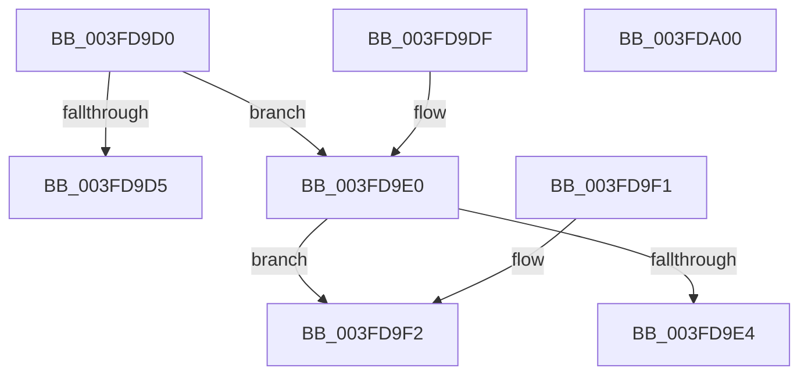

# DecodeProviderTraits

- RVA: `0x003FD9D0`–`0x003FDA01` (길이 `49` bytes)
- VA: `0x00000001403FD9D0`
- 실행 섹션: `.text`
- PDB 이름 있음: `예`; PDB Function 태그: `예`
- unwind 정보 RVA: `0x000DB714`
- 디코드: `21`개 명령, `49/49` bytes 표시
- 미해석 바이트: `0` (있으면 어셈블리에 `.byte`로 보존)

> 이 문서는 커널 이미지의 기계어와 PDB 기호를 분석해 생성했습니다. 4번과 5번은 함수 원형과 자료형을 바이너리 사용 방식에서 추정한 C 해석이며 원본 소스 복구 결과는 아닙니다.

## 1. Dependencies

- 직접 호출 지점: **0**; 고유 호출 대상: **0**
- 직접 호출자로 확인된 함수: **2**
- RIP 상대 이미지 참조: **0**

### Outgoing calls
- 직접 디코드된 call 명령이 없습니다.

### Direct callers
- [EtwpEventWriteFull](../22/EtwpEventWriteFull_function_00225C10.md) at `0x00225E15`
- [EtwpWriteUserEvent](../../page/AF/EtwpWriteUserEvent_function_00AF2FEC.md) at `0x00AF31AE`

### Static image references
- 디코드된 RIP-relative 메모리 참조가 없습니다.

## 2. Other-region calls and transfers

- 다른 실행 섹션으로 향하는 call: **0**
- 별도 외부 분기/꼬리 이동을 확인하지 못했습니다.

## 3. Assembly (complete function range)

```asm
003FD9D0  48 85 C9                        test rcx, rcx
003FD9D3  75 0B                           jne 0x1403fd9e0
003FD9D5  33 D2                           xor edx, edx
003FD9D7  66 41 89 10                     mov word ptr [r8], dx
003FD9DB  49 89 11                        mov qword ptr [r9], rdx
003FD9DE  C3                              ret
003FD9DF  CC                              int3
003FD9E0  84 D2                           test dl, dl
003FD9E2  75 0E                           jne 0x1403fd9f2
003FD9E4  0F B7 01                        movzx eax, word ptr [rcx]
003FD9E7  33 D2                           xor edx, edx
003FD9E9  66 41 89 00                     mov word ptr [r8], ax
003FD9ED  49 89 11                        mov qword ptr [r9], rdx
003FD9F0  C3                              ret
003FD9F1  CC                              int3
003FD9F2  33 D2                           xor edx, edx
003FD9F4  48 83 C1 06                     add rcx, 6
003FD9F8  66 41 89 10                     mov word ptr [r8], dx
003FD9FC  49 89 09                        mov qword ptr [r9], rcx
003FD9FF  C3                              ret
003FDA00  CC                              int3
```

## 4. C-style interpretation (structured pseudocode)

```c
__int64 __fastcall DecodeProviderTraits(__int64 a1, int a2, __int64 a3, __int64 a4)
{
    if (a1 != 0) goto loc_003FD9E0;
    a2 = 0;
    *(unsigned __int16 *)(a3) = 0;
    *(unsigned __int64 *)(a4) = 0;
    return result;
loc_003FD9E0:
    if (0 != 0) goto loc_003FD9F2;
    a2 = 0;
    *(unsigned __int16 *)(a3) = (unsigned __int16)(*(unsigned __int16 *)(a1));
    *(unsigned __int64 *)(a4) = 0;
    return *(unsigned __int16 *)(a1);
loc_003FD9F2:
    a2 = 0;
    a1 = (a1) + (6);
    *(unsigned __int16 *)(a3) = 0;
    *(unsigned __int64 *)(a4) = a1;
    return *(unsigned __int16 *)(a1);
}
```

## 5. (Beta) C Style

```c
int64_t DecodeProviderTraits(int64_t Arg1, int32_t Arg2, void *Arg3, void *Arg4)
{
    uint8_t *arg3 = (uint8_t *)Arg3;
    uint8_t *arg4 = (uint8_t *)Arg4;

    if (Arg1 != 0) goto loc_003FD9E0;
    Arg2 = 0;
    *(uint16_t *)(arg3) = 0;
    *(uint64_t *)(arg4) = 0;
    return result;
loc_003FD9E0:
    if (0 != 0) goto loc_003FD9F2;
    Arg2 = 0;
    *(uint16_t *)(arg3) = (uint16_t)(*(uint16_t *)(Arg1));
    *(uint64_t *)(arg4) = 0;
    return *(uint16_t *)(Arg1);
loc_003FD9F2:
    Arg2 = 0;
    Arg1 = (Arg1) + (6);
    *(uint16_t *)(arg3) = 0;
    *(uint64_t *)(arg4) = Arg1;
    return *(uint16_t *)(Arg1);
}
```

### 관측된 메모리 오프셋

구조체 형식이 확인되지 않은 접근은 인자 기준의 오프셋으로만 기록했습니다.

| 기준 인자 | 오프셋 표현 | 폭 (bit) | 접근 |
|---|---:|---:|---|
| `Arg3` | `+ 0x0` | `16` | `W` |
| `Arg4` | `+ 0x0` | `64` | `W` |

## 6. Execution-region graph

[열기: 2D/3D 그래프와 함수 탐색 컨트롤 패널](../../../control-panel.html?section=text&rva=0x003FD9D0&view=graph)

- 2D 그래프는 위에서 아래로 흐르고, 3D 그래프는 빈 공간을 드래그해 회전합니다. Shift+드래그는 이동, 휠은 확대·축소, 함수 노드 선택은 대상 보고서 이동입니다.

### Static fallback


