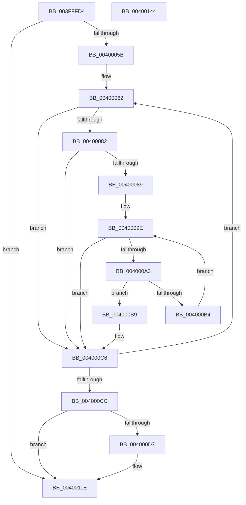

# EtwTraceObjectOperation

- RVA: `0x003FFFD4`–`0x00400145` (길이 `369` bytes)
- VA: `0x00000001403FFFD4`
- 실행 섹션: `.text`
- PDB 이름 있음: `예`; PDB Function 태그: `아니요`
- unwind 정보 RVA: `0x0009A1B0`
- 디코드: `95`개 명령, `369/369` bytes 표시
- 미해석 바이트: `0` (있으면 어셈블리에 `.byte`로 보존)

> 이 문서는 커널 이미지의 기계어와 PDB 기호를 분석해 생성했습니다. 4번과 5번은 함수 원형과 자료형을 바이너리 사용 방식에서 추정한 C 해석이며 원본 소스 복구 결과는 아닙니다.

## 1. Dependencies

- 직접 호출 지점: **3**; 고유 호출 대상: **3**
- 직접 호출자로 확인된 함수: **1**
- RIP 상대 이미지 참조: **4**

### Outgoing calls
- `0x004000AB` → [ExCheckSingleFilter](../40/ExCheckSingleFilter_function_0040014C.md) (function, `0x0040014C`)
- `0x00400119` → [EtwpTraceKernelEventWithFilter](../49/EtwpTraceKernelEventWithFilter_function_00498540.md) (function, `0x00498540`)
- `0x00400126` → [_security_check_cookie](../6A/_security_check_cookie_function_006AC640.md) (function, `0x006AC640`)

### Direct callers
- [ObpPushStackInfo](../21/ObpPushStackInfo_function_002109E4.md) at `0x00210A3E`

### Static image references
- `0x003FFFEA` → RVA `0x00E0A740` (`.data`; read)
- `0x0040001B` → RVA `0x00FC6E4C` (`ALMOSTRO`; read)
- `0x00400028` → RVA `0x00000000` (`image boundary/outside`; read)
- `0x00400043` → RVA `0x00FC6AA8` (`ALMOSTRO`; read)

## 2. Other-region calls and transfers

- 다른 실행 섹션으로 향하는 call: **0**
- 별도 외부 분기/꼬리 이동을 확인하지 못했습니다.

## 3. Assembly (complete function range)

```asm
003FFFD4  48 89 5C 24 10                  mov qword ptr [rsp + 0x10], rbx
003FFFD9  48 89 6C 24 18                  mov qword ptr [rsp + 0x18], rbp
003FFFDE  56                              push rsi
003FFFDF  57                              push rdi
003FFFE0  41 54                           push r12
003FFFE2  41 56                           push r14
003FFFE4  41 57                           push r15
003FFFE6  48 83 EC 70                     sub rsp, 0x70
003FFFEA  48 8B 05 4F A7 A0 00            mov rax, qword ptr [rip + 0xa0a74f]
003FFFF1  48 33 C4                        xor rax, rsp
003FFFF4  48 89 44 24 60                  mov qword ptr [rsp + 0x60], rax
003FFFF9  66 89 4C 24 30                  mov word ptr [rsp + 0x30], cx
003FFFFE  48 8B C2                        mov rax, rdx
00400001  48 C1 E8 08                     shr rax, 8
00400005  0F 57 C0                        xorps xmm0, xmm0
00400008  0F B6 C8                        movzx ecx, al
0040000B  41 8B E9                        mov ebp, r9d
0040000E  0F B6 42 18                     movzx eax, byte ptr [rdx + 0x18]
00400012  45 33 D2                        xor r10d, r10d
00400015  48 33 C8                        xor rcx, rax
00400018  45 8B F0                        mov r14d, r8d
0040001B  0F B6 05 2A 6E BC 00            movzx eax, byte ptr [rip + 0xbc6e2a]
00400022  48 8B F2                        mov rsi, rdx
00400025  48 33 C8                        xor rcx, rax
00400028  48 8D 05 D1 FF BF FF            lea rax, [rip - 0x40002f]
0040002F  0F 11 44 24 38                  movups xmmword ptr [rsp + 0x38], xmm0
00400034  48 8B 84 C8 00 78 FC 00         mov rax, qword ptr [rax + rcx*8 + 0xfc7800]
0040003C  44 8B A0 C0 00 00 00            mov r12d, dword ptr [rax + 0xc0]
00400043  48 8B 05 5E 6A BC 00            mov rax, qword ptr [rip + 0xbc6a5e]
0040004A  44 8B 88 A8 11 00 00            mov r9d, dword ptr [rax + 0x11a8]
00400051  45 0F BC D9                     bsf r11d, r9d
00400055  0F 84 C3 00 00 00               je 0x14040011e
0040005B  4C 8D 3D 9E FF BF FF            lea r15, [rip - 0x400062]
00400062  41 8D 41 FF                     lea eax, [r9 - 1]
00400066  41 8B CB                        mov ecx, r11d
00400069  44 23 C8                        and r9d, eax
0040006C  48 C1 E1 05                     shl rcx, 5
00400070  48 8B 05 31 6A BC 00            mov rax, qword ptr [rip + 0xbc6a31]
00400077  48 05 CC 11 00 00               add rax, 0x11cc
0040007D  48 03 C1                        add rax, rcx
00400080  74 44                           je 0x1404000c6
00400082  8B 40 10                        mov eax, dword ptr [rax + 0x10]
00400085  84 C0                           test al, al
00400087  79 3D                           jns 0x1404000c6
00400089  4B 8D 04 9B                     lea rax, [r11 + r11*4]
0040008D  45 33 C0                        xor r8d, r8d
00400090  49 8D 9F 80 F8 EF 00            lea rbx, [r15 + 0xeff880]
00400097  48 8D 1C 83                     lea rbx, [rbx + rax*4]
0040009B  0F B7 3B                        movzx edi, word ptr [rbx]
0040009E  44 3B C7                        cmp r8d, edi
004000A1  73 23                           jae 0x1404000c6
004000A3  42 8B 54 83 04                  mov edx, dword ptr [rbx + r8*4 + 4]
004000A8  41 8B CC                        mov ecx, r12d
004000AB  E8 9C 00 00 00                  call 0x14040014c
004000B0  85 C0                           test eax, eax
004000B2  75 05                           jne 0x1404000b9
004000B4  41 FF C0                        inc r8d
004000B7  EB E5                           jmp 0x14040009e
004000B9  41 8B CB                        mov ecx, r11d
004000BC  B8 01 00 00 00                  mov eax, 1
004000C1  D3 E0                           shl eax, cl
004000C3  44 0B D0                        or r10d, eax
004000C6  45 0F BC D9                     bsf r11d, r9d
004000CA  75 96                           jne 0x140400062
004000CC  44 0F B7 7C 24 30               movzx r15d, word ptr [rsp + 0x30]
004000D2  45 85 D2                        test r10d, r10d
004000D5  74 47                           je 0x14040011e
004000D7  83 64 24 5C 00                  and dword ptr [rsp + 0x5c], 0
004000DC  48 8D 46 30                     lea rax, [rsi + 0x30]
004000E0  48 89 44 24 38                  mov qword ptr [rsp + 0x38], rax
004000E5  48 8D 4C 24 50                  lea rcx, [rsp + 0x50]
004000EA  48 8D 44 24 38                  lea rax, [rsp + 0x38]
004000EF  89 6C 24 40                     mov dword ptr [rsp + 0x40], ebp
004000F3  45 0F B7 CF                     movzx r9d, r15w
004000F7  48 89 44 24 50                  mov qword ptr [rsp + 0x50], rax
004000FC  45 8B C2                        mov r8d, r10d
004000FF  44 89 74 24 44                  mov dword ptr [rsp + 0x44], r14d
00400104  BA 01 00 00 00                  mov edx, 1
00400109  C7 44 24 58 10 00 00 00         mov dword ptr [rsp + 0x58], 0x10
00400111  C7 44 24 20 02 1F 60 11         mov dword ptr [rsp + 0x20], 0x11601f02
00400119  E8 22 84 09 00                  call 0x140498540
0040011E  48 8B 4C 24 60                  mov rcx, qword ptr [rsp + 0x60]
00400123  48 33 CC                        xor rcx, rsp
00400126  E8 15 C5 2A 00                  call 0x1406ac640
0040012B  4C 8D 5C 24 70                  lea r11, [rsp + 0x70]
00400130  49 8B 5B 38                     mov rbx, qword ptr [r11 + 0x38]
00400134  49 8B 6B 40                     mov rbp, qword ptr [r11 + 0x40]
00400138  49 8B E3                        mov rsp, r11
0040013B  41 5F                           pop r15
0040013D  41 5E                           pop r14
0040013F  41 5C                           pop r12
00400141  5F                              pop rdi
00400142  5E                              pop rsi
00400143  C3                              ret
00400144  CC                              int3
```

## 4. C-style interpretation (structured pseudocode)

```c
__int64 __fastcall EtwTraceObjectOperation(unsigned __int16 a1, __int64 a2, int a3, int a4)
{
    __int64 result;
    __int64 v_r10;
    __int64 v_rsp;
    unsigned __int64 v_stack_m28;
    unsigned __int64 v_stack_m38;
    unsigned int v_stack_m3C;
    unsigned int v_stack_m40;
    unsigned __int64 v_stack_m48;
    unsigned int v_stack_m54;
    unsigned int v_stack_m58;
    unsigned __int64 v_stack_m60;
    unsigned __int16 v_stack_m68;
    unsigned int v_stack_m78;
    unsigned __int64 v_stack_p10;
    unsigned __int64 v_stack_p18;

    v_stack_p10 = v_rbx;
    v_stack_p18 = v_rbp;
    v_rsp = (v_rsp) - (112);
    result = (*(unsigned __int64 *)(v_rip + 10528591)) ^ (v_rsp);
    v_stack_m38 = result;
    v_stack_m68 = a1;
    result = (a2) >> (8);
    v_r10 = 0;
    a1 = ((unsigned __int8)(result)) ^ (*(unsigned __int8 *)(a2 + 24));
    a1 = (a1) ^ (*(unsigned __int8 *)(v_rip + 12348970));
    v_stack_m60 = v_xmm0;
    if (condition_is_equal) goto loc_0040011E;
loc_00400062:
    a4 = (unsigned int)(((unsigned int)(*(unsigned int *)(*(unsigned __int64 *)(v_rip + 12347998) + 4520))) & ((unsigned int)((unsigned int)(*(unsigned int *)(*(unsigned __int64 *)(v_rip + 12347998) + 4520)) - 1)));
    a1 = ((unsigned int)((unsigned int)(v_r11))) << (5);
    result = (*(unsigned __int64 *)(v_rip + 12347953)) + (0x11CCULL);
    result = (result) + (a1);
    if (condition_is_equal) goto loc_004000C6;
    if (!sign_flag) goto loc_004000C6;
    a3 = 0;
loc_0040009E:
    if (0 >= ((unsigned int)(*(unsigned __int16 *)(v_rip - 4194402 + 15726720 + v_r11 + v_r11 * 4 * 4)))) goto loc_004000C6;
    result = ExCheckSingleFilter((unsigned int)((unsigned int)((unsigned int)(*(unsigned int *)(*(unsigned __int64 *)(v_rip - 4194351 + a1 * 8 + 16545792) + 192)))), (unsigned int)(*(unsigned int *)(v_rip - 4194402 + 15726720 + v_r11 + v_r11 * 4 * 4 + a3 * 4 + 4)), a3, a4);
    if ((unsigned int)(result) != 0) goto loc_004000B9;
    a3 = (unsigned int)((a3) + 1);
    goto loc_0040009E;
loc_004000B9:
    result = (unsigned int)((1) << ((unsigned __int8)((unsigned int)((unsigned int)(v_r11)))));
    v_r10 = (unsigned int)((v_r10) | ((unsigned int)(result)));
loc_004000C6:
    if (condition_is_not_equal) goto loc_00400062;
    if ((unsigned int)(v_r10) != 0) {
        result = a2 + 48;
        v_stack_m60 = result;
        a1 = v_stack_m48;
        result = v_stack_m60;
        v_stack_m58 = (unsigned int)((unsigned int)(a4));
        a4 = (unsigned __int16)(v_stack_m68);
        v_stack_m48 = result;
        a3 = (unsigned int)(v_r10);
        v_stack_m54 = (unsigned int)((unsigned int)(a3));
        a2 = 1;
        v_stack_m40 = 16;
        v_stack_m78 = 0x11601F02ULL;
        result = EtwpTraceKernelEventWithFilter(a1, a2, a3, a4);
    }
    a1 = (v_stack_m38) ^ (v_rsp);
    result = _security_check_cookie(a1, a2, a3, a4);
    return result;
}
```

## 5. (Beta) C Style

```c
int64_t EtwTraceObjectOperation(uint16_t Arg1, void *Arg2, int32_t Arg3, int32_t Arg4)
{
    uint8_t *arg2 = (uint8_t *)Arg2;

    int64_t result;
    int64_t local_r10;
    int64_t local_rsp;
    uint64_t v_stack_m28;
    uint64_t v_stack_m38;
    uint32_t v_stack_m3C;
    uint32_t v_stack_m40;
    uint64_t v_stack_m48;
    uint32_t v_stack_m54;
    uint32_t v_stack_m58;
    uint64_t v_stack_m60;
    uint16_t v_stack_m68;
    uint32_t v_stack_m78;
    uint64_t v_stack_p10;
    uint64_t v_stack_p18;

    v_stack_p10 = local_rbx;
    v_stack_p18 = local_rbp;
    local_rsp = (local_rsp) - (112);
    result = (*(uint64_t *)(v_rip + 0xA0A74F)) ^ (local_rsp);
    v_stack_m38 = result;
    v_stack_m68 = Arg1;
    result = (Arg2) >> (8);
    local_r10 = 0;
    Arg1 = ((uint8_t)(result)) ^ (*(uint8_t *)(arg2 + 0x18));
    Arg1 = (Arg1) ^ (*(uint8_t *)(v_rip + 0xBC6E2A));
    v_stack_m60 = v_xmm0;
    if (condition_is_equal) goto loc_0040011E;
loc_00400062:
    Arg4 = (uint32_t)(((uint32_t)(*(uint32_t *)(*(uint64_t *)(v_rip + 0xBC6A5E) + 0x11A8))) & ((uint32_t)((uint32_t)(*(uint32_t *)(*(uint64_t *)(v_rip + 0xBC6A5E) + 0x11A8)) - 1)));
    Arg1 = ((uint32_t)((uint32_t)(local_r11))) << (5);
    result = (*(uint64_t *)(v_rip + 0xBC6A31)) + (0x11CCULL);
    result = (result) + (Arg1);
    if (condition_is_equal) goto loc_004000C6;
    if (!sign_flag) goto loc_004000C6;
    Arg3 = 0;
loc_0040009E:
    if (0 >= ((uint32_t)(*(uint16_t *)(v_rip - 0x400062 + 0xEFF880 + local_r11 + local_r11 * 4 * 4)))) goto loc_004000C6;
    result = ExCheckSingleFilter((uint32_t)((uint32_t)((uint32_t)(*(uint32_t *)(*(uint64_t *)(v_rip - 0x40002F + Arg1 * 8 + 0xFC7800) + 0xC0)))), (uint32_t)(*(uint32_t *)(v_rip - 0x400062 + 0xEFF880 + local_r11 + local_r11 * 4 * 4 + Arg3 * 4 + 0x4)), Arg3, Arg4);
    if ((uint32_t)(result) != 0) goto loc_004000B9;
    Arg3 = (uint32_t)((Arg3) + 1);
    goto loc_0040009E;
loc_004000B9:
    result = (uint32_t)((1) << ((uint8_t)((uint32_t)((uint32_t)(local_r11)))));
    local_r10 = (uint32_t)((local_r10) | ((uint32_t)(result)));
loc_004000C6:
    if (condition_is_not_equal) goto loc_00400062;
    if ((uint32_t)(local_r10) != 0) {
        result = Arg2 + 48;
        v_stack_m60 = result;
        Arg1 = v_stack_m48;
        result = v_stack_m60;
        v_stack_m58 = (uint32_t)((uint32_t)(Arg4));
        Arg4 = (uint16_t)(v_stack_m68);
        v_stack_m48 = result;
        Arg3 = (uint32_t)(local_r10);
        v_stack_m54 = (uint32_t)((uint32_t)(Arg3));
        Arg2 = 1;
        v_stack_m40 = 16;
        v_stack_m78 = 0x11601F02ULL;
        result = EtwpTraceKernelEventWithFilter(Arg1, Arg2, Arg3, Arg4);
    }
    Arg1 = (v_stack_m38) ^ (local_rsp);
    result = _security_check_cookie(Arg1, Arg2, Arg3, Arg4);
    return result;
}
```

### 관측된 메모리 오프셋

구조체 형식이 확인되지 않은 접근은 인자 기준의 오프셋으로만 기록했습니다.

| 기준 인자 | 오프셋 표현 | 폭 (bit) | 접근 |
|---|---:|---:|---|
| `Arg2` | `+ 0x18` | `8` | `R` |
| `Arg2` | `+ 0x30` | `64` | `R` |

## 6. Execution-region graph

[열기: 2D/3D 그래프와 함수 탐색 컨트롤 패널](../../../control-panel.html?section=text&rva=0x003FFFD4&view=graph)

- 2D 그래프는 위에서 아래로 흐르고, 3D 그래프는 빈 공간을 드래그해 회전합니다. Shift+드래그는 이동, 휠은 확대·축소, 함수 노드 선택은 대상 보고서 이동입니다.

### Static fallback


