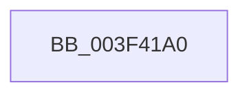

# EtwpApplyEventIdPayloadFilter

- RVA: `0x003F41A0`–`0x003F41DD` (길이 `61` bytes)
- VA: `0x00000001403F41A0`
- 실행 섹션: `.text`
- PDB 이름 있음: `예`; PDB Function 태그: `아니요`
- unwind 정보 RVA: `0x00097154`
- 디코드: `16`개 명령, `61/61` bytes 표시
- 미해석 바이트: `0` (있으면 어셈블리에 `.byte`로 보존)

> 이 문서는 커널 이미지의 기계어와 PDB 기호를 분석해 생성했습니다. 4번과 5번은 함수 원형과 자료형을 바이너리 사용 방식에서 추정한 C 해석이며 원본 소스 복구 결과는 아닙니다.

## 1. Dependencies

- 직접 호출 지점: **0**; 고유 호출 대상: **0**
- 직접 호출자로 확인된 함수: **2**
- RIP 상대 이미지 참조: **0**

### Outgoing calls
- 직접 디코드된 call 명령이 없습니다.

### Direct callers
- [EtwpEventWriteFull](../22/EtwpEventWriteFull_function_00225C10.md) at `0x0022609B`
- [EtwpApplyEventIdPayloadFilterOnUserEvent](../../page/9C/EtwpApplyEventIdPayloadFilterOnUserEvent_function_009C50D0.md) at `0x009C5110`

### Static image references
- 디코드된 RIP-relative 메모리 참조가 없습니다.

## 2. Other-region calls and transfers

- 다른 실행 섹션으로 향하는 call: **0**
- call이 아닌 외부 분기/꼬리 이동: **1**
  - `0x003F41D7` → [sub_003F42A6](Unknown_function_003F42A6.md) (`tail-transfer`)

## 3. Assembly (complete function range)

```asm
003F41A0  48 89 5C 24 10                  mov qword ptr [rsp + 0x10], rbx
003F41A5  48 89 6C 24 18                  mov qword ptr [rsp + 0x18], rbp
003F41AA  48 89 74 24 20                  mov qword ptr [rsp + 0x20], rsi
003F41AF  57                              push rdi
003F41B0  41 54                           push r12
003F41B2  41 57                           push r15
003F41B4  48 83 EC 50                     sub rsp, 0x50
003F41B8  0F B6 BC 24 B0 00 00 00         movzx edi, byte ptr [rsp + 0xb0]
003F41C0  33 DB                           xor ebx, ebx
003F41C2  8B EA                           mov ebp, edx
003F41C4  4D 8B F9                        mov r15, r9
003F41C7  C6 44 24 40 01                  mov byte ptr [rsp + 0x40], 1
003F41CC  45 0F B7 E0                     movzx r12d, r8w
003F41D0  48 8B F1                        mov rsi, rcx
003F41D3  40 80 FF 02                     cmp dil, 2
003F41D7  0F 83 C9 00 00 00               jae 0x1403f42a6
```

## 4. C-style interpretation (structured pseudocode)

```c
void __fastcall EtwpApplyEventIdPayloadFilter(__int64 a1, int a2, unsigned __int16 a3, __int64 a4, __int64 a5, __int64 a6, __int64 a7, __int64 a8, unsigned __int8 a9)
{
    __int64 v_rbx;
    __int64 v_rsp;
    unsigned __int8 v_stack_m28;
    unsigned __int64 v_stack_p10;
    unsigned __int64 v_stack_p18;
    unsigned __int64 v_stack_p20;

    v_stack_p10 = v_rbx;
    v_stack_p18 = v_rbp;
    v_stack_p20 = v_rsi;
    v_rsp = (v_rsp) - (80);
    v_rbx = 0;
    v_stack_m28 = 1;
}
```

## 5. (Beta) C Style

```c
void EtwpApplyEventIdPayloadFilter(int64_t Arg1, int32_t Arg2, uint16_t Arg3, int64_t Arg4, uint64_t Arg5, uint64_t Arg6, uint64_t Arg7, uint64_t Arg8, uint8_t Arg9)
{
    int64_t local_rbx;
    int64_t local_rsp;
    uint8_t v_stack_m28;
    uint64_t v_stack_p10;
    uint64_t v_stack_p18;
    uint64_t v_stack_p20;

    v_stack_p10 = local_rbx;
    v_stack_p18 = local_rbp;
    v_stack_p20 = local_rsi;
    local_rsp = (local_rsp) - (80);
    local_rbx = 0;
    v_stack_m28 = 1;
}
```

## 6. Execution-region graph

[열기: 2D/3D 그래프와 함수 탐색 컨트롤 패널](../../../control-panel.html?section=text&rva=0x003F41A0&view=graph)

- 2D 그래프는 위에서 아래로 흐르고, 3D 그래프는 빈 공간을 드래그해 회전합니다. Shift+드래그는 이동, 휠은 확대·축소, 함수 노드 선택은 대상 보고서 이동입니다.

### Static fallback


