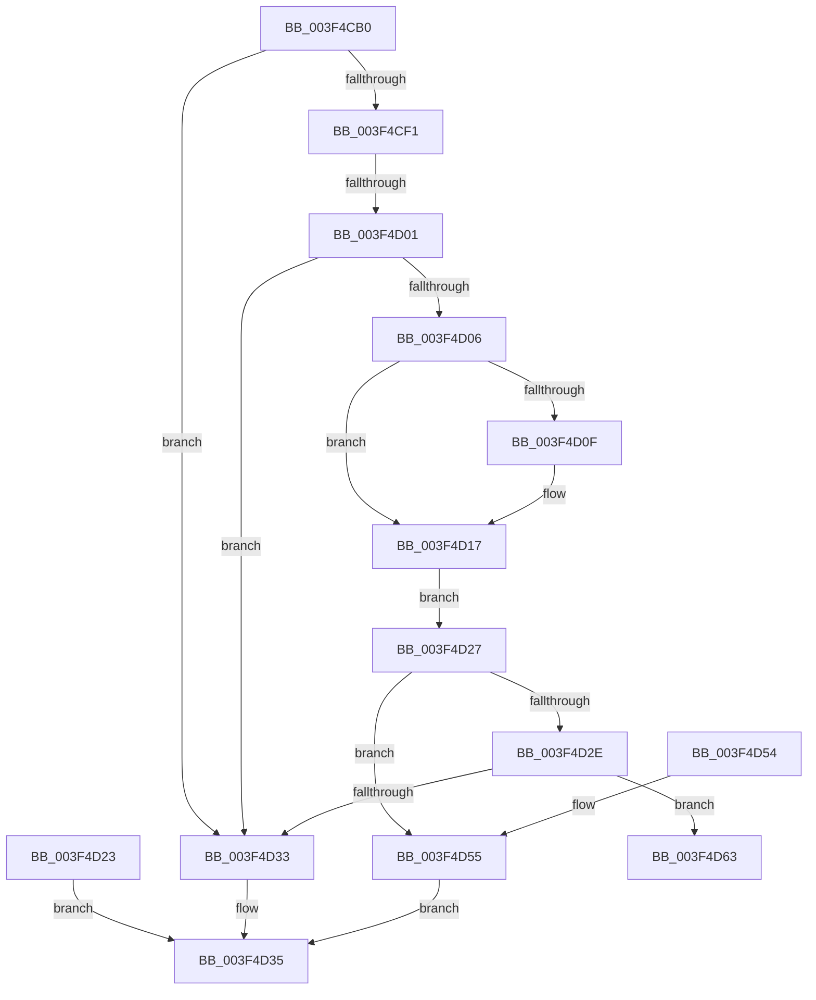

# EtwpApplyPredicate

- RVA: `0x003F4CB0`–`0x003F4D6A` (길이 `186` bytes)
- VA: `0x00000001403F4CB0`
- 실행 섹션: `.text`
- PDB 이름 있음: `예`; PDB Function 태그: `예`
- unwind 정보 RVA: `0x000972A0`
- 디코드: `58`개 명령, `186/186` bytes 표시
- 미해석 바이트: `0` (있으면 어셈블리에 `.byte`로 보존)

> 이 문서는 커널 이미지의 기계어와 PDB 기호를 분석해 생성했습니다. 4번과 5번은 함수 원형과 자료형을 바이너리 사용 방식에서 추정한 C 해석이며 원본 소스 복구 결과는 아닙니다.

## 1. Dependencies

- 직접 호출 지점: **0**; 고유 호출 대상: **0**
- 직접 호출자로 확인된 함수: **1**
- RIP 상대 이미지 참조: **0**

### Outgoing calls
- 직접 디코드된 call 명령이 없습니다.

### Direct callers
- [EtwpApplyPayloadFilterInternal](EtwpApplyPayloadFilterInternal_function_003F43D0.md) at `0x003F4865`

### Static image references
- 디코드된 RIP-relative 메모리 참조가 없습니다.

## 2. Other-region calls and transfers

- 다른 실행 섹션으로 향하는 call: **0**
- call이 아닌 외부 분기/꼬리 이동: **2**
  - `0x003F4CFB` → [sub_006EAEDE](../6E/Unknown_function_006EAEDE.md) (`tail-transfer`)
  - `0x003F4D65` → [sub_006EAEDE + 0x5D](../6E/Unknown_function_006EAEDE.md) (`tail-transfer`)

## 3. Assembly (complete function range)

```asm
003F4CB0  48 89 5C 24 08                  mov qword ptr [rsp + 8], rbx
003F4CB5  48 89 74 24 10                  mov qword ptr [rsp + 0x10], rsi
003F4CBA  48 89 7C 24 18                  mov qword ptr [rsp + 0x18], rdi
003F4CBF  4C 89 64 24 20                  mov qword ptr [rsp + 0x20], r12
003F4CC4  41 55                           push r13
003F4CC6  41 56                           push r14
003F4CC8  41 57                           push r15
003F4CCA  48 83 EC 50                     sub rsp, 0x50
003F4CCE  49 8B F9                        mov rdi, r9
003F4CD1  49 8B D8                        mov rbx, r8
003F4CD4  48 63 C2                        movsxd rax, edx
003F4CD7  4C 8B C1                        mov r8, rcx
003F4CDA  33 C9                           xor ecx, ecx
003F4CDC  48 89 4C 24 28                  mov qword ptr [rsp + 0x28], rcx
003F4CE1  48 89 4C 24 30                  mov qword ptr [rsp + 0x30], rcx
003F4CE6  8B 94 24 90 00 00 00            mov edx, dword ptr [rsp + 0x90]
003F4CED  85 D2                           test edx, edx
003F4CEF  74 42                           je 0x1403f4d33
003F4CF1  45 32 F6                        xor r14b, r14b
003F4CF4  0F B7 73 02                     movzx esi, word ptr [rbx + 2]
003F4CF8  83 F8 05                        cmp eax, 5
003F4CFB  0F 85 DD 61 2F 00               jne 0x1406eaede
003F4D01  83 FA 10                        cmp edx, 0x10
003F4D04  75 2D                           jne 0x1403f4d33
003F4D06  49 8B 01                        mov rax, qword ptr [r9]
003F4D09  48 2B 43 08                     sub rax, qword ptr [rbx + 8]
003F4D0D  75 08                           jne 0x1403f4d17
003F4D0F  49 8B 41 08                     mov rax, qword ptr [r9 + 8]
003F4D13  48 2B 43 10                     sub rax, qword ptr [rbx + 0x10]
003F4D17  48 85 C0                        test rax, rax
003F4D1A  0F 94 C3                        sete bl
003F4D1D  88 5C 24 20                     mov byte ptr [rsp + 0x20], bl
003F4D21  EB 04                           jmp 0x1403f4d27
003F4D23  32 C0                           xor al, al
003F4D25  EB 0E                           jmp 0x1403f4d35
003F4D27  8B CE                           mov ecx, esi
003F4D29  83 E9 1E                        sub ecx, 0x1e
003F4D2C  74 27                           je 0x1403f4d55
003F4D2E  83 F9 01                        cmp ecx, 1
003F4D31  74 30                           je 0x1403f4d63
003F4D33  32 C0                           xor al, al
003F4D35  4C 8D 5C 24 50                  lea r11, [rsp + 0x50]
003F4D3A  49 8B 5B 20                     mov rbx, qword ptr [r11 + 0x20]
003F4D3E  49 8B 73 28                     mov rsi, qword ptr [r11 + 0x28]
003F4D42  49 8B 7B 30                     mov rdi, qword ptr [r11 + 0x30]
003F4D46  4D 8B 63 38                     mov r12, qword ptr [r11 + 0x38]
003F4D4A  49 8B E3                        mov rsp, r11
003F4D4D  41 5F                           pop r15
003F4D4F  41 5E                           pop r14
003F4D51  41 5D                           pop r13
003F4D53  C3                              ret
003F4D54  CC                              int3
003F4D55  48 8B 84 24 98 00 00 00         mov rax, qword ptr [rsp + 0x98]
003F4D5D  88 18                           mov byte ptr [rax], bl
003F4D5F  B0 01                           mov al, 1
003F4D61  EB D2                           jmp 0x1403f4d35
003F4D63  84 DB                           test bl, bl
003F4D65  E9 D1 61 2F 00                  jmp 0x1406eaf3b
```

## 4. C-style interpretation (structured pseudocode)

```c
__int64 __fastcall EtwpApplyPredicate(__int64 a1, int a2, __int64 a3, __int64 a4, unsigned int a5, __int64 a6)
{
    __int64 result;
    __int64 v_r14;
    __int64 v_rbx;
    __int64 v_rsp;
    unsigned __int64 v_stack_m18;
    unsigned __int64 v_stack_m38;
    unsigned __int64 v_stack_m40;
    unsigned __int8 v_stack_m48;
    unsigned __int64 v_stack_p10;
    unsigned __int64 v_stack_p18;
    unsigned __int64 v_stack_p20;
    unsigned __int64 v_stack_p8;

    v_stack_p8 = v_rbx;
    v_stack_p10 = v_rsi;
    v_stack_p18 = v_rdi;
    v_stack_p20 = v_r12;
    v_rsp = (v_rsp) - (80);
    a1 = 0;
    v_stack_m40 = 0;
    v_stack_m38 = 0;
    if ((unsigned int)((unsigned int)(a5)) == 0) goto loc_003F4D33;
    v_r14 = 0;
    if (((unsigned int)((unsigned int)(a5))) != 16) goto loc_003F4D33;
    result = (*(unsigned __int64 *)(a4)) - (*(unsigned __int64 *)(a3 + 8));
    if (!(condition_is_not_equal)) {
        result = *(unsigned __int64 *)(a4 + 8);
        result = (result) - (*(unsigned __int64 *)(a3 + 16));
    }
    v_rbx = (result == 0) ? 1 : 0;
    v_stack_m48 = (unsigned __int8)(v_rbx);
    goto loc_003F4D27;
loc_003F4D27:
    a1 = (unsigned int)(((unsigned int)((unsigned int)(*(unsigned __int16 *)(a3 + 2)))) - (30));
    if (condition_is_equal) goto loc_003F4D55;
    if (((unsigned int)(a1)) == 1) goto loc_003F4D63;
loc_003F4D33:
    result = 0;
loc_003F4D35:
    return result;
loc_003F4D55:
    *(unsigned __int8 *)(a6) = (unsigned __int8)(*(unsigned __int64 *)(v_stack_m18 + 32));
    goto loc_003F4D35;
loc_003F4D63:
}
```

## 5. (Beta) C Style

```c
int64_t EtwpApplyPredicate(int64_t Arg1, int32_t Arg2, void *Arg3, void *Arg4, uint32_t Arg5, void *Arg6)
{
    uint8_t *arg3 = (uint8_t *)Arg3;
    uint8_t *arg4 = (uint8_t *)Arg4;
    uint8_t *arg6 = (uint8_t *)Arg6;

    int64_t result;
    int64_t local_r14;
    int64_t local_rbx;
    int64_t local_rsp;
    uint64_t v_stack_m18;
    uint64_t v_stack_m38;
    uint64_t v_stack_m40;
    uint8_t v_stack_m48;
    uint64_t v_stack_p10;
    uint64_t v_stack_p18;
    uint64_t v_stack_p20;
    uint64_t v_stack_p8;

    v_stack_p8 = local_rbx;
    v_stack_p10 = local_rsi;
    v_stack_p18 = local_rdi;
    v_stack_p20 = local_r12;
    local_rsp = (local_rsp) - (80);
    Arg1 = 0;
    v_stack_m40 = 0;
    v_stack_m38 = 0;
    if ((uint32_t)((uint32_t)(Arg5)) == 0) goto loc_003F4D33;
    local_r14 = 0;
    if (((uint32_t)((uint32_t)(Arg5))) != 16) goto loc_003F4D33;
    result = (*(uint64_t *)(arg4)) - (*(uint64_t *)(arg3 + 0x8));
    if (!(condition_is_not_equal)) {
        result = *(uint64_t *)(arg4 + 0x8);
        result = (result) - (*(uint64_t *)(arg3 + 0x10));
    }
    local_rbx = (result == 0) ? 1 : 0;
    v_stack_m48 = (uint8_t)(local_rbx);
    goto loc_003F4D27;
loc_003F4D27:
    Arg1 = (uint32_t)(((uint32_t)((uint32_t)(*(uint16_t *)(arg3 + 0x2)))) - (30));
    if (condition_is_equal) goto loc_003F4D55;
    if (((uint32_t)(Arg1)) == 1) goto loc_003F4D63;
loc_003F4D33:
    result = 0;
loc_003F4D35:
    return result;
loc_003F4D55:
    *(uint8_t *)(arg6) = (uint8_t)(*(uint64_t *)(v_stack_m18 + 0x20));
    goto loc_003F4D35;
loc_003F4D63:
}
```

### 관측된 메모리 오프셋

구조체 형식이 확인되지 않은 접근은 인자 기준의 오프셋으로만 기록했습니다.

| 기준 인자 | 오프셋 표현 | 폭 (bit) | 접근 |
|---|---:|---:|---|
| `Arg3` | `+ 0x2` | `16` | `R` |
| `Arg3` | `+ 0x8` | `64` | `R` |
| `Arg3` | `+ 0x10` | `64` | `R` |
| `Arg4` | `+ 0x0` | `64` | `R` |
| `Arg4` | `+ 0x8` | `64` | `R` |
| `Arg6` | `+ 0x0` | `8` | `W` |

## 6. Execution-region graph

[열기: 2D/3D 그래프와 함수 탐색 컨트롤 패널](../../../control-panel.html?section=text&rva=0x003F4CB0&view=graph)

- 2D 그래프는 위에서 아래로 흐르고, 3D 그래프는 빈 공간을 드래그해 회전합니다. Shift+드래그는 이동, 휠은 확대·축소, 함수 노드 선택은 대상 보고서 이동입니다.

### Static fallback


