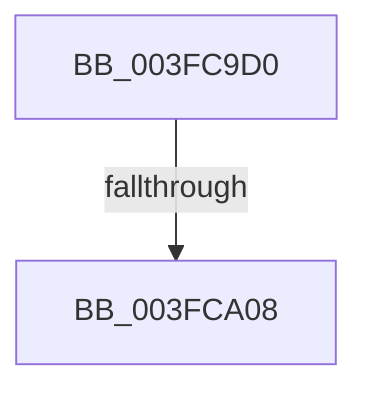

# EtwpDereferenceStackEntry

- RVA: `0x003FC9D0`–`0x003FCA13` (길이 `67` bytes)
- VA: `0x00000001403FC9D0`
- 실행 섹션: `.text`
- PDB 이름 있음: `예`; PDB Function 태그: `아니요`
- unwind 정보 RVA: `0x000998C8`
- 디코드: `15`개 명령, `67/67` bytes 표시
- 미해석 바이트: `0` (있으면 어셈블리에 `.byte`로 보존)

> 이 문서는 커널 이미지의 기계어와 PDB 기호를 분석해 생성했습니다. 4번과 5번은 함수 원형과 자료형을 바이너리 사용 방식에서 추정한 C 해석이며 원본 소스 복구 결과는 아닙니다.

## 1. Dependencies

- 직접 호출 지점: **0**; 고유 호출 대상: **0**
- 직접 호출자로 확인된 함수: **5**
- RIP 상대 이미지 참조: **1**

### Outgoing calls
- 직접 디코드된 call 명령이 없습니다.

### Direct callers
- [EtwpEventWriteFull](../22/EtwpEventWriteFull_function_00225C10.md) at `0x0022680F`
- [EtwpEventWriteFull](../22/EtwpEventWriteFull_function_00225C10.md) at `0x00226913`
- [EtwpTraceStackKey](EtwpTraceStackKey_function_003FC290.md) at `0x003FC467`
- [EtwpStackRundown](EtwpStackRundown_function_003FC8B4.md) at `0x003FC976`
- [EtwpGetCrimsonStackKey](../4D/EtwpGetCrimsonStackKey_function_004D68CC.md) at `0x004D6BAF`
- [EtwpGetCrimsonStackKey](../4D/EtwpGetCrimsonStackKey_function_004D68CC.md) at `0x004D6C04`
- [EtwpWriteUserEvent](../../page/AF/EtwpWriteUserEvent_function_00AF2FEC.md) at `0x00AF383B`
- [EtwpWriteUserEvent](../../page/AF/EtwpWriteUserEvent_function_00AF2FEC.md) at `0x00AF3934`
- [EtwpWriteUserEvent](../../page/AF/EtwpWriteUserEvent_function_00AF2FEC.md) at `0x00AF39CA`
- [EtwpWriteUserEvent](../../page/AF/EtwpWriteUserEvent_function_00AF2FEC.md) at `0x00AF3B02`
- [EtwpWriteUserEvent](../../page/AF/EtwpWriteUserEvent_function_00AF2FEC.md) at `0x00AF4686`

### Static image references
- `0x003FC9DD` → RVA `0x00E0A740` (`.data`; read)

## 2. Other-region calls and transfers

- 다른 실행 섹션으로 향하는 call: **0**
- call이 아닌 외부 분기/꼬리 이동: **1**
  - `0x003FCA02` → [sub_003FCAC0](Unknown_function_003FCAC0.md) (`tail-transfer`)

## 3. Assembly (complete function range)

```asm
003FC9D0  48 89 5C 24 20                  mov qword ptr [rsp + 0x20], rbx
003FC9D5  56                              push rsi
003FC9D6  48 81 EC E0 00 00 00            sub rsp, 0xe0
003FC9DD  48 8B 05 5C DD A0 00            mov rax, qword ptr [rip + 0xa0dd5c]
003FC9E4  48 33 C4                        xor rax, rsp
003FC9E7  48 89 84 24 D0 00 00 00         mov qword ptr [rsp + 0xd0], rax
003FC9EF  48 8B F2                        mov rsi, rdx
003FC9F2  48 8B D9                        mov rbx, rcx
003FC9F5  B8 FF FF FF FF                  mov eax, 0xffffffff
003FC9FA  F0 0F C1 41 18                  lock xadd dword ptr [rcx + 0x18], eax
003FC9FF  83 F8 01                        cmp eax, 1
003FCA02  0F 85 B8 00 00 00               jne 0x1403fcac0
003FCA08  48 8B 02                        mov rax, qword ptr [rdx]
003FCA0B  4C 8B D1                        mov r10, rcx
003FCA0E  48 89 4C 24 30                  mov qword ptr [rsp + 0x30], rcx
```

## 4. C-style interpretation (structured pseudocode)

```c
__int64 __fastcall EtwpDereferenceStackEntry(__int64 a1, __int64 a2)
{
    __int64 result;
    __int64 v_rsp;
    unsigned __int64 v_stack_m18;
    unsigned __int64 v_stack_mB8;
    unsigned __int64 v_stack_p20;

    v_stack_p20 = v_rbx;
    v_rsp = (v_rsp) - (224);
    result = (*(unsigned __int64 *)(v_rip + 10542428)) ^ (v_rsp);
    v_stack_m18 = result;
    v_stack_mB8 = a1;
    return *(unsigned __int64 *)(a2);
}
```

## 5. (Beta) C Style

```c
int64_t EtwpDereferenceStackEntry(void *Arg1, void *Arg2)
{
    uint8_t *arg1 = (uint8_t *)Arg1;
    uint8_t *arg2 = (uint8_t *)Arg2;

    int64_t result;
    int64_t local_rsp;
    uint64_t v_stack_m18;
    uint64_t v_stack_mB8;
    uint64_t v_stack_p20;

    v_stack_p20 = local_rbx;
    local_rsp = (local_rsp) - (224);
    result = (*(uint64_t *)(v_rip + 0xA0DD5C)) ^ (local_rsp);
    v_stack_m18 = result;
    v_stack_mB8 = Arg1;
    return *(uint64_t *)(arg2);
}
```

### 관측된 메모리 오프셋

구조체 형식이 확인되지 않은 접근은 인자 기준의 오프셋으로만 기록했습니다.

| 기준 인자 | 오프셋 표현 | 폭 (bit) | 접근 |
|---|---:|---:|---|
| `Arg1` | `+ 0x18` | `32` | `R/W` |
| `Arg2` | `+ 0x0` | `64` | `R` |

## 6. Execution-region graph

[열기: 2D/3D 그래프와 함수 탐색 컨트롤 패널](../../../control-panel.html?section=text&rva=0x003FC9D0&view=graph)

- 2D 그래프는 위에서 아래로 흐르고, 3D 그래프는 빈 공간을 드래그해 회전합니다. Shift+드래그는 이동, 휠은 확대·축소, 함수 노드 선택은 대상 보고서 이동입니다.

### Static fallback


