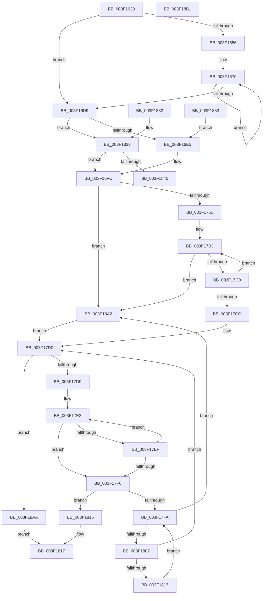

# EtwpEventNameFilterSearch

- RVA: `0x003F1620`–`0x003F18D0` (길이 `688` bytes)
- VA: `0x00000001403F1620`
- 실행 섹션: `.text`
- PDB 이름 있음: `예`; PDB Function 태그: `아니요`
- unwind 정보 RVA: `0x00096D74`
- 디코드: `198`개 명령, `688/688` bytes 표시
- 미해석 바이트: `8` (있으면 어셈블리에 `.byte`로 보존)

> 이 문서는 커널 이미지의 기계어와 PDB 기호를 분석해 생성했습니다. 4번과 5번은 함수 원형과 자료형을 바이너리 사용 방식에서 추정한 C 해석이며 원본 소스 복구 결과는 아닙니다.

## 1. Dependencies

- 직접 호출 지점: **0**; 고유 호출 대상: **0**
- 직접 호출자로 확인된 함수: **1**
- RIP 상대 이미지 참조: **1**

### Outgoing calls
- 직접 디코드된 call 명령이 없습니다.

### Direct callers
- [EtwpApplyEventNameFilter](EtwpApplyEventNameFilter_function_003F10B8.md) at `0x003F1361`

### Static image references
- `0x003F1840` → RVA `0x00000000` (`image boundary/outside`; read)

## 2. Other-region calls and transfers

- 다른 실행 섹션으로 향하는 call: **0**
- 별도 외부 분기/꼬리 이동을 확인하지 못했습니다.

## 3. Assembly (complete function range)

```asm
003F1620  48 89 5C 24 08                  mov qword ptr [rsp + 8], rbx
003F1625  48 89 6C 24 10                  mov qword ptr [rsp + 0x10], rbp
003F162A  48 89 74 24 18                  mov qword ptr [rsp + 0x18], rsi
003F162F  48 89 7C 24 20                  mov qword ptr [rsp + 0x20], rdi
003F1634  41 54                           push r12
003F1636  41 56                           push r14
003F1638  41 57                           push r15
003F163A  0F B7 DA                        movzx ebx, dx
003F163D  4D 8B F0                        mov r14, r8
003F1640  4C 8B E1                        mov r12, rcx
003F1643  4C 8B C9                        mov r9, rcx
003F1646  41 BA 2F CB 04 00               mov r10d, 0x4cb2f
003F164C  48 83 FB 08                     cmp rbx, 8
003F1650  0F 82 83 00 00 00               jb 0x1403f16d9
003F1656  44 8B DB                        mov r11d, ebx
003F1659  49 C1 EB 03                     shr r11, 3
003F165D  49 8B C3                        mov rax, r11
003F1660  48 F7 D8                        neg rax
003F1663  48 8D 1C C3                     lea rbx, [rbx + rax*8]
003F1667  66 0F 1F 84 00 00 00 00 00      nop word ptr [rax + rax]
003F1670  41 0F B6 01                     movzx eax, byte ptr [r9]
003F1674  49 6B CA 25                     imul rcx, r10, 0x25
003F1678  48 03 C8                        add rcx, rax
003F167B  41 0F B6 41 01                  movzx eax, byte ptr [r9 + 1]
003F1680  48 6B D1 25                     imul rdx, rcx, 0x25
003F1684  48 03 D0                        add rdx, rax
003F1687  41 0F B6 41 02                  movzx eax, byte ptr [r9 + 2]
003F168C  48 6B CA 25                     imul rcx, rdx, 0x25
003F1690  48 03 C8                        add rcx, rax
003F1693  41 0F B6 41 03                  movzx eax, byte ptr [r9 + 3]
003F1698  48 6B D1 25                     imul rdx, rcx, 0x25
003F169C  48 03 D0                        add rdx, rax
003F169F  41 0F B6 41 04                  movzx eax, byte ptr [r9 + 4]
003F16A4  48 6B CA 25                     imul rcx, rdx, 0x25
003F16A8  48 03 C8                        add rcx, rax
003F16AB  41 0F B6 41 05                  movzx eax, byte ptr [r9 + 5]
003F16B0  48 6B D1 25                     imul rdx, rcx, 0x25
003F16B4  48 03 D0                        add rdx, rax
003F16B7  41 0F B6 41 06                  movzx eax, byte ptr [r9 + 6]
003F16BC  48 6B CA 25                     imul rcx, rdx, 0x25
003F16C0  48 03 C8                        add rcx, rax
003F16C3  41 0F B6 41 07                  movzx eax, byte ptr [r9 + 7]
003F16C8  4C 6B D1 25                     imul r10, rcx, 0x25
003F16CC  49 83 C1 08                     add r9, 8
003F16D0  4C 03 D0                        add r10, rax
003F16D3  49 83 EB 01                     sub r11, 1
003F16D7  75 97                           jne 0x1403f1670
003F16D9  48 83 FB 02                     cmp rbx, 2
003F16DD  0F 85 50 01 00 00               jne 0x1403f1833
003F16E3  41 0F B6 01                     movzx eax, byte ptr [r9]
003F16E7  4D 6B D2 25                     imul r10, r10, 0x25
003F16EB  4C 03 D0                        add r10, rax
003F16EE  49 FF C1                        inc r9
003F16F1  41 0F B6 01                     movzx eax, byte ptr [r9]
003F16F5  4D 6B D2 25                     imul r10, r10, 0x25
003F16F9  4C 03 D0                        add r10, rax
003F16FC  45 8B 48 1C                     mov r9d, dword ptr [r8 + 0x1c]
003F1700  49 C7 C7 FF FF FF FF            mov r15, 0xffffffffffffffff
003F1707  41 8B C9                        mov ecx, r9d
003F170A  41 C1 E9 05                     shr r9d, 5
003F170E  83 E1 1F                        and ecx, 0x1f
003F1711  49 D3 E7                        shl r15, cl
003F1714  4D 23 D7                        and r10, r15
003F1717  4D 8B DA                        mov r11, r10
003F171A  4D 8B C2                        mov r8, r10
003F171D  49 8B DA                        mov rbx, r10
003F1720  49 C1 EB 38                     shr r11, 0x38
003F1724  49 8B FA                        mov rdi, r10
003F1727  49 C1 E8 30                     shr r8, 0x30
003F172B  49 8B F2                        mov rsi, r10
003F172E  48 C1 EB 28                     shr rbx, 0x28
003F1732  49 8B EA                        mov rbp, r10
003F1735  48 C1 EF 20                     shr rdi, 0x20
003F1739  49 8B D2                        mov rdx, r10
003F173C  48 C1 EE 18                     shr rsi, 0x18
003F1740  48 C1 ED 10                     shr rbp, 0x10
003F1744  48 C1 EA 08                     shr rdx, 8
003F1748  45 85 C9                        test r9d, r9d
003F174B  0F 84 51 01 00 00               je 0x1403f18a2
003F1751  41 0F B6 C2                     movzx eax, r10b
003F1755  48 05 CB 5D B1 00               add rax, 0xb15dcb
003F175B  48 6B C8 25                     imul rcx, rax, 0x25
003F175F  0F B6 C2                        movzx eax, dl
003F1762  48 03 C8                        add rcx, rax
003F1765  40 0F B6 C5                     movzx eax, bpl
003F1769  48 6B D1 25                     imul rdx, rcx, 0x25
003F176D  48 03 D0                        add rdx, rax
003F1770  40 0F B6 C6                     movzx eax, sil
003F1774  48 6B CA 25                     imul rcx, rdx, 0x25
003F1778  48 03 C8                        add rcx, rax
003F177B  40 0F B6 C7                     movzx eax, dil
003F177F  48 6B D1 25                     imul rdx, rcx, 0x25
003F1783  48 03 D0                        add rdx, rax
003F1786  0F B6 C3                        movzx eax, bl
003F1789  48 6B CA 25                     imul rcx, rdx, 0x25
003F178D  48 03 C8                        add rcx, rax
003F1790  41 0F B6 C0                     movzx eax, r8b
003F1794  48 6B D1 25                     imul rdx, rcx, 0x25
003F1798  41 8D 49 FF                     lea ecx, [r9 - 1]
003F179C  48 03 D0                        add rdx, rax
003F179F  48 6B C2 25                     imul rax, rdx, 0x25
003F17A3  49 03 C3                        add rax, r11
003F17A6  8B C0                           mov eax, eax
003F17A8  48 23 C8                        and rcx, rax
003F17AB  49 8B 46 20                     mov rax, qword ptr [r14 + 0x20]
003F17AF  4C 8D 0C C8                     lea r9, [rax + rcx*8]
003F17B3  4D 8B 09                        mov r9, qword ptr [r9]
003F17B6  41 F6 C1 01                     test r9b, 1
003F17BA  0F 85 E2 00 00 00               jne 0x1403f18a2
003F17C0  49 8B 41 08                     mov rax, qword ptr [r9 + 8]
003F17C4  49 23 C7                        and rax, r15
003F17C7  4C 3B D0                        cmp r10, rax
003F17CA  75 E7                           jne 0x1403f17b3
003F17CC  0F 1F 40 00                     nop dword ptr [rax]
003F17D0  4D 85 C9                        test r9, r9
003F17D3  0F 84 D1 00 00 00               je 0x1403f18aa
003F17D9  4D 8B 41 10                     mov r8, qword ptr [r9 + 0x10]
003F17DD  49 8B C4                        mov rax, r12
003F17E0  4D 2B C4                        sub r8, r12
003F17E3  0F B6 10                        movzx edx, byte ptr [rax]
003F17E6  42 0F B6 0C 00                  movzx ecx, byte ptr [rax + r8]
003F17EB  2B D1                           sub edx, ecx
003F17ED  75 07                           jne 0x1403f17f6
003F17EF  48 FF C0                        inc rax
003F17F2  85 C9                           test ecx, ecx
003F17F4  75 ED                           jne 0x1403f17e3
003F17F6  85 D2                           test edx, edx
003F17F8  74 1B                           je 0x1403f1815
003F17FA  4D 8B 09                        mov r9, qword ptr [r9]
003F17FD  41 F6 C1 01                     test r9b, 1
003F1801  0F 85 9B 00 00 00               jne 0x1403f18a2
003F1807  49 8B 41 08                     mov rax, qword ptr [r9 + 8]
003F180B  49 23 C7                        and rax, r15
003F180E  4C 3B D0                        cmp r10, rax
003F1811  74 BD                           je 0x1403f17d0
003F1813  EB E5                           jmp 0x1403f17fa
003F1815  B0 01                           mov al, 1
003F1817  48 8B 5C 24 20                  mov rbx, qword ptr [rsp + 0x20]
003F181C  48 8B 6C 24 28                  mov rbp, qword ptr [rsp + 0x28]
003F1821  48 8B 74 24 30                  mov rsi, qword ptr [rsp + 0x30]
003F1826  48 8B 7C 24 38                  mov rdi, qword ptr [rsp + 0x38]
003F182B  41 5F                           pop r15
003F182D  41 5E                           pop r14
003F182F  41 5C                           pop r12
003F1831  C3                              ret
003F1832  CC                              int3
003F1833  48 FF CB                        dec rbx
003F1836  48 83 FB 06                     cmp rbx, 6
003F183A  0F 87 BC FE FF FF               ja 0x1403f16fc
003F1840  48 8D 0D B9 E7 C0 FF            lea rcx, [rip - 0x3f1847]
003F1847  8B 84 99 B4 18 3F 00            mov eax, dword ptr [rcx + rbx*4 + 0x3f18b4]
003F184E  48 03 C1                        add rax, rcx
003F1851  FF E0                           jmp rax
003F1853  CC                              int3
003F1854  CC                              int3
003F1855  CC                              int3
003F1856  CC                              int3
003F1857  41 0F B6 01                     movzx eax, byte ptr [r9]
003F185B  4D 6B D2 25                     imul r10, r10, 0x25
003F185F  4C 03 D0                        add r10, rax
003F1862  49 FF C1                        inc r9
003F1865  41 0F B6 01                     movzx eax, byte ptr [r9]
003F1869  4D 6B D2 25                     imul r10, r10, 0x25
003F186D  4C 03 D0                        add r10, rax
003F1870  49 FF C1                        inc r9
003F1873  41 0F B6 01                     movzx eax, byte ptr [r9]
003F1877  4D 6B D2 25                     imul r10, r10, 0x25
003F187B  4C 03 D0                        add r10, rax
003F187E  49 FF C1                        inc r9
003F1881  41 0F B6 01                     movzx eax, byte ptr [r9]
003F1885  4D 6B D2 25                     imul r10, r10, 0x25
003F1889  4C 03 D0                        add r10, rax
003F188C  49 FF C1                        inc r9
003F188F  41 0F B6 01                     movzx eax, byte ptr [r9]
003F1893  4D 6B D2 25                     imul r10, r10, 0x25
003F1897  4C 03 D0                        add r10, rax
003F189A  49 FF C1                        inc r9
003F189D  E9 41 FE FF FF                  jmp 0x1403f16e3
003F18A2  45 33 C9                        xor r9d, r9d
003F18A5  E9 26 FF FF FF                  jmp 0x1403f17d0
003F18AA  32 C0                           xor al, al
003F18AC  E9 66 FF FF FF                  jmp 0x1403f1817
003F18B1  0F 1F 00                        nop dword ptr [rax]
003F18B4  F1                              int1
003F18B5  16                              .byte 0x16
003F18B6  3F                              .byte 0x3f
003F18B7  00 FC                           add ah, bh
003F18B9  16                              .byte 0x16
003F18BA  3F                              .byte 0x3f
003F18BB  00 8F 18 3F 00 81               add byte ptr [rdi - 0x7effc0e8], cl
003F18C1  18 3F                           sbb byte ptr [rdi], bh
003F18C3  00 73 18                        add byte ptr [rbx + 0x18], dh
003F18C6  3F                              .byte 0x3f
003F18C7  00 65 18                        add byte ptr [rbp + 0x18], ah
003F18CA  3F                              .byte 0x3f
003F18CB  00 57 18                        add byte ptr [rdi + 0x18], dl
003F18CE  3F                              .byte 0x3f
003F18CF  00                              .byte 0x00
```

## 4. C-style interpretation (structured pseudocode)

```c
__int64 __fastcall EtwpEventNameFilterSearch(__int64 a1, unsigned __int16 a2, __int64 a3)
{
    __int64 result;
    __int64 v_r10;
    __int64 v_r11;
    __int64 v_r15;
    __int64 v_rbp;
    __int64 v_rbx;
    __int64 v_rdi;
    __int64 v_rsi;
    unsigned __int64 v_stack_p10;
    unsigned __int64 v_stack_p18;
    unsigned __int64 v_stack_p20;
    unsigned __int64 v_stack_p8;

    v_stack_p8 = v_rbx;
    v_stack_p10 = v_rbp;
    v_stack_p18 = v_rsi;
    v_stack_p20 = v_rdi;
    if (a2 < 8) goto loc_003F16D9;
    v_r11 = ((unsigned int)(a2)) >> (3);
    result = -(v_r11);
loc_003F1670:
    a1 = (a1) * ((unsigned int)(0x4CB2FULL));
    a1 = (a1) + (*(unsigned __int8 *)(a1));
    a2 = (a2) * (a1);
    a2 = (a2) + (*(unsigned __int8 *)(a1 + 1));
    a1 = (a1) * (a2);
    a1 = (a1) + (*(unsigned __int8 *)(a1 + 2));
    a2 = (a2) * (a1);
    a2 = (a2) + (*(unsigned __int8 *)(a1 + 3));
    a1 = (a1) * (a2);
    a1 = (a1) + (*(unsigned __int8 *)(a1 + 4));
    a2 = (a2) * (a1);
    a2 = (a2) + (*(unsigned __int8 *)(a1 + 5));
    a1 = (a1) * (a2);
    a1 = (a1) + (*(unsigned __int8 *)(a1 + 6));
    v_r10 = ((unsigned int)(0x4CB2FULL)) * (a1);
    a4 = (a1) + (8);
    v_r10 = (v_r10) + (*(unsigned __int8 *)(a1 + 7));
    v_r11 = (v_r11) - (1);
    if (condition_is_not_equal) goto loc_003F1670;
loc_003F16D9:
    if ((a2 + result * 8) != 2) goto loc_003F1833;
loc_003F16E3:
    v_r10 = (v_r10) * (v_r10);
    v_r10 = (v_r10) + (*(unsigned __int8 *)(a4));
    a4 = (a4) + 1;
    v_r10 = (v_r10) * (v_r10);
    v_r10 = (v_r10) + (*(unsigned __int8 *)(a4));
loc_003F16FC:
    a4 = (unsigned int)(((unsigned int)(*(unsigned int *)(a3 + 28))) >> (5));
    a1 = (unsigned int)(((unsigned int)((unsigned int)((unsigned int)(*(unsigned int *)(a3 + 28))))) & (31));
    v_r15 = (-1) << ((unsigned __int8)(a1));
    v_r10 = (v_r10) & (v_r15);
    v_r11 = (v_r10) >> (56);
    a3 = (v_r10) >> (48);
    v_rbx = (v_r10) >> (40);
    v_rdi = (v_r10) >> (32);
    v_rsi = (v_r10) >> (24);
    v_rbp = (v_r10) >> (16);
    a2 = (v_r10) >> (8);
    if ((unsigned int)(a4) == 0) goto loc_003F18A2;
    result = ((unsigned __int8)(v_r10)) + (0xB15DCBULL);
    a1 = (a1) * (result);
    a1 = (a1) + ((unsigned __int8)(a2));
    a2 = (a2) * (a1);
    a2 = (a2) + ((unsigned __int8)(v_rbp));
    a1 = (a1) * (a2);
    a1 = (a1) + ((unsigned __int8)(v_rsi));
    a2 = (a2) * (a1);
    a2 = (a2) + ((unsigned __int8)(v_rdi));
    a1 = (a1) * (a2);
    a1 = (a1) + ((unsigned __int8)(v_rbx));
    a2 = (a2) * (a1);
    a2 = (a2) + ((unsigned __int8)(a3));
    result = ((unsigned __int8)(a3)) * (a2);
    result = (result) + (v_r11);
    a1 = (a4 - 1) & ((unsigned int)((unsigned int)(result)));
loc_003F17B3:
    if ((((unsigned __int8)(*(unsigned __int64 *)(*(unsigned __int64 *)(a3 + 32) + a1 * 8))) & (1)) != 0) goto loc_003F18A2;
    result = (*(unsigned __int64 *)(*(unsigned __int64 *)(*(unsigned __int64 *)(a3 + 32) + a1 * 8) + 8)) & (v_r15);
    if (v_r10 != result) goto loc_003F17B3;
loc_003F17D0:
    if (*(unsigned __int64 *)(*(unsigned __int64 *)(a3 + 32) + a1 * 8) == 0) goto loc_003F18AA;
    a3 = (*(unsigned __int64 *)(*(unsigned __int64 *)(*(unsigned __int64 *)(a3 + 32) + a1 * 8) + 16)) - (a1);
loc_003F17E3:
    a2 = (unsigned int)((*(unsigned __int8 *)(a1)) - ((unsigned int)(*(unsigned __int8 *)(a1 + a3 * 1))));
    if (condition_is_not_equal) goto loc_003F17F6;
    result = (a1) + 1;
    if ((unsigned int)(*(unsigned __int8 *)(a1 + a3 * 1)) != 0) goto loc_003F17E3;
loc_003F17F6:
    if (a2 == 0) goto loc_003F1815;
loc_003F17FA:
    if ((((unsigned __int8)(*(unsigned __int64 *)(*(unsigned __int64 *)(*(unsigned __int64 *)(a3 + 32) + a1 * 8)))) & (1)) != 0) goto loc_003F18A2;
    result = (*(unsigned __int64 *)(*(unsigned __int64 *)(*(unsigned __int64 *)(*(unsigned __int64 *)(a3 + 32) + a1 * 8)) + 8)) & (v_r15);
    if (v_r10 == result) goto loc_003F17D0;
    goto loc_003F17FA;
loc_003F1815:
loc_003F1817:
    return 1;
loc_003F1833:
    v_rbx = (v_stack_p8) - 1;
    if (v_rbx > 6) goto loc_003F16FC;
    result = ((unsigned int)(*(unsigned int *)(v_rip - 4134983 + v_rbx * 4 + 4135092))) + (v_rip - 4134983);
loc_003F18A2:
    a4 = 0;
    goto loc_003F17D0;
loc_003F18AA:
    result = 0;
    goto loc_003F1817;
}
```

## 5. (Beta) C Style

```c
int64_t EtwpEventNameFilterSearch(void *Arg1, uint16_t Arg2, void *Arg3)
{
    uint8_t *arg1 = (uint8_t *)Arg1;
    uint8_t *arg3 = (uint8_t *)Arg3;

    int64_t result;
    int64_t local_r10;
    int64_t local_r11;
    int64_t local_r15;
    int64_t local_rbp;
    int64_t local_rbx;
    int64_t local_rdi;
    int64_t local_rsi;
    uint64_t v_stack_p10;
    uint64_t v_stack_p18;
    uint64_t v_stack_p20;
    uint64_t v_stack_p8;

    v_stack_p8 = local_rbx;
    v_stack_p10 = local_rbp;
    v_stack_p18 = local_rsi;
    v_stack_p20 = local_rdi;
    if (Arg2 < 8) goto loc_003F16D9;
    local_r11 = ((uint32_t)(Arg2)) >> (3);
    result = -(local_r11);
loc_003F1670:
    Arg1 = (Arg1) * ((uint32_t)(0x4CB2FULL));
    Arg1 = (Arg1) + (*(uint8_t *)(arg1));
    Arg2 = (Arg2) * (Arg1);
    Arg2 = (Arg2) + (*(uint8_t *)(arg1 + 0x1));
    Arg1 = (Arg1) * (Arg2);
    Arg1 = (Arg1) + (*(uint8_t *)(arg1 + 0x2));
    Arg2 = (Arg2) * (Arg1);
    Arg2 = (Arg2) + (*(uint8_t *)(arg1 + 0x3));
    Arg1 = (Arg1) * (Arg2);
    Arg1 = (Arg1) + (*(uint8_t *)(arg1 + 0x4));
    Arg2 = (Arg2) * (Arg1);
    Arg2 = (Arg2) + (*(uint8_t *)(arg1 + 0x5));
    Arg1 = (Arg1) * (Arg2);
    Arg1 = (Arg1) + (*(uint8_t *)(arg1 + 0x6));
    local_r10 = ((uint32_t)(0x4CB2FULL)) * (Arg1);
    a4 = (Arg1) + (8);
    local_r10 = (local_r10) + (*(uint8_t *)(arg1 + 0x7));
    local_r11 = (local_r11) - (1);
    if (condition_is_not_equal) goto loc_003F1670;
loc_003F16D9:
    if ((Arg2 + result * 8) != 2) goto loc_003F1833;
loc_003F16E3:
    local_r10 = (local_r10) * (local_r10);
    local_r10 = (local_r10) + (*(uint8_t *)(a4));
    a4 = (a4) + 1;
    local_r10 = (local_r10) * (local_r10);
    local_r10 = (local_r10) + (*(uint8_t *)(a4));
loc_003F16FC:
    a4 = (uint32_t)(((uint32_t)(*(uint32_t *)(arg3 + 0x1C))) >> (5));
    Arg1 = (uint32_t)(((uint32_t)((uint32_t)((uint32_t)(*(uint32_t *)(arg3 + 0x1C))))) & (31));
    local_r15 = (-1) << ((uint8_t)(Arg1));
    local_r10 = (local_r10) & (local_r15);
    local_r11 = (local_r10) >> (56);
    Arg3 = (local_r10) >> (48);
    local_rbx = (local_r10) >> (40);
    local_rdi = (local_r10) >> (32);
    local_rsi = (local_r10) >> (24);
    local_rbp = (local_r10) >> (16);
    Arg2 = (local_r10) >> (8);
    if ((uint32_t)(a4) == 0) goto loc_003F18A2;
    result = ((uint8_t)(local_r10)) + (0xB15DCBULL);
    Arg1 = (Arg1) * (result);
    Arg1 = (Arg1) + ((uint8_t)(Arg2));
    Arg2 = (Arg2) * (Arg1);
    Arg2 = (Arg2) + ((uint8_t)(local_rbp));
    Arg1 = (Arg1) * (Arg2);
    Arg1 = (Arg1) + ((uint8_t)(local_rsi));
    Arg2 = (Arg2) * (Arg1);
    Arg2 = (Arg2) + ((uint8_t)(local_rdi));
    Arg1 = (Arg1) * (Arg2);
    Arg1 = (Arg1) + ((uint8_t)(local_rbx));
    Arg2 = (Arg2) * (Arg1);
    Arg2 = (Arg2) + ((uint8_t)(Arg3));
    result = ((uint8_t)(Arg3)) * (Arg2);
    result = (result) + (local_r11);
    Arg1 = (a4 - 1) & ((uint32_t)((uint32_t)(result)));
loc_003F17B3:
    if ((((uint8_t)(*(uint64_t *)(*(uint64_t *)(arg3 + 0x20) + arg1 * 8))) & (1)) != 0) goto loc_003F18A2;
    result = (*(uint64_t *)(*(uint64_t *)(*(uint64_t *)(arg3 + 0x20) + arg1 * 8) + 0x8)) & (local_r15);
    if (local_r10 != result) goto loc_003F17B3;
loc_003F17D0:
    if (*(uint64_t *)(*(uint64_t *)(arg3 + 0x20) + arg1 * 8) == 0) goto loc_003F18AA;
    Arg3 = (*(uint64_t *)(*(uint64_t *)(*(uint64_t *)(arg3 + 0x20) + arg1 * 8) + 0x10)) - (Arg1);
loc_003F17E3:
    Arg2 = (uint32_t)((*(uint8_t *)(arg1)) - ((uint32_t)(*(uint8_t *)(arg1 + arg3 * 1))));
    if (condition_is_not_equal) goto loc_003F17F6;
    result = (Arg1) + 1;
    if ((uint32_t)(*(uint8_t *)(arg1 + arg3 * 1)) != 0) goto loc_003F17E3;
loc_003F17F6:
    if (Arg2 == 0) goto loc_003F1815;
loc_003F17FA:
    if ((((uint8_t)(*(uint64_t *)(*(uint64_t *)(*(uint64_t *)(arg3 + 0x20) + arg1 * 8)))) & (1)) != 0) goto loc_003F18A2;
    result = (*(uint64_t *)(*(uint64_t *)(*(uint64_t *)(*(uint64_t *)(arg3 + 0x20) + arg1 * 8)) + 0x8)) & (local_r15);
    if (local_r10 == result) goto loc_003F17D0;
    goto loc_003F17FA;
loc_003F1815:
loc_003F1817:
    return 1;
loc_003F1833:
    local_rbx = (v_stack_p8) - 1;
    if (local_rbx > 6) goto loc_003F16FC;
    result = ((uint32_t)(*(uint32_t *)(v_rip - 0x3F1847 + local_rbx * 4 + 0x3F18B4))) + (v_rip - 4134983);
loc_003F18A2:
    a4 = 0;
    goto loc_003F17D0;
loc_003F18AA:
    result = 0;
    goto loc_003F1817;
}
```

### 관측된 메모리 오프셋

구조체 형식이 확인되지 않은 접근은 인자 기준의 오프셋으로만 기록했습니다.

| 기준 인자 | 오프셋 표현 | 폭 (bit) | 접근 |
|---|---:|---:|---|
| `Arg1` | `+ 0x0` | `8` | `R` |
| `Arg1` | `+ 0x1` | `8` | `R` |
| `Arg1` | `+ 0x2` | `8` | `R` |
| `Arg1` | `+ 0x3` | `8` | `R` |
| `Arg1` | `+ 0x4` | `8` | `R` |
| `Arg1` | `+ 0x5` | `8` | `R` |
| `Arg1` | `+ 0x6` | `8` | `R` |
| `Arg1` | `+ 0x7` | `8` | `R` |
| `Arg3` | `+ 0x1C` | `32` | `R` |
| `Arg3` | `+ 0x20` | `64` | `R` |

## 6. Execution-region graph

[열기: 2D/3D 그래프와 함수 탐색 컨트롤 패널](../../../control-panel.html?section=text&rva=0x003F1620&view=graph)

- 2D 그래프는 위에서 아래로 흐르고, 3D 그래프는 빈 공간을 드래그해 회전합니다. Shift+드래그는 이동, 휠은 확대·축소, 함수 노드 선택은 대상 보고서 이동입니다.

### Static fallback


