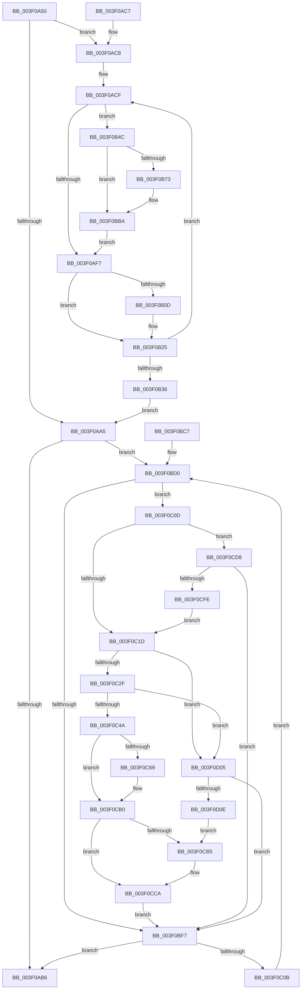

# EtwpFailLogging

- RVA: `0x003F0A50`–`0x003F0D10` (길이 `704` bytes)
- VA: `0x00000001403F0A50`
- 실행 섹션: `.text`
- PDB 이름 있음: `예`; PDB Function 태그: `아니요`
- unwind 정보 RVA: `0x00096C90`
- 디코드: `156`개 명령, `704/704` bytes 표시
- 미해석 바이트: `0` (있으면 어셈블리에 `.byte`로 보존)

> 이 문서는 커널 이미지의 기계어와 PDB 기호를 분석해 생성했습니다. 4번과 5번은 함수 원형과 자료형을 바이너리 사용 방식에서 추정한 C 해석이며 원본 소스 복구 결과는 아닙니다.

## 1. Dependencies

- 직접 호출 지점: **11**; 고유 호출 대상: **7**
- 직접 호출자로 확인된 함수: **2**
- RIP 상대 이미지 참조: **2**

### Outgoing calls
- `0x003F0B03` → [EtwpReleaseTraceBuffer](EtwpReleaseTraceBuffer_function_003F0D20.md) (function, `0x003F0D20`)
- `0x003F0B20` → [ExReleaseRundownProtectionCacheAwareEx](../25/ExReleaseRundownProtectionCacheAwareEx_function_0025F050.md) (function, `0x0025F050`)
- `0x003F0B57` → [EtwpUpdateEventsLostCount](EtwpUpdateEventsLostCount_function_003F18E0.md) (function, `0x003F18E0`)
- `0x003F0B6A` → [EtwEventEnabled](../39/EtwEventEnabled_function_00392450.md) (function, `0x00392450`)
- `0x003F0BB5` → [EtwpTraceLostEvent](EtwpTraceLostEvent_function_003F0D58.md) (function, `0x003F0D58`)
- `0x003F0BEE` → [EtwpLevelKeywordEnabled](../2F/EtwpLevelKeywordEnabled_function_002FD110.md) (function, `0x002FD110`)
- `0x003F0C4D` → [EtwpUpdateEventsLostCount](EtwpUpdateEventsLostCount_function_003F18E0.md) (function, `0x003F18E0`)
- `0x003F0C60` → [EtwEventEnabled](../39/EtwEventEnabled_function_00392450.md) (function, `0x00392450`)
- `0x003F0CAB` → [EtwpTraceLostEvent](EtwpTraceLostEvent_function_003F0D58.md) (function, `0x003F0D58`)
- `0x003F0CC5` → [ExReleaseRundownProtectionCacheAwareEx](../25/ExReleaseRundownProtectionCacheAwareEx_function_0025F050.md) (function, `0x0025F050`)
- `0x003F0CE8` → [ExAcquireRundownProtectionCacheAwareEx](../41/ExAcquireRundownProtectionCacheAwareEx_function_00411F50.md) (function, `0x00411F50`)

### Direct callers
- [EtwpEventWriteFull](../22/EtwpEventWriteFull_function_00225C10.md) at `0x00227787`
- [EtwpWriteUserEvent](../../page/AF/EtwpWriteUserEvent_function_00AF2FEC.md) at `0x00AF4769`

### Static image references
- `0x003F0B5C` → RVA `0x00EFF840` (`.data`; read)
- `0x003F0B63` → RVA `0x00013040` (`.rdata`; read)

## 2. Other-region calls and transfers

- 다른 실행 섹션으로 향하는 call: **0**
- 별도 외부 분기/꼬리 이동을 확인하지 못했습니다.

## 3. Assembly (complete function range)

```asm
003F0A50  48 89 54 24 10                  mov qword ptr [rsp + 0x10], rdx
003F0A55  88 4C 24 08                     mov byte ptr [rsp + 8], cl
003F0A59  53                              push rbx
003F0A5A  55                              push rbp
003F0A5B  56                              push rsi
003F0A5C  57                              push rdi
003F0A5D  41 54                           push r12
003F0A5F  41 55                           push r13
003F0A61  41 56                           push r14
003F0A63  41 57                           push r15
003F0A65  48 83 EC 58                     sub rsp, 0x58
003F0A69  4D 8B B0 88 02 00 00            mov r14, qword ptr [r8 + 0x288]
003F0A70  49 8B D9                        mov rbx, r9
003F0A73  44 0F B6 BC 24 F8 00 00 00      movzx r15d, byte ptr [rsp + 0xf8]
003F0A7C  33 F6                           xor esi, esi
003F0A7E  4C 8B A4 24 F0 00 00 00         mov r12, qword ptr [rsp + 0xf0]
003F0A86  49 8B F8                        mov rdi, r8
003F0A89  44 8B AC 24 E8 00 00 00         mov r13d, dword ptr [rsp + 0xe8]
003F0A91  44 0F B6 C9                     movzx r9d, cl
003F0A95  0F B6 AC 24 E0 00 00 00         movzx ebp, byte ptr [rsp + 0xe0]
003F0A9D  39 B3 00 03 00 00               cmp dword ptr [rbx + 0x300], esi
003F0AA3  77 23                           ja 0x1403f0ac8
003F0AA5  0F B7 9C 24 C0 00 00 00         movzx ebx, word ptr [rsp + 0xc0]
003F0AAD  0F BC CB                        bsf ecx, ebx
003F0AB0  0F 85 1A 01 00 00               jne 0x1403f0bd0
003F0AB6  48 83 C4 58                     add rsp, 0x58
003F0ABA  41 5F                           pop r15
003F0ABC  41 5E                           pop r14
003F0ABE  41 5D                           pop r13
003F0AC0  41 5C                           pop r12
003F0AC2  5F                              pop rdi
003F0AC3  5E                              pop rsi
003F0AC4  5D                              pop rbp
003F0AC5  5B                              pop rbx
003F0AC6  C3                              ret
003F0AC7  CC                              int3
003F0AC8  8B C6                           mov eax, esi
003F0ACA  B9 0D C0 00 00                  mov ecx, 0xc00d
003F0ACF  48 8D 04 40                     lea rax, [rax + rax*2]
003F0AD3  48 C1 E0 04                     shl rax, 4
003F0AD7  48 03 C3                        add rax, rbx
003F0ADA  48 89 84 24 B8 00 00 00         mov qword ptr [rsp + 0xb8], rax
003F0AE2  4C 8B 18                        mov r11, qword ptr [rax]
003F0AE5  4C 89 9C 24 B0 00 00 00         mov qword ptr [rsp + 0xb0], r11
003F0AED  41 F7 43 0C 00 00 00 08         test dword ptr [r11 + 0xc], 0x8000000
003F0AF5  74 55                           je 0x1403f0b4c
003F0AF7  48 8B 8C 24 B8 00 00 00         mov rcx, qword ptr [rsp + 0xb8]
003F0AFF  48 83 C1 10                     add rcx, 0x10
003F0B03  E8 18 02 00 00                  call 0x1403f0d20
003F0B08  40 84 ED                        test bpl, bpl
003F0B0B  74 18                           je 0x1403f0b25
003F0B0D  41 8B 03                        mov eax, dword ptr [r11]
003F0B10  BA 01 00 00 00                  mov edx, 1
003F0B15  49 8B 8E C0 02 00 00            mov rcx, qword ptr [r14 + 0x2c0]
003F0B1C  48 8B 0C C1                     mov rcx, qword ptr [rcx + rax*8]
003F0B20  E8 2B E5 E6 FF                  call 0x14025f050
003F0B25  FF C6                           inc esi
003F0B27  B9 0D C0 00 00                  mov ecx, 0xc00d
003F0B2C  8B C6                           mov eax, esi
003F0B2E  3B B3 00 03 00 00               cmp esi, dword ptr [rbx + 0x300]
003F0B34  72 99                           jb 0x1403f0acf
003F0B36  48 8B 94 24 A8 00 00 00         mov rdx, qword ptr [rsp + 0xa8]
003F0B3E  44 0F B6 8C 24 A0 00 00 00      movzx r9d, byte ptr [rsp + 0xa0]
003F0B47  E9 59 FF FF FF                  jmp 0x1403f0aa5
003F0B4C  48 8B 40 08                     mov rax, qword ptr [rax + 8]
003F0B50  66 89 48 02                     mov word ptr [rax + 2], cx
003F0B54  49 8B CB                        mov rcx, r11
003F0B57  E8 84 0D 00 00                  call 0x1403f18e0
003F0B5C  48 8B 0D DD EC B0 00            mov rcx, qword ptr [rip + 0xb0ecdd]
003F0B63  48 8D 15 D6 24 C2 FF            lea rdx, [rip - 0x3ddb2a]
003F0B6A  E8 E1 18 FA FF                  call 0x140392450
003F0B6F  84 C0                           test al, al
003F0B71  74 47                           je 0x1403f0bba
003F0B73  8B 84 24 D0 00 00 00            mov eax, dword ptr [rsp + 0xd0]
003F0B7A  48 8D 4F 28                     lea rcx, [rdi + 0x28]
003F0B7E  4C 8B 84 24 B0 00 00 00         mov r8, qword ptr [rsp + 0xb0]
003F0B86  44 8B 8C 24 C8 00 00 00         mov r9d, dword ptr [rsp + 0xc8]
003F0B8E  49 81 C0 88 00 00 00            add r8, 0x88
003F0B95  48 8B 94 24 D8 00 00 00         mov rdx, qword ptr [rsp + 0xd8]
003F0B9D  44 88 7C 24 40                  mov byte ptr [rsp + 0x40], r15b
003F0BA2  40 88 6C 24 38                  mov byte ptr [rsp + 0x38], bpl
003F0BA7  4C 89 64 24 30                  mov qword ptr [rsp + 0x30], r12
003F0BAC  44 89 6C 24 28                  mov dword ptr [rsp + 0x28], r13d
003F0BB1  89 44 24 20                     mov dword ptr [rsp + 0x20], eax
003F0BB5  E8 9E 01 00 00                  call 0x1403f0d58
003F0BBA  4C 8B 9C 24 B0 00 00 00         mov r11, qword ptr [rsp + 0xb0]
003F0BC2  E9 30 FF FF FF                  jmp 0x1403f0af7
003F0BC7  66 0F 1F 84 00 00 00 00 00      nop word ptr [rax + rax]
003F0BD0  44 8B D1                        mov r10d, ecx
003F0BD3  8D 43 FF                        lea eax, [rbx - 1]
003F0BD6  49 83 C2 04                     add r10, 4
003F0BDA  4C 8B C2                        mov r8, rdx
003F0BDD  49 C1 E2 05                     shl r10, 5
003F0BE1  41 0F B6 D1                     movzx edx, r9b
003F0BE5  4C 03 D7                        add r10, rdi
003F0BE8  66 23 D8                        and bx, ax
003F0BEB  49 8B CA                        mov rcx, r10
003F0BEE  E8 1D C5 F0 FF                  call 0x1402fd110
003F0BF3  84 C0                           test al, al
003F0BF5  75 16                           jne 0x1403f0c0d
003F0BF7  48 8B 94 24 A8 00 00 00         mov rdx, qword ptr [rsp + 0xa8]
003F0BFF  0F B7 C3                        movzx eax, bx
003F0C02  0F BC C8                        bsf ecx, eax
003F0C05  0F 84 AB FE FF FF               je 0x1403f0ab6
003F0C0B  EB C3                           jmp 0x1403f0bd0
003F0C0D  41 0F B7 42 06                  movzx eax, word ptr [r10 + 6]
003F0C12  8B F0                           mov esi, eax
003F0C14  40 84 ED                        test bpl, bpl
003F0C17  0F 85 BB 00 00 00               jne 0x1403f0cd8
003F0C1D  48 8D 34 F5 00 00 00 00         lea rsi, [rsi*8]
003F0C25  41 3B 46 10                     cmp eax, dword ptr [r14 + 0x10]
003F0C29  0F 83 D6 00 00 00               jae 0x1403f0d05
003F0C2F  49 8B 86 C8 02 00 00            mov rax, qword ptr [r14 + 0x2c8]
003F0C36  48 8B 04 06                     mov rax, qword ptr [rsi + rax]
003F0C3A  48 89 84 24 B0 00 00 00         mov qword ptr [rsp + 0xb0], rax
003F0C42  A8 01                           test al, 1
003F0C44  0F 85 BB 00 00 00               jne 0x1403f0d05
003F0C4A  48 8B C8                        mov rcx, rax
003F0C4D  E8 8E 0C 00 00                  call 0x1403f18e0
003F0C52  48 8B 0D E7 EB B0 00            mov rcx, qword ptr [rip + 0xb0ebe7]
003F0C59  48 8D 15 E0 23 C2 FF            lea rdx, [rip - 0x3ddc20]
003F0C60  E8 EB 17 FA FF                  call 0x140392450
003F0C65  84 C0                           test al, al
003F0C67  74 47                           je 0x1403f0cb0
003F0C69  8B 84 24 D0 00 00 00            mov eax, dword ptr [rsp + 0xd0]
003F0C70  48 8D 4F 28                     lea rcx, [rdi + 0x28]
003F0C74  4C 8B 84 24 B0 00 00 00         mov r8, qword ptr [rsp + 0xb0]
003F0C7C  44 8B 8C 24 C8 00 00 00         mov r9d, dword ptr [rsp + 0xc8]
003F0C84  49 81 C0 88 00 00 00            add r8, 0x88
003F0C8B  48 8B 94 24 D8 00 00 00         mov rdx, qword ptr [rsp + 0xd8]
003F0C93  44 88 7C 24 40                  mov byte ptr [rsp + 0x40], r15b
003F0C98  40 88 6C 24 38                  mov byte ptr [rsp + 0x38], bpl
003F0C9D  4C 89 64 24 30                  mov qword ptr [rsp + 0x30], r12
003F0CA2  44 89 6C 24 28                  mov dword ptr [rsp + 0x28], r13d
003F0CA7  89 44 24 20                     mov dword ptr [rsp + 0x20], eax
003F0CAB  E8 A8 00 00 00                  call 0x1403f0d58
003F0CB0  40 84 ED                        test bpl, bpl
003F0CB3  74 15                           je 0x1403f0cca
003F0CB5  49 8B 8E C0 02 00 00            mov rcx, qword ptr [r14 + 0x2c0]
003F0CBC  BA 01 00 00 00                  mov edx, 1
003F0CC1  48 8B 0C 31                     mov rcx, qword ptr [rcx + rsi]
003F0CC5  E8 86 E3 E6 FF                  call 0x14025f050
003F0CCA  44 0F B6 8C 24 A0 00 00 00      movzx r9d, byte ptr [rsp + 0xa0]
003F0CD3  E9 1F FF FF FF                  jmp 0x1403f0bf7
003F0CD8  49 8B 8E C0 02 00 00            mov rcx, qword ptr [r14 + 0x2c0]
003F0CDF  BA 01 00 00 00                  mov edx, 1
003F0CE4  48 8B 0C C1                     mov rcx, qword ptr [rcx + rax*8]
003F0CE8  E8 63 12 02 00                  call 0x140411f50
003F0CED  44 0F B6 8C 24 A0 00 00 00      movzx r9d, byte ptr [rsp + 0xa0]
003F0CF6  84 C0                           test al, al
003F0CF8  0F 84 F9 FE FF FF               je 0x1403f0bf7
003F0CFE  8B C6                           mov eax, esi
003F0D00  E9 18 FF FF FF                  jmp 0x1403f0c1d
003F0D05  40 84 ED                        test bpl, bpl
003F0D08  0F 84 E9 FE FF FF               je 0x1403f0bf7
003F0D0E  EB A5                           jmp 0x1403f0cb5
```

## 4. C-style interpretation (structured pseudocode)

```c
__int64 __fastcall EtwpFailLogging(unsigned __int8 a1, __int64 a2, __int64 a3, __int64 a4, unsigned __int16 a5, unsigned int a6, unsigned int a7, __int64 a8, unsigned __int8 a9, unsigned int a10, __int64 a11, unsigned __int8 a12)
{
    __int64 result;
    __int64 v_r10;
    __int64 v_rbx;
    __int64 v_rsi;
    __int64 v_rsp;
    unsigned __int64 v_stack_p10;
    unsigned int v_stack_p20;
    unsigned int v_stack_p28;
    unsigned __int64 v_stack_p30;
    unsigned __int8 v_stack_p38;
    unsigned __int8 v_stack_p40;
    unsigned __int8 v_stack_p8;
    unsigned __int8 v_stack_pA0;
    unsigned __int64 v_stack_pA8;
    unsigned __int64 v_stack_pB0;
    unsigned __int64 v_stack_pB8;

    v_stack_p10 = a2;
    v_stack_p8 = a1;
    v_rsp = (v_rsp) - (88);
    v_rsi = 0;
    if ((*(unsigned int *)(a4 + 768)) > 0) goto loc_003F0AC8;
loc_003F0AA5:
    if ((*(unsigned int *)(a4 + 768)) != 0) goto loc_003F0BD0;
loc_003F0AB6:
    v_rsp = (v_rsp) + (88);
    return result;
loc_003F0AC8:
loc_003F0ACF:
    result = (0 + 0 * 2) << (4);
    result = (result) + (a5);
    v_stack_pB8 = result;
    v_stack_pB0 = *(unsigned __int64 *)(result);
    if (((*(unsigned int *)(*(unsigned __int64 *)(result) + 12)) & (0x8000000ULL)) == 0) goto loc_003F0B4C;
loc_003F0AF7:
    a1 = (v_stack_pB8) + (16);
    result = EtwpReleaseTraceBuffer(a1, a2, a3, a1);
    if (a9 != 0) {
        result = *(unsigned int *)(*(unsigned __int64 *)(result));
        a2 = 1;
        a1 = *(unsigned __int64 *)(*(unsigned __int64 *)(a3 + 648) + 704);
        a1 = *(unsigned __int64 *)(a1 + result * 8);
        result = ExReleaseRundownProtectionCacheAwareEx(a1, a2, a3, a1);
    }
    v_rsi = (unsigned int)((v_rsi) + 1);
    if (((unsigned int)(v_rsi)) < (*(unsigned int *)(a5 + 768))) goto loc_003F0ACF;
    goto loc_003F0AA5;
loc_003F0B4C:
    *(unsigned __int16 *)(*(unsigned __int64 *)((unsigned int)((unsigned int)(v_rsi)) + 8) + 2) = (unsigned __int16)((unsigned int)(0xC00DULL));
    result = EtwpUpdateEventsLostCount(*(unsigned __int64 *)(result), v_stack_pA8, a3, v_stack_pA0);
    result = EtwEventEnabled(*(unsigned __int64 *)(v_rip + 11594973), v_rip - 4053802, a3, v_stack_pA0);
    if ((unsigned __int8)(result) != 0) {
        result = a7;
        a1 = a3 + 40;
        a3 = v_stack_pB0;
        a4 = a6;
        a3 = (a3) + (136);
        a2 = a8;
        v_stack_p40 = a12;
        v_stack_p38 = a9;
        v_stack_p30 = a11;
        v_stack_p28 = (unsigned int)((unsigned int)(a10));
        v_stack_p20 = (unsigned int)(result);
        result = EtwpTraceLostEvent(a1, a2, a3, a4);
    }
    goto loc_003F0AF7;
loc_003F0BD0:
    v_r10 = ((unsigned int)(a1)) + (4);
    v_r10 = (v_r10) << (5);
    v_r10 = (v_r10) + (a3);
    v_rbx = (unsigned __int16)((a5) & ((unsigned __int16)(a5 - 1)));
    result = EtwpLevelKeywordEnabled(v_r10, (unsigned __int8)(a4), a2, a4);
    if ((unsigned __int8)(result) != 0) goto loc_003F0C0D;
loc_003F0BF7:
    if ((unsigned __int8)(result) == 0) goto loc_003F0AB6;
    goto loc_003F0BD0;
loc_003F0C0D:
    if (a9 != 0) goto loc_003F0CD8;
loc_003F0C1D:
    if (((unsigned int)(*(unsigned __int16 *)(v_r10 + 6))) >= (*(unsigned int *)(*(unsigned __int64 *)(a3 + 648) + 16))) goto loc_003F0D05;
    v_stack_pB0 = *(unsigned __int64 *)((unsigned int)((unsigned int)(*(unsigned __int16 *)(v_r10 + 6))) * 8 + *(unsigned __int64 *)(*(unsigned __int64 *)(a3 + 648) + 712) * 1);
    if ((((unsigned __int8)(*(unsigned __int64 *)((unsigned int)((unsigned int)(*(unsigned __int16 *)(v_r10 + 6))) * 8 + *(unsigned __int64 *)(*(unsigned __int64 *)(a3 + 648) + 712) * 1))) & (1)) != 0) goto loc_003F0D05;
    result = EtwpUpdateEventsLostCount(*(unsigned __int64 *)((unsigned int)((unsigned int)(*(unsigned __int16 *)(v_r10 + 6))) * 8 + *(unsigned __int64 *)(*(unsigned __int64 *)(a3 + 648) + 712) * 1), v_stack_pA8, a2, a4);
    result = EtwEventEnabled(*(unsigned __int64 *)(v_rip + 11594727), v_rip - 4054048, a2, a4);
    if ((unsigned __int8)(result) != 0) {
        result = a7;
        a1 = a3 + 40;
        a3 = v_stack_pB0;
        a4 = a6;
        a3 = (a3) + (136);
        a2 = a8;
        v_stack_p40 = a12;
        v_stack_p38 = a9;
        v_stack_p30 = a11;
        v_stack_p28 = (unsigned int)((unsigned int)(a10));
        v_stack_p20 = (unsigned int)(result);
        result = EtwpTraceLostEvent(a1, a2, a3, a4);
    }
    if (a9 != 0) {
        a1 = *(unsigned __int64 *)(*(unsigned __int64 *)(a3 + 648) + 704);
        a2 = 1;
        a1 = *(unsigned __int64 *)(a1 + (unsigned int)((unsigned int)(*(unsigned __int16 *)(v_r10 + 6))) * 8 * 1);
        result = ExReleaseRundownProtectionCacheAwareEx(a1, a2, a3, a4);
    }
    goto loc_003F0BF7;
loc_003F0CD8:
    result = ExAcquireRundownProtectionCacheAwareEx(*(unsigned __int64 *)(*(unsigned __int64 *)(*(unsigned __int64 *)(a3 + 648) + 704) + result * 8), 1, a3, v_stack_pA0);
    if ((unsigned __int8)(result) == 0) goto loc_003F0BF7;
    goto loc_003F0C1D;
loc_003F0D05:
    if (a9 == 0) goto loc_003F0BF7;
    goto loc_003F0CB5;
}
```

## 5. (Beta) C Style

```c
int64_t EtwpFailLogging(uint8_t Arg1, int64_t Arg2, void *Arg3, void *Arg4, void *Arg5, uint32_t Arg6, uint32_t Arg7, int64_t Arg8, uint8_t Arg9, uint32_t Arg10, int64_t Arg11, uint8_t Arg12)
{
    uint8_t *arg3 = (uint8_t *)Arg3;
    uint8_t *arg4 = (uint8_t *)Arg4;
    uint8_t *arg5 = (uint8_t *)Arg5;

    int64_t result;
    int64_t local_r10;
    int64_t local_rbx;
    int64_t local_rsi;
    int64_t local_rsp;
    uint64_t v_stack_p10;
    uint32_t v_stack_p20;
    uint32_t v_stack_p28;
    uint64_t v_stack_p30;
    uint8_t v_stack_p38;
    uint8_t v_stack_p40;
    uint8_t v_stack_p8;
    uint8_t v_stack_pA0;
    uint64_t v_stack_pA8;
    uint64_t v_stack_pB0;
    uint64_t v_stack_pB8;

    v_stack_p10 = Arg2;
    v_stack_p8 = Arg1;
    local_rsp = (local_rsp) - (88);
    local_rsi = 0;
    if ((*(uint32_t *)(arg4 + 0x300)) > 0) goto loc_003F0AC8;
loc_003F0AA5:
    if ((*(uint32_t *)(arg4 + 0x300)) != 0) goto loc_003F0BD0;
loc_003F0AB6:
    local_rsp = (local_rsp) + (88);
    return result;
loc_003F0AC8:
loc_003F0ACF:
    result = (0 + 0 * 2) << (4);
    result = (result) + (Arg5);
    v_stack_pB8 = result;
    v_stack_pB0 = *(uint64_t *)(result);
    if (((*(uint32_t *)(*(uint64_t *)(result) + 0xC)) & (0x8000000ULL)) == 0) goto loc_003F0B4C;
loc_003F0AF7:
    Arg1 = (v_stack_pB8) + (16);
    result = EtwpReleaseTraceBuffer(Arg1, Arg2, Arg3, Arg1);
    if (Arg9 != 0) {
        result = *(uint32_t *)(*(uint64_t *)(result));
        Arg2 = 1;
        Arg1 = *(uint64_t *)(*(uint64_t *)(arg3 + 0x288) + 0x2C0);
        Arg1 = *(uint64_t *)(Arg1 + result * 8);
        result = ExReleaseRundownProtectionCacheAwareEx(Arg1, Arg2, Arg3, Arg1);
    }
    local_rsi = (uint32_t)((local_rsi) + 1);
    if (((uint32_t)(local_rsi)) < (*(uint32_t *)(arg5 + 0x300))) goto loc_003F0ACF;
    goto loc_003F0AA5;
loc_003F0B4C:
    *(uint16_t *)(*(uint64_t *)((uint32_t)((uint32_t)(local_rsi)) + 0x8) + 0x2) = (uint16_t)((uint32_t)(0xC00DULL));
    result = EtwpUpdateEventsLostCount(*(uint64_t *)(result), v_stack_pA8, Arg3, v_stack_pA0);
    result = EtwEventEnabled(*(uint64_t *)(v_rip + 0xB0ECDD), v_rip - 4053802, Arg3, v_stack_pA0);
    if ((uint8_t)(result) != 0) {
        result = Arg7;
        Arg1 = Arg3 + 40;
        Arg3 = v_stack_pB0;
        Arg4 = Arg6;
        Arg3 = (Arg3) + (136);
        Arg2 = Arg8;
        v_stack_p40 = Arg12;
        v_stack_p38 = Arg9;
        v_stack_p30 = Arg11;
        v_stack_p28 = (uint32_t)((uint32_t)(Arg10));
        v_stack_p20 = (uint32_t)(result);
        result = EtwpTraceLostEvent(Arg1, Arg2, Arg3, Arg4);
    }
    goto loc_003F0AF7;
loc_003F0BD0:
    local_r10 = ((uint32_t)(Arg1)) + (4);
    local_r10 = (local_r10) << (5);
    local_r10 = (local_r10) + (Arg3);
    local_rbx = (uint16_t)((Arg5) & ((uint16_t)(Arg5 - 1)));
    result = EtwpLevelKeywordEnabled(local_r10, (uint8_t)(Arg4), Arg2, Arg4);
    if ((uint8_t)(result) != 0) goto loc_003F0C0D;
loc_003F0BF7:
    if ((uint8_t)(result) == 0) goto loc_003F0AB6;
    goto loc_003F0BD0;
loc_003F0C0D:
    if (Arg9 != 0) goto loc_003F0CD8;
loc_003F0C1D:
    if (((uint32_t)(*(uint16_t *)(local_r10 + 0x6))) >= (*(uint32_t *)(*(uint64_t *)(arg3 + 0x288) + 0x10))) goto loc_003F0D05;
    v_stack_pB0 = *(uint64_t *)((uint32_t)((uint32_t)(*(uint16_t *)(local_r10 + 0x6))) * 8 + *(uint64_t *)(*(uint64_t *)(arg3 + 0x288) + 0x2C8) * 1);
    if ((((uint8_t)(*(uint64_t *)((uint32_t)((uint32_t)(*(uint16_t *)(local_r10 + 0x6))) * 8 + *(uint64_t *)(*(uint64_t *)(arg3 + 0x288) + 0x2C8) * 1))) & (1)) != 0) goto loc_003F0D05;
    result = EtwpUpdateEventsLostCount(*(uint64_t *)((uint32_t)((uint32_t)(*(uint16_t *)(local_r10 + 0x6))) * 8 + *(uint64_t *)(*(uint64_t *)(arg3 + 0x288) + 0x2C8) * 1), v_stack_pA8, Arg2, Arg4);
    result = EtwEventEnabled(*(uint64_t *)(v_rip + 0xB0EBE7), v_rip - 4054048, Arg2, Arg4);
    if ((uint8_t)(result) != 0) {
        result = Arg7;
        Arg1 = Arg3 + 40;
        Arg3 = v_stack_pB0;
        Arg4 = Arg6;
        Arg3 = (Arg3) + (136);
        Arg2 = Arg8;
        v_stack_p40 = Arg12;
        v_stack_p38 = Arg9;
        v_stack_p30 = Arg11;
        v_stack_p28 = (uint32_t)((uint32_t)(Arg10));
        v_stack_p20 = (uint32_t)(result);
        result = EtwpTraceLostEvent(Arg1, Arg2, Arg3, Arg4);
    }
    if (Arg9 != 0) {
        Arg1 = *(uint64_t *)(*(uint64_t *)(arg3 + 0x288) + 0x2C0);
        Arg2 = 1;
        Arg1 = *(uint64_t *)(Arg1 + (uint32_t)((uint32_t)(*(uint16_t *)(local_r10 + 0x6))) * 8 * 1);
        result = ExReleaseRundownProtectionCacheAwareEx(Arg1, Arg2, Arg3, Arg4);
    }
    goto loc_003F0BF7;
loc_003F0CD8:
    result = ExAcquireRundownProtectionCacheAwareEx(*(uint64_t *)(*(uint64_t *)(*(uint64_t *)(arg3 + 0x288) + 0x2C0) + result * 8), 1, Arg3, v_stack_pA0);
    if ((uint8_t)(result) == 0) goto loc_003F0BF7;
    goto loc_003F0C1D;
loc_003F0D05:
    if (Arg9 == 0) goto loc_003F0BF7;
    goto loc_003F0CB5;
}
```

### 관측된 메모리 오프셋

구조체 형식이 확인되지 않은 접근은 인자 기준의 오프셋으로만 기록했습니다.

| 기준 인자 | 오프셋 표현 | 폭 (bit) | 접근 |
|---|---:|---:|---|
| `Arg3` | `+ 0x28` | `64` | `R` |
| `Arg3` | `+ 0x288` | `64` | `R` |
| `Arg4` | `+ 0x300` | `32` | `R` |
| `Arg5` | `- 0x1` | `32` | `R` |

## 6. Execution-region graph

[열기: 2D/3D 그래프와 함수 탐색 컨트롤 패널](../../../control-panel.html?section=text&rva=0x003F0A50&view=graph)

- 2D 그래프는 위에서 아래로 흐르고, 3D 그래프는 빈 공간을 드래그해 회전합니다. Shift+드래그는 이동, 휠은 확대·축소, 함수 노드 선택은 대상 보고서 이동입니다.

### Static fallback


