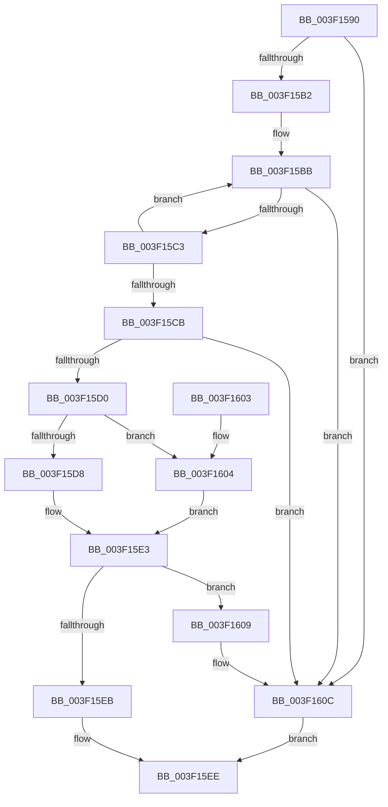

# EtwpGetEventNameFromEventMetadata

- RVA: `0x003F1590`–`0x003F1610` (길이 `128` bytes)
- VA: `0x00000001403F1590`
- 실행 섹션: `.text`
- PDB 이름 있음: `예`; PDB Function 태그: `아니요`
- unwind 정보 RVA: `0x0007293C`
- 디코드: `43`개 명령, `128/128` bytes 표시
- 미해석 바이트: `0` (있으면 어셈블리에 `.byte`로 보존)

> 이 문서는 커널 이미지의 기계어와 PDB 기호를 분석해 생성했습니다. 4번과 5번은 함수 원형과 자료형을 바이너리 사용 방식에서 추정한 C 해석이며 원본 소스 복구 결과는 아닙니다.

## 1. Dependencies

- 직접 호출 지점: **1**; 고유 호출 대상: **1**
- 직접 호출자로 확인된 함수: **2**
- RIP 상대 이미지 참조: **0**

### Outgoing calls
- `0x003F15DE` → [strnlen](../50/strnlen_function_00501590.md) (function, `0x00501590`)

### Direct callers
- [EtwpTraceLostEvent](EtwpTraceLostEvent_function_003F0D58.md) at `0x003F104A`
- [EtwpApplyEventNameFilter](EtwpApplyEventNameFilter_function_003F10B8.md) at `0x003F1340`

### Static image references
- 디코드된 RIP-relative 메모리 참조가 없습니다.

## 2. Other-region calls and transfers

- 다른 실행 섹션으로 향하는 call: **0**
- 별도 외부 분기/꼬리 이동을 확인하지 못했습니다.

## 3. Assembly (complete function range)

```asm
003F1590  48 89 5C 24 08                  mov qword ptr [rsp + 8], rbx
003F1595  48 89 6C 24 10                  mov qword ptr [rsp + 0x10], rbp
003F159A  48 89 74 24 18                  mov qword ptr [rsp + 0x18], rsi
003F159F  57                              push rdi
003F15A0  48 83 EC 20                     sub rsp, 0x20
003F15A4  33 ED                           xor ebp, ebp
003F15A6  49 8B F0                        mov rsi, r8
003F15A9  66 41 89 28                     mov word ptr [r8], bp
003F15AD  83 FA 03                        cmp edx, 3
003F15B0  72 5A                           jb 0x1403f160c
003F15B2  8B FA                           mov edi, edx
003F15B4  48 8D 59 02                     lea rbx, [rcx + 2]
003F15B8  48 03 F9                        add rdi, rcx
003F15BB  48 8B C3                        mov rax, rbx
003F15BE  48 3B DF                        cmp rbx, rdi
003F15C1  74 49                           je 0x1403f160c
003F15C3  48 FF C3                        inc rbx
003F15C6  40 38 28                        cmp byte ptr [rax], bpl
003F15C9  7C F0                           jl 0x1403f15bb
003F15CB  48 3B DF                        cmp rbx, rdi
003F15CE  74 3C                           je 0x1403f160c
003F15D0  66 2B FB                        sub di, bx
003F15D3  48 85 DB                        test rbx, rbx
003F15D6  74 2C                           je 0x1403f1604
003F15D8  0F B7 D7                        movzx edx, di
003F15DB  48 8B CB                        mov rcx, rbx
003F15DE  E8 AD FF 10 00                  call 0x140501590
003F15E3  66 89 06                        mov word ptr [rsi], ax
003F15E6  66 3B C7                        cmp ax, di
003F15E9  74 1E                           je 0x1403f1609
003F15EB  48 8B C3                        mov rax, rbx
003F15EE  48 8B 5C 24 30                  mov rbx, qword ptr [rsp + 0x30]
003F15F3  48 8B 6C 24 38                  mov rbp, qword ptr [rsp + 0x38]
003F15F8  48 8B 74 24 40                  mov rsi, qword ptr [rsp + 0x40]
003F15FD  48 83 C4 20                     add rsp, 0x20
003F1601  5F                              pop rdi
003F1602  C3                              ret
003F1603  CC                              int3
003F1604  48 8B C5                        mov rax, rbp
003F1607  EB DA                           jmp 0x1403f15e3
003F1609  66 89 2E                        mov word ptr [rsi], bp
003F160C  33 C0                           xor eax, eax
003F160E  EB DE                           jmp 0x1403f15ee
```

## 4. C-style interpretation (structured pseudocode)

```c
__int64 __fastcall EtwpGetEventNameFromEventMetadata(__int64 a1, int a2, __int64 a3)
{
    __int64 result;
    __int64 v_rbp;
    __int64 v_rbx;
    __int64 v_rdi;
    __int64 v_rsp;
    unsigned __int64 v_stack_p10;
    unsigned __int64 v_stack_p18;
    unsigned __int64 v_stack_p8;

    v_stack_p8 = v_rbx;
    v_stack_p10 = v_rbp;
    v_stack_p18 = v_rsi;
    v_rsp = (v_rsp) - (32);
    v_rbp = 0;
    *(unsigned __int16 *)(a3) = 0;
    if (a2 < 3) goto loc_003F160C;
    v_rdi = ((unsigned int)(a2)) + (a1);
loc_003F15BB:
    if ((a1 + 2) == v_rdi) goto loc_003F160C;
    v_rbx = (a1 + 2) + 1;
    if ((*(unsigned __int8 *)(a1 + 2)) < 0) goto loc_003F15BB;
    if (v_rbx == v_rdi) goto loc_003F160C;
    v_rdi = (unsigned __int16)((v_rdi) - ((unsigned __int16)(v_rbx)));
    if (v_rbx == 0) goto loc_003F1604;
    result = strnlen(v_rbx, (unsigned __int16)(v_rdi), a3, a4);
loc_003F15E3:
    *(unsigned __int16 *)(a3) = (unsigned __int16)(result);
    if (((unsigned __int16)(result)) == ((unsigned __int16)(v_rdi))) goto loc_003F1609;
loc_003F15EE:
    v_rsp = (v_rsp) + (32);
    return v_rbx;
loc_003F1604:
    goto loc_003F15E3;
loc_003F1609:
    *(unsigned __int16 *)(v_stack_p18) = (unsigned __int16)(v_stack_p10);
loc_003F160C:
    result = 0;
    goto loc_003F15EE;
}
```

## 5. (Beta) C Style

```c
int64_t EtwpGetEventNameFromEventMetadata(void *Arg1, int32_t Arg2, void *Arg3)
{
    uint8_t *arg1 = (uint8_t *)Arg1;
    uint8_t *arg3 = (uint8_t *)Arg3;

    int64_t result;
    int64_t local_rbp;
    int64_t local_rbx;
    int64_t local_rdi;
    int64_t local_rsp;
    uint64_t v_stack_p10;
    uint64_t v_stack_p18;
    uint64_t v_stack_p8;

    v_stack_p8 = local_rbx;
    v_stack_p10 = local_rbp;
    v_stack_p18 = local_rsi;
    local_rsp = (local_rsp) - (32);
    local_rbp = 0;
    *(uint16_t *)(arg3) = 0;
    if (Arg2 < 3) goto loc_003F160C;
    local_rdi = ((uint32_t)(Arg2)) + (Arg1);
loc_003F15BB:
    if ((Arg1 + 2) == local_rdi) goto loc_003F160C;
    local_rbx = (Arg1 + 2) + 1;
    if ((*(uint8_t *)(arg1 + 0x2)) < 0) goto loc_003F15BB;
    if (local_rbx == local_rdi) goto loc_003F160C;
    local_rdi = (uint16_t)((local_rdi) - ((uint16_t)(local_rbx)));
    if (local_rbx == 0) goto loc_003F1604;
    result = strnlen(local_rbx, (uint16_t)(local_rdi), Arg3, a4);
loc_003F15E3:
    *(uint16_t *)(arg3) = (uint16_t)(result);
    if (((uint16_t)(result)) == ((uint16_t)(local_rdi))) goto loc_003F1609;
loc_003F15EE:
    local_rsp = (local_rsp) + (32);
    return local_rbx;
loc_003F1604:
    goto loc_003F15E3;
loc_003F1609:
    *(uint16_t *)(v_stack_p18) = (uint16_t)(v_stack_p10);
loc_003F160C:
    result = 0;
    goto loc_003F15EE;
}
```

### 관측된 메모리 오프셋

구조체 형식이 확인되지 않은 접근은 인자 기준의 오프셋으로만 기록했습니다.

| 기준 인자 | 오프셋 표현 | 폭 (bit) | 접근 |
|---|---:|---:|---|
| `Arg1` | `+ 0x2` | `64` | `R` |
| `Arg3` | `+ 0x0` | `16` | `W` |

## 6. Execution-region graph

[열기: 2D/3D 그래프와 함수 탐색 컨트롤 패널](../../../control-panel.html?section=text&rva=0x003F1590&view=graph)

- 2D 그래프는 위에서 아래로 흐르고, 3D 그래프는 빈 공간을 드래그해 회전합니다. Shift+드래그는 이동, 휠은 확대·축소, 함수 노드 선택은 대상 보고서 이동입니다.

### Static fallback


