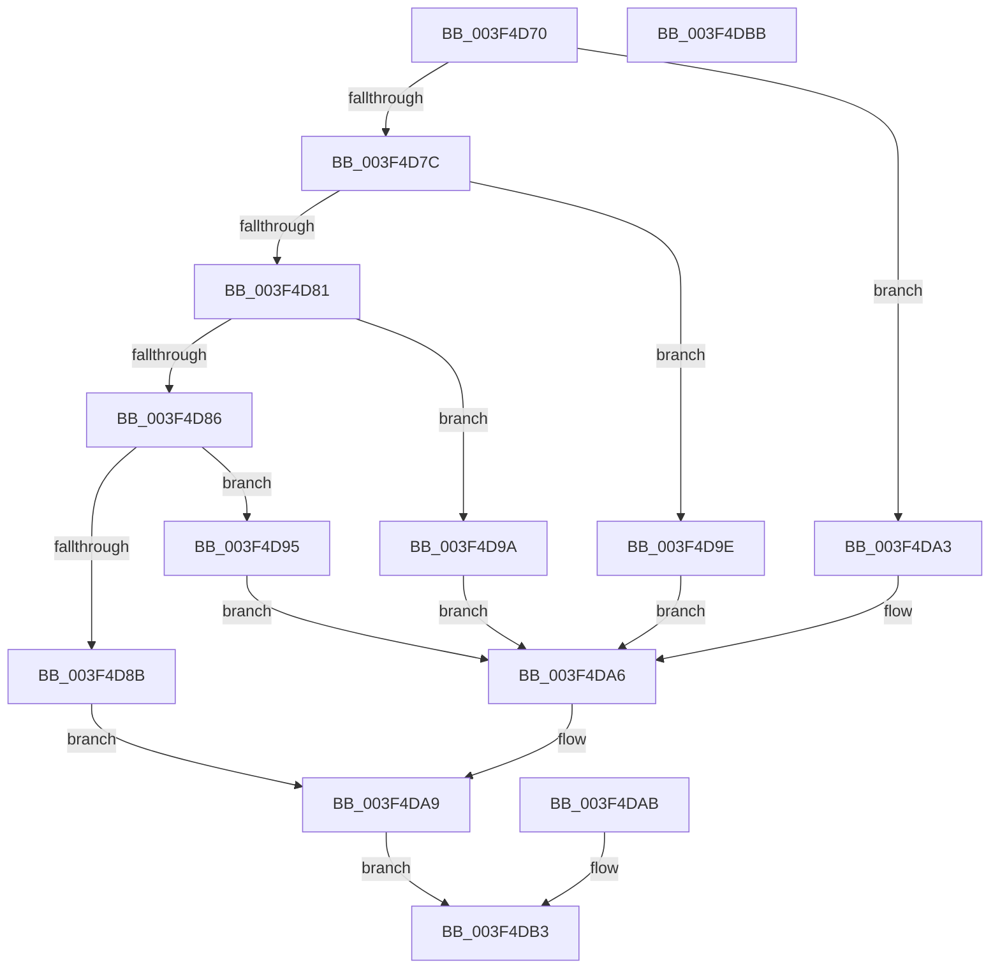

# EtwpGetFieldValue

- RVA: `0x003F4D70`–`0x003F4DBC` (길이 `76` bytes)
- VA: `0x00000001403F4D70`
- 실행 섹션: `.text`
- PDB 이름 있음: `예`; PDB Function 태그: `예`
- unwind 정보 RVA: `0x00097364`
- 디코드: `28`개 명령, `76/76` bytes 표시
- 미해석 바이트: `0` (있으면 어셈블리에 `.byte`로 보존)

> 이 문서는 커널 이미지의 기계어와 PDB 기호를 분석해 생성했습니다. 4번과 5번은 함수 원형과 자료형을 바이너리 사용 방식에서 추정한 C 해석이며 원본 소스 복구 결과는 아닙니다.

## 1. Dependencies

- 직접 호출 지점: **0**; 고유 호출 대상: **0**
- 직접 호출자로 확인된 함수: **2**
- RIP 상대 이미지 참조: **0**

### Outgoing calls
- 직접 디코드된 call 명령이 없습니다.

### Direct callers
- [EtwpApplyPayloadFilterInternal](EtwpApplyPayloadFilterInternal_function_003F43D0.md) at `0x003F4AFA`
- [EtwpApplyPayloadFilterInternal](EtwpApplyPayloadFilterInternal_function_003F43D0.md) at `0x003F4BB9`
- [EtwpApplyPayloadFilterInternal](EtwpApplyPayloadFilterInternal_function_003F43D0.md) at `0x003F4C06`
- [sub_006EAEDE](../6E/Unknown_function_006EAEDE.md) at `0x006EAFD3`

### Static image references
- 디코드된 RIP-relative 메모리 참조가 없습니다.

## 2. Other-region calls and transfers

- 다른 실행 섹션으로 향하는 call: **0**
- 별도 외부 분기/꼬리 이동을 확인하지 못했습니다.

## 3. Assembly (complete function range)

```asm
003F4D70  48 83 EC 38                     sub rsp, 0x38
003F4D74  41 B1 01                        mov r9b, 1
003F4D77  83 EA 01                        sub edx, 1
003F4D7A  74 27                           je 0x1403f4da3
003F4D7C  83 EA 01                        sub edx, 1
003F4D7F  74 1D                           je 0x1403f4d9e
003F4D81  83 EA 02                        sub edx, 2
003F4D84  74 14                           je 0x1403f4d9a
003F4D86  83 FA 04                        cmp edx, 4
003F4D89  74 0A                           je 0x1403f4d95
003F4D8B  45 32 C9                        xor r9b, r9b
003F4D8E  44 88 4C 24 20                  mov byte ptr [rsp + 0x20], r9b
003F4D93  EB 14                           jmp 0x1403f4da9
003F4D95  48 8B 01                        mov rax, qword ptr [rcx]
003F4D98  EB 0C                           jmp 0x1403f4da6
003F4D9A  8B 01                           mov eax, dword ptr [rcx]
003F4D9C  EB 08                           jmp 0x1403f4da6
003F4D9E  0F B7 01                        movzx eax, word ptr [rcx]
003F4DA1  EB 03                           jmp 0x1403f4da6
003F4DA3  0F B6 01                        movzx eax, byte ptr [rcx]
003F4DA6  49 89 00                        mov qword ptr [r8], rax
003F4DA9  EB 08                           jmp 0x1403f4db3
003F4DAB  45 32 C9                        xor r9b, r9b
003F4DAE  44 88 4C 24 20                  mov byte ptr [rsp + 0x20], r9b
003F4DB3  41 8A C1                        mov al, r9b
003F4DB6  48 83 C4 38                     add rsp, 0x38
003F4DBA  C3                              ret
003F4DBB  CC                              int3
```

## 4. C-style interpretation (structured pseudocode)

```c
__int64 __fastcall EtwpGetFieldValue(__int64 a1, int a2, __int64 a3)
{
    __int64 v_rsp;
    unsigned __int8 v_stack_m18;

    v_rsp = (v_rsp) - (56);
    a2 = (unsigned int)((a2) - (1));
    if (condition_is_equal) goto loc_003F4DA3;
    a2 = (unsigned int)((a2) - (1));
    if (condition_is_equal) goto loc_003F4D9E;
    a2 = (unsigned int)((a2) - (2));
    if (condition_is_equal) goto loc_003F4D9A;
    if (a2 == 4) goto loc_003F4D95;
    a4 = 0;
    v_stack_m18 = 0;
    goto loc_003F4DA9;
loc_003F4D95:
    goto loc_003F4DA6;
loc_003F4D9A:
    goto loc_003F4DA6;
loc_003F4D9E:
    goto loc_003F4DA6;
loc_003F4DA3:
loc_003F4DA6:
    *(unsigned __int64 *)(a3) = *(unsigned __int8 *)(a1);
loc_003F4DA9:
    goto loc_003F4DB3;
loc_003F4DB3:
    v_rsp = (v_rsp) + (56);
    return 0;
}
```

## 5. (Beta) C Style

```c
int64_t EtwpGetFieldValue(void *Arg1, int32_t Arg2, void *Arg3)
{
    uint8_t *arg1 = (uint8_t *)Arg1;
    uint8_t *arg3 = (uint8_t *)Arg3;

    int64_t local_rsp;
    uint8_t v_stack_m18;

    local_rsp = (local_rsp) - (56);
    Arg2 = (uint32_t)((Arg2) - (1));
    if (condition_is_equal) goto loc_003F4DA3;
    Arg2 = (uint32_t)((Arg2) - (1));
    if (condition_is_equal) goto loc_003F4D9E;
    Arg2 = (uint32_t)((Arg2) - (2));
    if (condition_is_equal) goto loc_003F4D9A;
    if (Arg2 == 4) goto loc_003F4D95;
    a4 = 0;
    v_stack_m18 = 0;
    goto loc_003F4DA9;
loc_003F4D95:
    goto loc_003F4DA6;
loc_003F4D9A:
    goto loc_003F4DA6;
loc_003F4D9E:
    goto loc_003F4DA6;
loc_003F4DA3:
loc_003F4DA6:
    *(uint64_t *)(arg3) = *(uint8_t *)(arg1);
loc_003F4DA9:
    goto loc_003F4DB3;
loc_003F4DB3:
    local_rsp = (local_rsp) + (56);
    return 0;
}
```

### 관측된 메모리 오프셋

구조체 형식이 확인되지 않은 접근은 인자 기준의 오프셋으로만 기록했습니다.

| 기준 인자 | 오프셋 표현 | 폭 (bit) | 접근 |
|---|---:|---:|---|
| `Arg1` | `+ 0x0` | `8` | `R` |
| `Arg1` | `+ 0x0` | `16` | `R` |
| `Arg1` | `+ 0x0` | `32` | `R` |
| `Arg1` | `+ 0x0` | `64` | `R` |
| `Arg3` | `+ 0x0` | `64` | `W` |

## 6. Execution-region graph

[열기: 2D/3D 그래프와 함수 탐색 컨트롤 패널](../../../control-panel.html?section=text&rva=0x003F4D70&view=graph)

- 2D 그래프는 위에서 아래로 흐르고, 3D 그래프는 빈 공간을 드래그해 회전합니다. Shift+드래그는 이동, 휠은 확대·축소, 함수 노드 선택은 대상 보고서 이동입니다.

### Static fallback


