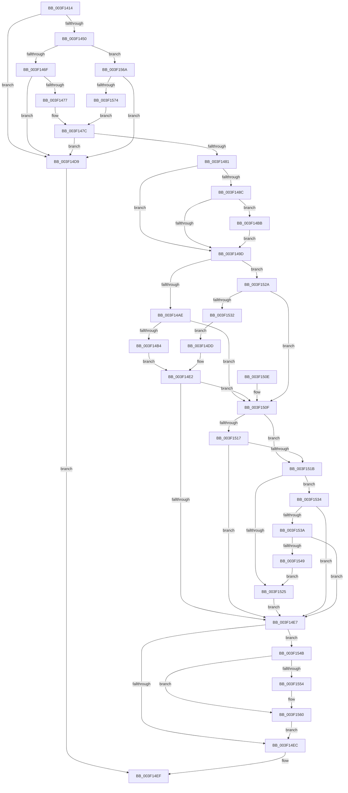

# EtwpIsEventNameFilterEnabled

- RVA: `0x003F1414`–`0x003F157E` (길이 `362` bytes)
- VA: `0x00000001403F1414`
- 실행 섹션: `.text`
- PDB 이름 있음: `예`; PDB Function 태그: `아니요`
- unwind 정보 RVA: `0x00096D54`
- 디코드: `106`개 명령, `362/362` bytes 표시
- 미해석 바이트: `0` (있으면 어셈블리에 `.byte`로 보존)

> 이 문서는 커널 이미지의 기계어와 PDB 기호를 분석해 생성했습니다. 4번과 5번은 함수 원형과 자료형을 바이너리 사용 방식에서 추정한 C 해석이며 원본 소스 복구 결과는 아닙니다.

## 1. Dependencies

- 직접 호출 지점: **2**; 고유 호출 대상: **2**
- 직접 호출자로 확인된 함수: **3**
- RIP 상대 이미지 참조: **1**

### Outgoing calls
- `0x003F14C1` → [KiRaiseIrqlProcessIrqlFlags](../4F/KiRaiseIrqlProcessIrqlFlags_function_004F56FC.md) (function, `0x004F56FC`)
- `0x003F155B` → [KiLowerIrqlProcessIrqlFlags](../4F/KiLowerIrqlProcessIrqlFlags_function_004F5698.md) (function, `0x004F5698`)

### Direct callers
- [EtwpEventWriteFull](../22/EtwpEventWriteFull_function_00225C10.md) at `0x002260E4`
- [EtwpApplyEventNameFilter](EtwpApplyEventNameFilter_function_003F10B8.md) at `0x003F1324`
- [EtwpWriteUserEvent](../../page/AF/EtwpWriteUserEvent_function_00AF2FEC.md) at `0x00AF3372`

### Static image references
- `0x003F1494` → RVA `0x00FC6D20` (`ALMOSTRO`; read)

## 2. Other-region calls and transfers

- 다른 실행 섹션으로 향하는 call: **0**
- 별도 외부 분기/꼬리 이동을 확인하지 못했습니다.

## 3. Assembly (complete function range)

```asm
003F1414  48 8B C4                        mov rax, rsp
003F1417  48 89 58 08                     mov qword ptr [rax + 8], rbx
003F141B  48 89 70 10                     mov qword ptr [rax + 0x10], rsi
003F141F  48 89 78 18                     mov qword ptr [rax + 0x18], rdi
003F1423  4C 89 60 20                     mov qword ptr [rax + 0x20], r12
003F1427  41 55                           push r13
003F1429  41 56                           push r14
003F142B  41 57                           push r15
003F142D  48 83 EC 20                     sub rsp, 0x20
003F1431  48 8B 99 80 02 00 00            mov rbx, qword ptr [rcx + 0x280]
003F1438  45 32 F6                        xor r14b, r14b
003F143B  40 32 F6                        xor sil, sil
003F143E  45 8A E9                        mov r13b, r9b
003F1441  45 8A E0                        mov r12b, r8b
003F1444  4C 8B F9                        mov r15, rcx
003F1447  48 85 DB                        test rbx, rbx
003F144A  0F 84 89 00 00 00               je 0x1403f14d9
003F1450  8B C2                           mov eax, edx
003F1452  41 B9 00 04 00 80               mov r9d, 0x80000400
003F1458  48 6B F8 68                     imul rdi, rax, 0x68
003F145C  BA 00 20 00 80                  mov edx, 0x80002000
003F1461  8B 04 1F                        mov eax, dword ptr [rdi + rbx]
003F1464  40 38 74 24 68                  cmp byte ptr [rsp + 0x68], sil
003F1469  0F 85 FB 00 00 00               jne 0x1403f156a
003F146F  41 23 C1                        and eax, r9d
003F1472  41 3B C1                        cmp eax, r9d
003F1475  75 62                           jne 0x1403f14d9
003F1477  48 8B 5C 1F 60                  mov rbx, qword ptr [rdi + rbx + 0x60]
003F147C  48 85 DB                        test rbx, rbx
003F147F  74 58                           je 0x1403f14d9
003F1481  41 B8 02 00 00 00               mov r8d, 2
003F1487  45 3A E0                        cmp r12b, r8b
003F148A  73 11                           jae 0x1403f149d
003F148C  44 0F 20 C6                     mov rsi, cr8
003F1490  45 0F 22 C0                     mov cr8, r8
003F1494  83 3D 85 58 BD 00 00            cmp dword ptr [rip + 0xbd5885], 0
003F149B  75 1E                           jne 0x1403f14bb
003F149D  49 8B 8F 80 02 00 00            mov rcx, qword ptr [r15 + 0x280]
003F14A4  8B 04 0F                        mov eax, dword ptr [rdi + rcx]
003F14A7  44 38 74 24 68                  cmp byte ptr [rsp + 0x68], r14b
003F14AC  74 7C                           je 0x1403f152a
003F14AE  23 C2                           and eax, edx
003F14B0  3B C2                           cmp eax, edx
003F14B2  75 5B                           jne 0x1403f150f
003F14B4  48 8B 5C 0F 38                  mov rbx, qword ptr [rdi + rcx + 0x38]
003F14B9  EB 27                           jmp 0x1403f14e2
003F14BB  41 8A D0                        mov dl, r8b
003F14BE  40 8A CE                        mov cl, sil
003F14C1  E8 36 42 10 00                  call 0x1404f56fc
003F14C6  BA 00 20 00 80                  mov edx, 0x80002000
003F14CB  41 B8 02 00 00 00               mov r8d, 2
003F14D1  41 B9 00 04 00 80               mov r9d, 0x80000400
003F14D7  EB C4                           jmp 0x1403f149d
003F14D9  32 C0                           xor al, al
003F14DB  EB 12                           jmp 0x1403f14ef
003F14DD  48 8B 5C 0F 60                  mov rbx, qword ptr [rdi + rcx + 0x60]
003F14E2  48 85 DB                        test rbx, rbx
003F14E5  75 28                           jne 0x1403f150f
003F14E7  45 3A E0                        cmp r12b, r8b
003F14EA  72 5F                           jb 0x1403f154b
003F14EC  41 8A C6                        mov al, r14b
003F14EF  48 8B 5C 24 40                  mov rbx, qword ptr [rsp + 0x40]
003F14F4  48 8B 74 24 48                  mov rsi, qword ptr [rsp + 0x48]
003F14F9  48 8B 7C 24 50                  mov rdi, qword ptr [rsp + 0x50]
003F14FE  4C 8B 64 24 58                  mov r12, qword ptr [rsp + 0x58]
003F1503  48 83 C4 20                     add rsp, 0x20
003F1507  41 5F                           pop r15
003F1509  41 5E                           pop r14
003F150B  41 5D                           pop r13
003F150D  C3                              ret
003F150E  CC                              int3
003F150F  8A 43 01                        mov al, byte ptr [rbx + 1]
003F1512  44 3A E8                        cmp r13b, al
003F1515  76 04                           jbe 0x1403f151b
003F1517  84 C0                           test al, al
003F1519  75 CC                           jne 0x1403f14e7
003F151B  48 8B 54 24 60                  mov rdx, qword ptr [rsp + 0x60]
003F1520  48 85 D2                        test rdx, rdx
003F1523  75 0F                           jne 0x1403f1534
003F1525  41 B6 01                        mov r14b, 1
003F1528  EB BD                           jmp 0x1403f14e7
003F152A  41 23 C1                        and eax, r9d
003F152D  41 3B C1                        cmp eax, r9d
003F1530  75 DD                           jne 0x1403f150f
003F1532  EB A9                           jmp 0x1403f14dd
003F1534  48 85 53 08                     test qword ptr [rbx + 8], rdx
003F1538  74 AD                           je 0x1403f14e7
003F153A  48 8B 4B 10                     mov rcx, qword ptr [rbx + 0x10]
003F153E  48 8B C1                        mov rax, rcx
003F1541  48 23 C2                        and rax, rdx
003F1544  48 3B C1                        cmp rax, rcx
003F1547  75 9E                           jne 0x1403f14e7
003F1549  EB DA                           jmp 0x1403f1525
003F154B  83 3D CE 57 BD 00 00            cmp dword ptr [rip + 0xbd57ce], 0
003F1552  74 0C                           je 0x1403f1560
003F1554  44 0F 20 C1                     mov rcx, cr8
003F1558  40 8A D6                        mov dl, sil
003F155B  E8 38 41 10 00                  call 0x1404f5698
003F1560  40 0F B6 CE                     movzx ecx, sil
003F1564  44 0F 22 C1                     mov cr8, rcx
003F1568  EB 82                           jmp 0x1403f14ec
003F156A  23 C2                           and eax, edx
003F156C  3B C2                           cmp eax, edx
003F156E  0F 85 65 FF FF FF               jne 0x1403f14d9
003F1574  48 8B 5C 1F 38                  mov rbx, qword ptr [rdi + rbx + 0x38]
003F1579  E9 FE FE FF FF                  jmp 0x1403f147c
```

## 4. C-style interpretation (structured pseudocode)

```c
__int64 __fastcall EtwpIsEventNameFilterEnabled(__int64 a1, int a2, unsigned __int8 a3, unsigned __int8 a4, __int64 a5, unsigned __int8 a6)
{
    __int64 result;
    __int64 v_r14;
    __int64 v_rdi;
    __int64 v_rsi;
    __int64 v_rsp;
    unsigned __int64 v_stack_p10;
    unsigned __int64 v_stack_p18;
    unsigned __int64 v_stack_p20;
    unsigned __int64 v_stack_p8;

    *(unsigned __int64 *)(v_rsp + 8) = v_rbx;
    *(unsigned __int64 *)(v_rsp + 16) = v_rsi;
    *(unsigned __int64 *)(v_rsp + 24) = v_rdi;
    *(unsigned __int64 *)(v_rsp + 32) = v_r12;
    v_rsp = (v_rsp) - (32);
    v_r14 = 0;
    v_rsi = 0;
    if (*(unsigned __int64 *)(a1 + 640) == 0) goto loc_003F14D9;
    v_rdi = (v_rdi) * ((unsigned int)(a2));
    if (a6 != 0) goto loc_003F156A;
    result = (unsigned int)(((unsigned int)(*(unsigned int *)(v_rdi + *(unsigned __int64 *)(a1 + 640) * 1))) & ((unsigned int)((unsigned int)(0x80000400ULL))));
    if (((unsigned int)(result)) != ((unsigned int)((unsigned int)(0x80000400ULL)))) goto loc_003F14D9;
loc_003F147C:
    if (*(unsigned __int64 *)(v_rdi + *(unsigned __int64 *)(a1 + 640) * 1 + 96) == 0) goto loc_003F14D9;
    if (a3 >= 2) goto loc_003F149D;
    if ((*(unsigned int *)(v_rip + 12408965)) != 0) goto loc_003F14BB;
loc_003F149D:
    if (a6 == 0) goto loc_003F152A;
    result = (unsigned int)(((unsigned int)(*(unsigned int *)(v_rdi + *(unsigned __int64 *)(a1 + 640) * 1))) & ((unsigned int)((unsigned int)(0x80002000ULL))));
    if (((unsigned int)(result)) != ((unsigned int)((unsigned int)(0x80002000ULL)))) goto loc_003F150F;
    goto loc_003F14E2;
loc_003F14BB:
    result = KiRaiseIrqlProcessIrqlFlags((unsigned __int8)(v_cr8), 2, 2, (unsigned int)(0x80000400ULL));
    goto loc_003F149D;
loc_003F14D9:
    result = 0;
    goto loc_003F14EF;
loc_003F14DD:
loc_003F14E2:
    if (*(unsigned __int64 *)(v_rdi + (unsigned __int8)(v_cr8) * 1 + 96) != 0) goto loc_003F150F;
loc_003F14E7:
    if (a3 < 2) goto loc_003F154B;
loc_003F14EC:
loc_003F14EF:
    v_rsp = (v_rsp) + (32);
    return 0;
loc_003F150F:
    if (a4 <= ((unsigned __int8)(*(unsigned __int8 *)(v_stack_p8 + 1)))) goto loc_003F151B;
    if ((unsigned __int8)(*(unsigned __int8 *)(v_stack_p8 + 1)) != 0) goto loc_003F14E7;
loc_003F151B:
    if (a5 != 0) goto loc_003F1534;
loc_003F1525:
    goto loc_003F14E7;
loc_003F152A:
    result = (unsigned int)((*(unsigned __int8 *)(v_stack_p8 + 1)) & ((unsigned int)((unsigned int)(0x80000400ULL))));
    if (((unsigned int)(result)) != ((unsigned int)((unsigned int)(0x80000400ULL)))) goto loc_003F150F;
    goto loc_003F14DD;
loc_003F1534:
    if (((*(unsigned __int64 *)(v_stack_p8 + 8)) & (a5)) == 0) goto loc_003F14E7;
    result = (*(unsigned __int64 *)(v_stack_p8 + 16)) & (a5);
    if (result != (*(unsigned __int64 *)(v_stack_p8 + 16))) goto loc_003F14E7;
    goto loc_003F1525;
loc_003F154B:
    if ((*(unsigned int *)(v_rip + 12408782)) != 0) {
        a1 = 2;
        a2 = (unsigned __int8)(v_stack_p10);
        result = KiLowerIrqlProcessIrqlFlags(a1, a2, 2, (unsigned int)(0x80000400ULL));
    }
    goto loc_003F14EC;
loc_003F156A:
    result = (unsigned int)((result) & (a2));
    if (((unsigned int)(result)) != a2) goto loc_003F14D9;
    goto loc_003F147C;
}
```

## 5. (Beta) C Style

```c
int64_t EtwpIsEventNameFilterEnabled(void *Arg1, int32_t Arg2, uint8_t Arg3, uint8_t Arg4, int64_t Arg5, uint8_t Arg6)
{
    uint8_t *arg1 = (uint8_t *)Arg1;

    int64_t result;
    int64_t local_r14;
    int64_t local_rdi;
    int64_t local_rsi;
    int64_t local_rsp;
    uint64_t v_stack_p10;
    uint64_t v_stack_p18;
    uint64_t v_stack_p20;
    uint64_t v_stack_p8;

    *(uint64_t *)(local_rsp + 0x8) = local_rbx;
    *(uint64_t *)(local_rsp + 0x10) = local_rsi;
    *(uint64_t *)(local_rsp + 0x18) = local_rdi;
    *(uint64_t *)(local_rsp + 0x20) = local_r12;
    local_rsp = (local_rsp) - (32);
    local_r14 = 0;
    local_rsi = 0;
    if (*(uint64_t *)(arg1 + 0x280) == 0) goto loc_003F14D9;
    local_rdi = (local_rdi) * ((uint32_t)(Arg2));
    if (Arg6 != 0) goto loc_003F156A;
    result = (uint32_t)(((uint32_t)(*(uint32_t *)(local_rdi + *(uint64_t *)(arg1 + 0x280) * 1))) & ((uint32_t)((uint32_t)(0x80000400ULL))));
    if (((uint32_t)(result)) != ((uint32_t)((uint32_t)(0x80000400ULL)))) goto loc_003F14D9;
loc_003F147C:
    if (*(uint64_t *)(local_rdi + *(uint64_t *)(arg1 + 0x280) * 1 + 0x60) == 0) goto loc_003F14D9;
    if (Arg3 >= 2) goto loc_003F149D;
    if ((*(uint32_t *)(v_rip + 0xBD5885)) != 0) goto loc_003F14BB;
loc_003F149D:
    if (Arg6 == 0) goto loc_003F152A;
    result = (uint32_t)(((uint32_t)(*(uint32_t *)(local_rdi + *(uint64_t *)(arg1 + 0x280) * 1))) & ((uint32_t)((uint32_t)(0x80002000ULL))));
    if (((uint32_t)(result)) != ((uint32_t)((uint32_t)(0x80002000ULL)))) goto loc_003F150F;
    goto loc_003F14E2;
loc_003F14BB:
    result = KiRaiseIrqlProcessIrqlFlags((uint8_t)(v_cr8), 2, 2, (uint32_t)(0x80000400ULL));
    goto loc_003F149D;
loc_003F14D9:
    result = 0;
    goto loc_003F14EF;
loc_003F14DD:
loc_003F14E2:
    if (*(uint64_t *)(local_rdi + (uint8_t)(v_cr8) * 1 + 0x60) != 0) goto loc_003F150F;
loc_003F14E7:
    if (Arg3 < 2) goto loc_003F154B;
loc_003F14EC:
loc_003F14EF:
    local_rsp = (local_rsp) + (32);
    return 0;
loc_003F150F:
    if (Arg4 <= ((uint8_t)(*(uint8_t *)(v_stack_p8 + 0x1)))) goto loc_003F151B;
    if ((uint8_t)(*(uint8_t *)(v_stack_p8 + 0x1)) != 0) goto loc_003F14E7;
loc_003F151B:
    if (Arg5 != 0) goto loc_003F1534;
loc_003F1525:
    goto loc_003F14E7;
loc_003F152A:
    result = (uint32_t)((*(uint8_t *)(v_stack_p8 + 0x1)) & ((uint32_t)((uint32_t)(0x80000400ULL))));
    if (((uint32_t)(result)) != ((uint32_t)((uint32_t)(0x80000400ULL)))) goto loc_003F150F;
    goto loc_003F14DD;
loc_003F1534:
    if (((*(uint64_t *)(v_stack_p8 + 0x8)) & (Arg5)) == 0) goto loc_003F14E7;
    result = (*(uint64_t *)(v_stack_p8 + 0x10)) & (Arg5);
    if (result != (*(uint64_t *)(v_stack_p8 + 0x10))) goto loc_003F14E7;
    goto loc_003F1525;
loc_003F154B:
    if ((*(uint32_t *)(v_rip + 0xBD57CE)) != 0) {
        Arg1 = 2;
        Arg2 = (uint8_t)(v_stack_p10);
        result = KiLowerIrqlProcessIrqlFlags(Arg1, Arg2, 2, (uint32_t)(0x80000400ULL));
    }
    goto loc_003F14EC;
loc_003F156A:
    result = (uint32_t)((result) & (Arg2));
    if (((uint32_t)(result)) != Arg2) goto loc_003F14D9;
    goto loc_003F147C;
}
```

### 관측된 메모리 오프셋

구조체 형식이 확인되지 않은 접근은 인자 기준의 오프셋으로만 기록했습니다.

| 기준 인자 | 오프셋 표현 | 폭 (bit) | 접근 |
|---|---:|---:|---|
| `Arg1` | `+ 0x280` | `64` | `R` |

## 6. Execution-region graph

[열기: 2D/3D 그래프와 함수 탐색 컨트롤 패널](../../../control-panel.html?section=text&rva=0x003F1414&view=graph)

- 2D 그래프는 위에서 아래로 흐르고, 3D 그래프는 빈 공간을 드래그해 회전합니다. Shift+드래그는 이동, 휠은 확대·축소, 함수 노드 선택은 대상 보고서 이동입니다.

### Static fallback


