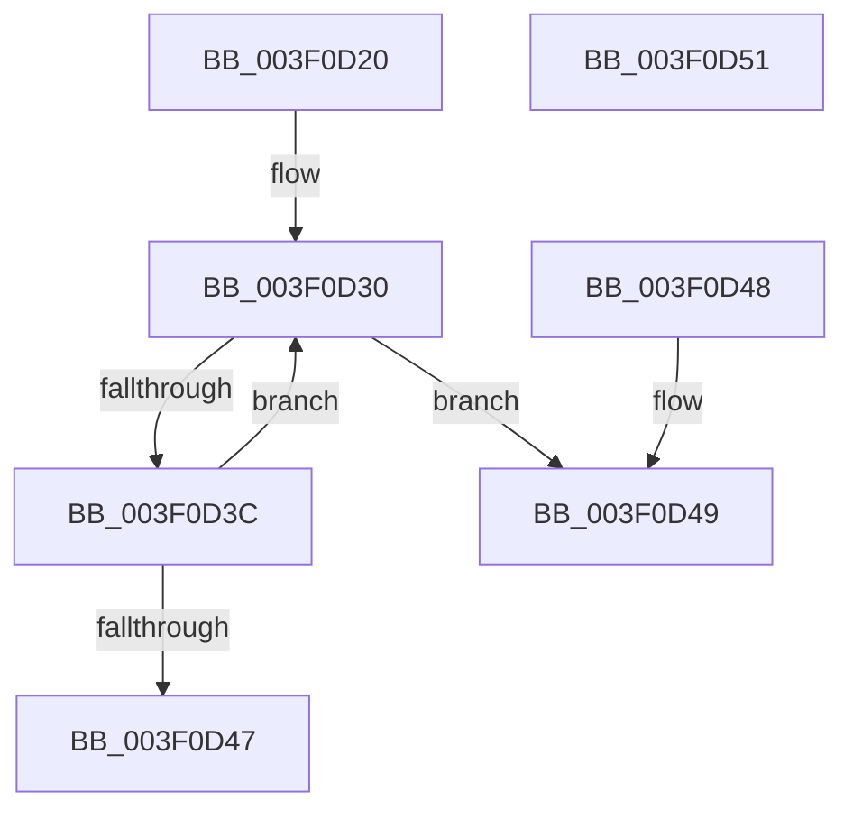

# EtwpReleaseTraceBuffer

- RVA: `0x003F0D20`–`0x003F0D52` (길이 `50` bytes)
- VA: `0x00000001403F0D20`
- 실행 섹션: `.text`
- PDB 이름 있음: `예`; PDB Function 태그: `아니요`
- unwind 정보 RVA: `0x000DB714`
- 디코드: `18`개 명령, `50/50` bytes 표시
- 미해석 바이트: `0` (있으면 어셈블리에 `.byte`로 보존)

> 이 문서는 커널 이미지의 기계어와 PDB 기호를 분석해 생성했습니다. 4번과 5번은 함수 원형과 자료형을 바이너리 사용 방식에서 추정한 C 해석이며 원본 소스 복구 결과는 아닙니다.

## 1. Dependencies

- 직접 호출 지점: **0**; 고유 호출 대상: **0**
- 직접 호출자로 확인된 함수: **4**
- RIP 상대 이미지 참조: **0**

### Outgoing calls
- 직접 디코드된 call 명령이 없습니다.

### Direct callers
- [EtwpEventWriteFull](../22/EtwpEventWriteFull_function_00225C10.md) at `0x002276F2`
- [EtwpFailLogging](EtwpFailLogging_function_003F0A50.md) at `0x003F0B03`
- [EtwTraceRaw](../65/EtwTraceRaw_function_006516CC.md) at `0x006518A1`
- [EtwpWriteUserEvent](../../page/AF/EtwpWriteUserEvent_function_00AF2FEC.md) at `0x00AF46DF`

### Static image references
- 디코드된 RIP-relative 메모리 참조가 없습니다.

## 2. Other-region calls and transfers

- 다른 실행 섹션으로 향하는 call: **0**
- 별도 외부 분기/꼬리 이동을 확인하지 못했습니다.

## 3. Assembly (complete function range)

```asm
003F0D20  4C 8B 11                        mov r10, qword ptr [rcx]
003F0D23  4C 8B C9                        mov r9, rcx
003F0D26  48 8B 51 08                     mov rdx, qword ptr [rcx + 8]
003F0D2A  0F 0D 0A                        prefetchw byte ptr [rdx]
003F0D2D  48 8B 02                        mov rax, qword ptr [rdx]
003F0D30  4C 8B C0                        mov r8, rax
003F0D33  4D 33 C2                        xor r8, r10
003F0D36  49 83 F8 0F                     cmp r8, 0xf
003F0D3A  73 0D                           jae 0x1403f0d49
003F0D3C  48 8D 48 01                     lea rcx, [rax + 1]
003F0D40  F0 48 0F B1 0A                  lock cmpxchg qword ptr [rdx], rcx
003F0D45  75 E9                           jne 0x1403f0d30
003F0D47  C3                              ret
003F0D48  CC                              int3
003F0D49  49 8B 01                        mov rax, qword ptr [r9]
003F0D4C  F0 FF 48 0C                     lock dec dword ptr [rax + 0xc]
003F0D50  C3                              ret
003F0D51  CC                              int3
```

## 4. C-style interpretation (structured pseudocode)

```c
__int64 __fastcall EtwpReleaseTraceBuffer(__int64 a1)
{
loc_003F0D30:
    a3 = (*(unsigned __int64 *)(*(unsigned __int64 *)(a1 + 8))) ^ (*(unsigned __int64 *)(a1));
    if (a3 >= 15) goto loc_003F0D49;
    if (a3 != 15) goto loc_003F0D30;
    return *(unsigned __int64 *)(*(unsigned __int64 *)(a1 + 8));
loc_003F0D49:
    return *(unsigned __int64 *)(a1);
}
```

## 5. (Beta) C Style

```c
int64_t EtwpReleaseTraceBuffer(void *Arg1)
{
    uint8_t *arg1 = (uint8_t *)Arg1;

loc_003F0D30:
    a3 = (*(uint64_t *)(*(uint64_t *)(arg1 + 0x8))) ^ (*(uint64_t *)(arg1));
    if (a3 >= 15) goto loc_003F0D49;
    if (a3 != 15) goto loc_003F0D30;
    return *(uint64_t *)(*(uint64_t *)(arg1 + 0x8));
loc_003F0D49:
    return *(uint64_t *)(arg1);
}
```

### 관측된 메모리 오프셋

구조체 형식이 확인되지 않은 접근은 인자 기준의 오프셋으로만 기록했습니다.

| 기준 인자 | 오프셋 표현 | 폭 (bit) | 접근 |
|---|---:|---:|---|
| `Arg1` | `+ 0x0` | `64` | `R` |
| `Arg1` | `+ 0x8` | `64` | `R` |

## 6. Execution-region graph

[열기: 2D/3D 그래프와 함수 탐색 컨트롤 패널](../../../control-panel.html?section=text&rva=0x003F0D20&view=graph)

- 2D 그래프는 위에서 아래로 흐르고, 3D 그래프는 빈 공간을 드래그해 회전합니다. Shift+드래그는 이동, 휠은 확대·축소, 함수 노드 선택은 대상 보고서 이동입니다.

### Static fallback


