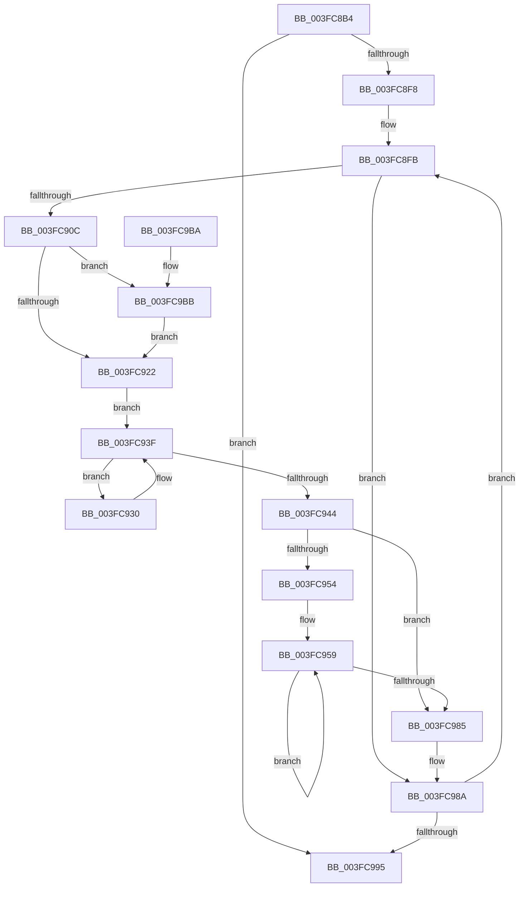

# EtwpStackRundown

- RVA: `0x003FC8B4`–`0x003FC9C8` (길이 `276` bytes)
- VA: `0x00000001403FC8B4`
- 실행 섹션: `.text`
- PDB 이름 있음: `예`; PDB Function 태그: `아니요`
- unwind 정보 RVA: `0x000998A4`
- 디코드: `81`개 명령, `276/276` bytes 표시
- 미해석 바이트: `0` (있으면 어셈블리에 `.byte`로 보존)

> 이 문서는 커널 이미지의 기계어와 PDB 기호를 분석해 생성했습니다. 4번과 5번은 함수 원형과 자료형을 바이너리 사용 방식에서 추정한 C 해석이며 원본 소스 복구 결과는 아닙니다.

## 1. Dependencies

- 직접 호출 지점: **6**; 고유 호출 대상: **6**
- 직접 호출자로 확인된 함수: **2**
- RIP 상대 이미지 참조: **2**

### Outgoing calls
- `0x003FC926` → [KeAcquireSpinLockAtDpcLevel](../20/KeAcquireSpinLockAtDpcLevel_function_00208430.md) (function, `0x00208430`)
- `0x003FC94B` → [KeReleaseSpinLock](../39/KeReleaseSpinLock_function_00392BA0.md) (function, `0x00392BA0`)
- `0x003FC96B` → [EtwpTraceCachedStack](EtwpTraceCachedStack_function_003FCAF0.md) (function, `0x003FCAF0`)
- `0x003FC976` → [EtwpDereferenceStackEntry](EtwpDereferenceStackEntry_function_003FC9D0.md) (function, `0x003FC9D0`)
- `0x003FC99D` → [_security_check_cookie](../6A/_security_check_cookie_function_006AC640.md) (function, `0x006AC640`)
- `0x003FC9BE` → [KiRaiseIrqlProcessIrqlFlags](../4F/KiRaiseIrqlProcessIrqlFlags_function_004F56FC.md) (function, `0x004F56FC`)

### Direct callers
- [EtwpStopLoggerInstance](../../page/9B/EtwpStopLoggerInstance_function_009BEB94.md) at `0x009BEEBA`
- [EtwpCheckLoggerAccessAndDoRundown](../../page/9E/EtwpCheckLoggerAccessAndDoRundown_function_009E3EFC.md) at `0x009E3FA1`

### Static image references
- `0x003FC8C8` → RVA `0x00E0A740` (`.data`; read)
- `0x003FC916` → RVA `0x00FC6D20` (`ALMOSTRO`; read)

## 2. Other-region calls and transfers

- 다른 실행 섹션으로 향하는 call: **0**
- 별도 외부 분기/꼬리 이동을 확인하지 못했습니다.

## 3. Assembly (complete function range)

```asm
003FC8B4  48 89 5C 24 20                  mov qword ptr [rsp + 0x20], rbx
003FC8B9  55                              push rbp
003FC8BA  56                              push rsi
003FC8BB  57                              push rdi
003FC8BC  41 54                           push r12
003FC8BE  41 55                           push r13
003FC8C0  41 56                           push r14
003FC8C2  41 57                           push r15
003FC8C4  48 83 EC 50                     sub rsp, 0x50
003FC8C8  48 8B 05 71 DE A0 00            mov rax, qword ptr [rip + 0xa0de71]
003FC8CF  48 33 C4                        xor rax, rsp
003FC8D2  48 89 44 24 40                  mov qword ptr [rsp + 0x40], rax
003FC8D7  0F 57 C0                        xorps xmm0, xmm0
003FC8DA  33 F6                           xor esi, esi
003FC8DC  45 8B E8                        mov r13d, r8d
003FC8DF  4C 8B E2                        mov r12, rdx
003FC8E2  48 8B E9                        mov rbp, rcx
003FC8E5  0F 11 44 24 20                  movups xmmword ptr [rsp + 0x20], xmm0
003FC8EA  0F 11 44 24 30                  movups xmmword ptr [rsp + 0x30], xmm0
003FC8EF  39 71 08                        cmp dword ptr [rcx + 8], esi
003FC8F2  0F 86 9D 00 00 00               jbe 0x1403fc995
003FC8F8  8D 56 02                        lea edx, [rsi + 2]
003FC8FB  48 8D 0C 76                     lea rcx, [rsi + rsi*2]
003FC8FF  48 8D 5D 20                     lea rbx, [rbp + 0x20]
003FC903  48 8D 1C CB                     lea rbx, [rbx + rcx*8]
003FC907  48 39 1B                        cmp qword ptr [rbx], rbx
003FC90A  74 7E                           je 0x1403fc98a
003FC90C  33 FF                           xor edi, edi
003FC90E  45 0F 20 C6                     mov r14, cr8
003FC912  44 0F 22 C2                     mov cr8, rdx
003FC916  39 3D 04 A4 BC 00               cmp dword ptr [rip + 0xbca404], edi
003FC91C  0F 85 99 00 00 00               jne 0x1403fc9bb
003FC922  48 8D 4B 10                     lea rcx, [rbx + 0x10]
003FC926  E8 05 BB E0 FF                  call 0x140208430
003FC92B  4C 8B 03                        mov r8, qword ptr [rbx]
003FC92E  EB 0F                           jmp 0x1403fc93f
003FC930  F0 41 FF 40 18                  lock inc dword ptr [r8 + 0x18]
003FC935  4C 89 44 FC 20                  mov qword ptr [rsp + rdi*8 + 0x20], r8
003FC93A  FF C7                           inc edi
003FC93C  4D 8B 00                        mov r8, qword ptr [r8]
003FC93F  4C 3B C3                        cmp r8, rbx
003FC942  75 EC                           jne 0x1403fc930
003FC944  41 8A D6                        mov dl, r14b
003FC947  48 8D 4B 10                     lea rcx, [rbx + 0x10]
003FC94B  E8 50 62 F9 FF                  call 0x140392ba0
003FC950  85 FF                           test edi, edi
003FC952  74 31                           je 0x1403fc985
003FC954  4C 8D 74 24 20                  lea r14, [rsp + 0x20]
003FC959  49 8B 1E                        mov rbx, qword ptr [r14]
003FC95C  41 B8 24 18 00 00               mov r8d, 0x1824
003FC962  4C 8B CB                        mov r9, rbx
003FC965  41 8B D5                        mov edx, r13d
003FC968  49 8B CC                        mov rcx, r12
003FC96B  E8 80 01 00 00                  call 0x1403fcaf0
003FC970  48 8B D5                        mov rdx, rbp
003FC973  48 8B CB                        mov rcx, rbx
003FC976  E8 55 00 00 00                  call 0x1403fc9d0
003FC97B  4D 8D 76 08                     lea r14, [r14 + 8]
003FC97F  48 83 EF 01                     sub rdi, 1
003FC983  75 D4                           jne 0x1403fc959
003FC985  BA 02 00 00 00                  mov edx, 2
003FC98A  FF C6                           inc esi
003FC98C  3B 75 08                        cmp esi, dword ptr [rbp + 8]
003FC98F  0F 82 66 FF FF FF               jb 0x1403fc8fb
003FC995  48 8B 4C 24 40                  mov rcx, qword ptr [rsp + 0x40]
003FC99A  48 33 CC                        xor rcx, rsp
003FC99D  E8 9E FC 2A 00                  call 0x1406ac640
003FC9A2  48 8B 9C 24 A8 00 00 00         mov rbx, qword ptr [rsp + 0xa8]
003FC9AA  48 83 C4 50                     add rsp, 0x50
003FC9AE  41 5F                           pop r15
003FC9B0  41 5E                           pop r14
003FC9B2  41 5D                           pop r13
003FC9B4  41 5C                           pop r12
003FC9B6  5F                              pop rdi
003FC9B7  5E                              pop rsi
003FC9B8  5D                              pop rbp
003FC9B9  C3                              ret
003FC9BA  CC                              int3
003FC9BB  41 8A CE                        mov cl, r14b
003FC9BE  E8 39 8D 0F 00                  call 0x1404f56fc
003FC9C3  E9 5A FF FF FF                  jmp 0x1403fc922
```

## 4. C-style interpretation (structured pseudocode)

```c
__int64 __fastcall EtwpStackRundown(__int64 a1, __int64 a2, int a3)
{
    __int64 result;
    __int64 v_rdi;
    __int64 v_rsi;
    __int64 v_rsp;
    unsigned __int64 v_stack_m48;
    unsigned __int64 v_stack_m58;
    unsigned __int64 v_stack_m68;
    unsigned __int64 v_stack_p20;

    v_stack_p20 = v_rbx;
    v_rsp = (v_rsp) - (80);
    result = (*(unsigned __int64 *)(v_rip + 10542705)) ^ (v_rsp);
    v_stack_m48 = result;
    v_rsi = 0;
    v_stack_m68 = v_xmm0;
    v_stack_m58 = v_xmm0;
    if ((*(unsigned int *)(a1 + 8)) <= 0) goto loc_003FC995;
loc_003FC8FB:
    if ((*(unsigned __int64 *)(a1 + 32 + v_rsi + v_rsi * 2 * 8)) == (a1 + 32 + v_rsi + v_rsi * 2 * 8)) goto loc_003FC98A;
    v_rdi = 0;
    if ((*(unsigned int *)(v_rip + 12362756)) != 0) goto loc_003FC9BB;
loc_003FC922:
    result = KeAcquireSpinLockAtDpcLevel(a1 + 32 + v_rsi + v_rsi * 2 * 8 + 16, v_rsi + 2, a3, a4);
    goto loc_003FC93F;
loc_003FC930:
    *(unsigned __int64 *)(v_rsp + v_rdi * 8 + 32) = *(unsigned __int64 *)(a1 + 32 + v_rsi + v_rsi * 2 * 8);
    v_rdi = (unsigned int)((v_rdi) + 1);
loc_003FC93F:
    if ((*(unsigned __int64 *)(*(unsigned __int64 *)(a1 + 32 + v_rsi + v_rsi * 2 * 8))) != (a1 + 32 + v_rsi + v_rsi * 2 * 8)) goto loc_003FC930;
    result = KeReleaseSpinLock(a1 + 32 + v_rsi + v_rsi * 2 * 8 + 16, (unsigned __int8)(v_cr8), *(unsigned __int64 *)(*(unsigned __int64 *)(a1 + 32 + v_rsi + v_rsi * 2 * 8)), a4);
    if ((unsigned int)(v_rdi) == 0) goto loc_003FC985;
loc_003FC959:
    result = EtwpTraceCachedStack(a2, (unsigned int)((unsigned int)((unsigned int)(a3))), (unsigned int)(0x1824ULL), *(unsigned __int64 *)(v_stack_m68));
    result = EtwpDereferenceStackEntry(*(unsigned __int64 *)(v_stack_m68), a1, (unsigned int)(0x1824ULL), *(unsigned __int64 *)(v_stack_m68));
    v_rdi = (v_rdi) - (1);
    if (condition_is_not_equal) goto loc_003FC959;
loc_003FC985:
loc_003FC98A:
    v_rsi = (unsigned int)((v_rsi) + 1);
    if (((unsigned int)(v_rsi)) < (*(unsigned int *)(a1 + 8))) goto loc_003FC8FB;
loc_003FC995:
    a1 = (v_stack_m48) ^ (v_rsp);
    result = _security_check_cookie(a1, 2, (unsigned int)(0x1824ULL), *(unsigned __int64 *)(v_stack_m68));
    v_rsp = (v_rsp) + (80);
    return result;
loc_003FC9BB:
    result = KiRaiseIrqlProcessIrqlFlags((unsigned __int8)(v_stack_m68 + 8), 2, (unsigned int)(0x1824ULL), *(unsigned __int64 *)(v_stack_m68));
    goto loc_003FC922;
}
```

## 5. (Beta) C Style

```c
int64_t EtwpStackRundown(void *Arg1, int64_t Arg2, int32_t Arg3)
{
    uint8_t *arg1 = (uint8_t *)Arg1;

    int64_t result;
    int64_t local_rdi;
    int64_t local_rsi;
    int64_t local_rsp;
    uint64_t v_stack_m48;
    uint64_t v_stack_m58;
    uint64_t v_stack_m68;
    uint64_t v_stack_p20;

    v_stack_p20 = local_rbx;
    local_rsp = (local_rsp) - (80);
    result = (*(uint64_t *)(v_rip + 0xA0DE71)) ^ (local_rsp);
    v_stack_m48 = result;
    local_rsi = 0;
    v_stack_m68 = v_xmm0;
    v_stack_m58 = v_xmm0;
    if ((*(uint32_t *)(arg1 + 0x8)) <= 0) goto loc_003FC995;
loc_003FC8FB:
    if ((*(uint64_t *)(arg1 + 0x20 + local_rsi + local_rsi * 2 * 8)) == (Arg1 + 32 + local_rsi + local_rsi * 2 * 8)) goto loc_003FC98A;
    local_rdi = 0;
    if ((*(uint32_t *)(v_rip + 0xBCA404)) != 0) goto loc_003FC9BB;
loc_003FC922:
    result = KeAcquireSpinLockAtDpcLevel(Arg1 + 32 + local_rsi + local_rsi * 2 * 8 + 16, local_rsi + 2, Arg3, a4);
    goto loc_003FC93F;
loc_003FC930:
    *(uint64_t *)(local_rsp + local_rdi * 8 + 0x20) = *(uint64_t *)(arg1 + 0x20 + local_rsi + local_rsi * 2 * 8);
    local_rdi = (uint32_t)((local_rdi) + 1);
loc_003FC93F:
    if ((*(uint64_t *)(*(uint64_t *)(arg1 + 0x20 + local_rsi + local_rsi * 2 * 8))) != (Arg1 + 32 + local_rsi + local_rsi * 2 * 8)) goto loc_003FC930;
    result = KeReleaseSpinLock(Arg1 + 32 + local_rsi + local_rsi * 2 * 8 + 16, (uint8_t)(v_cr8), *(uint64_t *)(*(uint64_t *)(arg1 + 0x20 + local_rsi + local_rsi * 2 * 8)), a4);
    if ((uint32_t)(local_rdi) == 0) goto loc_003FC985;
loc_003FC959:
    result = EtwpTraceCachedStack(Arg2, (uint32_t)((uint32_t)((uint32_t)(Arg3))), (uint32_t)(0x1824ULL), *(uint64_t *)(v_stack_m68));
    result = EtwpDereferenceStackEntry(*(uint64_t *)(v_stack_m68), Arg1, (uint32_t)(0x1824ULL), *(uint64_t *)(v_stack_m68));
    local_rdi = (local_rdi) - (1);
    if (condition_is_not_equal) goto loc_003FC959;
loc_003FC985:
loc_003FC98A:
    local_rsi = (uint32_t)((local_rsi) + 1);
    if (((uint32_t)(local_rsi)) < (*(uint32_t *)(arg1 + 0x8))) goto loc_003FC8FB;
loc_003FC995:
    Arg1 = (v_stack_m48) ^ (local_rsp);
    result = _security_check_cookie(Arg1, 2, (uint32_t)(0x1824ULL), *(uint64_t *)(v_stack_m68));
    local_rsp = (local_rsp) + (80);
    return result;
loc_003FC9BB:
    result = KiRaiseIrqlProcessIrqlFlags((uint8_t)(v_stack_m68 + 8), 2, (uint32_t)(0x1824ULL), *(uint64_t *)(v_stack_m68));
    goto loc_003FC922;
}
```

### 관측된 메모리 오프셋

구조체 형식이 확인되지 않은 접근은 인자 기준의 오프셋으로만 기록했습니다.

| 기준 인자 | 오프셋 표현 | 폭 (bit) | 접근 |
|---|---:|---:|---|
| `Arg1` | `+ 0x0` | `64` | `R` |
| `Arg1` | `+ 0x0 + rcx*8` | `64` | `R` |
| `Arg1` | `+ 0x8` | `32` | `R` |
| `Arg1` | `+ 0x10` | `64` | `R` |
| `Arg1` | `+ 0x20` | `64` | `R` |

## 6. Execution-region graph

[열기: 2D/3D 그래프와 함수 탐색 컨트롤 패널](../../../control-panel.html?section=text&rva=0x003FC8B4&view=graph)

- 2D 그래프는 위에서 아래로 흐르고, 3D 그래프는 빈 공간을 드래그해 회전합니다. Shift+드래그는 이동, 휠은 확대·축소, 함수 노드 선택은 대상 보고서 이동입니다.

### Static fallback


