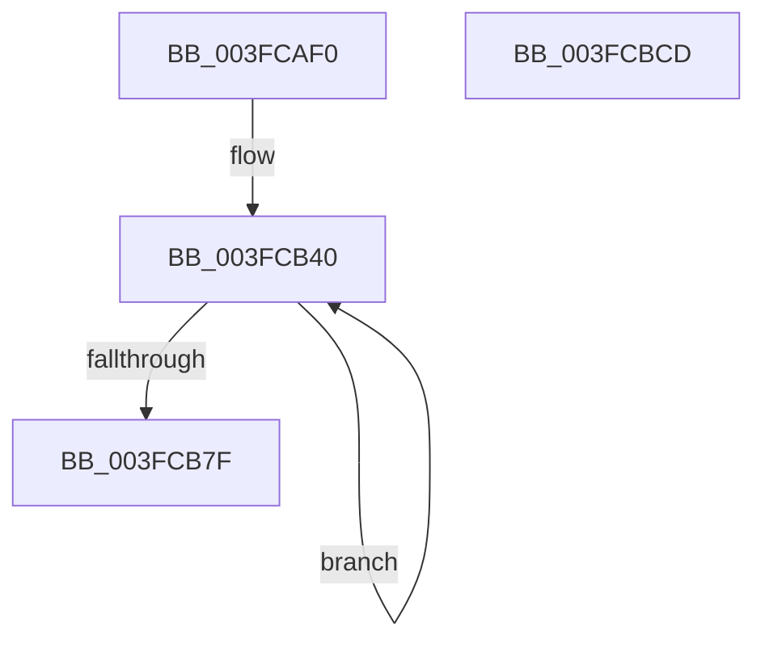

# EtwpTraceCachedStack

- RVA: `0x003FCAF0`–`0x003FCBCE` (길이 `222` bytes)
- VA: `0x00000001403FCAF0`
- 실행 섹션: `.text`
- PDB 이름 있음: `예`; PDB Function 태그: `아니요`
- unwind 정보 RVA: `0x00099908`
- 디코드: `53`개 명령, `222/222` bytes 표시
- 미해석 바이트: `0` (있으면 어셈블리에 `.byte`로 보존)

> 이 문서는 커널 이미지의 기계어와 PDB 기호를 분석해 생성했습니다. 4번과 5번은 함수 원형과 자료형을 바이너리 사용 방식에서 추정한 C 해석이며 원본 소스 복구 결과는 아닙니다.

## 1. Dependencies

- 직접 호출 지점: **2**; 고유 호출 대상: **2**
- 직접 호출자로 확인된 함수: **1**
- RIP 상대 이미지 참조: **1**

### Outgoing calls
- `0x003FCBAE` → [EtwpLogKernelEvent](../25/EtwpLogKernelEvent_function_0025CC00.md) (function, `0x0025CC00`)
- `0x003FCBBE` → [_security_check_cookie](../6A/_security_check_cookie_function_006AC640.md) (function, `0x006AC640`)

### Direct callers
- [EtwpStackRundown](EtwpStackRundown_function_003FC8B4.md) at `0x003FC96B`

### Static image references
- `0x003FCAFE` → RVA `0x00E0A740` (`.data`; read)

## 2. Other-region calls and transfers

- 다른 실행 섹션으로 향하는 call: **0**
- 별도 외부 분기/꼬리 이동을 확인하지 못했습니다.

## 3. Assembly (complete function range)

```asm
003FCAF0  4C 89 4C 24 20                  mov qword ptr [rsp + 0x20], r9
003FCAF5  53                              push rbx
003FCAF6  57                              push rdi
003FCAF7  48 81 EC D8 00 00 00            sub rsp, 0xd8
003FCAFE  48 8B 05 3B DC A0 00            mov rax, qword ptr [rip + 0xa0dc3b]
003FCB05  48 33 C4                        xor rax, rsp
003FCB08  48 89 84 24 C0 00 00 00         mov qword ptr [rsp + 0xc0], rax
003FCB10  33 FF                           xor edi, edi
003FCB12  48 C7 44 24 38 08 00 00 00      mov qword ptr [rsp + 0x38], 8
003FCB1B  48 8D 84 24 08 01 00 00         lea rax, [rsp + 0x108]
003FCB23  8B DA                           mov ebx, edx
003FCB25  4C 8B D9                        mov r11, rcx
003FCB28  48 89 44 24 30                  mov qword ptr [rsp + 0x30], rax
003FCB2D  44 8D 57 01                     lea r10d, [rdi + 1]
003FCB31  0F 1F 40 00                     nop dword ptr [rax]
003FCB35  66 66 66 0F 1F 84 00 00 00 00 00  nop word ptr [rax + rax]
003FCB40  41 8B 41 20                     mov eax, dword ptr [r9 + 0x20]
003FCB44  48 8D 4C 24 30                  lea rcx, [rsp + 0x30]
003FCB49  BA 20 00 00 00                  mov edx, 0x20
003FCB4E  3B C2                           cmp eax, edx
003FCB50  0F 42 D0                        cmovb edx, eax
003FCB53  41 0F B7 C2                     movzx eax, r10w
003FCB57  48 C1 E0 04                     shl rax, 4
003FCB5B  66 41 FF C2                     inc r10w
003FCB5F  48 03 C8                        add rcx, rax
003FCB62  49 8D 41 28                     lea rax, [r9 + 0x28]
003FCB66  48 89 01                        mov qword ptr [rcx], rax
003FCB69  8D 04 D5 00 00 00 00            lea eax, [rdx*8]
003FCB70  89 41 08                        mov dword ptr [rcx + 8], eax
003FCB73  89 79 0C                        mov dword ptr [rcx + 0xc], edi
003FCB76  4D 8B 49 10                     mov r9, qword ptr [r9 + 0x10]
003FCB7A  4D 85 C9                        test r9, r9
003FCB7D  75 C1                           jne 0x1403fcb40
003FCB7F  BA 24 18 00 00                  mov edx, 0x1824
003FCB84  45 0F B7 CA                     movzx r9d, r10w
003FCB88  66 44 3B C2                     cmp r8w, dx
003FCB8C  B8 02 06 50 00                  mov eax, 0x500602
003FCB91  B9 02 00 50 00                  mov ecx, 0x500002
003FCB96  49 8B D3                        mov rdx, r11
003FCB99  0F 44 C1                        cmove eax, ecx
003FCB9C  48 8D 4C 24 30                  lea rcx, [rsp + 0x30]
003FCBA1  89 44 24 28                     mov dword ptr [rsp + 0x28], eax
003FCBA5  66 44 89 44 24 20               mov word ptr [rsp + 0x20], r8w
003FCBAB  44 8B C3                        mov r8d, ebx
003FCBAE  E8 4D 00 E6 FF                  call 0x14025cc00
003FCBB3  48 8B 8C 24 C0 00 00 00         mov rcx, qword ptr [rsp + 0xc0]
003FCBBB  48 33 CC                        xor rcx, rsp
003FCBBE  E8 7D FA 2A 00                  call 0x1406ac640
003FCBC3  48 81 C4 D8 00 00 00            add rsp, 0xd8
003FCBCA  5F                              pop rdi
003FCBCB  5B                              pop rbx
003FCBCC  C3                              ret
003FCBCD  CC                              int3
```

## 4. C-style interpretation (structured pseudocode)

```c
__int64 __fastcall EtwpTraceCachedStack(__int64 a1, int a2, unsigned __int16 a3, __int64 a4)
{
    __int64 result;
    __int64 v_r10;
    __int64 v_rdi;
    __int64 v_rsp;
    unsigned __int64 v_stack_m28;
    unsigned __int64 v_stack_mB0;
    unsigned __int64 v_stack_mB8;
    unsigned int v_stack_mC0;
    unsigned __int16 v_stack_mC8;
    unsigned __int64 v_stack_p20;

    v_stack_p20 = a4;
    v_rsp = (v_rsp) - (216);
    result = (*(unsigned __int64 *)(v_rip + 10542139)) ^ (v_rsp);
    v_stack_m28 = result;
    v_rdi = 0;
    v_stack_mB0 = 8;
    v_stack_mB8 = v_stack_p20;
loc_003FCB40:
    a2 = 32;
    if (((unsigned int)((unsigned int)(*(unsigned int *)(a4 + 32)))) < 32) { a2 = (unsigned int)((unsigned int)(*(unsigned int *)(a4 + 32))); }
    result = ((unsigned __int16)(v_rdi + 1)) << (4);
    v_r10 = (unsigned __int16)((v_rdi + 1) + 1);
    a1 = (v_stack_mB8) + (result);
    *(unsigned __int64 *)(a1) = a4 + 40;
    *(unsigned int *)(a1 + 8) = (unsigned int)(a2 * 8);
    *(unsigned int *)(a1 + 12) = 0;
    if (*(unsigned __int64 *)(a4 + 16) != 0) goto loc_003FCB40;
    result = (unsigned int)(0x500602ULL);
    if (a3 == ((unsigned __int16)((unsigned int)(0x1824ULL)))) { result = (unsigned int)((unsigned int)(0x500002ULL)); }
    v_stack_mC0 = (unsigned int)(result);
    v_stack_mC8 = a3;
    result = EtwpLogKernelEvent(v_stack_mB8, a1, (unsigned int)((unsigned int)((unsigned int)(a2))), (unsigned __int16)(v_r10));
    a1 = (v_stack_m28) ^ (v_rsp);
    result = _security_check_cookie(a1, a1, (unsigned int)((unsigned int)((unsigned int)(a2))), (unsigned __int16)(v_r10));
    v_rsp = (v_rsp) + (216);
    return result;
}
```

## 5. (Beta) C Style

```c
int64_t EtwpTraceCachedStack(int64_t Arg1, int32_t Arg2, uint16_t Arg3, int64_t Arg4)
{
    int64_t result;
    int64_t local_r10;
    int64_t local_rdi;
    int64_t local_rsp;
    uint64_t v_stack_m28;
    uint64_t v_stack_mB0;
    uint64_t v_stack_mB8;
    uint32_t v_stack_mC0;
    uint16_t v_stack_mC8;
    uint64_t v_stack_p20;

    v_stack_p20 = Arg4;
    local_rsp = (local_rsp) - (216);
    result = (*(uint64_t *)(v_rip + 0xA0DC3B)) ^ (local_rsp);
    v_stack_m28 = result;
    local_rdi = 0;
    v_stack_mB0 = 8;
    v_stack_mB8 = v_stack_p20;
loc_003FCB40:
    Arg2 = 32;
    if (((uint32_t)((uint32_t)(*(uint32_t *)(Arg4 + 0x20)))) < 32) { Arg2 = (uint32_t)((uint32_t)(*(uint32_t *)(Arg4 + 0x20))); }
    result = ((uint16_t)(local_rdi + 1)) << (4);
    local_r10 = (uint16_t)((local_rdi + 1) + 1);
    Arg1 = (v_stack_mB8) + (result);
    *(uint64_t *)(Arg1) = Arg4 + 40;
    *(uint32_t *)(Arg1 + 0x8) = (uint32_t)(Arg2 * 8);
    *(uint32_t *)(Arg1 + 0xC) = 0;
    if (*(uint64_t *)(Arg4 + 0x10) != 0) goto loc_003FCB40;
    result = (uint32_t)(0x500602ULL);
    if (Arg3 == ((uint16_t)((uint32_t)(0x1824ULL)))) { result = (uint32_t)((uint32_t)(0x500002ULL)); }
    v_stack_mC0 = (uint32_t)(result);
    v_stack_mC8 = Arg3;
    result = EtwpLogKernelEvent(v_stack_mB8, Arg1, (uint32_t)((uint32_t)((uint32_t)(Arg2))), (uint16_t)(local_r10));
    Arg1 = (v_stack_m28) ^ (local_rsp);
    result = _security_check_cookie(Arg1, Arg1, (uint32_t)((uint32_t)((uint32_t)(Arg2))), (uint16_t)(local_r10));
    local_rsp = (local_rsp) + (216);
    return result;
}
```

## 6. Execution-region graph

[열기: 2D/3D 그래프와 함수 탐색 컨트롤 패널](../../../control-panel.html?section=text&rva=0x003FCAF0&view=graph)

- 2D 그래프는 위에서 아래로 흐르고, 3D 그래프는 빈 공간을 드래그해 회전합니다. Shift+드래그는 이동, 휠은 확대·축소, 함수 노드 선택은 대상 보고서 이동입니다.

### Static fallback


