# EtwpTraceLostEvent

- RVA: `0x003F0D58`–`0x003F10B0` (길이 `856` bytes)
- VA: `0x00000001403F0D58`
- 실행 섹션: `.text`
- PDB 이름 있음: `예`; PDB Function 태그: `아니요`
- unwind 정보 RVA: `0x00096CAC`
- 디코드: `207`개 명령, `856/856` bytes 표시
- 미해석 바이트: `0` (있으면 어셈블리에 `.byte`로 보존)

> 이 문서는 커널 이미지의 기계어와 PDB 기호를 분석해 생성했습니다. 4번과 5번은 함수 원형과 자료형을 바이너리 사용 방식에서 추정한 C 해석이며 원본 소스 복구 결과는 아닙니다.

## 1. Dependencies

- 직접 호출 지점: **7**; 고유 호출 대상: **7**
- 직접 호출자로 확인된 함수: **3**
- RIP 상대 이미지 참조: **7**

### Outgoing calls
- `0x003F0E6F` → [ExAllocatePool2](../../poolcode/B8/ExAllocatePool2_function_00B820F0.md) (function, `0x00B820F0`)
- `0x003F0EA4` → [_chkstk](../6B/_chkstk_function_006BA960.md) (function, `0x006BA960`)
- `0x003F0EBF` → [memcpy](../6C/memcpy_function_006C6840.md) (function, `0x006C6840`)
- `0x003F0FFF` → [EtwWriteEx](../25/EtwWriteEx_function_0025F0D0.md) (function, `0x0025F0D0`)
- `0x003F1017` → [_security_check_cookie](../6A/_security_check_cookie_function_006AC640.md) (function, `0x006AC640`)
- `0x003F104A` → [EtwpGetEventNameFromEventMetadata](EtwpGetEventNameFromEventMetadata_function_003F1590.md) (function, `0x003F1590`)
- `0x003F10A6` → [ExFreePoolWithTag](../../poolcode/B8/ExFreePoolWithTag_function_00B82870.md) (function, `0x00B82870`)

### Direct callers
- [EtwpEventWriteFull](../22/EtwpEventWriteFull_function_00225C10.md) at `0x002269C0`
- [EtwpFailLogging](EtwpFailLogging_function_003F0A50.md) at `0x003F0BB5`
- [EtwpFailLogging](EtwpFailLogging_function_003F0A50.md) at `0x003F0CAB`
- [EtwpWriteUserEvent](../../page/AF/EtwpWriteUserEvent_function_00AF2FEC.md) at `0x00AF3B98`

### Static image references
- `0x003F0D80` → RVA `0x00E0A740` (`.data`; read)
- `0x003F0DCB` → RVA `0x00013050` (`.rdata`; read)
- `0x003F0DD8` → RVA `0x00013058` (`.rdata`; read)
- `0x003F0F9B` → RVA `0x000105E0` (`.rdata`; read)
- `0x003F0FBF` → RVA `0x00013040` (`.rdata`; read)
- `0x003F0FC6` → RVA `0x00013030` (`.rdata`; read)
- `0x003F0FF8` → RVA `0x00EFF840` (`.data`; read)

## 2. Other-region calls and transfers

- 다른 실행 섹션으로 향하는 call: **2**
  - `0x003F0E6F` → [ExAllocatePool2](../../poolcode/B8/ExAllocatePool2_function_00B820F0.md) (`.text` → `POOLCODE`)
  - `0x003F10A6` → [ExFreePoolWithTag](../../poolcode/B8/ExFreePoolWithTag_function_00B82870.md) (`.text` → `POOLCODE`)
- 별도 외부 분기/꼬리 이동을 확인하지 못했습니다.

## 3. Assembly (complete function range)

```asm
003F0D58  4C 89 44 24 18                  mov qword ptr [rsp + 0x18], r8
003F0D5D  48 89 54 24 10                  mov qword ptr [rsp + 0x10], rdx
003F0D62  55                              push rbp
003F0D63  56                              push rsi
003F0D64  57                              push rdi
003F0D65  41 54                           push r12
003F0D67  41 55                           push r13
003F0D69  41 56                           push r14
003F0D6B  41 57                           push r15
003F0D6D  48 81 EC 00 01 00 00            sub rsp, 0x100
003F0D74  48 8D 6C 24 40                  lea rbp, [rsp + 0x40]
003F0D79  48 89 9D 00 01 00 00            mov qword ptr [rbp + 0x100], rbx
003F0D80  48 8B 05 B9 99 A1 00            mov rax, qword ptr [rip + 0xa199b9]
003F0D87  48 33 C5                        xor rax, rbp
003F0D8A  48 89 85 B0 00 00 00            mov qword ptr [rbp + 0xb0], rax
003F0D91  4D 8B E8                        mov r13, r8
003F0D94  4C 8B E2                        mov r12, rdx
003F0D97  4C 8B F9                        mov r15, rcx
003F0D9A  48 89 4D 38                     mov qword ptr [rbp + 0x38], rcx
003F0D9E  44 89 4D 20                     mov dword ptr [rbp + 0x20], r9d
003F0DA2  4C 8B 8D 30 01 00 00            mov r9, qword ptr [rbp + 0x130]
003F0DA9  33 DB                           xor ebx, ebx
003F0DAB  66 89 5D 08                     mov word ptr [rbp + 8], bx
003F0DAF  44 8B F3                        mov r14d, ebx
003F0DB2  66 89 5D 04                     mov word ptr [rbp + 4], bx
003F0DB6  8B FB                           mov edi, ebx
003F0DB8  48 89 5D 10                     mov qword ptr [rbp + 0x10], rbx
003F0DBC  0F 57 C0                        xorps xmm0, xmm0
003F0DBF  0F 11 45 40                     movups xmmword ptr [rbp + 0x40], xmm0
003F0DC3  8B F3                           mov esi, ebx
003F0DC5  88 5D 00                        mov byte ptr [rbp], bl
003F0DC8  48 8B 09                        mov rcx, qword ptr [rcx]
003F0DCB  48 2B 0D 7E 22 C2 FF            sub rcx, qword ptr [rip - 0x3ddd82]
003F0DD2  75 0B                           jne 0x1403f0ddf
003F0DD4  49 8B 4F 08                     mov rcx, qword ptr [r15 + 8]
003F0DD8  48 2B 0D 79 22 C2 FF            sub rcx, qword ptr [rip - 0x3ddd87]
003F0DDF  8B C3                           mov eax, ebx
003F0DE1  48 85 C9                        test rcx, rcx
003F0DE4  0F 94 C0                        sete al
003F0DE7  85 C0                           test eax, eax
003F0DE9  0F 85 1E 02 00 00               jne 0x1403f100d
003F0DEF  8B CB                           mov ecx, ebx
003F0DF1  89 5D 18                        mov dword ptr [rbp + 0x18], ebx
003F0DF4  3B 8D 28 01 00 00               cmp ecx, dword ptr [rbp + 0x128]
003F0DFA  0F 83 05 01 00 00               jae 0x1403f0f05
003F0E00  8B C1                           mov eax, ecx
003F0E02  48 03 C0                        add rax, rax
003F0E05  41 80 7C C1 0C 01               cmp byte ptr [r9 + rax*8 + 0xc], 1
003F0E0B  74 07                           je 0x1403f0e14
003F0E0D  FF C1                           inc ecx
003F0E0F  89 4D 18                        mov dword ptr [rbp + 0x18], ecx
003F0E12  EB E0                           jmp 0x1403f0df4
003F0E14  8B F1                           mov esi, ecx
003F0E16  48 C1 E6 04                     shl rsi, 4
003F0E1A  49 03 F1                        add rsi, r9
003F0E1D  38 9D 38 01 00 00               cmp byte ptr [rbp + 0x138], bl
003F0E23  0F 84 D1 00 00 00               je 0x1403f0efa
003F0E29  0F 10 06                        movups xmm0, xmmword ptr [rsi]
003F0E2C  0F 11 45 40                     movups xmmword ptr [rbp + 0x40], xmm0
003F0E30  48 8D 75 40                     lea rsi, [rbp + 0x40]
003F0E34  48 89 75 28                     mov qword ptr [rbp + 0x28], rsi
003F0E38  4C 8B CE                        mov r9, rsi
003F0E3B  66 0F 73 D8 08                  psrldq xmm0, 8
003F0E40  66 0F 7E C1                     movd ecx, xmm0
003F0E44  81 F9 FF FF 00 00               cmp ecx, 0xffff
003F0E4A  0F 83 B5 00 00 00               jae 0x1403f0f05
003F0E50  38 9D 40 01 00 00               cmp byte ptr [rbp + 0x140], bl
003F0E56  75 6E                           jne 0x1403f0ec6
003F0E58  41 8B 51 08                     mov edx, dword ptr [r9 + 8]
003F0E5C  81 F9 00 01 00 00               cmp ecx, 0x100
003F0E62  76 29                           jbe 0x1403f0e8d
003F0E64  B9 42 00 00 00                  mov ecx, 0x42
003F0E69  41 B8 45 74 77 74               mov r8d, 0x74777445
003F0E6F  E8 7C 12 79 00                  call 0x140b820f0
003F0E74  48 8B F8                        mov rdi, rax
003F0E77  48 89 45 10                     mov qword ptr [rbp + 0x10], rax
003F0E7B  48 85 C0                        test rax, rax
003F0E7E  0F 84 81 00 00 00               je 0x1403f0f05
003F0E84  C6 45 00 01                     mov byte ptr [rbp], 1
003F0E88  8B 4D 48                        mov ecx, dword ptr [rbp + 0x48]
003F0E8B  EB 28                           jmp 0x1403f0eb5
003F0E8D  48 8D 42 0F                     lea rax, [rdx + 0xf]
003F0E91  48 3B C2                        cmp rax, rdx
003F0E94  77 0A                           ja 0x1403f0ea0
003F0E96  48 B8 F0 FF FF FF FF FF FF 0F   movabs rax, 0xffffffffffffff0
003F0EA0  48 83 E0 F0                     and rax, 0xfffffffffffffff0
003F0EA4  E8 B7 9A 2C 00                  call 0x1406ba960
003F0EA9  48 2B E0                        sub rsp, rax
003F0EAC  48 8D 7C 24 40                  lea rdi, [rsp + 0x40]
003F0EB1  48 89 7D 10                     mov qword ptr [rbp + 0x10], rdi
003F0EB5  44 8B C1                        mov r8d, ecx
003F0EB8  48 8B 55 40                     mov rdx, qword ptr [rbp + 0x40]
003F0EBC  48 8B CF                        mov rcx, rdi
003F0EBF  E8 7C 59 2D 00                  call 0x1406c6840
003F0EC4  EB 3F                           jmp 0x1403f0f05
003F0EC6  85 C9                           test ecx, ecx
003F0EC8  74 8E                           je 0x1403f0e58
003F0ECA  44 8B C1                        mov r8d, ecx
003F0ECD  48 8B 55 40                     mov rdx, qword ptr [rbp + 0x40]
003F0ED1  4C 03 C2                        add r8, rdx
003F0ED4  48 B8 00 00 FF FF FF 7F 00 00   movabs rax, 0x7fffffff0000
003F0EDE  4C 3B C0                        cmp r8, rax
003F0EE1  77 09                           ja 0x1403f0eec
003F0EE3  4C 3B C2                        cmp r8, rdx
003F0EE6  0F 83 6C FF FF FF               jae 0x1403f0e58
003F0EEC  8A 00                           mov al, byte ptr [rax]
003F0EEE  8B 4D 48                        mov ecx, dword ptr [rbp + 0x48]
003F0EF1  48 8B 75 28                     mov rsi, qword ptr [rbp + 0x28]
003F0EF5  E9 5E FF FF FF                  jmp 0x1403f0e58
003F0EFA  48 89 75 28                     mov qword ptr [rbp + 0x28], rsi
003F0EFE  48 8B 3E                        mov rdi, qword ptr [rsi]
003F0F01  48 89 7D 10                     mov qword ptr [rbp + 0x10], rdi
003F0F05  EB 21                           jmp 0x1403f0f28
003F0F07  33 F6                           xor esi, esi
003F0F09  48 89 75 28                     mov qword ptr [rbp + 0x28], rsi
003F0F0D  33 DB                           xor ebx, ebx
003F0F0F  4C 8B AD 10 01 00 00            mov r13, qword ptr [rbp + 0x110]
003F0F16  4C 8B A5 08 01 00 00            mov r12, qword ptr [rbp + 0x108]
003F0F1D  44 8B F3                        mov r14d, ebx
003F0F20  48 8B 7D 10                     mov rdi, qword ptr [rbp + 0x10]
003F0F24  4C 8B 7D 38                     mov r15, qword ptr [rbp + 0x38]
003F0F28  48 85 F6                        test rsi, rsi
003F0F2B  0F 85 06 01 00 00               jne 0x1403f1037
003F0F31  4C 89 7D 50                     mov qword ptr [rbp + 0x50], r15
003F0F35  48 C7 45 58 10 00 00 00         mov qword ptr [rbp + 0x58], 0x10
003F0F3D  48 8D 85 20 01 00 00            lea rax, [rbp + 0x120]
003F0F44  48 89 45 60                     mov qword ptr [rbp + 0x60], rax
003F0F48  48 C7 45 68 04 00 00 00         mov qword ptr [rbp + 0x68], 4
003F0F50  4D 85 F6                        test r14, r14
003F0F53  0F 85 FE 00 00 00               jne 0x1403f1057
003F0F59  41 0F B7 04 24                  movzx eax, word ptr [r12]
003F0F5E  66 89 45 08                     mov word ptr [rbp + 8], ax
003F0F62  EB 13                           jmp 0x1403f0f77
003F0F64  33 C0                           xor eax, eax
003F0F66  66 89 45 08                     mov word ptr [rbp + 8], ax
003F0F6A  33 DB                           xor ebx, ebx
003F0F6C  4C 8B AD 10 01 00 00            mov r13, qword ptr [rbp + 0x110]
003F0F73  48 8B 7D 10                     mov rdi, qword ptr [rbp + 0x10]
003F0F77  48 8D 45 08                     lea rax, [rbp + 8]
003F0F7B  48 89 45 70                     mov qword ptr [rbp + 0x70], rax
003F0F7F  48 C7 45 78 02 00 00 00         mov qword ptr [rbp + 0x78], 2
003F0F87  41 BA 05 00 00 00               mov r10d, 5
003F0F8D  48 8D 95 80 00 00 00            lea rdx, [rbp + 0x80]
003F0F94  4C 8D 85 90 00 00 00            lea r8, [rbp + 0x90]
003F0F9B  48 8D 0D 3E F6 C1 FF            lea rcx, [rip - 0x3e09c2]
003F0FA2  49 8B 45 08                     mov rax, qword ptr [r13 + 8]
003F0FA6  48 89 02                        mov qword ptr [rdx], rax
003F0FA9  41 0F B7 45 00                  movzx eax, word ptr [r13]
003F0FAE  89 42 08                        mov dword ptr [rdx + 8], eax
003F0FB1  89 5A 0C                        mov dword ptr [rdx + 0xc], ebx
003F0FB4  49 89 08                        mov qword ptr [r8], rcx
003F0FB7  49 C7 40 08 02 00 00 00         mov qword ptr [r8 + 8], 2
003F0FBF  48 8D 15 7A 20 C2 FF            lea rdx, [rip - 0x3ddf86]
003F0FC6  48 8D 05 63 20 C2 FF            lea rax, [rip - 0x3ddf9d]
003F0FCD  66 39 5D 04                     cmp word ptr [rbp + 4], bx
003F0FD1  48 0F 45 D0                     cmovne rdx, rax
003F0FD5  44 8B 4D 20                     mov r9d, dword ptr [rbp + 0x20]
003F0FD9  41 83 C9 01                     or r9d, 1
003F0FDD  48 8D 45 50                     lea rax, [rbp + 0x50]
003F0FE1  48 89 44 24 38                  mov qword ptr [rsp + 0x38], rax
003F0FE6  44 89 54 24 30                  mov dword ptr [rsp + 0x30], r10d
003F0FEB  48 89 5C 24 28                  mov qword ptr [rsp + 0x28], rbx
003F0FF0  48 89 5C 24 20                  mov qword ptr [rsp + 0x20], rbx
003F0FF5  45 33 C0                        xor r8d, r8d
003F0FF8  48 8B 0D 41 E8 B0 00            mov rcx, qword ptr [rip + 0xb0e841]
003F0FFF  E8 CC E0 E6 FF                  call 0x14025f0d0
003F1004  38 5D 00                        cmp byte ptr [rbp], bl
003F1007  0F 85 94 00 00 00               jne 0x1403f10a1
003F100D  48 8B 8D B0 00 00 00            mov rcx, qword ptr [rbp + 0xb0]
003F1014  48 33 CD                        xor rcx, rbp
003F1017  E8 24 B6 2B 00                  call 0x1406ac640
003F101C  48 8B 9D 00 01 00 00            mov rbx, qword ptr [rbp + 0x100]
003F1023  48 8D A5 C0 00 00 00            lea rsp, [rbp + 0xc0]
003F102A  41 5F                           pop r15
003F102C  41 5E                           pop r14
003F102E  41 5D                           pop r13
003F1030  41 5C                           pop r12
003F1032  5F                              pop rdi
003F1033  5E                              pop rsi
003F1034  5D                              pop rbp
003F1035  C3                              ret
003F1036  CC                              int3
003F1037  48 85 FF                        test rdi, rdi
003F103A  0F 84 F1 FE FF FF               je 0x1403f0f31
003F1040  4C 8D 45 04                     lea r8, [rbp + 4]
003F1044  8B 56 08                        mov edx, dword ptr [rsi + 8]
003F1047  48 8B CF                        mov rcx, rdi
003F104A  E8 41 05 00 00                  call 0x1403f1590
003F104F  4C 8B F0                        mov r14, rax
003F1052  E9 DA FE FF FF                  jmp 0x1403f0f31
003F1057  66 39 5D 04                     cmp word ptr [rbp + 4], bx
003F105B  0F 84 F8 FE FF FF               je 0x1403f0f59
003F1061  4C 89 75 70                     mov qword ptr [rbp + 0x70], r14
003F1065  0F B7 45 04                     movzx eax, word ptr [rbp + 4]
003F1069  89 45 78                        mov dword ptr [rbp + 0x78], eax
003F106C  89 5D 7C                        mov dword ptr [rbp + 0x7c], ebx
003F106F  48 8D 0D 6A F5 C1 FF            lea rcx, [rip - 0x3e0a96]
003F1076  48 89 8D 80 00 00 00            mov qword ptr [rbp + 0x80], rcx
003F107D  48 C7 85 88 00 00 00 01 00 00 00  mov qword ptr [rbp + 0x88], 1
003F1088  41 BA 06 00 00 00               mov r10d, 6
003F108E  48 8D 95 90 00 00 00            lea rdx, [rbp + 0x90]
003F1095  4C 8D 85 A0 00 00 00            lea r8, [rbp + 0xa0]
003F109C  E9 01 FF FF FF                  jmp 0x1403f0fa2
003F10A1  33 D2                           xor edx, edx
003F10A3  48 8B CF                        mov rcx, rdi
003F10A6  E8 C5 17 79 00                  call 0x140b82870
003F10AB  E9 5D FF FF FF                  jmp 0x1403f100d
```

## 4. C-style interpretation (structured pseudocode)

```c
__int64 __fastcall EtwpTraceLostEvent(__int64 a1, __int64 a2, __int64 a3, int a4, __int64 a5, unsigned int a6, __int64 a7, unsigned __int8 a8, unsigned __int8 a9)
{
    __int64 result;
    __int64 v_rbx;
    __int64 v_rsi;
    __int64 v_rsp;
    unsigned __int64 v_stack_m100;
    unsigned int v_stack_m108;
    unsigned __int64 v_stack_m110;
    unsigned __int64 v_stack_m118;
    unsigned __int64 v_stack_m38;
    unsigned __int64 v_stack_m48;
    unsigned __int64 v_stack_m58;
    unsigned __int64 v_stack_m68;
    unsigned __int64 v_stack_m70;
    unsigned __int64 v_stack_m78;
    unsigned int v_stack_m7C;
    unsigned __int64 v_stack_m80;
    unsigned __int64 v_stack_m88;
    unsigned __int64 v_stack_m90;
    unsigned __int64 v_stack_m98;
    unsigned __int64 v_stack_mA0;
    unsigned __int64 v_stack_mA8;
    unsigned int v_stack_mB0;
    unsigned __int64 v_stack_mB8;
    unsigned __int64 v_stack_mC0;
    unsigned __int64 v_stack_mD0;
    unsigned int v_stack_mD8;
    unsigned int v_stack_mE0;
    unsigned __int64 v_stack_mE8;
    unsigned __int16 v_stack_mF0;
    unsigned __int16 v_stack_mF4;
    unsigned __int64 v_stack_mF8;
    unsigned __int64 v_stack_p10;
    unsigned __int64 v_stack_p18;
    unsigned __int64 v_stack_p8;

    v_stack_p18 = a3;
    v_stack_p10 = a2;
    v_rsp = (v_rsp) - (256);
    v_stack_p8 = v_rbx;
    result = (*(unsigned __int64 *)(v_rip + 10590649)) ^ (v_stack_mF8);
    v_stack_m48 = result;
    v_stack_mC0 = a1;
    v_stack_mD8 = a4;
    v_rbx = 0;
    v_stack_mF0 = 0;
    v_stack_mF4 = 0;
    v_stack_mE8 = 0;
    v_stack_mB8 = v_xmm0;
    v_stack_mF8 = 0;
    a1 = (*(unsigned __int64 *)(a1)) - (*(unsigned __int64 *)(v_rip - 4054402));
    if (!(condition_is_not_equal)) {
        a1 = *(unsigned __int64 *)(a1 + 8);
        a1 = (a1) - (*(unsigned __int64 *)(v_rip - 4054407));
    }
    result = (a1 == 0) ? 1 : 0;
    if ((unsigned int)(result) != 0) goto loc_003F100D;
    v_stack_mE0 = 0;
loc_003F0DF4:
    if (0 >= a6) goto loc_003F0F05;
    result = (0) + (0);
    if ((*(unsigned __int8 *)(a7 + result * 8 + 12)) == 1) goto loc_003F0E14;
    a1 = (unsigned int)((0) + 1);
    v_stack_mE0 = (unsigned int)(a1);
    goto loc_003F0DF4;
loc_003F0E14:
    v_rsi = ((unsigned int)((unsigned int)(a1))) << (4);
    v_rsi = (v_rsi) + (a7);
    if (a8 == 0) goto loc_003F0EFA;
    v_stack_mB8 = v_xmm0;
    v_stack_mD0 = v_stack_mB8;
    if (((unsigned int)(a1)) >= 0xFFFFULL) goto loc_003F0F05;
    if (a9 != 0) goto loc_003F0EC6;
loc_003F0E58:
    if (((unsigned int)(a1)) <= 256) goto loc_003F0E8D;
    result = ExAllocatePool2(66, (unsigned int)(*(unsigned int *)(v_stack_mB8 + 8)), (unsigned int)(0x74777445ULL), v_stack_mB8);
    v_stack_mE8 = result;
    if (result == 0) goto loc_003F0F05;
    v_stack_mF8 = 1;
    goto loc_003F0EB5;
loc_003F0E8D:
    if (((unsigned int)(*(unsigned int *)(v_stack_mB8 + 8)) + 15) <= ((unsigned int)(*(unsigned int *)(v_stack_mB8 + 8)))) {
    }
    result = ((unsigned int)(*(unsigned int *)(v_stack_mB8 + 8)) + 15) & (-16);
    result = _chkstk((unsigned int)(v_stack_mB0), (unsigned int)(*(unsigned int *)(v_stack_mB8 + 8)), (unsigned int)(0x74777445ULL), v_stack_mB8);
    v_rsp = (v_rsp) - (result);
    v_stack_mE8 = v_stack_mF8;
loc_003F0EB5:
    result = memcpy(v_stack_mF8, v_stack_mB8, (unsigned int)((unsigned int)((unsigned int)(v_stack_mB0))), v_stack_mB8);
    goto loc_003F0F05;
loc_003F0EC6:
    if ((unsigned int)(v_stack_mF8) == 0) goto loc_003F0E58;
    a3 = ((unsigned int)((unsigned int)(v_stack_mF8))) + (v_stack_mB8);
    if (a3 > result) goto loc_003F0EEC;
    if (a3 >= v_stack_mB8) goto loc_003F0E58;
loc_003F0EEC:
    goto loc_003F0E58;
loc_003F0EFA:
    v_stack_mD0 = v_stack_mD0;
    v_stack_mE8 = *(unsigned __int64 *)(v_stack_mD0);
loc_003F0F05:
    goto loc_003F0F28;
loc_003F0F28:
    if (v_stack_mD0 != 0) goto loc_003F1037;
loc_003F0F31:
    v_stack_mA8 = a1;
    v_stack_mA0 = 16;
    v_stack_m98 = a5;
    v_stack_m90 = 4;
    if (0 != 0) goto loc_003F1057;
loc_003F0F59:
    v_stack_mF0 = (unsigned __int16)(*(unsigned __int16 *)(a2));
    goto loc_003F0F77;
loc_003F0F77:
    v_stack_m88 = v_stack_mF0;
    v_stack_m80 = 2;
loc_003F0FA2:
    *(unsigned __int64 *)(v_stack_m78) = *(unsigned __int64 *)(a3 + 8);
    *(unsigned int *)(v_stack_m78 + 8) = (unsigned int)(*(unsigned __int16 *)(a3));
    *(unsigned int *)(v_stack_m78 + 12) = 0;
    *(unsigned __int64 *)(v_stack_m68) = v_rip - 4065730;
    *(unsigned __int64 *)(v_stack_m68 + 8) = 2;
    a2 = v_rip - 4054918;
    if (v_stack_mF4 != 0) { a2 = v_rip - 4054941; }
    a4 = (unsigned int)(((unsigned int)(v_stack_mD8)) | (1));
    v_stack_m100 = v_stack_mA8;
    v_stack_m108 = 5;
    v_stack_m110 = 0;
    v_stack_m118 = 0;
    a3 = 0;
    result = EtwWriteEx(*(unsigned __int64 *)(v_rip + 11593793), a2, a3, a4);
    if (v_stack_mF8 != 0) goto loc_003F10A1;
loc_003F100D:
    a1 = (v_stack_m48) ^ (v_stack_mF8);
    result = _security_check_cookie(a1, a2, a3, a4);
    return result;
loc_003F1037:
    if (*(unsigned __int64 *)(v_stack_mD0) == 0) goto loc_003F0F31;
    result = EtwpGetEventNameFromEventMetadata(*(unsigned __int64 *)(v_stack_mD0), (unsigned int)(*(unsigned int *)(v_stack_mD0 + 8)), v_stack_mF4, a4);
    goto loc_003F0F31;
loc_003F1057:
    if (v_stack_mF4 == ((unsigned __int16)(v_stack_p8))) goto loc_003F0F59;
    v_stack_m88 = result;
    v_stack_m80 = (unsigned int)(v_stack_mF4);
    v_stack_m7C = (unsigned int)(v_stack_p8);
    v_stack_m78 = v_rip - 4065942;
    v_stack_m70 = 1;
    goto loc_003F0FA2;
loc_003F10A1:
    a2 = 0;
    result = ExFreePoolWithTag(*(unsigned __int64 *)(v_stack_mD0), a2, v_stack_m58, a4);
    goto loc_003F100D;
}
```

## 5. (Beta) C Style

```c
int64_t EtwpTraceLostEvent(void *Arg1, void *Arg2, void *Arg3, int32_t Arg4, int64_t Arg5, uint32_t Arg6, void *Arg7, uint8_t Arg8, uint8_t Arg9)
{
    uint8_t *arg1 = (uint8_t *)Arg1;
    uint8_t *arg2 = (uint8_t *)Arg2;
    uint8_t *arg3 = (uint8_t *)Arg3;
    uint8_t *arg7 = (uint8_t *)Arg7;

    int64_t result;
    int64_t local_rbx;
    int64_t local_rsi;
    int64_t local_rsp;
    uint64_t v_stack_m100;
    uint32_t v_stack_m108;
    uint64_t v_stack_m110;
    uint64_t v_stack_m118;
    uint64_t v_stack_m38;
    uint64_t v_stack_m48;
    uint64_t v_stack_m58;
    uint64_t v_stack_m68;
    uint64_t v_stack_m70;
    uint64_t v_stack_m78;
    uint32_t v_stack_m7C;
    uint64_t v_stack_m80;
    uint64_t v_stack_m88;
    uint64_t v_stack_m90;
    uint64_t v_stack_m98;
    uint64_t v_stack_mA0;
    uint64_t v_stack_mA8;
    uint32_t v_stack_mB0;
    uint64_t v_stack_mB8;
    uint64_t v_stack_mC0;
    uint64_t v_stack_mD0;
    uint32_t v_stack_mD8;
    uint32_t v_stack_mE0;
    uint64_t v_stack_mE8;
    uint16_t v_stack_mF0;
    uint16_t v_stack_mF4;
    uint64_t v_stack_mF8;
    uint64_t v_stack_p10;
    uint64_t v_stack_p18;
    uint64_t v_stack_p8;

    v_stack_p18 = Arg3;
    v_stack_p10 = Arg2;
    local_rsp = (local_rsp) - (256);
    v_stack_p8 = local_rbx;
    result = (*(uint64_t *)(v_rip + 0xA199B9)) ^ (v_stack_mF8);
    v_stack_m48 = result;
    v_stack_mC0 = Arg1;
    v_stack_mD8 = Arg4;
    local_rbx = 0;
    v_stack_mF0 = 0;
    v_stack_mF4 = 0;
    v_stack_mE8 = 0;
    v_stack_mB8 = v_xmm0;
    v_stack_mF8 = 0;
    Arg1 = (*(uint64_t *)(arg1)) - (*(uint64_t *)(v_rip - 0x3DDD82));
    if (!(condition_is_not_equal)) {
        Arg1 = *(uint64_t *)(arg1 + 0x8);
        Arg1 = (Arg1) - (*(uint64_t *)(v_rip - 0x3DDD87));
    }
    result = (Arg1 == NULL) ? 1 : 0;
    if ((uint32_t)(result) != 0) goto loc_003F100D;
    v_stack_mE0 = 0;
loc_003F0DF4:
    if (0 >= Arg6) goto loc_003F0F05;
    result = (0) + (0);
    if ((*(uint8_t *)(arg7 + result * 8 + 0xC)) == 1) goto loc_003F0E14;
    Arg1 = (uint32_t)((0) + 1);
    v_stack_mE0 = (uint32_t)(Arg1);
    goto loc_003F0DF4;
loc_003F0E14:
    local_rsi = ((uint32_t)((uint32_t)(Arg1))) << (4);
    local_rsi = (local_rsi) + (Arg7);
    if (Arg8 == 0) goto loc_003F0EFA;
    v_stack_mB8 = v_xmm0;
    v_stack_mD0 = v_stack_mB8;
    if (((uint32_t)(Arg1)) >= 0xFFFFULL) goto loc_003F0F05;
    if (Arg9 != 0) goto loc_003F0EC6;
loc_003F0E58:
    if (((uint32_t)(Arg1)) <= 256) goto loc_003F0E8D;
    result = ExAllocatePool2(66, (uint32_t)(*(uint32_t *)(v_stack_mB8 + 0x8)), (uint32_t)(0x74777445ULL), v_stack_mB8);
    v_stack_mE8 = result;
    if (result == 0) goto loc_003F0F05;
    v_stack_mF8 = 1;
    goto loc_003F0EB5;
loc_003F0E8D:
    if (((uint32_t)(*(uint32_t *)(v_stack_mB8 + 0x8)) + 15) <= ((uint32_t)(*(uint32_t *)(v_stack_mB8 + 0x8)))) {
    }
    result = ((uint32_t)(*(uint32_t *)(v_stack_mB8 + 0x8)) + 15) & (-16);
    result = _chkstk((uint32_t)(v_stack_mB0), (uint32_t)(*(uint32_t *)(v_stack_mB8 + 0x8)), (uint32_t)(0x74777445ULL), v_stack_mB8);
    local_rsp = (local_rsp) - (result);
    v_stack_mE8 = v_stack_mF8;
loc_003F0EB5:
    result = memcpy(v_stack_mF8, v_stack_mB8, (uint32_t)((uint32_t)((uint32_t)(v_stack_mB0))), v_stack_mB8);
    goto loc_003F0F05;
loc_003F0EC6:
    if ((uint32_t)(v_stack_mF8) == 0) goto loc_003F0E58;
    Arg3 = ((uint32_t)((uint32_t)(v_stack_mF8))) + (v_stack_mB8);
    if (Arg3 > result) goto loc_003F0EEC;
    if (Arg3 >= v_stack_mB8) goto loc_003F0E58;
loc_003F0EEC:
    goto loc_003F0E58;
loc_003F0EFA:
    v_stack_mD0 = v_stack_mD0;
    v_stack_mE8 = *(uint64_t *)(v_stack_mD0);
loc_003F0F05:
    goto loc_003F0F28;
loc_003F0F28:
    if (v_stack_mD0 != 0) goto loc_003F1037;
loc_003F0F31:
    v_stack_mA8 = Arg1;
    v_stack_mA0 = 16;
    v_stack_m98 = Arg5;
    v_stack_m90 = 4;
    if (0 != 0) goto loc_003F1057;
loc_003F0F59:
    v_stack_mF0 = (uint16_t)(*(uint16_t *)(arg2));
    goto loc_003F0F77;
loc_003F0F77:
    v_stack_m88 = v_stack_mF0;
    v_stack_m80 = 2;
loc_003F0FA2:
    *(uint64_t *)(v_stack_m78) = *(uint64_t *)(arg3 + 0x8);
    *(uint32_t *)(v_stack_m78 + 0x8) = (uint32_t)(*(uint16_t *)(arg3));
    *(uint32_t *)(v_stack_m78 + 0xC) = 0;
    *(uint64_t *)(v_stack_m68) = v_rip - 4065730;
    *(uint64_t *)(v_stack_m68 + 0x8) = 2;
    Arg2 = v_rip - 4054918;
    if (v_stack_mF4 != 0) { Arg2 = v_rip - 4054941; }
    Arg4 = (uint32_t)(((uint32_t)(v_stack_mD8)) | (1));
    v_stack_m100 = v_stack_mA8;
    v_stack_m108 = 5;
    v_stack_m110 = 0;
    v_stack_m118 = 0;
    Arg3 = 0;
    result = EtwWriteEx(*(uint64_t *)(v_rip + 0xB0E841), Arg2, Arg3, Arg4);
    if (v_stack_mF8 != 0) goto loc_003F10A1;
loc_003F100D:
    Arg1 = (v_stack_m48) ^ (v_stack_mF8);
    result = _security_check_cookie(Arg1, Arg2, Arg3, Arg4);
    return result;
loc_003F1037:
    if (*(uint64_t *)(v_stack_mD0) == 0) goto loc_003F0F31;
    result = EtwpGetEventNameFromEventMetadata(*(uint64_t *)(v_stack_mD0), (uint32_t)(*(uint32_t *)(v_stack_mD0 + 0x8)), v_stack_mF4, Arg4);
    goto loc_003F0F31;
loc_003F1057:
    if (v_stack_mF4 == ((uint16_t)(v_stack_p8))) goto loc_003F0F59;
    v_stack_m88 = result;
    v_stack_m80 = (uint32_t)(v_stack_mF4);
    v_stack_m7C = (uint32_t)(v_stack_p8);
    v_stack_m78 = v_rip - 4065942;
    v_stack_m70 = 1;
    goto loc_003F0FA2;
loc_003F10A1:
    Arg2 = 0;
    result = ExFreePoolWithTag(*(uint64_t *)(v_stack_mD0), Arg2, v_stack_m58, Arg4);
    goto loc_003F100D;
}
```

### 관측된 메모리 오프셋

구조체 형식이 확인되지 않은 접근은 인자 기준의 오프셋으로만 기록했습니다.

| 기준 인자 | 오프셋 표현 | 폭 (bit) | 접근 |
|---|---:|---:|---|
| `Arg1` | `+ 0x0` | `64` | `R` |
| `Arg1` | `+ 0x8` | `64` | `R` |
| `Arg2` | `+ 0x0` | `16` | `R` |
| `Arg3` | `+ 0x0` | `16` | `R` |
| `Arg3` | `+ 0x8` | `64` | `R` |
| `Arg7` | `+ 0xC + rax*8` | `8` | `R` |

## 6. Execution-region graph

[열기: 2D/3D 그래프와 함수 탐색 컨트롤 패널](../../../control-panel.html?section=text&rva=0x003F0D58&view=graph)

- 2D 그래프는 위에서 아래로 흐르고, 3D 그래프는 빈 공간을 드래그해 회전합니다. Shift+드래그는 이동, 휠은 확대·축소, 함수 노드 선택은 대상 보고서 이동입니다.

### Static fallback

```mermaid
flowchart TD
  bb_003F0D58[BB_003F0D58]
  bb_003F0DD4[BB_003F0DD4]
  bb_003F0DDF[BB_003F0DDF]
  bb_003F0DEF[BB_003F0DEF]
  bb_003F0DF4[BB_003F0DF4]
  bb_003F0E00[BB_003F0E00]
  bb_003F0E0D[BB_003F0E0D]
  bb_003F0E14[BB_003F0E14]
  bb_003F0E29[BB_003F0E29]
  bb_003F0E50[BB_003F0E50]
  bb_003F0E58[BB_003F0E58]
  bb_003F0E64[BB_003F0E64]
  bb_003F0E84[BB_003F0E84]
  bb_003F0E8D[BB_003F0E8D]
  bb_003F0E96[BB_003F0E96]
  bb_003F0EA0[BB_003F0EA0]
  bb_003F0EB5[BB_003F0EB5]
  bb_003F0EC6[BB_003F0EC6]
  bb_003F0ECA[BB_003F0ECA]
  bb_003F0EE3[BB_003F0EE3]
  bb_003F0EEC[BB_003F0EEC]
  bb_003F0EFA[BB_003F0EFA]
  bb_003F0F05[BB_003F0F05]
  bb_003F0F07[BB_003F0F07]
  bb_003F0F28[BB_003F0F28]
  bb_003F0F31[BB_003F0F31]
  bb_003F0F59[BB_003F0F59]
  bb_003F0F64[BB_003F0F64]
  bb_003F0F77[BB_003F0F77]
  bb_003F0FA2[BB_003F0FA2]
  bb_003F100D[BB_003F100D]
  bb_003F1036[BB_003F1036]
  bb_003F1037[BB_003F1037]
  bb_003F1040[BB_003F1040]
  bb_003F1057[BB_003F1057]
  bb_003F1061[BB_003F1061]
  bb_003F10A1[BB_003F10A1]
  bb_003F0D58 -->|branch| bb_003F0DDF
  bb_003F0D58 -->|fallthrough| bb_003F0DD4
  bb_003F0DD4 -->|flow| bb_003F0DDF
  bb_003F0DDF -->|branch| bb_003F100D
  bb_003F0DDF -->|fallthrough| bb_003F0DEF
  bb_003F0DEF -->|flow| bb_003F0DF4
  bb_003F0DF4 -->|branch| bb_003F0F05
  bb_003F0DF4 -->|fallthrough| bb_003F0E00
  bb_003F0E00 -->|branch| bb_003F0E14
  bb_003F0E00 -->|fallthrough| bb_003F0E0D
  bb_003F0E0D -->|branch| bb_003F0DF4
  bb_003F0E14 -->|branch| bb_003F0EFA
  bb_003F0E14 -->|fallthrough| bb_003F0E29
  bb_003F0E29 -->|branch| bb_003F0F05
  bb_003F0E29 -->|fallthrough| bb_003F0E50
  bb_003F0E50 -->|branch| bb_003F0EC6
  bb_003F0E50 -->|fallthrough| bb_003F0E58
  bb_003F0E58 -->|branch| bb_003F0E8D
  bb_003F0E58 -->|fallthrough| bb_003F0E64
  bb_003F0E64 -->|branch| bb_003F0F05
  bb_003F0E64 -->|fallthrough| bb_003F0E84
  bb_003F0E84 -->|branch| bb_003F0EB5
  bb_003F0E8D -->|branch| bb_003F0EA0
  bb_003F0E8D -->|fallthrough| bb_003F0E96
  bb_003F0E96 -->|flow| bb_003F0EA0
  bb_003F0EA0 -->|flow| bb_003F0EB5
  bb_003F0EB5 -->|branch| bb_003F0F05
  bb_003F0EC6 -->|branch| bb_003F0E58
  bb_003F0EC6 -->|fallthrough| bb_003F0ECA
  bb_003F0ECA -->|branch| bb_003F0EEC
  bb_003F0ECA -->|fallthrough| bb_003F0EE3
  bb_003F0EE3 -->|branch| bb_003F0E58
  bb_003F0EE3 -->|fallthrough| bb_003F0EEC
  bb_003F0EEC -->|branch| bb_003F0E58
  bb_003F0EFA -->|flow| bb_003F0F05
  bb_003F0F05 -->|branch| bb_003F0F28
  bb_003F0F07 -->|flow| bb_003F0F28
  bb_003F0F28 -->|branch| bb_003F1037
  bb_003F0F28 -->|fallthrough| bb_003F0F31
  bb_003F0F31 -->|branch| bb_003F1057
  bb_003F0F31 -->|fallthrough| bb_003F0F59
  bb_003F0F59 -->|branch| bb_003F0F77
  bb_003F0F64 -->|flow| bb_003F0F77
  bb_003F0F77 -->|flow| bb_003F0FA2
  bb_003F0FA2 -->|branch| bb_003F10A1
  bb_003F0FA2 -->|fallthrough| bb_003F100D
  bb_003F1036 -->|flow| bb_003F1037
  bb_003F1037 -->|branch| bb_003F0F31
  bb_003F1037 -->|fallthrough| bb_003F1040
  bb_003F1040 -->|branch| bb_003F0F31
  bb_003F1057 -->|branch| bb_003F0F59
  bb_003F1057 -->|fallthrough| bb_003F1061
  bb_003F1061 -->|branch| bb_003F0FA2
  bb_003F10A1 -->|branch| bb_003F100D
```


