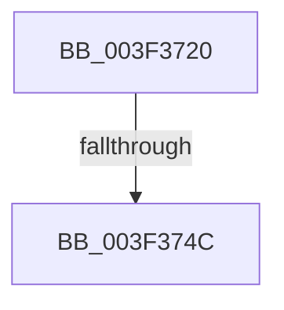

# ExAcquireFastMutexUnsafe

- RVA: `0x003F3720`–`0x003F374F` (길이 `47` bytes)
- VA: `0x00000001403F3720`
- 실행 섹션: `.text`
- PDB 이름 있음: `예`; PDB Function 태그: `아니요`
- unwind 정보 RVA: `0x000970C8`
- 디코드: `13`개 명령, `47/47` bytes 표시
- 미해석 바이트: `0` (있으면 어셈블리에 `.byte`로 보존)

> 이 문서는 커널 이미지의 기계어와 PDB 기호를 분석해 생성했습니다. 4번과 5번은 함수 원형과 자료형을 바이너리 사용 방식에서 추정한 C 해석이며 원본 소스 복구 결과는 아닙니다.

## 1. Dependencies

- 직접 호출 지점: **1**; 고유 호출 대상: **1**
- 직접 호출자로 확인된 함수: **60**
- RIP 상대 이미지 참조: **0**

### Outgoing calls
- `0x003F3739` → [KeAbPreAcquire](../21/KeAbPreAcquire_function_00210230.md) (function, `0x00210230`)

### Direct callers
- [FsRtlpAcknowledgeOplockBreakByCacheFlags](FsRtlpAcknowledgeOplockBreakByCacheFlags_function_003F1988.md) at `0x003F1B1A`
- [KeAcquireGuardedMutexUnsafe](KeAcquireGuardedMutexUnsafe_function_003F2940.md) at `0x003F2944`
- [FsRtlpOplockStoreKeyForDeleteOperation](FsRtlpOplockStoreKeyForDeleteOperation_function_003F2A90.md) at `0x003F2B33`
- [FsRtlCheckOplockEx2](FsRtlCheckOplockEx2_function_003F2BC0.md) at `0x003F2CAD`
- [FsRtlCheckOplockEx2](FsRtlCheckOplockEx2_function_003F2BC0.md) at `0x003F2FDA`
- [ExEnterCriticalRegionAndAcquireFastMutexUnsafe](ExEnterCriticalRegionAndAcquireFastMutexUnsafe_function_003F36F0.md) at `0x003F3705`
- [FsRtlpRequestExclusiveOplock](FsRtlpRequestExclusiveOplock_function_003F3800.md) at `0x003F3866`
- [FsRtlUninitializeOplock](../4E/FsRtlUninitializeOplock_function_004E42C0.md) at `0x004E42F7`
- [FsRtlpRequestShareableOplock](../4E/FsRtlpRequestShareableOplock_function_004E6EC8.md) at `0x004E6F6D`
- [FsRtlCancelNotify](../4E/FsRtlCancelNotify_function_004E7F90.md) at `0x004E8029`
- [FsRtlOplockBreakToNoneEx](../58/FsRtlOplockBreakToNoneEx_function_00581F40.md) at `0x00581FB1`
- [FsRtlOplockGetAnyBreakOwnerProcess](../58/FsRtlOplockGetAnyBreakOwnerProcess_function_005820D0.md) at `0x005820EE`
- [FsRtlpAcknowledgeOplockBreak](../58/FsRtlpAcknowledgeOplockBreak_function_00582144.md) at `0x0058219E`
- [FsRtlpOplockAckTimeoutWorker](../58/FsRtlpOplockAckTimeoutWorker_function_00582950.md) at `0x005829B5`
- [DifExAcquireFastMutexUnsafeWrapper](../61/DifExAcquireFastMutexUnsafeWrapper_function_0061D4A0.md) at `0x0061D566`
- [DifKeAcquireGuardedMutexUnsafeWrapper](../62/DifKeAcquireGuardedMutexUnsafeWrapper_function_0062DFF0.md) at `0x0062E0B6`
- [FsRtlCheckUpperOplock](../../page/71/FsRtlCheckUpperOplock_function_007145F0.md) at `0x00714695`
- [FsRtlpOpBatchBreakClosePending](../../page/71/FsRtlpOpBatchBreakClosePending_function_00714CDC.md) at `0x00714D2F`
- [FsRtlpOplockBreakNotify](../../page/71/FsRtlpOplockBreakNotify_function_00714E10.md) at `0x00714E66`
- [FsRtlNotifyCleanupAll](../../page/71/FsRtlNotifyCleanupAll_function_00716D90.md) at `0x00716DBE`
- [KeStartDynamicProcessor](../../page/74/KeStartDynamicProcessor_function_00746730.md) at `0x00746771`
- [SeRegisterLogonSessionTerminatedRoutine](../../page/7A/SeRegisterLogonSessionTerminatedRoutine_function_007A1200.md) at `0x007A1255`
- [SeRegisterLogonSessionTerminatedRoutineEx](../../page/7A/SeRegisterLogonSessionTerminatedRoutineEx_function_007A12A0.md) at `0x007A12FD`
- [SeUnregisterLogonSessionTerminatedRoutine](../../page/7A/SeUnregisterLogonSessionTerminatedRoutine_function_007A1350.md) at `0x007A1388`
- [SeUnregisterLogonSessionTerminatedRoutineEx](../../page/7A/SeUnregisterLogonSessionTerminatedRoutineEx_function_007A1410.md) at `0x007A1453`
- [SepNotifyFileSystems](../../page/7A/SepNotifyFileSystems_function_007A1910.md) at `0x007A193A`
- [ExpSetBootEntry](../../page/7C/ExpSetBootEntry_function_007CBD2C.md) at `0x007CC189`
- [ExpSetDriverEntry](../../page/7C/ExpSetDriverEntry_function_007CC424.md) at `0x007CC71D`
- [ExpSetFirmwareEnvironmentVariable](../../page/7C/ExpSetFirmwareEnvironmentVariable_function_007CC9A8.md) at `0x007CCA11`
- [NtDeleteBootEntry](../../page/7C/NtDeleteBootEntry_function_007CD2B0.md) at `0x007CD33C`
- [NtDeleteDriverEntry](../../page/7C/NtDeleteDriverEntry_function_007CD440.md) at `0x007CD4CC`
- [NtEnumerateDriverEntries](../../page/7C/NtEnumerateDriverEntries_function_007CD5D0.md) at `0x007CD72B`
- [NtEnumerateSystemEnvironmentValuesEx](../../page/7C/NtEnumerateSystemEnvironmentValuesEx_function_007CDA30.md) at `0x007CDB4B`
- [NtGetEnvironmentVariableEx](../../page/7C/NtGetEnvironmentVariableEx_function_007CDBC0.md) at `0x007CDC21`
- [NtQueryDriverEntryOrder](../../page/7C/NtQueryDriverEntryOrder_function_007CDCE0.md) at `0x007CDE1F`
- [NtQueryEnvironmentVariableInfoEx](../../page/7C/NtQueryEnvironmentVariableInfoEx_function_007CDF00.md) at `0x007CDF60`
- [NtQuerySystemEnvironmentValue](../../page/7C/NtQuerySystemEnvironmentValue_function_007CDFB0.md) at `0x007CE1C6`
- [NtSetBootOptions](../../page/7C/NtSetBootOptions_function_007CE2B0.md) at `0x007CE3D1`
- [NtSetDriverEntryOrder](../../page/7C/NtSetDriverEntryOrder_function_007CE490.md) at `0x007CE5D5`
- [NtSetSystemEnvironmentValue](../../page/7C/NtSetSystemEnvironmentValue_function_007CE650.md) at `0x007CE8FC`
- [CmpPostNotify](../../page/86/CmpPostNotify_function_008645D8.md) at `0x00864658`
- [LOCK_TRANSACTION_LIST](../../page/87/LOCK_TRANSACTION_LIST_function_00874AD4.md) at `0x00874AF0`
- [CmpNotifyTriggerCheck](../../page/8C/CmpNotifyTriggerCheck_function_008C74A4.md) at `0x008C74C3`
- [CmNotifyRunDown](../../page/90/CmNotifyRunDown_function_00906984.md) at `0x009069D9`
- [NtQuerySystemEnvironmentValueEx](../../page/95/NtQuerySystemEnvironmentValueEx_function_00952180.md) at `0x009523B4`
- [ExpGetFirmwareEnvironmentVariable](../../page/95/ExpGetFirmwareEnvironmentVariable_function_009524DC.md) at `0x00952548`
- [LOCK_CM_RM_LIST](../../page/9B/LOCK_CM_RM_LIST_function_009B1490.md) at `0x009B14AC`
- [NtNotifyChangeMultipleKeys](../../page/9D/NtNotifyChangeMultipleKeys_function_009DC6B0.md) at `0x009DCC63`
- [NtNotifyChangeMultipleKeys](../../page/9D/NtNotifyChangeMultipleKeys_function_009DC6B0.md) at `0x009DCF0D`
- [NtNotifyChangeMultipleKeys](../../page/9D/NtNotifyChangeMultipleKeys_function_009DC6B0.md) at `0x009DD0DE`
- [FsRtlpOplockFsctrlInternal](../../page/9F/FsRtlpOplockFsctrlInternal_function_009F1640.md) at `0x009F182A`
- [FsRtlCheckOplockForFsFilterCallback](../../page/9F/FsRtlCheckOplockForFsFilterCallback_function_009F67A0.md) at `0x009F6806`
- [FsRtlCheckOplockForFsFilterCallback](../../page/9F/FsRtlCheckOplockForFsFilterCallback_function_009F67A0.md) at `0x009F698E`
- [FsRtlNotifyFilterReportChange](../../page/A1/FsRtlNotifyFilterReportChange_function_00A1E880.md) at `0x00A1E932`
- [FsRtlNotifyFilterReportChangeLiteEx](../../page/A1/FsRtlNotifyFilterReportChangeLiteEx_function_00A1F2B0.md) at `0x00A1F317`
- [NtEnumerateBootEntries](../../page/A2/NtEnumerateBootEntries_function_00A25040.md) at `0x00A25179`
- [FsRtlNotifyCleanup](../../page/A3/FsRtlNotifyCleanup_function_00A32840.md) at `0x00A32870`
- [FsRtlOplockBreakH2](../../page/A4/FsRtlOplockBreakH2_function_00A44550.md) at `0x00A44656`
- [NtQueryBootEntryOrder](../../page/A9/NtQueryBootEntryOrder_function_00A91720.md) at `0x00A91866`
- [NtSetBootEntryOrder](../../page/A9/NtSetBootEntryOrder_function_00A91930.md) at `0x00A919A9`
- [FsRtlNotifyFilterChangeDirectory](../../page/AA/FsRtlNotifyFilterChangeDirectory_function_00AAB9E0.md) at `0x00AABA2E`
- [NtQueryBootOptions](../../page/AA/NtQueryBootOptions_function_00AAFBC0.md) at `0x00AAFCC1`
- [FsRtlNotifyFilterChangeDirectoryLite](../../page/AD/FsRtlNotifyFilterChangeDirectoryLite_function_00ADC950.md) at `0x00ADC9CB`
- [KeInitSystem](../../init/C7/KeInitSystem_function_00C71660.md) at `0x00C71BEF`

### Static image references
- 디코드된 RIP-relative 메모리 참조가 없습니다.

## 2. Other-region calls and transfers

- 다른 실행 섹션으로 향하는 call: **0**
- call이 아닌 외부 분기/꼬리 이동: **1**
  - `0x003F3746` → [sub_003F37E3](Unknown_function_003F37E3.md) (`tail-transfer`)

## 3. Assembly (complete function range)

```asm
003F3720  40 53                           push rbx
003F3722  55                              push rbp
003F3723  56                              push rsi
003F3724  48 83 EC 30                     sub rsp, 0x30
003F3728  65 48 8B 2C 25 88 01 00 00      mov rbp, qword ptr gs:[0x188]
003F3731  45 33 C0                        xor r8d, r8d
003F3734  33 D2                           xor edx, edx
003F3736  48 8B D9                        mov rbx, rcx
003F3739  E8 F2 CA E1 FF                  call 0x140210230
003F373E  F0 0F BA 33 00                  lock btr dword ptr [rbx], 0
003F3743  48 8B F0                        mov rsi, rax
003F3746  0F 82 97 00 00 00               jb 0x1403f37e3
003F374C  FF 43 10                        inc dword ptr [rbx + 0x10]
```

## 4. C-style interpretation (structured pseudocode)

```c
__int64 __fastcall ExAcquireFastMutexUnsafe(__int64 a1, int a2, int a3)
{
    __int64 result;
    __int64 v_rsp;

    v_rsp = (v_rsp) - (48);
    a3 = 0;
    a2 = 0;
    result = KeAbPreAcquire(a1, a2, a3, a4);
    return result;
}
```

## 5. (Beta) C Style

```c
int64_t ExAcquireFastMutexUnsafe(void *Arg1, int32_t Arg2, int32_t Arg3)
{
    uint8_t *arg1 = (uint8_t *)Arg1;

    int64_t result;
    int64_t local_rsp;

    local_rsp = (local_rsp) - (48);
    Arg3 = 0;
    Arg2 = 0;
    result = KeAbPreAcquire(Arg1, Arg2, Arg3, a4);
    return result;
}
```

### 관측된 메모리 오프셋

구조체 형식이 확인되지 않은 접근은 인자 기준의 오프셋으로만 기록했습니다.

| 기준 인자 | 오프셋 표현 | 폭 (bit) | 접근 |
|---|---:|---:|---|
| `Arg1` | `+ 0x0` | `32` | `R/W` |
| `Arg1` | `+ 0x10` | `32` | `R/W` |

## 6. Execution-region graph

[열기: 2D/3D 그래프와 함수 탐색 컨트롤 패널](../../../control-panel.html?section=text&rva=0x003F3720&view=graph)

- 2D 그래프는 위에서 아래로 흐르고, 3D 그래프는 빈 공간을 드래그해 회전합니다. Shift+드래그는 이동, 휠은 확대·축소, 함수 노드 선택은 대상 보고서 이동입니다.

### Static fallback


