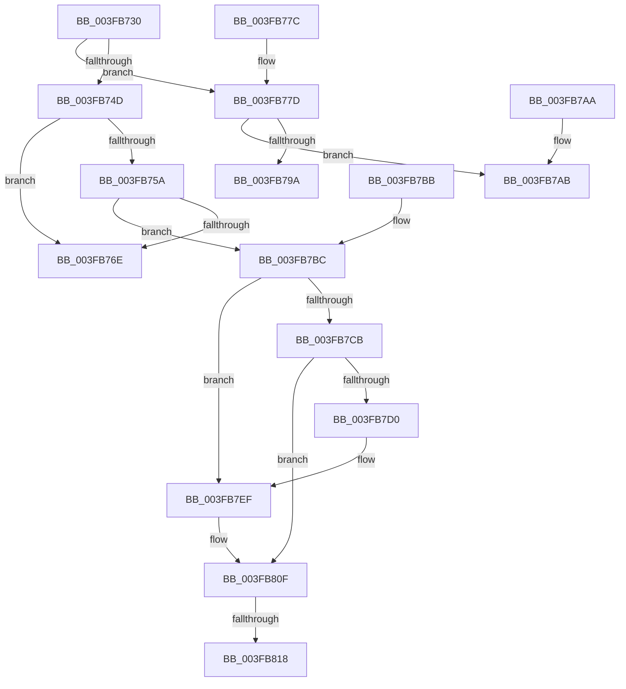

# ExAllocateFromPagedLookasideList

- RVA: `0x003FB730`–`0x003FB834` (길이 `260` bytes)
- VA: `0x00000001403FB730`
- 실행 섹션: `.text`
- PDB 이름 있음: `예`; PDB Function 태그: `아니요`
- unwind 정보 RVA: `0x000985EC`
- 디코드: `72`개 명령, `260/260` bytes 표시
- 미해석 바이트: `0` (있으면 어셈블리에 `.byte`로 보존)

> 이 문서는 커널 이미지의 기계어와 PDB 기호를 분석해 생성했습니다. 4번과 5번은 함수 원형과 자료형을 바이너리 사용 방식에서 추정한 C 해석이며 원본 소스 복구 결과는 아닙니다.

## 1. Dependencies

- 직접 호출 지점: **6**; 고유 호출 대상: **4**
- 직접 호출자로 확인된 함수: **17**
- RIP 상대 이미지 참조: **3**

### Outgoing calls
- `0x003FB740` → [ExpInterlockedPopEntrySList](../6B/ExpInterlockedPopEntrySList_function_006BA570.md) (function, `0x006BA570`)
- `0x003FB79A` → [guard_dispatch_icall](../6B/guard_dispatch_icall_function_006BAAD0.md) (function, `0x006BAAD0`)
- `0x003FB7AB` → [AlpcpAllocateMessageFunction](../../page/89/AlpcpAllocateMessageFunction_function_00892FF0.md) (function, `0x00892FF0`)
- `0x003FB7E9` → [KeBugCheckEx](../4F/KeBugCheckEx_function_004FD660.md) (function, `0x004FD660`)
- `0x003FB809` → [KeBugCheckEx](../4F/KeBugCheckEx_function_004FD660.md) (function, `0x004FD660`)
- `0x003FB82E` → [KeBugCheckEx](../4F/KeBugCheckEx_function_004FD660.md) (function, `0x004FD660`)

### Direct callers
- [FsRtlTruncateBaseMcb](FsRtlTruncateBaseMcb_function_003FB460.md) at `0x003FB551`
- [FsRtlAllocateFileLock](FsRtlAllocateFileLock_function_003FB5F0.md) at `0x003FB607`
- [FsRtlInitializeBaseMcbEx](FsRtlInitializeBaseMcbEx_function_003FB6B0.md) at `0x003FB6DA`
- [HashpHashMemory](../../page/84/HashpHashMemory_function_008419AC.md) at `0x008419E6`
- [HashpVerifyPkcs1Signature](../../page/84/HashpVerifyPkcs1Signature_function_00841C68.md) at `0x00841CDE`
- [AlpcpSendMessage](../../page/88/AlpcpSendMessage_function_0088BD40.md) at `0x0088C2A7`
- [AlpcpAllocateBlob](../../page/89/AlpcpAllocateBlob_function_008925B0.md) at `0x008925D9`
- [AlpcpAllocateMessage](../../page/89/AlpcpAllocateMessage_function_008926C0.md) at `0x008926F4`
- [FsRtlAllocateExtraCreateParameterFromLookasideList](../../page/8A/FsRtlAllocateExtraCreateParameterFromLookasideList_function_008A1CD0.md) at `0x008A1D1D`
- [IopSymlinkAllocateAndAddECP](../../page/8A/IopSymlinkAllocateAndAddECP_function_008A1E20.md) at `0x008A1EC1`
- [PspCreateUserProcessEcp](../../page/8A/PspCreateUserProcessEcp_function_008A2288.md) at `0x008A22D0`
- [AlpcInitializeHandleTable](../../page/92/AlpcInitializeHandleTable_function_00925D70.md) at `0x00925D89`
- [FsRtlAddToTunnelCacheEx](../../page/93/FsRtlAddToTunnelCacheEx_function_00937C00.md) at `0x00937F69`
- [FsRtlAllocateExtraCreateParameterList](../../page/9D/FsRtlAllocateExtraCreateParameterList_function_009D6200.md) at `0x009D621C`
- [WmipAllocEntry](../../page/9D/WmipAllocEntry_function_009DDF70.md) at `0x009DDF80`
- [RtlpCopyRangeListEntry](../../page/A6/RtlpCopyRangeListEntry_function_00A69720.md) at `0x00A69743`
- [RtlpCopyRangeListEntry](../../page/A6/RtlpCopyRangeListEntry_function_00A69720.md) at `0x00A697C5`
- [RtlAddRange](../../page/A8/RtlAddRange_function_00A8E860.md) at `0x00A8E894`

### Static image references
- `0x003FB74D` → RVA `0x00475D80` (`CmSiFreeMemory`; read)
- `0x003FB765` → RVA `0x00FCEC68` (`ALMOSTRO`; read)
- `0x003FB780` → RVA `0x00892FF0` (`AlpcpAllocateMessageFunction`; read)

## 2. Other-region calls and transfers

- 다른 실행 섹션으로 향하는 call: **1**
  - `0x003FB7AB` → [AlpcpAllocateMessageFunction](../../page/89/AlpcpAllocateMessageFunction_function_00892FF0.md) (`.text` → `PAGE`)
- call이 아닌 외부 분기/꼬리 이동: **1**
  - `0x003FB816` → [sub_003FB834](Unknown_function_003FB834.md) (`tail-transfer`)

## 3. Assembly (complete function range)

```asm
003FB730  48 89 5C 24 18                  mov qword ptr [rsp + 0x18], rbx
003FB735  57                              push rdi
003FB736  48 83 EC 30                     sub rsp, 0x30
003FB73A  FF 41 14                        inc dword ptr [rcx + 0x14]
003FB73D  48 8B D9                        mov rbx, rcx
003FB740  E8 2B EE 2B 00                  call 0x1406ba570
003FB745  48 8B F8                        mov rdi, rax
003FB748  48 85 C0                        test rax, rax
003FB74B  74 30                           je 0x1403fb77d
003FB74D  48 8D 05 2C A6 07 00            lea rax, [rip + 0x7a62c]
003FB754  48 39 43 38                     cmp qword ptr [rbx + 0x38], rax
003FB758  75 14                           jne 0x1403fb76e
003FB75A  8B 5B 2C                        mov ebx, dword ptr [rbx + 0x2c]
003FB75D  48 8D 4F 08                     lea rcx, [rdi + 8]
003FB761  48 83 EB 08                     sub rbx, 8
003FB765  80 3D FC 34 BD 00 00            cmp byte ptr [rip + 0xbd34fc], 0
003FB76C  75 4E                           jne 0x1403fb7bc
003FB76E  48 8B C7                        mov rax, rdi
003FB771  48 8B 5C 24 50                  mov rbx, qword ptr [rsp + 0x50]
003FB776  48 83 C4 30                     add rsp, 0x30
003FB77A  5F                              pop rdi
003FB77B  C3                              ret
003FB77C  CC                              int3
003FB77D  FF 43 18                        inc dword ptr [rbx + 0x18]
003FB780  4C 8D 0D 69 78 49 00            lea r9, [rip + 0x497869]
003FB787  48 8B 43 30                     mov rax, qword ptr [rbx + 0x30]
003FB78B  44 8B 43 28                     mov r8d, dword ptr [rbx + 0x28]
003FB78F  8B 53 2C                        mov edx, dword ptr [rbx + 0x2c]
003FB792  8B 4B 24                        mov ecx, dword ptr [rbx + 0x24]
003FB795  49 3B C1                        cmp rax, r9
003FB798  74 11                           je 0x1403fb7ab
003FB79A  E8 31 F3 2B 00                  call 0x1406baad0
003FB79F  48 8B 5C 24 50                  mov rbx, qword ptr [rsp + 0x50]
003FB7A4  48 83 C4 30                     add rsp, 0x30
003FB7A8  5F                              pop rdi
003FB7A9  C3                              ret
003FB7AA  CC                              int3
003FB7AB  E8 40 78 49 00                  call 0x140892ff0
003FB7B0  48 8B 5C 24 50                  mov rbx, qword ptr [rsp + 0x50]
003FB7B5  48 83 C4 30                     add rsp, 0x30
003FB7B9  5F                              pop rdi
003FB7BA  C3                              ret
003FB7BB  CC                              int3
003FB7BC  48 B8 00 00 00 00 00 80 FF FF   movabs rax, 0xffff800000000000
003FB7C6  48 3B C8                        cmp rcx, rax
003FB7C9  72 24                           jb 0x1403fb7ef
003FB7CB  F6 C1 07                        test cl, 7
003FB7CE  74 3F                           je 0x1403fb80f
003FB7D0  BA 02 00 00 00                  mov edx, 2
003FB7D5  48 C7 44 24 20 08 00 00 00      mov qword ptr [rsp + 0x20], 8
003FB7DE  4C 8B C9                        mov r9, rcx
003FB7E1  44 8B C2                        mov r8d, edx
003FB7E4  B9 F1 01 00 00                  mov ecx, 0x1f1
003FB7E9  E8 72 1E 10 00                  call 0x1404fd660
003FB7EE  CC                              int3
003FB7EF  BA 02 00 00 00                  mov edx, 2
003FB7F4  48 C7 44 24 20 00 00 00 00      mov qword ptr [rsp + 0x20], 0
003FB7FD  4C 8B C9                        mov r9, rcx
003FB800  B9 F1 01 00 00                  mov ecx, 0x1f1
003FB805  44 8D 42 FF                     lea r8d, [rdx - 1]
003FB809  E8 52 1E 10 00                  call 0x1404fd660
003FB80E  CC                              int3
003FB80F  48 8D 04 19                     lea rax, [rcx + rbx]
003FB813  48 3B C1                        cmp rax, rcx
003FB816  73 1C                           jae 0x1403fb834
003FB818  BA 02 00 00 00                  mov edx, 2
003FB81D  48 89 5C 24 20                  mov qword ptr [rsp + 0x20], rbx
003FB822  4C 8B C9                        mov r9, rcx
003FB825  B9 F1 01 00 00                  mov ecx, 0x1f1
003FB82A  44 8D 42 01                     lea r8d, [rdx + 1]
003FB82E  E8 2D 1E 10 00                  call 0x1404fd660
003FB833  CC                              int3
```

## 4. C-style interpretation (structured pseudocode)

```c
__int64 __fastcall ExAllocateFromPagedLookasideList(__int64 a1)
{
    __int64 result;
    __int64 v_rbx;
    __int64 v_rsp;
    unsigned __int64 v_stack_p18;
    unsigned __int64 v_stack_p50;
    unsigned __int64 v_stack_p88;
    unsigned __int64 v_stack_p90;

    v_stack_p18 = v_rbx;
    v_rsp = (v_rsp) - (48);
    result = ExpInterlockedPopEntrySList(a1, a2, a3, a4);
    if (result == 0) goto loc_003FB77D;
    if ((*(unsigned __int64 *)(a1 + 56)) != (v_rip + 501292)) goto loc_003FB76E;
    v_rbx = ((unsigned int)(*(unsigned int *)(a1 + 44))) - (8);
    if ((*(unsigned __int8 *)(v_rip + 12399868)) != 0) goto loc_003FB7BC;
loc_003FB76E:
    v_rsp = (v_rsp) + (48);
    return result;
loc_003FB77D:
    if ((*(unsigned __int64 *)(v_stack_p18 + 48)) == (v_rip + 4814953)) goto loc_003FB7AB;
    result = guard_dispatch_icall((unsigned int)(*(unsigned int *)(v_stack_p18 + 36)), (unsigned int)(*(unsigned int *)(v_stack_p18 + 44)), (unsigned int)(*(unsigned int *)(v_stack_p18 + 40)), v_rip + 4814953);
    v_rsp = (v_rsp) + (48);
    return result;
loc_003FB7AB:
    result = AlpcpAllocateMessageFunction((unsigned int)(*(unsigned int *)(v_stack_p18 + 36)), (unsigned int)(*(unsigned int *)(v_stack_p18 + 44)), (unsigned int)(*(unsigned int *)(v_stack_p18 + 40)), v_rip + 4814953);
    v_rsp = (v_rsp) + (48);
    return result;
loc_003FB7BC:
    if (((unsigned int)(*(unsigned int *)(v_stack_p18 + 36))) < result) goto loc_003FB7EF;
    if ((((unsigned __int8)((unsigned int)(*(unsigned int *)(v_stack_p18 + 36)))) & (7)) == 0) goto loc_003FB80F;
    v_stack_p90 = 8;
    result = KeBugCheckEx(497, 2, 2, (unsigned int)(*(unsigned int *)(v_stack_p18 + 36)));
loc_003FB7EF:
    v_stack_p90 = 0;
    result = KeBugCheckEx(497, 2, 2 - 1, 497);
loc_003FB80F:
    v_stack_p90 = v_stack_p88;
    result = KeBugCheckEx(497, 2, 2 + 1, 497);
    return result;
}
```

## 5. (Beta) C Style

```c
int64_t ExAllocateFromPagedLookasideList(void *Arg1)
{
    uint8_t *arg1 = (uint8_t *)Arg1;

    int64_t result;
    int64_t local_rbx;
    int64_t local_rsp;
    uint64_t v_stack_p18;
    uint64_t v_stack_p50;
    uint64_t v_stack_p88;
    uint64_t v_stack_p90;

    v_stack_p18 = local_rbx;
    local_rsp = (local_rsp) - (48);
    result = ExpInterlockedPopEntrySList(Arg1, a2, a3, a4);
    if (result == 0) goto loc_003FB77D;
    if ((*(uint64_t *)(arg1 + 0x38)) != (v_rip + 501292)) goto loc_003FB76E;
    local_rbx = ((uint32_t)(*(uint32_t *)(arg1 + 0x2C))) - (8);
    if ((*(uint8_t *)(v_rip + 0xBD34FC)) != 0) goto loc_003FB7BC;
loc_003FB76E:
    local_rsp = (local_rsp) + (48);
    return result;
loc_003FB77D:
    if ((*(uint64_t *)(v_stack_p18 + 0x30)) == (v_rip + 4814953)) goto loc_003FB7AB;
    result = guard_dispatch_icall((uint32_t)(*(uint32_t *)(v_stack_p18 + 0x24)), (uint32_t)(*(uint32_t *)(v_stack_p18 + 0x2C)), (uint32_t)(*(uint32_t *)(v_stack_p18 + 0x28)), v_rip + 4814953);
    local_rsp = (local_rsp) + (48);
    return result;
loc_003FB7AB:
    result = AlpcpAllocateMessageFunction((uint32_t)(*(uint32_t *)(v_stack_p18 + 0x24)), (uint32_t)(*(uint32_t *)(v_stack_p18 + 0x2C)), (uint32_t)(*(uint32_t *)(v_stack_p18 + 0x28)), v_rip + 4814953);
    local_rsp = (local_rsp) + (48);
    return result;
loc_003FB7BC:
    if (((uint32_t)(*(uint32_t *)(v_stack_p18 + 0x24))) < result) goto loc_003FB7EF;
    if ((((uint8_t)((uint32_t)(*(uint32_t *)(v_stack_p18 + 0x24)))) & (7)) == 0) goto loc_003FB80F;
    v_stack_p90 = 8;
    result = KeBugCheckEx(497, 2, 2, (uint32_t)(*(uint32_t *)(v_stack_p18 + 0x24)));
loc_003FB7EF:
    v_stack_p90 = 0;
    result = KeBugCheckEx(497, 2, 2 - 1, 497);
loc_003FB80F:
    v_stack_p90 = v_stack_p88;
    result = KeBugCheckEx(497, 2, 2 + 1, 497);
    return result;
}
```

### 관측된 메모리 오프셋

구조체 형식이 확인되지 않은 접근은 인자 기준의 오프셋으로만 기록했습니다.

| 기준 인자 | 오프셋 표현 | 폭 (bit) | 접근 |
|---|---:|---:|---|
| `Arg1` | `+ 0x14` | `32` | `R/W` |
| `Arg1` | `+ 0x18` | `32` | `R/W` |
| `Arg1` | `+ 0x24` | `32` | `R` |
| `Arg1` | `+ 0x28` | `32` | `R` |
| `Arg1` | `+ 0x2C` | `32` | `R` |
| `Arg1` | `+ 0x30` | `64` | `R` |
| `Arg1` | `+ 0x38` | `64` | `R` |

## 6. Execution-region graph

[열기: 2D/3D 그래프와 함수 탐색 컨트롤 패널](../../../control-panel.html?section=text&rva=0x003FB730&view=graph)

- 2D 그래프는 위에서 아래로 흐르고, 3D 그래프는 빈 공간을 드래그해 회전합니다. Shift+드래그는 이동, 휠은 확대·축소, 함수 노드 선택은 대상 보고서 이동입니다.

### Static fallback


