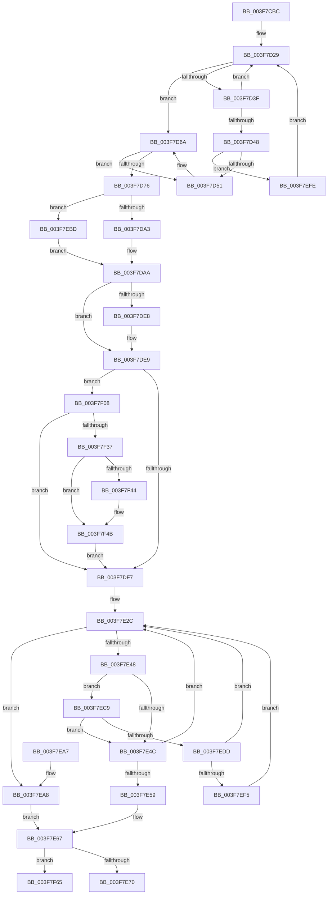

# ExRemovePoolTag

- RVA: `0x003F7CBC`–`0x003F7F7B` (길이 `703` bytes)
- VA: `0x00000001403F7CBC`
- 실행 섹션: `.text`
- PDB 이름 있음: `예`; PDB Function 태그: `예`
- unwind 정보 RVA: `0x00098278`
- 디코드: `184`개 명령, `703/703` bytes 표시
- 미해석 바이트: `0` (있으면 어셈블리에 `.byte`로 보존)

> 이 문서는 커널 이미지의 기계어와 PDB 기호를 분석해 생성했습니다. 4번과 5번은 함수 원형과 자료형을 바이너리 사용 방식에서 추정한 C 해석이며 원본 소스 복구 결과는 아닙니다.

## 1. Dependencies

- 직접 호출 지점: **8**; 고유 호출 대상: **8**
- 직접 호출자로 확인된 함수: **1**
- RIP 상대 이미지 참조: **9**

### Outgoing calls
- `0x003F7CF5` → [ExAcquireSpinLockShared](../24/ExAcquireSpinLockShared_function_0024DCE0.md) (function, `0x0024DCE0`)
- `0x003F7D64` → [KeBugCheckEx](../4F/KeBugCheckEx_function_004FD660.md) (function, `0x004FD660`)
- `0x003F7DBF` → [ExReleaseSpinLockShared](../2F/ExReleaseSpinLockShared_function_002F0EF0.md) (function, `0x002F0EF0`)
- `0x003F7E62` → [ExpRemovePoolTrackerExpansion](../36/ExpRemovePoolTrackerExpansion_function_00361300.md) (function, `0x00361300`)
- `0x003F7E8A` → [ExpFreePoolChecks](../35/ExpFreePoolChecks_function_0035F4F0.md) (function, `0x0035F4F0`)
- `0x003F7EB6` → [ExpPoolTrackerReturnLimit](../36/ExpPoolTrackerReturnLimit_function_00361570.md) (function, `0x00361570`)
- `0x003F7F2A` → [ExpPoolFlagsToPoolType](../../poolcode/B8/ExpPoolFlagsToPoolType_function_00B84080.md) (function, `0x00B84080`)
- `0x003F7F5B` → [EtwTracePool](../2E/EtwTracePool_function_002ECEEC.md) (function, `0x002ECEEC`)

### Direct callers
- [MmFreeContiguousMemory](MmFreeContiguousMemory_function_003F6F60.md) at `0x003F6FF0`

### Static image references
- `0x003F7CE0` → RVA `0x00EFACF8` (`.data`; read)
- `0x003F7CFA` → RVA `0x00EFED38` (`.data`; read)
- `0x003F7D29` → RVA `0x00EFED30` (`.data`; read)
- `0x003F7DAA` → RVA `0x00FCF100` (`CACHEALI`; read/write)
- `0x003F7DC8` → RVA `0x00FC514C` (`ALMOSTRO`; read)
- `0x003F7DE9` → RVA `0x00FC6B04` (`ALMOSTRO`; read)
- `0x003F7DFF` → RVA `0x00EFAD20` (`.data`; read)
- `0x003F7E06` → RVA `0x00EFED58` (`.data`; read)
- `0x003F7EC9` → RVA `0x00EFED60` (`.data`; read)

## 2. Other-region calls and transfers

- 다른 실행 섹션으로 향하는 call: **1**
  - `0x003F7F2A` → [ExpPoolFlagsToPoolType](../../poolcode/B8/ExpPoolFlagsToPoolType_function_00B84080.md) (`.text` → `POOLCODE`)
- call이 아닌 외부 분기/꼬리 이동: **1**
  - `0x003F7F76` → [sub_006EB9F2](../6E/Unknown_function_006EB9F2.md) (`tail-transfer`)

## 3. Assembly (complete function range)

```asm
003F7CBC  48 89 5C 24 18                  mov qword ptr [rsp + 0x18], rbx
003F7CC1  48 89 54 24 10                  mov qword ptr [rsp + 0x10], rdx
003F7CC6  55                              push rbp
003F7CC7  56                              push rsi
003F7CC8  57                              push rdi
003F7CC9  41 54                           push r12
003F7CCB  41 55                           push r13
003F7CCD  41 56                           push r14
003F7CCF  41 57                           push r15
003F7CD1  48 83 EC 40                     sub rsp, 0x40
003F7CD5  41 8B 01                        mov eax, dword ptr [r9]
003F7CD8  48 8B F1                        mov rsi, rcx
003F7CDB  25 C0 01 00 00                  and eax, 0x1c0
003F7CE0  48 8D 0D 11 30 B0 00            lea rcx, [rip + 0xb03011]
003F7CE7  48 89 44 24 38                  mov qword ptr [rsp + 0x38], rax
003F7CEC  49 8B F9                        mov rdi, r9
003F7CEF  4D 8B F8                        mov r15, r8
003F7CF2  4C 8B E2                        mov r12, rdx
003F7CF5  E8 E6 5F E5 FF                  call 0x14024dce0
003F7CFA  4C 8B 15 37 70 B0 00            mov r10, qword ptr [rip + 0xb07037]
003F7D01  4C 8B C6                        mov r8, rsi
003F7D04  49 C1 E8 0C                     shr r8, 0xc
003F7D08  44 8A D8                        mov r11b, al
003F7D0B  49 69 C8 5F 9E 00 00            imul rcx, r8, 0x9e5f
003F7D12  41 B9 01 00 00 00               mov r9d, 1
003F7D18  48 8B D1                        mov rdx, rcx
003F7D1B  48 C1 EA 20                     shr rdx, 0x20
003F7D1F  33 D1                           xor edx, ecx
003F7D21  41 8D 4A FF                     lea ecx, [r10 - 1]
003F7D25  23 D1                           and edx, ecx
003F7D27  33 DB                           xor ebx, ebx
003F7D29  48 8B 05 00 70 B0 00            mov rax, qword ptr [rip + 0xb07000]
003F7D30  8B CA                           mov ecx, edx
003F7D32  48 C1 E1 05                     shl rcx, 5
003F7D36  48 8B 04 01                     mov rax, qword ptr [rcx + rax]
003F7D3A  48 3B C6                        cmp rax, rsi
003F7D3D  74 2B                           je 0x1403f7d6a
003F7D3F  FF C2                           inc edx
003F7D41  8B C2                           mov eax, edx
003F7D43  49 3B C2                        cmp rax, r10
003F7D46  72 E1                           jb 0x1403f7d29
003F7D48  45 85 C9                        test r9d, r9d
003F7D4B  0F 85 AD 01 00 00               jne 0x1403f7efe
003F7D51  44 8B 0F                        mov r9d, dword ptr [rdi]
003F7D54  BA 22 00 00 00                  mov edx, 0x22
003F7D59  4C 8B C6                        mov r8, rsi
003F7D5C  48 89 5C 24 20                  mov qword ptr [rsp + 0x20], rbx
003F7D61  8D 4A F7                        lea ecx, [rdx - 9]
003F7D64  E8 F7 58 10 00                  call 0x1404fd660
003F7D69  CC                              int3
003F7D6A  48 8B 15 BF 6F B0 00            mov rdx, qword ptr [rip + 0xb06fbf]
003F7D71  48 03 D1                        add rdx, rcx
003F7D74  74 DB                           je 0x1403f7d51
003F7D76  8B 4A 08                        mov ecx, dword ptr [rdx + 8]
003F7D79  44 8B 72 0C                     mov r14d, dword ptr [rdx + 0xc]
003F7D7D  41 8B C6                        mov eax, r14d
003F7D80  48 8B 6A 10                     mov rbp, qword ptr [rdx + 0x10]
003F7D84  48 C1 E8 08                     shr rax, 8
003F7D88  25 FF 0F 00 00                  and eax, 0xfff
003F7D8D  41 89 0C 24                     mov dword ptr [r12], ecx
003F7D91  48 89 07                        mov qword ptr [rdi], rax
003F7D94  49 89 2F                        mov qword ptr [r15], rbp
003F7D97  81 F9 50 6F 6F 6C               cmp ecx, 0x6c6f6f50
003F7D9D  0F 84 1A 01 00 00               je 0x1403f7ebd
003F7DA3  45 8A FE                        mov r15b, r14b
003F7DA6  41 C1 EE 14                     shr r14d, 0x14
003F7DAA  F0 FF 0D 4F 73 BD 00            lock dec dword ptr [rip + 0xbd734f]
003F7DB1  F0 48 FF 02                     lock inc qword ptr [rdx]
003F7DB5  41 8A D3                        mov dl, r11b
003F7DB8  48 8D 0D 39 2F B0 00            lea rcx, [rip + 0xb02f39]
003F7DBF  E8 2C 91 EF FF                  call 0x1402f0ef0
003F7DC4  45 8B 24 24                     mov r12d, dword ptr [r12]
003F7DC8  8B 05 7E D3 BC 00               mov eax, dword ptr [rip + 0xbcd37e]
003F7DCE  48 8B 3F                        mov rdi, qword ptr [rdi]
003F7DD1  89 5C 24 30                     mov dword ptr [rsp + 0x30], ebx
003F7DD5  88 9C 24 80 00 00 00            mov byte ptr [rsp + 0x80], bl
003F7DDC  88 9C 24 98 00 00 00            mov byte ptr [rsp + 0x98], bl
003F7DE3  44 3B E0                        cmp r12d, eax
003F7DE6  75 01                           jne 0x1403f7de9
003F7DE8  CC                              int3
003F7DE9  8B 05 15 ED BC 00               mov eax, dword ptr [rip + 0xbced15]
003F7DEF  A8 41                           test al, 0x41
003F7DF1  0F 85 11 01 00 00               jne 0x1403f7f08
003F7DF7  65 8B 04 25 A4 01 00 00         mov eax, dword ptr gs:[0x1a4]
003F7DFF  4C 8D 2D 1A 2F B0 00            lea r13, [rip + 0xb02f1a]
003F7E06  4C 8B 15 4B 6F B0 00            mov r10, qword ptr [rip + 0xb06f4b]
003F7E0D  48 83 E7 FB                     and rdi, 0xfffffffffffffffb
003F7E11  49 69 CC 5F 9E 00 00            imul rcx, r12, 0x9e5f
003F7E18  4D 8B 6C C5 00                  mov r13, qword ptr [r13 + rax*8]
003F7E1D  48 8B D1                        mov rdx, rcx
003F7E20  48 C1 EA 20                     shr rdx, 0x20
003F7E24  33 D1                           xor edx, ecx
003F7E26  41 23 D2                        and edx, r10d
003F7E29  44 8B DA                        mov r11d, edx
003F7E2C  8B C2                           mov eax, edx
003F7E2E  48 8D 0C 80                     lea rcx, [rax + rax*4]
003F7E32  48 03 C9                        add rcx, rcx
003F7E35  4C 8D 04 CD 00 00 00 00         lea r8, [rcx*8]
003F7E3D  4D 03 C5                        add r8, r13
003F7E40  41 8B 00                        mov eax, dword ptr [r8]
003F7E43  41 3B C4                        cmp eax, r12d
003F7E46  74 60                           je 0x1403f7ea8
003F7E48  85 C0                           test eax, eax
003F7E4A  74 7D                           je 0x1403f7ec9
003F7E4C  8D 42 01                        lea eax, [rdx + 1]
003F7E4F  41 23 C2                        and eax, r10d
003F7E52  8B D0                           mov edx, eax
003F7E54  41 3B C3                        cmp eax, r11d
003F7E57  75 D3                           jne 0x1403f7e2c
003F7E59  4C 8B C7                        mov r8, rdi
003F7E5C  48 8B D5                        mov rdx, rbp
003F7E5F  41 8B CC                        mov ecx, r12d
003F7E62  E8 99 94 F6 FF                  call 0x140361300
003F7E67  45 84 FF                        test r15b, r15b
003F7E6A  0F 85 F5 00 00 00               jne 0x1403f7f65
003F7E70  48 8B 94 24 88 00 00 00         mov rdx, qword ptr [rsp + 0x88]
003F7E78  4C 8B C5                        mov r8, rbp
003F7E7B  4C 8B 4C 24 38                  mov r9, qword ptr [rsp + 0x38]
003F7E80  48 8B CE                        mov rcx, rsi
003F7E83  48 89 74 24 20                  mov qword ptr [rsp + 0x20], rsi
003F7E88  8B 12                           mov edx, dword ptr [rdx]
003F7E8A  E8 61 76 F6 FF                  call 0x14035f4f0
003F7E8F  48 8B 9C 24 90 00 00 00         mov rbx, qword ptr [rsp + 0x90]
003F7E97  48 83 C4 40                     add rsp, 0x40
003F7E9B  41 5F                           pop r15
003F7E9D  41 5E                           pop r14
003F7E9F  41 5D                           pop r13
003F7EA1  41 5C                           pop r12
003F7EA3  5F                              pop rdi
003F7EA4  5E                              pop rsi
003F7EA5  5D                              pop rbp
003F7EA6  C3                              ret
003F7EA7  CC                              int3
003F7EA8  48 C1 EF 08                     shr rdi, 8
003F7EAC  48 8B D5                        mov rdx, rbp
003F7EAF  F7 D7                           not edi
003F7EB1  83 E7 01                        and edi, 1
003F7EB4  8B CF                           mov ecx, edi
003F7EB6  E8 B5 96 F6 FF                  call 0x140361570
003F7EBB  EB AA                           jmp 0x1403f7e67
003F7EBD  44 8A FB                        mov r15b, bl
003F7EC0  44 0F B7 F3                     movzx r14d, bx
003F7EC4  E9 E1 FE FF FF                  jmp 0x1403f7daa
003F7EC9  48 8B 05 90 6E B0 00            mov rax, qword ptr [rip + 0xb06e90]
003F7ED0  44 8B 0C C8                     mov r9d, dword ptr [rax + rcx*8]
003F7ED4  45 85 C9                        test r9d, r9d
003F7ED7  0F 84 6F FF FF FF               je 0x1403f7e4c
003F7EDD  45 89 08                        mov dword ptr [r8], r9d
003F7EE0  48 8B 05 79 6E B0 00            mov rax, qword ptr [rip + 0xb06e79]
003F7EE7  4C 8B 4C C8 48                  mov r9, qword ptr [rax + rcx*8 + 0x48]
003F7EEC  4D 85 C9                        test r9, r9
003F7EEF  0F 84 37 FF FF FF               je 0x1403f7e2c
003F7EF5  4D 89 48 48                     mov qword ptr [r8 + 0x48], r9
003F7EF9  E9 2E FF FF FF                  jmp 0x1403f7e2c
003F7EFE  8B D3                           mov edx, ebx
003F7F00  44 8B CB                        mov r9d, ebx
003F7F03  E9 21 FE FF FF                  jmp 0x1403f7d29
003F7F08  8B D7                           mov edx, edi
003F7F0A  48 8D 84 24 98 00 00 00         lea rax, [rsp + 0x98]
003F7F12  83 E2 10                        and edx, 0x10
003F7F15  48 89 44 24 20                  mov qword ptr [rsp + 0x20], rax
003F7F1A  4C 8D 8C 24 80 00 00 00         lea r9, [rsp + 0x80]
003F7F22  48 8B CF                        mov rcx, rdi
003F7F25  4C 8D 44 24 30                  lea r8, [rsp + 0x30]
003F7F2A  E8 51 C1 78 00                  call 0x140b84080
003F7F2F  85 C0                           test eax, eax
003F7F31  0F 88 C0 FE FF FF               js 0x1403f7df7
003F7F37  8B 54 24 30                     mov edx, dword ptr [rsp + 0x30]
003F7F3B  38 9C 24 80 00 00 00            cmp byte ptr [rsp + 0x80], bl
003F7F42  74 07                           je 0x1403f7f4b
003F7F44  83 CA 08                        or edx, 8
003F7F47  89 54 24 30                     mov dword ptr [rsp + 0x30], edx
003F7F4B  B9 22 0E 00 00                  mov ecx, 0xe22
003F7F50  48 89 6C 24 20                  mov qword ptr [rsp + 0x20], rbp
003F7F55  4C 8B CE                        mov r9, rsi
003F7F58  45 8B C4                        mov r8d, r12d
003F7F5B  E8 8C 4F EF FF                  call 0x1402eceec
003F7F60  E9 92 FE FF FF                  jmp 0x1403f7df7
003F7F65  41 0F B7 C6                     movzx eax, r14w
003F7F69  4C 8B CD                        mov r9, rbp
003F7F6C  4C 2B C8                        sub r9, rax
003F7F6F  41 0F B7 C6                     movzx eax, r14w
003F7F73  4C 03 CE                        add r9, rsi
003F7F76  E9 77 3A 2F 00                  jmp 0x1406eb9f2
```

## 4. C-style interpretation (structured pseudocode)

```c
__int64 __fastcall ExRemovePoolTag(__int64 a1, __int64 a2, __int64 a3, __int64 a4)
{
    __int64 result;
    __int64 v_r14;
    __int64 v_rbx;
    __int64 v_rdi;
    __int64 v_rsp;
    unsigned __int64 v_stack_m40;
    unsigned int v_stack_m48;
    unsigned __int64 v_stack_m58;
    unsigned __int64 v_stack_p10;
    unsigned __int64 v_stack_p18;
    unsigned __int8 v_stack_p20;
    unsigned __int64 v_stack_p30;
    unsigned __int8 v_stack_p8;
    unsigned __int64 v_stack_p80;
    unsigned __int64 v_stack_p98;

    v_stack_p18 = v_rbx;
    v_stack_p10 = a2;
    v_rsp = (v_rsp) - (64);
    result = (unsigned int)(((unsigned int)(*(unsigned int *)(a4))) & (448));
    v_stack_m40 = result;
    result = ExAcquireSpinLockShared(v_rip + 11546641, a2, a3, a4);
    a3 = (a1) >> (12);
    a1 = (v_rip + 11546641) * (a3);
    a2 = (a1) >> (32);
    a2 = (unsigned int)((a2) ^ ((unsigned int)(a1)));
    a2 = (unsigned int)((a2) & ((unsigned int)(*(unsigned __int64 *)(v_rip + 11563063) - 1)));
    v_rbx = 0;
loc_003F7D29:
    a1 = ((unsigned int)((unsigned int)(a2))) << (5);
    if ((*(unsigned __int64 *)(a1 + *(unsigned __int64 *)(v_rip + 11563008) * 1)) == a1) goto loc_003F7D6A;
    a2 = (unsigned int)((a2) + 1);
    if (((unsigned int)((unsigned int)(a2))) < (*(unsigned __int64 *)(v_rip + 11563063))) goto loc_003F7D29;
    if (1 != 0) goto loc_003F7EFE;
loc_003F7D51:
    v_stack_m58 = 0;
    result = KeBugCheckEx(34 - 9, 34, a1, (unsigned int)(*(unsigned int *)(a4)));
loc_003F7D6A:
    a2 = (*(unsigned __int64 *)(v_rip + 11562943)) + (34 - 9);
    if (condition_is_equal) goto loc_003F7D51;
    result = ((unsigned int)((unsigned int)((unsigned int)(*(unsigned int *)(a2 + 12))))) >> (8);
    result = (unsigned int)((result) & (0xFFFULL));
    *(unsigned int *)(a2) = (unsigned int)((unsigned int)(*(unsigned int *)(a2 + 8)));
    *(unsigned __int64 *)(a4) = result;
    *(unsigned __int64 *)(a3) = *(unsigned __int64 *)(a2 + 16);
    if (((unsigned int)((unsigned int)(*(unsigned int *)(a2 + 8)))) == 0x6C6F6F50ULL) goto loc_003F7EBD;
    v_r14 = (unsigned int)(((unsigned int)(*(unsigned int *)(a2 + 12))) >> (20));
loc_003F7DAA:
    result = ExReleaseSpinLockShared(v_rip + 11546425, (unsigned __int8)((unsigned __int8)(result)), a1, (unsigned int)(*(unsigned int *)(a4)));
    v_stack_m48 = 0;
    v_stack_p8 = 0;
    v_stack_p20 = 0;
    if (((unsigned int)((unsigned int)(*(unsigned int *)(a2)))) == ((unsigned int)((unsigned int)(*(unsigned int *)(v_rip + 12374910))))) {
    }
    if ((((unsigned __int8)((unsigned int)(*(unsigned int *)(v_rip + 12381461)))) & (65)) != 0) goto loc_003F7F08;
loc_003F7DF7:
    v_rdi = (*(unsigned __int64 *)(a4)) & (-5);
    a1 = (v_rip + 11546425) * ((unsigned int)(*(unsigned int *)(a2)));
    a2 = (a1) >> (32);
    a2 = (unsigned int)((a2) ^ ((unsigned int)(a1)));
    a2 = (unsigned int)((a2) & ((unsigned int)(*(unsigned __int64 *)(v_rip + 11562827))));
loc_003F7E2C:
    a1 = ((unsigned int)((unsigned int)(a2)) + (unsigned int)((unsigned int)(a2)) * 4) + ((unsigned int)((unsigned int)(a2)) + (unsigned int)((unsigned int)(a2)) * 4);
    a3 = (a1 * 8) + (*(unsigned __int64 *)(v_rip + 11546394 + (unsigned int)(*(unsigned int *)(gs_base + (0 + 420))) * 8));
    if (((unsigned int)((unsigned int)(*(unsigned int *)(a3)))) == ((unsigned int)((unsigned int)(*(unsigned int *)(a2))))) goto loc_003F7EA8;
    if ((unsigned int)((unsigned int)(*(unsigned int *)(a3))) == 0) goto loc_003F7EC9;
loc_003F7E4C:
    result = (unsigned int)((a2 + 1) & ((unsigned int)(*(unsigned __int64 *)(v_rip + 11562827))));
    if (((unsigned int)(result)) != ((unsigned int)((unsigned int)((unsigned int)(a2))))) goto loc_003F7E2C;
    result = ExpRemovePoolTrackerExpansion((unsigned int)((unsigned int)((unsigned int)(*(unsigned int *)(a2)))), *(unsigned __int64 *)(a2 + 16), v_rdi, (unsigned int)(*(unsigned int *)(a4)));
loc_003F7E67:
    if ((unsigned __int8)((unsigned __int8)((unsigned int)(*(unsigned int *)(a2 + 12)))) != 0) goto loc_003F7F65;
    v_stack_m58 = a1;
    result = ExpFreePoolChecks(a1, (unsigned int)(*(unsigned int *)(v_stack_p10)), *(unsigned __int64 *)(a2 + 16), v_stack_m40);
    v_rsp = (v_rsp) + (64);
    return result;
loc_003F7EA8:
    v_rdi = (v_rdi) >> (8);
    v_rdi = (unsigned int)(~(v_rdi));
    v_rdi = (unsigned int)((v_rdi) & (1));
    result = ExpPoolTrackerReturnLimit((unsigned int)((unsigned int)(v_rdi)), *(unsigned __int64 *)(a2 + 16), *(unsigned __int64 *)(a2 + 16), v_stack_m40);
    goto loc_003F7E67;
loc_003F7EBD:
    goto loc_003F7DAA;
loc_003F7EC9:
    if ((unsigned int)((unsigned int)(*(unsigned int *)(*(unsigned __int64 *)(v_rip + 11562640) + (unsigned int)((unsigned int)(v_rdi)) * 8))) == 0) goto loc_003F7E4C;
    *(unsigned int *)(*(unsigned __int64 *)(a2 + 16)) = (unsigned int)((unsigned int)(*(unsigned int *)(*(unsigned __int64 *)(v_rip + 11562640) + (unsigned int)((unsigned int)(v_rdi)) * 8)));
    if (*(unsigned __int64 *)(*(unsigned __int64 *)(v_rip + 11562617) + (unsigned int)((unsigned int)(v_rdi)) * 8 + 72) == 0) goto loc_003F7E2C;
    *(unsigned __int64 *)(*(unsigned __int64 *)(a2 + 16) + 72) = *(unsigned __int64 *)(*(unsigned __int64 *)(v_rip + 11562617) + (unsigned int)((unsigned int)(v_rdi)) * 8 + 72);
    goto loc_003F7E2C;
loc_003F7EFE:
    goto loc_003F7D29;
loc_003F7F08:
    a2 = (unsigned int)(((unsigned int)((unsigned int)(v_rdi))) & (16));
    v_stack_p20 = v_stack_p98;
    result = ExpPoolFlagsToPoolType(v_rdi, a2, v_stack_p30, v_stack_p80);
    if (sign_flag) goto loc_003F7DF7;
    if (v_stack_p80 != ((unsigned __int8)(v_stack_p18))) {
        a2 = (unsigned int)(((unsigned int)(v_stack_p30)) | (8));
        v_stack_p30 = (unsigned int)(a2);
    }
    v_stack_p20 = *(unsigned __int64 *)(a2 + 16);
    result = EtwTracePool((unsigned int)(0xE22ULL), a2, (unsigned int)((unsigned int)((unsigned int)(*(unsigned int *)(a2)))), a1);
    goto loc_003F7DF7;
loc_003F7F65:
    a4 = (*(unsigned __int64 *)(a2 + 16)) - ((unsigned __int16)((unsigned __int16)(v_stack_p18)));
    a4 = (a4) + (a1);
}
```

## 5. (Beta) C Style

```c
int64_t ExRemovePoolTag(int64_t Arg1, void *Arg2, void *Arg3, void *Arg4)
{
    uint8_t *arg2 = (uint8_t *)Arg2;
    uint8_t *arg3 = (uint8_t *)Arg3;
    uint8_t *arg4 = (uint8_t *)Arg4;

    int64_t result;
    int64_t local_r14;
    int64_t local_rbx;
    int64_t local_rdi;
    int64_t local_rsp;
    uint64_t v_stack_m40;
    uint32_t v_stack_m48;
    uint64_t v_stack_m58;
    uint64_t v_stack_p10;
    uint64_t v_stack_p18;
    uint8_t v_stack_p20;
    uint64_t v_stack_p30;
    uint8_t v_stack_p8;
    uint64_t v_stack_p80;
    uint64_t v_stack_p98;

    v_stack_p18 = local_rbx;
    v_stack_p10 = Arg2;
    local_rsp = (local_rsp) - (64);
    result = (uint32_t)(((uint32_t)(*(uint32_t *)(arg4))) & (448));
    v_stack_m40 = result;
    result = ExAcquireSpinLockShared(v_rip + 11546641, Arg2, Arg3, Arg4);
    Arg3 = (Arg1) >> (12);
    Arg1 = (v_rip + 11546641) * (Arg3);
    Arg2 = (Arg1) >> (32);
    Arg2 = (uint32_t)((Arg2) ^ ((uint32_t)(Arg1)));
    Arg2 = (uint32_t)((Arg2) & ((uint32_t)(*(uint64_t *)(v_rip + 0xB07037) - 1)));
    local_rbx = 0;
loc_003F7D29:
    Arg1 = ((uint32_t)((uint32_t)(Arg2))) << (5);
    if ((*(uint64_t *)(Arg1 + *(uint64_t *)(v_rip + 0xB07000) * 1)) == Arg1) goto loc_003F7D6A;
    Arg2 = (uint32_t)((Arg2) + 1);
    if (((uint32_t)((uint32_t)(Arg2))) < (*(uint64_t *)(v_rip + 0xB07037))) goto loc_003F7D29;
    if (1 != 0) goto loc_003F7EFE;
loc_003F7D51:
    v_stack_m58 = 0;
    result = KeBugCheckEx(34 - 9, 34, Arg1, (uint32_t)(*(uint32_t *)(arg4)));
loc_003F7D6A:
    Arg2 = (*(uint64_t *)(v_rip + 0xB06FBF)) + (34 - 9);
    if (condition_is_equal) goto loc_003F7D51;
    result = ((uint32_t)((uint32_t)((uint32_t)(*(uint32_t *)(arg2 + 0xC))))) >> (8);
    result = (uint32_t)((result) & (0xFFFULL));
    *(uint32_t *)(arg2) = (uint32_t)((uint32_t)(*(uint32_t *)(arg2 + 0x8)));
    *(uint64_t *)(arg4) = result;
    *(uint64_t *)(arg3) = *(uint64_t *)(arg2 + 0x10);
    if (((uint32_t)((uint32_t)(*(uint32_t *)(arg2 + 0x8)))) == 0x6C6F6F50ULL) goto loc_003F7EBD;
    local_r14 = (uint32_t)(((uint32_t)(*(uint32_t *)(arg2 + 0xC))) >> (20));
loc_003F7DAA:
    result = ExReleaseSpinLockShared(v_rip + 11546425, (uint8_t)((uint8_t)(result)), Arg1, (uint32_t)(*(uint32_t *)(arg4)));
    v_stack_m48 = 0;
    v_stack_p8 = 0;
    v_stack_p20 = 0;
    if (((uint32_t)((uint32_t)(*(uint32_t *)(arg2)))) == ((uint32_t)((uint32_t)(*(uint32_t *)(v_rip + 0xBCD37E))))) {
    }
    if ((((uint8_t)((uint32_t)(*(uint32_t *)(v_rip + 0xBCED15)))) & (65)) != 0) goto loc_003F7F08;
loc_003F7DF7:
    local_rdi = (*(uint64_t *)(arg4)) & (-5);
    Arg1 = (v_rip + 11546425) * ((uint32_t)(*(uint32_t *)(arg2)));
    Arg2 = (Arg1) >> (32);
    Arg2 = (uint32_t)((Arg2) ^ ((uint32_t)(Arg1)));
    Arg2 = (uint32_t)((Arg2) & ((uint32_t)(*(uint64_t *)(v_rip + 0xB06F4B))));
loc_003F7E2C:
    Arg1 = ((uint32_t)((uint32_t)(Arg2)) + (uint32_t)((uint32_t)(Arg2)) * 4) + ((uint32_t)((uint32_t)(Arg2)) + (uint32_t)((uint32_t)(Arg2)) * 4);
    Arg3 = (Arg1 * 8) + (*(uint64_t *)(v_rip + 0xB02F1A + (uint32_t)(*(uint32_t *)(gs_base + (0 + 0x1A4))) * 8));
    if (((uint32_t)((uint32_t)(*(uint32_t *)(arg3)))) == ((uint32_t)((uint32_t)(*(uint32_t *)(arg2))))) goto loc_003F7EA8;
    if ((uint32_t)((uint32_t)(*(uint32_t *)(arg3))) == 0) goto loc_003F7EC9;
loc_003F7E4C:
    result = (uint32_t)((Arg2 + 1) & ((uint32_t)(*(uint64_t *)(v_rip + 0xB06F4B))));
    if (((uint32_t)(result)) != ((uint32_t)((uint32_t)((uint32_t)(Arg2))))) goto loc_003F7E2C;
    result = ExpRemovePoolTrackerExpansion((uint32_t)((uint32_t)((uint32_t)(*(uint32_t *)(arg2)))), *(uint64_t *)(arg2 + 0x10), local_rdi, (uint32_t)(*(uint32_t *)(arg4)));
loc_003F7E67:
    if ((uint8_t)((uint8_t)((uint32_t)(*(uint32_t *)(arg2 + 0xC)))) != 0) goto loc_003F7F65;
    v_stack_m58 = Arg1;
    result = ExpFreePoolChecks(Arg1, (uint32_t)(*(uint32_t *)(v_stack_p10)), *(uint64_t *)(arg2 + 0x10), v_stack_m40);
    local_rsp = (local_rsp) + (64);
    return result;
loc_003F7EA8:
    local_rdi = (local_rdi) >> (8);
    local_rdi = (uint32_t)(~(local_rdi));
    local_rdi = (uint32_t)((local_rdi) & (1));
    result = ExpPoolTrackerReturnLimit((uint32_t)((uint32_t)(local_rdi)), *(uint64_t *)(arg2 + 0x10), *(uint64_t *)(arg2 + 0x10), v_stack_m40);
    goto loc_003F7E67;
loc_003F7EBD:
    goto loc_003F7DAA;
loc_003F7EC9:
    if ((uint32_t)((uint32_t)(*(uint32_t *)(*(uint64_t *)(v_rip + 0xB06E90) + (uint32_t)((uint32_t)(local_rdi)) * 8))) == 0) goto loc_003F7E4C;
    *(uint32_t *)(*(uint64_t *)(arg2 + 0x10)) = (uint32_t)((uint32_t)(*(uint32_t *)(*(uint64_t *)(v_rip + 0xB06E90) + (uint32_t)((uint32_t)(local_rdi)) * 8)));
    if (*(uint64_t *)(*(uint64_t *)(v_rip + 0xB06E79) + (uint32_t)((uint32_t)(local_rdi)) * 8 + 0x48) == 0) goto loc_003F7E2C;
    *(uint64_t *)(*(uint64_t *)(arg2 + 0x10) + 0x48) = *(uint64_t *)(*(uint64_t *)(v_rip + 0xB06E79) + (uint32_t)((uint32_t)(local_rdi)) * 8 + 0x48);
    goto loc_003F7E2C;
loc_003F7EFE:
    goto loc_003F7D29;
loc_003F7F08:
    Arg2 = (uint32_t)(((uint32_t)((uint32_t)(local_rdi))) & (16));
    v_stack_p20 = v_stack_p98;
    result = ExpPoolFlagsToPoolType(local_rdi, Arg2, v_stack_p30, v_stack_p80);
    if (sign_flag) goto loc_003F7DF7;
    if (v_stack_p80 != ((uint8_t)(v_stack_p18))) {
        Arg2 = (uint32_t)(((uint32_t)(v_stack_p30)) | (8));
        v_stack_p30 = (uint32_t)(Arg2);
    }
    v_stack_p20 = *(uint64_t *)(arg2 + 0x10);
    result = EtwTracePool((uint32_t)(0xE22ULL), Arg2, (uint32_t)((uint32_t)((uint32_t)(*(uint32_t *)(arg2)))), Arg1);
    goto loc_003F7DF7;
loc_003F7F65:
    Arg4 = (*(uint64_t *)(arg2 + 0x10)) - ((uint16_t)((uint16_t)(v_stack_p18)));
    Arg4 = (Arg4) + (Arg1);
}
```

### 관측된 메모리 오프셋

구조체 형식이 확인되지 않은 접근은 인자 기준의 오프셋으로만 기록했습니다.

| 기준 인자 | 오프셋 표현 | 폭 (bit) | 접근 |
|---|---:|---:|---|
| `Arg2` | `+ 0x0` | `32` | `R` |
| `Arg2` | `+ 0x0` | `32` | `W` |
| `Arg3` | `+ 0x0` | `64` | `W` |
| `Arg4` | `+ 0x0` | `32` | `R` |
| `Arg4` | `+ 0x0` | `64` | `R` |
| `Arg4` | `+ 0x0` | `64` | `W` |

## 6. Execution-region graph

[열기: 2D/3D 그래프와 함수 탐색 컨트롤 패널](../../../control-panel.html?section=text&rva=0x003F7CBC&view=graph)

- 2D 그래프는 위에서 아래로 흐르고, 3D 그래프는 빈 공간을 드래그해 회전합니다. Shift+드래그는 이동, 휠은 확대·축소, 함수 노드 선택은 대상 보고서 이동입니다.

### Static fallback


