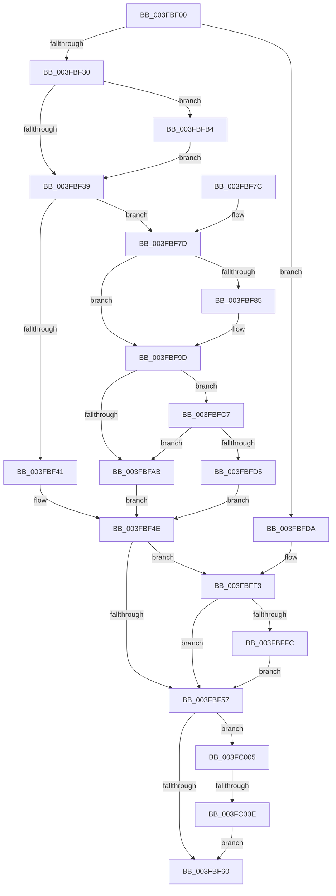

# ExTryAcquireAutoExpandPushLockShared

- RVA: `0x003FBF00`–`0x003FC01E` (길이 `286` bytes)
- VA: `0x00000001403FBF00`
- 실행 섹션: `.text`
- PDB 이름 있음: `예`; PDB Function 태그: `예`
- unwind 정보 RVA: `0x00099830`
- 디코드: `83`개 명령, `286/286` bytes 표시
- 미해석 바이트: `0` (있으면 어셈블리에 `.byte`로 보존)

> 이 문서는 커널 이미지의 기계어와 PDB 기호를 분석해 생성했습니다. 4번과 5번은 함수 원형과 자료형을 바이너리 사용 방식에서 추정한 C 해석이며 원본 소스 복구 결과는 아닙니다.

## 1. Dependencies

- 직접 호출 지점: **6**; 고유 호출 대상: **5**
- 직접 호출자로 확인된 함수: **0**
- RIP 상대 이미지 참조: **0**

### Outgoing calls
- `0x003FBF46` → [ExpTryAcquireFannedOutPushLockShared](ExpTryAcquireFannedOutPushLockShared_function_003FC024.md) (function, `0x003FC024`)
- `0x003FBF97` → [KeBugCheckEx](../4F/KeBugCheckEx_function_004FD660.md) (function, `0x004FD660`)
- `0x003FBFBA` → [KeAbPreAcquire](../21/KeAbPreAcquire_function_00210230.md) (function, `0x00210230`)
- `0x003FBFCC` → [ExfTryAcquirePushLockSharedEx](ExfTryAcquirePushLockSharedEx_function_003FC210.md) (function, `0x003FC210`)
- `0x003FBFED` → [KeBugCheckEx](../4F/KeBugCheckEx_function_004FD660.md) (function, `0x004FD660`)
- `0x003FC014` → [KeAbPostReleaseEx](../26/KeAbPostReleaseEx_function_00262210.md) (function, `0x00262210`)

### Direct callers
- 이 함수 시작 RVA로 연결되는 직접 call은 확인되지 않았습니다. 간접 호출은 완전히 역산할 수 없습니다.

### Static image references
- 디코드된 RIP-relative 메모리 참조가 없습니다.

## 2. Other-region calls and transfers

- 다른 실행 섹션으로 향하는 call: **0**
- call이 아닌 외부 분기/꼬리 이동: **1**
  - `0x003FC008` → [sub_006EBCCC](../6E/Unknown_function_006EBCCC.md) (`tail-transfer`)

## 3. Assembly (complete function range)

```asm
003FBF00  48 89 5C 24 08                  mov qword ptr [rsp + 8], rbx
003FBF05  48 89 6C 24 10                  mov qword ptr [rsp + 0x10], rbp
003FBF0A  48 89 74 24 18                  mov qword ptr [rsp + 0x18], rsi
003FBF0F  57                              push rdi
003FBF10  41 56                           push r14
003FBF12  41 57                           push r15
003FBF14  48 83 EC 30                     sub rsp, 0x30
003FBF18  33 ED                           xor ebp, ebp
003FBF1A  8B F2                           mov esi, edx
003FBF1C  33 DB                           xor ebx, ebx
003FBF1E  41 BF F8 FF FF FF               mov r15d, 0xfffffff8
003FBF24  48 8B F9                        mov rdi, rcx
003FBF27  41 85 D7                        test r15d, edx
003FBF2A  0F 85 AA 00 00 00               jne 0x1403fbfda
003FBF30  44 8B F6                        mov r14d, esi
003FBF33  41 83 E6 02                     and r14d, 2
003FBF37  74 7B                           je 0x1403fbfb4
003FBF39  8B 4F 08                        mov ecx, dword ptr [rdi + 8]
003FBF3C  F6 C1 01                        test cl, 1
003FBF3F  74 3C                           je 0x1403fbf7d
003FBF41  49 23 CF                        and rcx, r15
003FBF44  8B D6                           mov edx, esi
003FBF46  E8 D9 00 00 00                  call 0x1403fc024
003FBF4B  48 8B D8                        mov rbx, rax
003FBF4E  45 85 F6                        test r14d, r14d
003FBF51  0F 84 9C 00 00 00               je 0x1403fbff3
003FBF57  48 85 ED                        test rbp, rbp
003FBF5A  0F 85 A5 00 00 00               jne 0x1403fc005
003FBF60  48 8B 6C 24 58                  mov rbp, qword ptr [rsp + 0x58]
003FBF65  48 8B C3                        mov rax, rbx
003FBF68  48 8B 5C 24 50                  mov rbx, qword ptr [rsp + 0x50]
003FBF6D  48 8B 74 24 60                  mov rsi, qword ptr [rsp + 0x60]
003FBF72  48 83 C4 30                     add rsp, 0x30
003FBF76  41 5F                           pop r15
003FBF78  41 5E                           pop r14
003FBF7A  5F                              pop rdi
003FBF7B  C3                              ret
003FBF7C  CC                              int3
003FBF7D  83 CE 02                        or esi, 2
003FBF80  41 85 F7                        test r15d, esi
003FBF83  74 18                           je 0x1403fbf9d
003FBF85  48 21 5C 24 20                  and qword ptr [rsp + 0x20], rbx
003FBF8A  45 33 C9                        xor r9d, r9d
003FBF8D  8B D6                           mov edx, esi
003FBF8F  4C 8B C7                        mov r8, rdi
003FBF92  B9 52 01 00 00                  mov ecx, 0x152
003FBF97  E8 C4 16 10 00                  call 0x1404fd660
003FBF9C  CC                              int3
003FBF9D  B9 11 00 00 00                  mov ecx, 0x11
003FBFA2  33 C0                           xor eax, eax
003FBFA4  F0 48 0F B1 0F                  lock cmpxchg qword ptr [rdi], rcx
003FBFA9  75 1C                           jne 0x1403fbfc7
003FBFAB  48 8B DF                        mov rbx, rdi
003FBFAE  48 83 CB 01                     or rbx, 1
003FBFB2  EB 9A                           jmp 0x1403fbf4e
003FBFB4  33 D2                           xor edx, edx
003FBFB6  44 8D 42 01                     lea r8d, [rdx + 1]
003FBFBA  E8 71 42 E1 FF                  call 0x140210230
003FBFBF  48 8B E8                        mov rbp, rax
003FBFC2  E9 72 FF FF FF                  jmp 0x1403fbf39
003FBFC7  8B D6                           mov edx, esi
003FBFC9  48 8B CF                        mov rcx, rdi
003FBFCC  E8 3F 02 00 00                  call 0x1403fc210
003FBFD1  84 C0                           test al, al
003FBFD3  75 D6                           jne 0x1403fbfab
003FBFD5  E9 74 FF FF FF                  jmp 0x1403fbf4e
003FBFDA  48 21 5C 24 20                  and qword ptr [rsp + 0x20], rbx
003FBFDF  48 8B D6                        mov rdx, rsi
003FBFE2  45 33 C9                        xor r9d, r9d
003FBFE5  4C 8B C7                        mov r8, rdi
003FBFE8  B9 52 01 00 00                  mov ecx, 0x152
003FBFED  E8 6E 16 10 00                  call 0x1404fd660
003FBFF2  CC                              int3
003FBFF3  48 85 DB                        test rbx, rbx
003FBFF6  0F 84 5B FF FF FF               je 0x1403fbf57
003FBFFC  48 83 CB 02                     or rbx, 2
003FC000  E9 52 FF FF FF                  jmp 0x1403fbf57
003FC005  48 85 DB                        test rbx, rbx
003FC008  0F 85 BE FC 2E 00               jne 0x1406ebccc
003FC00E  48 8B D5                        mov rdx, rbp
003FC011  48 8B CF                        mov rcx, rdi
003FC014  E8 F7 61 E6 FF                  call 0x140262210
003FC019  E9 42 FF FF FF                  jmp 0x1403fbf60
```

## 4. C-style interpretation (structured pseudocode)

```c
__int64 __fastcall ExTryAcquireAutoExpandPushLockShared(__int64 a1, int a2, __int64 a3, int a4)
{
    __int64 result;
    __int64 v_r14;
    __int64 v_rbp;
    __int64 v_rbx;
    __int64 v_rsi;
    __int64 v_rsp;
    unsigned __int64 v_stack_p10;
    unsigned __int64 v_stack_p18;
    unsigned __int64 v_stack_p20;
    unsigned __int64 v_stack_p8;

    v_stack_p8 = v_rbx;
    v_stack_p10 = v_rbp;
    v_stack_p18 = v_rsi;
    v_rsp = (v_rsp) - (48);
    v_rbp = 0;
    v_rbx = 0;
    if ((((unsigned int)((unsigned int)(0xFFFFFFF8ULL))) & (a2)) != 0) goto loc_003FBFDA;
    v_r14 = (unsigned int)(((unsigned int)((unsigned int)((unsigned int)(a2)))) & (2));
    if (condition_is_equal) goto loc_003FBFB4;
loc_003FBF39:
    if ((((unsigned __int8)((unsigned int)(*(unsigned int *)(a1 + 8)))) & (1)) == 0) goto loc_003FBF7D;
    a1 = ((unsigned int)(*(unsigned int *)(a1 + 8))) & ((unsigned int)(0xFFFFFFF8ULL));
    result = ExpTryAcquireFannedOutPushLockShared(a1, (unsigned int)((unsigned int)((unsigned int)(a2))), a3, a4);
loc_003FBF4E:
    if ((unsigned int)(v_r14) == 0) goto loc_003FBFF3;
loc_003FBF57:
    if (0 != 0) goto loc_003FC005;
loc_003FBF60:
    v_rsp = (v_rsp) + (48);
    return result;
loc_003FBF7D:
    v_rsi = (unsigned int)((v_stack_p18) | (2));
    if ((((unsigned int)((unsigned int)(0xFFFFFFF8ULL))) & ((unsigned int)(v_rsi))) != 0) {
        a4 = 0;
        a2 = (unsigned int)(v_rsi);
        a3 = a1;
        a1 = 338;
        result = KeBugCheckEx(a1, a2, a3, a4);
    }
    result = 0;
    if (condition_is_not_equal) goto loc_003FBFC7;
loc_003FBFAB:
    v_rbx = (a1) | (1);
    goto loc_003FBF4E;
loc_003FBFB4:
    a2 = 0;
    result = KeAbPreAcquire(17, a2, a2 + 1, a4);
    goto loc_003FBF39;
loc_003FBFC7:
    result = ExfTryAcquirePushLockSharedEx(a1, (unsigned int)((unsigned int)(v_rsi)), a2 + 1, a4);
    if ((unsigned __int8)(result) != 0) goto loc_003FBFAB;
    goto loc_003FBF4E;
loc_003FBFDA:
    a4 = 0;
    result = KeBugCheckEx(338, v_rsi, a1, a4);
loc_003FBFF3:
    if (v_rbx == 0) goto loc_003FBF57;
    v_rbx = (v_rbx) | (2);
    goto loc_003FBF57;
loc_003FC005:
    result = KeAbPostReleaseEx(a1, result, a1, a4);
    goto loc_003FBF60;
}
```

## 5. (Beta) C Style

```c
int64_t ExTryAcquireAutoExpandPushLockShared(void *Arg1, int32_t Arg2, int64_t Arg3, int32_t Arg4)
{
    uint8_t *arg1 = (uint8_t *)Arg1;

    int64_t result;
    int64_t local_r14;
    int64_t local_rbp;
    int64_t local_rbx;
    int64_t local_rsi;
    int64_t local_rsp;
    uint64_t v_stack_p10;
    uint64_t v_stack_p18;
    uint64_t v_stack_p20;
    uint64_t v_stack_p8;

    v_stack_p8 = local_rbx;
    v_stack_p10 = local_rbp;
    v_stack_p18 = local_rsi;
    local_rsp = (local_rsp) - (48);
    local_rbp = 0;
    local_rbx = 0;
    if ((((uint32_t)((uint32_t)(0xFFFFFFF8ULL))) & (Arg2)) != 0) goto loc_003FBFDA;
    local_r14 = (uint32_t)(((uint32_t)((uint32_t)((uint32_t)(Arg2)))) & (2));
    if (condition_is_equal) goto loc_003FBFB4;
loc_003FBF39:
    if ((((uint8_t)((uint32_t)(*(uint32_t *)(arg1 + 0x8)))) & (1)) == 0) goto loc_003FBF7D;
    Arg1 = ((uint32_t)(*(uint32_t *)(arg1 + 0x8))) & ((uint32_t)(0xFFFFFFF8ULL));
    result = ExpTryAcquireFannedOutPushLockShared(Arg1, (uint32_t)((uint32_t)((uint32_t)(Arg2))), Arg3, Arg4);
loc_003FBF4E:
    if ((uint32_t)(local_r14) == 0) goto loc_003FBFF3;
loc_003FBF57:
    if (0 != 0) goto loc_003FC005;
loc_003FBF60:
    local_rsp = (local_rsp) + (48);
    return result;
loc_003FBF7D:
    local_rsi = (uint32_t)((v_stack_p18) | (2));
    if ((((uint32_t)((uint32_t)(0xFFFFFFF8ULL))) & ((uint32_t)(local_rsi))) != 0) {
        Arg4 = 0;
        Arg2 = (uint32_t)(local_rsi);
        Arg3 = Arg1;
        Arg1 = 338;
        result = KeBugCheckEx(Arg1, Arg2, Arg3, Arg4);
    }
    result = 0;
    if (condition_is_not_equal) goto loc_003FBFC7;
loc_003FBFAB:
    local_rbx = (Arg1) | (1);
    goto loc_003FBF4E;
loc_003FBFB4:
    Arg2 = 0;
    result = KeAbPreAcquire(17, Arg2, Arg2 + 1, Arg4);
    goto loc_003FBF39;
loc_003FBFC7:
    result = ExfTryAcquirePushLockSharedEx(Arg1, (uint32_t)((uint32_t)(local_rsi)), Arg2 + 1, Arg4);
    if ((uint8_t)(result) != 0) goto loc_003FBFAB;
    goto loc_003FBF4E;
loc_003FBFDA:
    Arg4 = 0;
    result = KeBugCheckEx(338, local_rsi, Arg1, Arg4);
loc_003FBFF3:
    if (local_rbx == 0) goto loc_003FBF57;
    local_rbx = (local_rbx) | (2);
    goto loc_003FBF57;
loc_003FC005:
    result = KeAbPostReleaseEx(Arg1, result, Arg1, Arg4);
    goto loc_003FBF60;
}
```

### 관측된 메모리 오프셋

구조체 형식이 확인되지 않은 접근은 인자 기준의 오프셋으로만 기록했습니다.

| 기준 인자 | 오프셋 표현 | 폭 (bit) | 접근 |
|---|---:|---:|---|
| `Arg1` | `+ 0x0` | `64` | `R` |
| `Arg1` | `+ 0x8` | `32` | `R` |

## 6. Execution-region graph

[열기: 2D/3D 그래프와 함수 탐색 컨트롤 패널](../../../control-panel.html?section=text&rva=0x003FBF00&view=graph)

- 2D 그래프는 위에서 아래로 흐르고, 3D 그래프는 빈 공간을 드래그해 회전합니다. Shift+드래그는 이동, 휠은 확대·축소, 함수 노드 선택은 대상 보고서 이동입니다.

### Static fallback


