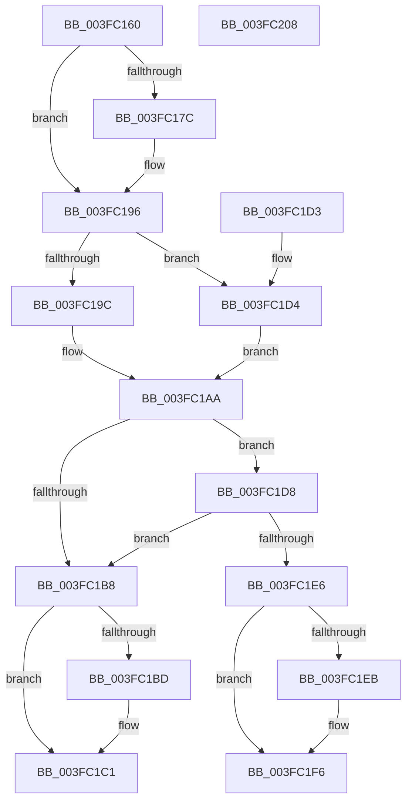

# ExTryAcquirePushLockSharedEx

- RVA: `0x003FC160`–`0x003FC209` (길이 `169` bytes)
- VA: `0x00000001403FC160`
- 실행 섹션: `.text`
- PDB 이름 있음: `예`; PDB Function 태그: `아니요`
- unwind 정보 RVA: `0x00099868`
- 디코드: `55`개 명령, `169/169` bytes 표시
- 미해석 바이트: `0` (있으면 어셈블리에 `.byte`로 보존)

> 이 문서는 커널 이미지의 기계어와 PDB 기호를 분석해 생성했습니다. 4번과 5번은 함수 원형과 자료형을 바이너리 사용 방식에서 추정한 C 해석이며 원본 소스 복구 결과는 아닙니다.

## 1. Dependencies

- 직접 호출 지점: **4**; 고유 호출 대상: **4**
- 직접 호출자로 확인된 함수: **0**
- RIP 상대 이미지 참조: **0**

### Outgoing calls
- `0x003FC190` → [KeBugCheckEx](../4F/KeBugCheckEx_function_004FD660.md) (function, `0x004FD660`)
- `0x003FC1A2` → [KeAbPreAcquire](../21/KeAbPreAcquire_function_00210230.md) (function, `0x00210230`)
- `0x003FC1DD` → [ExfTryAcquirePushLockSharedEx](ExfTryAcquirePushLockSharedEx_function_003FC210.md) (function, `0x003FC210`)
- `0x003FC1F1` → [KeAbPostReleaseEx](../26/KeAbPostReleaseEx_function_00262210.md) (function, `0x00262210`)

### Direct callers
- 이 함수 시작 RVA로 연결되는 직접 call은 확인되지 않았습니다. 간접 호출은 완전히 역산할 수 없습니다.

### Static image references
- 디코드된 RIP-relative 메모리 참조가 없습니다.

## 2. Other-region calls and transfers

- 다른 실행 섹션으로 향하는 call: **0**
- 별도 외부 분기/꼬리 이동을 확인하지 못했습니다.

## 3. Assembly (complete function range)

```asm
003FC160  48 89 5C 24 08                  mov qword ptr [rsp + 8], rbx
003FC165  48 89 74 24 10                  mov qword ptr [rsp + 0x10], rsi
003FC16A  57                              push rdi
003FC16B  48 83 EC 30                     sub rsp, 0x30
003FC16F  8B FA                           mov edi, edx
003FC171  48 8B F1                        mov rsi, rcx
003FC174  F7 C2 F8 FF FF FF               test edx, 0xfffffff8
003FC17A  74 1A                           je 0x1403fc196
003FC17C  33 DB                           xor ebx, ebx
003FC17E  4C 8B C1                        mov r8, rcx
003FC181  B9 52 01 00 00                  mov ecx, 0x152
003FC186  48 89 5C 24 20                  mov qword ptr [rsp + 0x20], rbx
003FC18B  8B D7                           mov edx, edi
003FC18D  45 33 C9                        xor r9d, r9d
003FC190  E8 CB 14 10 00                  call 0x1404fd660
003FC195  CC                              int3
003FC196  40 F6 C7 02                     test dil, 2
003FC19A  75 38                           jne 0x1403fc1d4
003FC19C  33 D2                           xor edx, edx
003FC19E  44 8D 42 01                     lea r8d, [rdx + 1]
003FC1A2  E8 89 40 E1 FF                  call 0x140210230
003FC1A7  48 8B D8                        mov rbx, rax
003FC1AA  B9 11 00 00 00                  mov ecx, 0x11
003FC1AF  33 C0                           xor eax, eax
003FC1B1  F0 48 0F B1 0E                  lock cmpxchg qword ptr [rsi], rcx
003FC1B6  75 20                           jne 0x1403fc1d8
003FC1B8  48 85 DB                        test rbx, rbx
003FC1BB  74 04                           je 0x1403fc1c1
003FC1BD  C6 43 0A 01                     mov byte ptr [rbx + 0xa], 1
003FC1C1  B0 01                           mov al, 1
003FC1C3  48 8B 5C 24 40                  mov rbx, qword ptr [rsp + 0x40]
003FC1C8  48 8B 74 24 48                  mov rsi, qword ptr [rsp + 0x48]
003FC1CD  48 83 C4 30                     add rsp, 0x30
003FC1D1  5F                              pop rdi
003FC1D2  C3                              ret
003FC1D3  CC                              int3
003FC1D4  33 DB                           xor ebx, ebx
003FC1D6  EB D2                           jmp 0x1403fc1aa
003FC1D8  8B D7                           mov edx, edi
003FC1DA  48 8B CE                        mov rcx, rsi
003FC1DD  E8 2E 00 00 00                  call 0x1403fc210
003FC1E2  84 C0                           test al, al
003FC1E4  75 D2                           jne 0x1403fc1b8
003FC1E6  48 85 DB                        test rbx, rbx
003FC1E9  74 0B                           je 0x1403fc1f6
003FC1EB  48 8B D3                        mov rdx, rbx
003FC1EE  48 8B CE                        mov rcx, rsi
003FC1F1  E8 1A 60 E6 FF                  call 0x140262210
003FC1F6  48 8B 5C 24 40                  mov rbx, qword ptr [rsp + 0x40]
003FC1FB  32 C0                           xor al, al
003FC1FD  48 8B 74 24 48                  mov rsi, qword ptr [rsp + 0x48]
003FC202  48 83 C4 30                     add rsp, 0x30
003FC206  5F                              pop rdi
003FC207  C3                              ret
003FC208  CC                              int3
```

## 4. C-style interpretation (structured pseudocode)

```c
__int64 __fastcall ExTryAcquirePushLockSharedEx(__int64 a1, int a2, __int64 a3, int a4)
{
    __int64 result;
    __int64 v_rbx;
    __int64 v_rsp;
    unsigned __int64 v_stack_m18;
    unsigned __int64 v_stack_p10;
    unsigned __int64 v_stack_p40;
    unsigned __int64 v_stack_p48;
    unsigned __int64 v_stack_p8;

    v_stack_p8 = v_rbx;
    v_stack_p10 = v_rsi;
    v_rsp = (v_rsp) - (48);
    if (((a2) & (0xFFFFFFF8ULL)) != 0) {
        v_rbx = 0;
        a3 = a1;
        a1 = 338;
        v_stack_m18 = 0;
        a2 = (unsigned int)((unsigned int)(a2));
        a4 = 0;
        result = KeBugCheckEx(a1, a2, a3, a4);
    }
    if ((((unsigned __int8)((unsigned int)(a2))) & (2)) != 0) goto loc_003FC1D4;
    a2 = 0;
    result = KeAbPreAcquire(a1, a2, a2 + 1, a4);
loc_003FC1AA:
    result = 0;
    if (condition_is_not_equal) goto loc_003FC1D8;
loc_003FC1B8:
    if (0 != 0) {
        *(unsigned __int8 *)(result + 10) = 1;
    }
    v_rsp = (v_rsp) + (48);
    return 1;
loc_003FC1D4:
    v_rbx = 0;
    goto loc_003FC1AA;
loc_003FC1D8:
    result = ExfTryAcquirePushLockSharedEx(v_stack_p10, (unsigned int)((unsigned int)((unsigned int)(a2))), a2 + 1, a4);
    if ((unsigned __int8)(result) != 0) goto loc_003FC1B8;
    if (0 != 0) {
        a2 = 0;
        a1 = v_stack_p10;
        result = KeAbPostReleaseEx(a1, a2, a2 + 1, a4);
    }
    result = 0;
    v_rsp = (v_rsp) + (48);
    return result;
}
```

## 5. (Beta) C Style

```c
int64_t ExTryAcquirePushLockSharedEx(void *Arg1, int32_t Arg2, int64_t Arg3, int32_t Arg4)
{
    uint8_t *arg1 = (uint8_t *)Arg1;

    int64_t result;
    int64_t local_rbx;
    int64_t local_rsp;
    uint64_t v_stack_m18;
    uint64_t v_stack_p10;
    uint64_t v_stack_p40;
    uint64_t v_stack_p48;
    uint64_t v_stack_p8;

    v_stack_p8 = local_rbx;
    v_stack_p10 = local_rsi;
    local_rsp = (local_rsp) - (48);
    if (((Arg2) & (0xFFFFFFF8ULL)) != 0) {
        local_rbx = 0;
        Arg3 = Arg1;
        Arg1 = 338;
        v_stack_m18 = 0;
        Arg2 = (uint32_t)((uint32_t)(Arg2));
        Arg4 = 0;
        result = KeBugCheckEx(Arg1, Arg2, Arg3, Arg4);
    }
    if ((((uint8_t)((uint32_t)(Arg2))) & (2)) != 0) goto loc_003FC1D4;
    Arg2 = 0;
    result = KeAbPreAcquire(Arg1, Arg2, Arg2 + 1, Arg4);
loc_003FC1AA:
    result = 0;
    if (condition_is_not_equal) goto loc_003FC1D8;
loc_003FC1B8:
    if (0 != 0) {
        *(uint8_t *)(result + 0xA) = 1;
    }
    local_rsp = (local_rsp) + (48);
    return 1;
loc_003FC1D4:
    local_rbx = 0;
    goto loc_003FC1AA;
loc_003FC1D8:
    result = ExfTryAcquirePushLockSharedEx(v_stack_p10, (uint32_t)((uint32_t)((uint32_t)(Arg2))), Arg2 + 1, Arg4);
    if ((uint8_t)(result) != 0) goto loc_003FC1B8;
    if (0 != 0) {
        Arg2 = 0;
        Arg1 = v_stack_p10;
        result = KeAbPostReleaseEx(Arg1, Arg2, Arg2 + 1, Arg4);
    }
    result = 0;
    local_rsp = (local_rsp) + (48);
    return result;
}
```

### 관측된 메모리 오프셋

구조체 형식이 확인되지 않은 접근은 인자 기준의 오프셋으로만 기록했습니다.

| 기준 인자 | 오프셋 표현 | 폭 (bit) | 접근 |
|---|---:|---:|---|
| `Arg1` | `+ 0x0` | `64` | `R` |

## 6. Execution-region graph

[열기: 2D/3D 그래프와 함수 탐색 컨트롤 패널](../../../control-panel.html?section=text&rva=0x003FC160&view=graph)

- 2D 그래프는 위에서 아래로 흐르고, 3D 그래프는 빈 공간을 드래그해 회전합니다. Shift+드래그는 이동, 휠은 확대·축소, 함수 노드 선택은 대상 보고서 이동입니다.

### Static fallback


