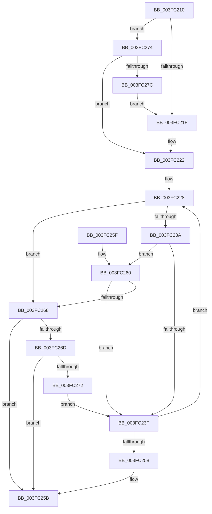

# ExfTryAcquirePushLockSharedEx

- RVA: `0x003FC210`–`0x003FC27E` (길이 `110` bytes)
- VA: `0x00000001403FC210`
- 실행 섹션: `.text`
- PDB 이름 있음: `예`; PDB Function 태그: `아니요`
- unwind 정보 RVA: `0x000DB714`
- 디코드: `37`개 명령, `110/110` bytes 표시
- 미해석 바이트: `0` (있으면 어셈블리에 `.byte`로 보존)

> 이 문서는 커널 이미지의 기계어와 PDB 기호를 분석해 생성했습니다. 4번과 5번은 함수 원형과 자료형을 바이너리 사용 방식에서 추정한 C 해석이며 원본 소스 복구 결과는 아닙니다.

## 1. Dependencies

- 직접 호출 지점: **0**; 고유 호출 대상: **0**
- 직접 호출자로 확인된 함수: **10**
- RIP 상대 이미지 참조: **1**

### Outgoing calls
- 직접 디코드된 call 명령이 없습니다.

### Direct callers
- [ExTryAcquireAutoExpandPushLockShared](ExTryAcquireAutoExpandPushLockShared_function_003FBF00.md) at `0x003FBFCC`
- [ExpTryAcquireFannedOutPushLockShared](ExpTryAcquireFannedOutPushLockShared_function_003FC024.md) at `0x003FC0BA`
- [PfLockSharedTryAcquire](PfLockSharedTryAcquire_function_003FC0D0.md) at `0x003FC129`
- [ExTryAcquirePushLockSharedEx](ExTryAcquirePushLockSharedEx_function_003FC160.md) at `0x003FC1DD`
- [IopProcessIoTracking](../59/IopProcessIoTracking_function_005986C0.md) at `0x00598750`
- [DifExfTryAcquirePushLockSharedWrapper](../62/DifExfTryAcquirePushLockSharedWrapper_function_00623EF0.md) at `0x00623FBF`
- [ExTryAcquireCacheAwarePushLockSharedEx](../65/ExTryAcquireCacheAwarePushLockSharedEx_function_00657FF0.md) at `0x00658062`
- [ExfTryAcquirePushLockShared](../65/ExfTryAcquirePushLockShared_function_006580B0.md) at `0x006580B6`
- [MiTryAcquirePushLockUnordered](../67/MiTryAcquirePushLockUnordered_function_0067B4CC.md) at `0x0067B502`
- [ObpLookupObjectName](../../page/89/ObpLookupObjectName_function_0089BE90.md) at `0x0089DB1F`

### Static image references
- `0x003FC216` → RVA `0x00E685A8` (`.data`; read)

## 2. Other-region calls and transfers

- 다른 실행 섹션으로 향하는 call: **0**
- 별도 외부 분기/꼬리 이동을 확인하지 못했습니다.

## 3. Assembly (complete function range)

```asm
003FC210  45 33 C0                        xor r8d, r8d
003FC213  4C 8B C9                        mov r9, rcx
003FC216  44 39 05 8B C3 A6 00            cmp dword ptr [rip + 0xa6c38b], r8d
003FC21D  75 55                           jne 0x1403fc274
003FC21F  45 8A D8                        mov r11b, r8b
003FC222  0F 0D 09                        prefetchw byte ptr [rcx]
003FC225  48 8B 01                        mov rax, qword ptr [rcx]
003FC228  4C 8B D0                        mov r10, rax
003FC22B  48 8B C8                        mov rcx, rax
003FC22E  41 83 E2 02                     and r10d, 2
003FC232  83 E1 01                        and ecx, 1
003FC235  4D 85 D2                        test r10, r10
003FC238  75 2E                           jne 0x1403fc268
003FC23A  48 85 C9                        test rcx, rcx
003FC23D  75 21                           jne 0x1403fc260
003FC23F  48 8B D0                        mov rdx, rax
003FC242  48 83 CA 01                     or rdx, 1
003FC246  4D 85 D2                        test r10, r10
003FC249  48 8D 4A 10                     lea rcx, [rdx + 0x10]
003FC24D  48 0F 45 CA                     cmovne rcx, rdx
003FC251  F0 49 0F B1 09                  lock cmpxchg qword ptr [r9], rcx
003FC256  75 D0                           jne 0x1403fc228
003FC258  41 B0 01                        mov r8b, 1
003FC25B  41 8A C0                        mov al, r8b
003FC25E  C3                              ret
003FC25F  CC                              int3
003FC260  48 A9 F0 FF FF FF               test rax, -0x10
003FC266  77 D7                           ja 0x1403fc23f
003FC268  45 84 DB                        test r11b, r11b
003FC26B  74 EE                           je 0x1403fc25b
003FC26D  48 85 C9                        test rcx, rcx
003FC270  75 E9                           jne 0x1403fc25b
003FC272  EB CB                           jmp 0x1403fc23f
003FC274  41 B3 01                        mov r11b, 1
003FC277  F6 C2 04                        test dl, 4
003FC27A  74 A6                           je 0x1403fc222
003FC27C  EB A1                           jmp 0x1403fc21f
```

## 4. C-style interpretation (structured pseudocode)

```c
__int64 __fastcall ExfTryAcquirePushLockSharedEx(__int64 a1, __int64 a2, int a3)
{
    __int64 v_r10;

    a3 = 0;
    if ((*(unsigned int *)(v_rip + 10929035)) != 0) goto loc_003FC274;
loc_003FC21F:
loc_003FC222:
loc_003FC228:
    v_r10 = (unsigned int)((*(unsigned __int64 *)(a1)) & (2));
    a1 = (unsigned int)((*(unsigned __int64 *)(a1)) & (1));
    if (v_r10 != 0) goto loc_003FC268;
    if (a1 != 0) goto loc_003FC260;
loc_003FC23F:
    a2 = (*(unsigned __int64 *)(a1)) | (1);
    a1 = a2 + 16;
    if (v_r10 != 0) { a1 = a2; }
    if (v_r10 != 0) goto loc_003FC228;
loc_003FC25B:
    return 1;
loc_003FC260:
    if (condition_is_above) goto loc_003FC23F;
loc_003FC268:
    if (0 == 0) goto loc_003FC25B;
    if (a1 != 0) goto loc_003FC25B;
    goto loc_003FC23F;
loc_003FC274:
    if ((((unsigned __int8)(a2)) & (4)) == 0) goto loc_003FC222;
    goto loc_003FC21F;
}
```

## 5. (Beta) C Style

```c
int64_t ExfTryAcquirePushLockSharedEx(void *Arg1, int64_t Arg2, int32_t Arg3)
{
    uint8_t *arg1 = (uint8_t *)Arg1;

    int64_t local_r10;

    Arg3 = 0;
    if ((*(uint32_t *)(v_rip + 0xA6C38B)) != 0) goto loc_003FC274;
loc_003FC21F:
loc_003FC222:
loc_003FC228:
    local_r10 = (uint32_t)((*(uint64_t *)(arg1)) & (2));
    Arg1 = (uint32_t)((*(uint64_t *)(arg1)) & (1));
    if (local_r10 != 0) goto loc_003FC268;
    if (Arg1 != NULL) goto loc_003FC260;
loc_003FC23F:
    Arg2 = (*(uint64_t *)(arg1)) | (1);
    Arg1 = Arg2 + 16;
    if (local_r10 != 0) { Arg1 = Arg2; }
    if (local_r10 != 0) goto loc_003FC228;
loc_003FC25B:
    return 1;
loc_003FC260:
    if (condition_is_above) goto loc_003FC23F;
loc_003FC268:
    if (0 == 0) goto loc_003FC25B;
    if (Arg1 != NULL) goto loc_003FC25B;
    goto loc_003FC23F;
loc_003FC274:
    if ((((uint8_t)(Arg2)) & (4)) == 0) goto loc_003FC222;
    goto loc_003FC21F;
}
```

### 관측된 메모리 오프셋

구조체 형식이 확인되지 않은 접근은 인자 기준의 오프셋으로만 기록했습니다.

| 기준 인자 | 오프셋 표현 | 폭 (bit) | 접근 |
|---|---:|---:|---|
| `Arg1` | `+ 0x0` | `8` | `R` |
| `Arg1` | `+ 0x0` | `64` | `R` |

## 6. Execution-region graph

[열기: 2D/3D 그래프와 함수 탐색 컨트롤 패널](../../../control-panel.html?section=text&rva=0x003FC210&view=graph)

- 2D 그래프는 위에서 아래로 흐르고, 3D 그래프는 빈 공간을 드래그해 회전합니다. Shift+드래그는 이동, 휠은 확대·축소, 함수 노드 선택은 대상 보고서 이동입니다.

### Static fallback


