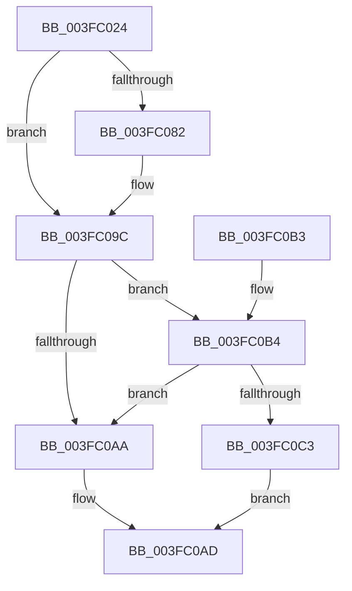

# ExpTryAcquireFannedOutPushLockShared

- RVA: `0x003FC024`–`0x003FC0C7` (길이 `163` bytes)
- VA: `0x00000001403FC024`
- 실행 섹션: `.text`
- PDB 이름 있음: `예`; PDB Function 태그: `아니요`
- unwind 정보 RVA: `0x0009985C`
- 디코드: `46`개 명령, `163/163` bytes 표시
- 미해석 바이트: `0` (있으면 어셈블리에 `.byte`로 보존)

> 이 문서는 커널 이미지의 기계어와 PDB 기호를 분석해 생성했습니다. 4번과 5번은 함수 원형과 자료형을 바이너리 사용 방식에서 추정한 C 해석이며 원본 소스 복구 결과는 아닙니다.

## 1. Dependencies

- 직접 호출 지점: **2**; 고유 호출 대상: **2**
- 직접 호출자로 확인된 함수: **1**
- RIP 상대 이미지 참조: **0**

### Outgoing calls
- `0x003FC096` → [KeBugCheckEx](../4F/KeBugCheckEx_function_004FD660.md) (function, `0x004FD660`)
- `0x003FC0BA` → [ExfTryAcquirePushLockSharedEx](ExfTryAcquirePushLockSharedEx_function_003FC210.md) (function, `0x003FC210`)

### Direct callers
- [ExTryAcquireAutoExpandPushLockShared](ExTryAcquireAutoExpandPushLockShared_function_003FBF00.md) at `0x003FBF46`

### Static image references
- 디코드된 RIP-relative 메모리 참조가 없습니다.

## 2. Other-region calls and transfers

- 다른 실행 섹션으로 향하는 call: **0**
- 별도 외부 분기/꼬리 이동을 확인하지 못했습니다.

## 3. Assembly (complete function range)

```asm
003FC024  40 53                           push rbx
003FC026  48 83 EC 30                     sub rsp, 0x30
003FC02A  65 4C 8B 04 25 20 00 00 00      mov r8, qword ptr gs:[0x20]
003FC033  8B C1                           mov eax, ecx
003FC035  C1 E8 0D                        shr eax, 0xd
003FC038  44 8B D2                        mov r10d, edx
003FC03B  25 FF FF 03 00                  and eax, 0x3ffff
003FC040  44 8B C9                        mov r9d, ecx
003FC043  0F BD C8                        bsr ecx, eax
003FC046  49 C1 E9 04                     shr r9, 4
003FC04A  BA 01 00 00 00                  mov edx, 1
003FC04F  D3 E2                           shl edx, cl
003FC051  41 81 E1 FF 01 00 00            and r9d, 0x1ff
003FC058  33 D0                           xor edx, eax
003FC05A  89 4C 24 48                     mov dword ptr [rsp + 0x48], ecx
003FC05E  49 8B 80 B0 8B 00 00            mov rax, qword ptr [r8 + 0x8bb0]
003FC065  83 C1 FE                        add ecx, -2
003FC068  41 83 CA 02                     or r10d, 2
003FC06C  48 8B 04 C8                     mov rax, qword ptr [rax + rcx*8]
003FC070  48 8B 44 D0 08                  mov rax, qword ptr [rax + rdx*8 + 8]
003FC075  4A 8D 1C C8                     lea rbx, [rax + r9*8]
003FC079  41 F7 C2 F8 FF FF FF            test r10d, 0xfffffff8
003FC080  74 1A                           je 0x1403fc09c
003FC082  48 83 64 24 20 00               and qword ptr [rsp + 0x20], 0
003FC088  45 33 C9                        xor r9d, r9d
003FC08B  41 8B D2                        mov edx, r10d
003FC08E  4C 8B C3                        mov r8, rbx
003FC091  B9 52 01 00 00                  mov ecx, 0x152
003FC096  E8 C5 15 10 00                  call 0x1404fd660
003FC09B  CC                              int3
003FC09C  B9 11 00 00 00                  mov ecx, 0x11
003FC0A1  33 C0                           xor eax, eax
003FC0A3  F0 48 0F B1 0B                  lock cmpxchg qword ptr [rbx], rcx
003FC0A8  75 0A                           jne 0x1403fc0b4
003FC0AA  48 8B C3                        mov rax, rbx
003FC0AD  48 83 C4 30                     add rsp, 0x30
003FC0B1  5B                              pop rbx
003FC0B2  C3                              ret
003FC0B3  CC                              int3
003FC0B4  41 8B D2                        mov edx, r10d
003FC0B7  48 8B CB                        mov rcx, rbx
003FC0BA  E8 51 01 00 00                  call 0x1403fc210
003FC0BF  84 C0                           test al, al
003FC0C1  75 E7                           jne 0x1403fc0aa
003FC0C3  33 C0                           xor eax, eax
003FC0C5  EB E6                           jmp 0x1403fc0ad
```

## 4. C-style interpretation (structured pseudocode)

```c
__int64 __fastcall ExpTryAcquireFannedOutPushLockShared(int a1, int a2)
{
    __int64 result;
    __int64 v_r10;
    __int64 v_rsp;
    unsigned __int64 v_stack_m18;
    unsigned int v_stack_p10;

    v_rsp = (v_rsp) - (48);
    result = (unsigned int)(((unsigned int)(a1)) >> (13));
    result = (unsigned int)((result) & (0x3FFFFULL));
    a4 = ((unsigned int)(a1)) >> (4);
    a2 = (unsigned int)((1) << ((unsigned __int8)(a1)));
    a4 = (unsigned int)((a4) & (511));
    a2 = (unsigned int)((a2) ^ ((unsigned int)(result)));
    v_stack_p10 = a1;
    a1 = (unsigned int)((a1) + (-2));
    v_r10 = (unsigned int)(((unsigned int)(a2)) | (2));
    result = *(unsigned __int64 *)(*(unsigned __int64 *)(*(unsigned __int64 *)(*(unsigned __int64 *)(gs_base + (0 + 32)) + 35760) + a1 * 8) + a2 * 8 + 8);
    if ((((unsigned int)(v_r10)) & (0xFFFFFFF8ULL)) != 0) {
        a4 = 0;
        a2 = (unsigned int)(v_r10);
        a3 = *(unsigned __int64 *)(*(unsigned __int64 *)(*(unsigned __int64 *)(*(unsigned __int64 *)(gs_base + (0 + 32)) + 35760) + a1 * 8) + a2 * 8 + 8) + a4 * 8;
        a1 = 338;
        result = KeBugCheckEx(a1, a2, a3, a4);
    }
    result = 0;
    if (condition_is_not_equal) goto loc_003FC0B4;
loc_003FC0AA:
loc_003FC0AD:
    v_rsp = (v_rsp) + (48);
    return *(unsigned __int64 *)(*(unsigned __int64 *)(*(unsigned __int64 *)(*(unsigned __int64 *)(gs_base + (0 + 32)) + 35760) + a1 * 8) + a2 * 8 + 8) + a4 * 8;
loc_003FC0B4:
    result = ExfTryAcquirePushLockSharedEx(*(unsigned __int64 *)(*(unsigned __int64 *)(*(unsigned __int64 *)(*(unsigned __int64 *)(gs_base + (0 + 32)) + 35760) + a1 * 8) + a2 * 8 + 8) + a4 * 8, (unsigned int)((unsigned int)(v_r10)), a3, a4);
    if ((unsigned __int8)(result) != 0) goto loc_003FC0AA;
    result = 0;
    goto loc_003FC0AD;
}
```

## 5. (Beta) C Style

```c
int64_t ExpTryAcquireFannedOutPushLockShared(int32_t Arg1, int32_t Arg2)
{
    int64_t result;
    int64_t local_r10;
    int64_t local_rsp;
    uint64_t v_stack_m18;
    uint32_t v_stack_p10;

    local_rsp = (local_rsp) - (48);
    result = (uint32_t)(((uint32_t)(Arg1)) >> (13));
    result = (uint32_t)((result) & (0x3FFFFULL));
    a4 = ((uint32_t)(Arg1)) >> (4);
    Arg2 = (uint32_t)((1) << ((uint8_t)(Arg1)));
    a4 = (uint32_t)((a4) & (511));
    Arg2 = (uint32_t)((Arg2) ^ ((uint32_t)(result)));
    v_stack_p10 = Arg1;
    Arg1 = (uint32_t)((Arg1) + (-2));
    local_r10 = (uint32_t)(((uint32_t)(Arg2)) | (2));
    result = *(uint64_t *)(*(uint64_t *)(*(uint64_t *)(*(uint64_t *)(gs_base + (0 + 0x20)) + 0x8BB0) + Arg1 * 8) + Arg2 * 8 + 0x8);
    if ((((uint32_t)(local_r10)) & (0xFFFFFFF8ULL)) != 0) {
        a4 = 0;
        Arg2 = (uint32_t)(local_r10);
        a3 = *(uint64_t *)(*(uint64_t *)(*(uint64_t *)(*(uint64_t *)(gs_base + (0 + 0x20)) + 0x8BB0) + Arg1 * 8) + Arg2 * 8 + 0x8) + a4 * 8;
        Arg1 = 338;
        result = KeBugCheckEx(Arg1, Arg2, a3, a4);
    }
    result = 0;
    if (condition_is_not_equal) goto loc_003FC0B4;
loc_003FC0AA:
loc_003FC0AD:
    local_rsp = (local_rsp) + (48);
    return *(uint64_t *)(*(uint64_t *)(*(uint64_t *)(*(uint64_t *)(gs_base + (0 + 0x20)) + 0x8BB0) + Arg1 * 8) + Arg2 * 8 + 0x8) + a4 * 8;
loc_003FC0B4:
    result = ExfTryAcquirePushLockSharedEx(*(uint64_t *)(*(uint64_t *)(*(uint64_t *)(*(uint64_t *)(gs_base + (0 + 0x20)) + 0x8BB0) + Arg1 * 8) + Arg2 * 8 + 0x8) + a4 * 8, (uint32_t)((uint32_t)(local_r10)), a3, a4);
    if ((uint8_t)(result) != 0) goto loc_003FC0AA;
    result = 0;
    goto loc_003FC0AD;
}
```

## 6. Execution-region graph

[열기: 2D/3D 그래프와 함수 탐색 컨트롤 패널](../../../control-panel.html?section=text&rva=0x003FC024&view=graph)

- 2D 그래프는 위에서 아래로 흐르고, 3D 그래프는 빈 공간을 드래그해 회전합니다. Shift+드래그는 이동, 휠은 확대·축소, 함수 노드 선택은 대상 보고서 이동입니다.

### Static fallback


