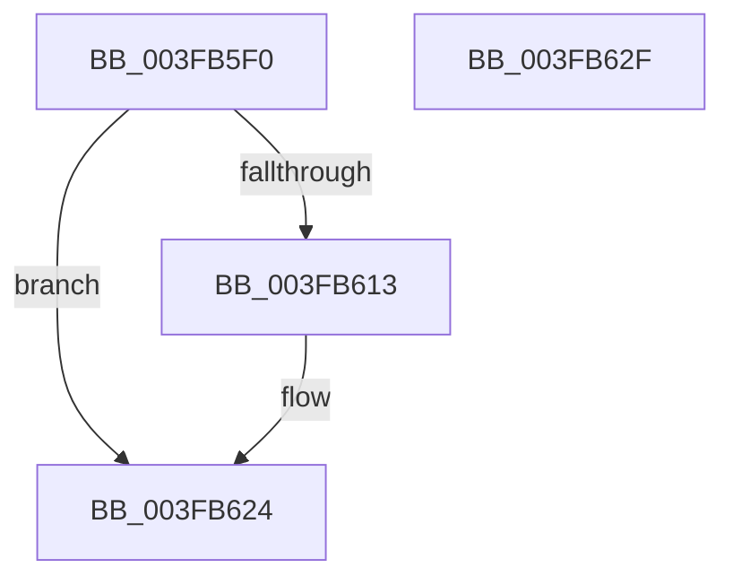

# FsRtlAllocateFileLock

- RVA: `0x003FB5F0`–`0x003FB630` (길이 `64` bytes)
- VA: `0x00000001403FB5F0`
- 실행 섹션: `.text`
- PDB 이름 있음: `예`; PDB Function 태그: `아니요`
- unwind 정보 RVA: `0x0005CAAC`
- 디코드: `20`개 명령, `64/64` bytes 표시
- 미해석 바이트: `0` (있으면 어셈블리에 `.byte`로 보존)

> 이 문서는 커널 이미지의 기계어와 PDB 기호를 분석해 생성했습니다. 4번과 5번은 함수 원형과 자료형을 바이너리 사용 방식에서 추정한 C 해석이며 원본 소스 복구 결과는 아닙니다.

## 1. Dependencies

- 직접 호출 지점: **1**; 고유 호출 대상: **1**
- 직접 호출자로 확인된 함수: **0**
- RIP 상대 이미지 참조: **1**

### Outgoing calls
- `0x003FB607` → [ExAllocateFromPagedLookasideList](ExAllocateFromPagedLookasideList_function_003FB730.md) (function, `0x003FB730`)

### Direct callers
- 이 함수 시작 RVA로 연결되는 직접 call은 확인되지 않았습니다. 간접 호출은 완전히 역산할 수 없습니다.

### Static image references
- `0x003FB600` → RVA `0x00E12080` (`.data`; read)

## 2. Other-region calls and transfers

- 다른 실행 섹션으로 향하는 call: **0**
- 별도 외부 분기/꼬리 이동을 확인하지 못했습니다.

## 3. Assembly (complete function range)

```asm
003FB5F0  48 89 5C 24 08                  mov qword ptr [rsp + 8], rbx
003FB5F5  57                              push rdi
003FB5F6  48 83 EC 20                     sub rsp, 0x20
003FB5FA  48 8B F9                        mov rdi, rcx
003FB5FD  48 8B DA                        mov rbx, rdx
003FB600  48 8D 0D 79 6A A1 00            lea rcx, [rip + 0xa16a79]
003FB607  E8 24 01 00 00                  call 0x1403fb730
003FB60C  33 C9                           xor ecx, ecx
003FB60E  48 85 C0                        test rax, rax
003FB611  74 11                           je 0x1403fb624
003FB613  48 89 48 18                     mov qword ptr [rax + 0x18], rcx
003FB617  48 89 38                        mov qword ptr [rax], rdi
003FB61A  48 89 58 08                     mov qword ptr [rax + 8], rbx
003FB61E  88 48 10                        mov byte ptr [rax + 0x10], cl
003FB621  89 48 58                        mov dword ptr [rax + 0x58], ecx
003FB624  48 8B 5C 24 30                  mov rbx, qword ptr [rsp + 0x30]
003FB629  48 83 C4 20                     add rsp, 0x20
003FB62D  5F                              pop rdi
003FB62E  C3                              ret
003FB62F  CC                              int3
```

## 4. C-style interpretation (structured pseudocode)

```c
__int64 __fastcall FsRtlAllocateFileLock(__int64 a1, __int64 a2)
{
    __int64 result;
    __int64 v_rsp;
    unsigned __int64 v_stack_p8;

    v_stack_p8 = v_rbx;
    v_rsp = (v_rsp) - (32);
    result = ExAllocateFromPagedLookasideList(v_rip + 10578553, a2, a3, a4);
    a1 = 0;
    if (result != 0) {
        *(unsigned __int64 *)(result + 24) = 0;
        *(unsigned __int64 *)(result) = 0;
        *(unsigned __int64 *)(result + 8) = a2;
        *(unsigned __int8 *)(result + 16) = 0;
        *(unsigned int *)(result + 88) = 0;
    }
    v_rsp = (v_rsp) + (32);
    return result;
}
```

## 5. (Beta) C Style

```c
int64_t FsRtlAllocateFileLock(int64_t Arg1, int64_t Arg2)
{
    int64_t result;
    int64_t local_rsp;
    uint64_t v_stack_p8;

    v_stack_p8 = local_rbx;
    local_rsp = (local_rsp) - (32);
    result = ExAllocateFromPagedLookasideList(v_rip + 10578553, Arg2, a3, a4);
    Arg1 = 0;
    if (result != 0) {
        *(uint64_t *)(result + 0x18) = 0;
        *(uint64_t *)(result) = 0;
        *(uint64_t *)(result + 0x8) = Arg2;
        *(uint8_t *)(result + 0x10) = 0;
        *(uint32_t *)(result + 0x58) = 0;
    }
    local_rsp = (local_rsp) + (32);
    return result;
}
```

## 6. Execution-region graph

[열기: 2D/3D 그래프와 함수 탐색 컨트롤 패널](../../../control-panel.html?section=text&rva=0x003FB5F0&view=graph)

- 2D 그래프는 위에서 아래로 흐르고, 3D 그래프는 빈 공간을 드래그해 회전합니다. Shift+드래그는 이동, 휠은 확대·축소, 함수 노드 선택은 대상 보고서 이동입니다.

### Static fallback


