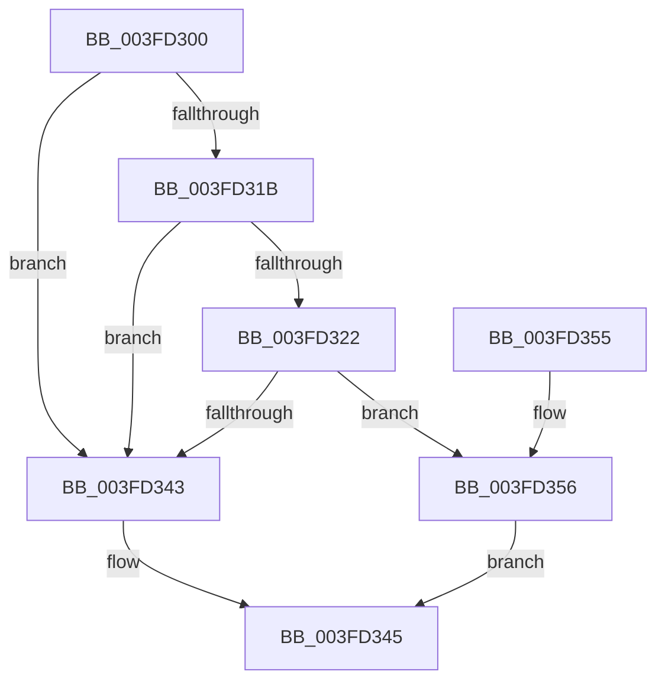

# FsRtlCheckLockForReadAccess

- RVA: `0x003FD300`–`0x003FD386` (길이 `134` bytes)
- VA: `0x00000001403FD300`
- 실행 섹션: `.text`
- PDB 이름 있음: `예`; PDB Function 태그: `아니요`
- unwind 정보 RVA: `0x000999B8`
- 디코드: `37`개 명령, `134/134` bytes 표시
- 미해석 바이트: `0` (있으면 어셈블리에 `.byte`로 보존)

> 이 문서는 커널 이미지의 기계어와 PDB 기호를 분석해 생성했습니다. 4번과 5번은 함수 원형과 자료형을 바이너리 사용 방식에서 추정한 C 해석이며 원본 소스 복구 결과는 아닙니다.

## 1. Dependencies

- 직접 호출 지점: **2**; 고유 호출 대상: **2**
- 직접 호출자로 확인된 함수: **0**
- RIP 상대 이미지 참조: **0**

### Outgoing calls
- `0x003FD360` → [IoGetRequestorProcess](IoGetRequestorProcess_function_003FD4E0.md) (function, `0x003FD4E0`)
- `0x003FD37F` → [FsRtlFastCheckLockForRead](FsRtlFastCheckLockForRead_function_003FD390.md) (function, `0x003FD390`)

### Direct callers
- 이 함수 시작 RVA로 연결되는 직접 call은 확인되지 않았습니다. 간접 호출은 완전히 역산할 수 없습니다.

### Static image references
- 디코드된 RIP-relative 메모리 참조가 없습니다.

## 2. Other-region calls and transfers

- 다른 실행 섹션으로 향하는 call: **0**
- 별도 외부 분기/꼬리 이동을 확인하지 못했습니다.

## 3. Assembly (complete function range)

```asm
003FD300  48 89 5C 24 10                  mov qword ptr [rsp + 0x10], rbx
003FD305  48 89 74 24 20                  mov qword ptr [rsp + 0x20], rsi
003FD30A  57                              push rdi
003FD30B  48 83 EC 30                     sub rsp, 0x30
003FD30F  4C 8B 49 18                     mov r9, qword ptr [rcx + 0x18]
003FD313  48 8B F1                        mov rsi, rcx
003FD316  4D 85 C9                        test r9, r9
003FD319  74 28                           je 0x1403fd343
003FD31B  49 83 79 28 00                  cmp qword ptr [r9 + 0x28], 0
003FD320  74 21                           je 0x1403fd343
003FD322  48 8B 9A B8 00 00 00            mov rbx, qword ptr [rdx + 0xb8]
003FD329  4C 8B 43 18                     mov r8, qword ptr [rbx + 0x18]
003FD32D  8B 43 08                        mov eax, dword ptr [rbx + 8]
003FD330  4C 89 44 24 50                  mov qword ptr [rsp + 0x50], r8
003FD335  48 89 44 24 40                  mov qword ptr [rsp + 0x40], rax
003FD33A  49 8D 0C 00                     lea rcx, [r8 + rax]
003FD33E  49 3B 09                        cmp rcx, qword ptr [r9]
003FD341  77 13                           ja 0x1403fd356
003FD343  B0 01                           mov al, 1
003FD345  48 8B 5C 24 48                  mov rbx, qword ptr [rsp + 0x48]
003FD34A  48 8B 74 24 58                  mov rsi, qword ptr [rsp + 0x58]
003FD34F  48 83 C4 30                     add rsp, 0x30
003FD353  5F                              pop rdi
003FD354  C3                              ret
003FD355  CC                              int3
003FD356  8B 7B 10                        mov edi, dword ptr [rbx + 0x10]
003FD359  48 8B CA                        mov rcx, rdx
003FD35C  48 8B 5B 30                     mov rbx, qword ptr [rbx + 0x30]
003FD360  E8 7B 01 00 00                  call 0x1403fd4e0
003FD365  48 89 44 24 28                  mov qword ptr [rsp + 0x28], rax
003FD36A  4C 8D 44 24 40                  lea r8, [rsp + 0x40]
003FD36F  44 8B CF                        mov r9d, edi
003FD372  48 89 5C 24 20                  mov qword ptr [rsp + 0x20], rbx
003FD377  48 8D 54 24 50                  lea rdx, [rsp + 0x50]
003FD37C  48 8B CE                        mov rcx, rsi
003FD37F  E8 0C 00 00 00                  call 0x1403fd390
003FD384  EB BF                           jmp 0x1403fd345
```

## 4. C-style interpretation (structured pseudocode)

```c
__int64 __fastcall FsRtlCheckLockForReadAccess(__int64 a1, __int64 a2)
{
    __int64 result;
    __int64 v_rsp;
    unsigned __int64 v_stack_p10;
    unsigned __int64 v_stack_p18;
    unsigned __int64 v_stack_p20;
    unsigned __int64 v_stack_p28;
    unsigned __int64 v_stack_p40;
    unsigned __int64 v_stack_p50;
    unsigned __int64 v_stack_p8;

    v_stack_p10 = v_rbx;
    v_stack_p20 = v_rsi;
    v_rsp = (v_rsp) - (48);
    if (*(unsigned __int64 *)(a1 + 24) == 0) goto loc_003FD343;
    if ((*(unsigned __int64 *)(*(unsigned __int64 *)(a1 + 24) + 40)) == 0) goto loc_003FD343;
    v_stack_p18 = *(unsigned __int64 *)(*(unsigned __int64 *)(a2 + 184) + 24);
    v_stack_p8 = (unsigned int)(*(unsigned int *)(*(unsigned __int64 *)(a2 + 184) + 8));
    if ((*(unsigned __int64 *)(*(unsigned __int64 *)(a2 + 184) + 24) + (unsigned int)(*(unsigned int *)(*(unsigned __int64 *)(a2 + 184) + 8)) * 1) > (*(unsigned __int64 *)(*(unsigned __int64 *)(a1 + 24)))) goto loc_003FD356;
loc_003FD343:
loc_003FD345:
    v_rsp = (v_rsp) + (48);
    return 1;
loc_003FD356:
    result = IoGetRequestorProcess(a2, a2, *(unsigned __int64 *)(*(unsigned __int64 *)(a2 + 184) + 24), *(unsigned __int64 *)(a1 + 24));
    v_stack_p28 = result;
    v_stack_p20 = *(unsigned __int64 *)(v_stack_p10 + 48);
    result = FsRtlFastCheckLockForRead(v_stack_p20, v_stack_p50, v_stack_p40, (unsigned int)((unsigned int)((unsigned int)(*(unsigned int *)(v_stack_p10 + 16)))));
    goto loc_003FD345;
}
```

## 5. (Beta) C Style

```c
int64_t FsRtlCheckLockForReadAccess(void *Arg1, void *Arg2)
{
    uint8_t *arg1 = (uint8_t *)Arg1;
    uint8_t *arg2 = (uint8_t *)Arg2;

    int64_t result;
    int64_t local_rsp;
    uint64_t v_stack_p10;
    uint64_t v_stack_p18;
    uint64_t v_stack_p20;
    uint64_t v_stack_p28;
    uint64_t v_stack_p40;
    uint64_t v_stack_p50;
    uint64_t v_stack_p8;

    v_stack_p10 = local_rbx;
    v_stack_p20 = local_rsi;
    local_rsp = (local_rsp) - (48);
    if (*(uint64_t *)(arg1 + 0x18) == 0) goto loc_003FD343;
    if ((*(uint64_t *)(*(uint64_t *)(arg1 + 0x18) + 0x28)) == 0) goto loc_003FD343;
    v_stack_p18 = *(uint64_t *)(*(uint64_t *)(arg2 + 0xB8) + 0x18);
    v_stack_p8 = (uint32_t)(*(uint32_t *)(*(uint64_t *)(arg2 + 0xB8) + 0x8));
    if ((*(uint64_t *)(*(uint64_t *)(arg2 + 0xB8) + 0x18) + (uint32_t)(*(uint32_t *)(*(uint64_t *)(arg2 + 0xB8) + 0x8)) * 1) > (*(uint64_t *)(*(uint64_t *)(arg1 + 0x18)))) goto loc_003FD356;
loc_003FD343:
loc_003FD345:
    local_rsp = (local_rsp) + (48);
    return 1;
loc_003FD356:
    result = IoGetRequestorProcess(Arg2, Arg2, *(uint64_t *)(*(uint64_t *)(arg2 + 0xB8) + 0x18), *(uint64_t *)(arg1 + 0x18));
    v_stack_p28 = result;
    v_stack_p20 = *(uint64_t *)(v_stack_p10 + 0x30);
    result = FsRtlFastCheckLockForRead(v_stack_p20, v_stack_p50, v_stack_p40, (uint32_t)((uint32_t)((uint32_t)(*(uint32_t *)(v_stack_p10 + 0x10)))));
    goto loc_003FD345;
}
```

### 관측된 메모리 오프셋

구조체 형식이 확인되지 않은 접근은 인자 기준의 오프셋으로만 기록했습니다.

| 기준 인자 | 오프셋 표현 | 폭 (bit) | 접근 |
|---|---:|---:|---|
| `Arg1` | `+ 0x18` | `64` | `R` |
| `Arg2` | `+ 0xB8` | `64` | `R` |

## 6. Execution-region graph

[열기: 2D/3D 그래프와 함수 탐색 컨트롤 패널](../../../control-panel.html?section=text&rva=0x003FD300&view=graph)

- 2D 그래프는 위에서 아래로 흐르고, 3D 그래프는 빈 공간을 드래그해 회전합니다. Shift+드래그는 이동, 휠은 확대·축소, 함수 노드 선택은 대상 보고서 이동입니다.

### Static fallback


