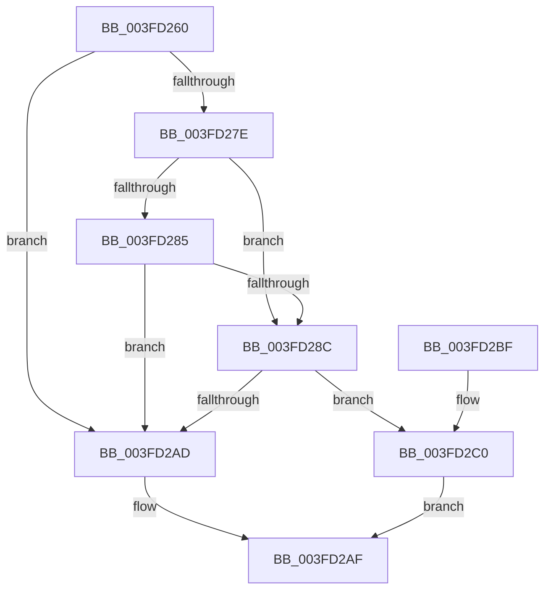

# FsRtlCheckLockForWriteAccess

- RVA: `0x003FD260`–`0x003FD2F0` (길이 `144` bytes)
- VA: `0x00000001403FD260`
- 실행 섹션: `.text`
- PDB 이름 있음: `예`; PDB Function 태그: `아니요`
- unwind 정보 RVA: `0x000999B8`
- 디코드: `40`개 명령, `144/144` bytes 표시
- 미해석 바이트: `0` (있으면 어셈블리에 `.byte`로 보존)

> 이 문서는 커널 이미지의 기계어와 PDB 기호를 분석해 생성했습니다. 4번과 5번은 함수 원형과 자료형을 바이너리 사용 방식에서 추정한 C 해석이며 원본 소스 복구 결과는 아닙니다.

## 1. Dependencies

- 직접 호출 지점: **2**; 고유 호출 대상: **2**
- 직접 호출자로 확인된 함수: **0**
- RIP 상대 이미지 참조: **0**

### Outgoing calls
- `0x003FD2CA` → [IoGetRequestorProcess](IoGetRequestorProcess_function_003FD4E0.md) (function, `0x003FD4E0`)
- `0x003FD2E9` → [FsRtlFastCheckLockForWrite](../39/FsRtlFastCheckLockForWrite_function_003910D0.md) (function, `0x003910D0`)

### Direct callers
- 이 함수 시작 RVA로 연결되는 직접 call은 확인되지 않았습니다. 간접 호출은 완전히 역산할 수 없습니다.

### Static image references
- 디코드된 RIP-relative 메모리 참조가 없습니다.

## 2. Other-region calls and transfers

- 다른 실행 섹션으로 향하는 call: **0**
- 별도 외부 분기/꼬리 이동을 확인하지 못했습니다.

## 3. Assembly (complete function range)

```asm
003FD260  48 89 5C 24 10                  mov qword ptr [rsp + 0x10], rbx
003FD265  48 89 74 24 20                  mov qword ptr [rsp + 0x20], rsi
003FD26A  57                              push rdi
003FD26B  48 83 EC 30                     sub rsp, 0x30
003FD26F  4C 8B 41 18                     mov r8, qword ptr [rcx + 0x18]
003FD273  4C 8B CA                        mov r9, rdx
003FD276  48 8B F1                        mov rsi, rcx
003FD279  4D 85 C0                        test r8, r8
003FD27C  74 2F                           je 0x1403fd2ad
003FD27E  49 83 78 28 00                  cmp qword ptr [r8 + 0x28], 0
003FD283  75 07                           jne 0x1403fd28c
003FD285  49 83 78 20 00                  cmp qword ptr [r8 + 0x20], 0
003FD28A  74 21                           je 0x1403fd2ad
003FD28C  48 8B 9A B8 00 00 00            mov rbx, qword ptr [rdx + 0xb8]
003FD293  48 8B 53 18                     mov rdx, qword ptr [rbx + 0x18]
003FD297  8B 43 08                        mov eax, dword ptr [rbx + 8]
003FD29A  48 89 54 24 50                  mov qword ptr [rsp + 0x50], rdx
003FD29F  48 89 44 24 40                  mov qword ptr [rsp + 0x40], rax
003FD2A4  48 8D 0C 02                     lea rcx, [rdx + rax]
003FD2A8  49 3B 08                        cmp rcx, qword ptr [r8]
003FD2AB  77 13                           ja 0x1403fd2c0
003FD2AD  B0 01                           mov al, 1
003FD2AF  48 8B 5C 24 48                  mov rbx, qword ptr [rsp + 0x48]
003FD2B4  48 8B 74 24 58                  mov rsi, qword ptr [rsp + 0x58]
003FD2B9  48 83 C4 30                     add rsp, 0x30
003FD2BD  5F                              pop rdi
003FD2BE  C3                              ret
003FD2BF  CC                              int3
003FD2C0  8B 7B 10                        mov edi, dword ptr [rbx + 0x10]
003FD2C3  49 8B C9                        mov rcx, r9
003FD2C6  48 8B 5B 30                     mov rbx, qword ptr [rbx + 0x30]
003FD2CA  E8 11 02 00 00                  call 0x1403fd4e0
003FD2CF  48 89 44 24 28                  mov qword ptr [rsp + 0x28], rax
003FD2D4  4C 8D 44 24 40                  lea r8, [rsp + 0x40]
003FD2D9  44 8B CF                        mov r9d, edi
003FD2DC  48 89 5C 24 20                  mov qword ptr [rsp + 0x20], rbx
003FD2E1  48 8D 54 24 50                  lea rdx, [rsp + 0x50]
003FD2E6  48 8B CE                        mov rcx, rsi
003FD2E9  E8 E2 3D F9 FF                  call 0x1403910d0
003FD2EE  EB BF                           jmp 0x1403fd2af
```

## 4. C-style interpretation (structured pseudocode)

```c
__int64 __fastcall FsRtlCheckLockForWriteAccess(__int64 a1, __int64 a2)
{
    __int64 result;
    __int64 v_rsp;
    unsigned __int64 v_stack_p10;
    unsigned __int64 v_stack_p18;
    unsigned __int64 v_stack_p20;
    unsigned __int64 v_stack_p28;
    unsigned __int64 v_stack_p40;
    unsigned __int64 v_stack_p50;
    unsigned __int64 v_stack_p8;

    v_stack_p10 = v_rbx;
    v_stack_p20 = v_rsi;
    v_rsp = (v_rsp) - (48);
    if (*(unsigned __int64 *)(a1 + 24) == 0) goto loc_003FD2AD;
    if ((*(unsigned __int64 *)(*(unsigned __int64 *)(a1 + 24) + 40)) != 0) goto loc_003FD28C;
    if ((*(unsigned __int64 *)(*(unsigned __int64 *)(a1 + 24) + 32)) == 0) goto loc_003FD2AD;
loc_003FD28C:
    v_stack_p18 = *(unsigned __int64 *)(*(unsigned __int64 *)(a2 + 184) + 24);
    v_stack_p8 = (unsigned int)(*(unsigned int *)(*(unsigned __int64 *)(a2 + 184) + 8));
    if ((*(unsigned __int64 *)(*(unsigned __int64 *)(a2 + 184) + 24) + (unsigned int)(*(unsigned int *)(*(unsigned __int64 *)(a2 + 184) + 8)) * 1) > (*(unsigned __int64 *)(*(unsigned __int64 *)(a1 + 24)))) goto loc_003FD2C0;
loc_003FD2AD:
loc_003FD2AF:
    v_rsp = (v_rsp) + (48);
    return 1;
loc_003FD2C0:
    result = IoGetRequestorProcess(a2, *(unsigned __int64 *)(*(unsigned __int64 *)(a2 + 184) + 24), *(unsigned __int64 *)(a1 + 24), a2);
    v_stack_p28 = result;
    v_stack_p20 = *(unsigned __int64 *)(v_stack_p10 + 48);
    result = FsRtlFastCheckLockForWrite(v_stack_p20, v_stack_p50, v_stack_p40, (unsigned int)((unsigned int)((unsigned int)(*(unsigned int *)(v_stack_p10 + 16)))));
    goto loc_003FD2AF;
}
```

## 5. (Beta) C Style

```c
int64_t FsRtlCheckLockForWriteAccess(void *Arg1, void *Arg2)
{
    uint8_t *arg1 = (uint8_t *)Arg1;
    uint8_t *arg2 = (uint8_t *)Arg2;

    int64_t result;
    int64_t local_rsp;
    uint64_t v_stack_p10;
    uint64_t v_stack_p18;
    uint64_t v_stack_p20;
    uint64_t v_stack_p28;
    uint64_t v_stack_p40;
    uint64_t v_stack_p50;
    uint64_t v_stack_p8;

    v_stack_p10 = local_rbx;
    v_stack_p20 = local_rsi;
    local_rsp = (local_rsp) - (48);
    if (*(uint64_t *)(arg1 + 0x18) == 0) goto loc_003FD2AD;
    if ((*(uint64_t *)(*(uint64_t *)(arg1 + 0x18) + 0x28)) != 0) goto loc_003FD28C;
    if ((*(uint64_t *)(*(uint64_t *)(arg1 + 0x18) + 0x20)) == 0) goto loc_003FD2AD;
loc_003FD28C:
    v_stack_p18 = *(uint64_t *)(*(uint64_t *)(arg2 + 0xB8) + 0x18);
    v_stack_p8 = (uint32_t)(*(uint32_t *)(*(uint64_t *)(arg2 + 0xB8) + 0x8));
    if ((*(uint64_t *)(*(uint64_t *)(arg2 + 0xB8) + 0x18) + (uint32_t)(*(uint32_t *)(*(uint64_t *)(arg2 + 0xB8) + 0x8)) * 1) > (*(uint64_t *)(*(uint64_t *)(arg1 + 0x18)))) goto loc_003FD2C0;
loc_003FD2AD:
loc_003FD2AF:
    local_rsp = (local_rsp) + (48);
    return 1;
loc_003FD2C0:
    result = IoGetRequestorProcess(Arg2, *(uint64_t *)(*(uint64_t *)(arg2 + 0xB8) + 0x18), *(uint64_t *)(arg1 + 0x18), Arg2);
    v_stack_p28 = result;
    v_stack_p20 = *(uint64_t *)(v_stack_p10 + 0x30);
    result = FsRtlFastCheckLockForWrite(v_stack_p20, v_stack_p50, v_stack_p40, (uint32_t)((uint32_t)((uint32_t)(*(uint32_t *)(v_stack_p10 + 0x10)))));
    goto loc_003FD2AF;
}
```

### 관측된 메모리 오프셋

구조체 형식이 확인되지 않은 접근은 인자 기준의 오프셋으로만 기록했습니다.

| 기준 인자 | 오프셋 표현 | 폭 (bit) | 접근 |
|---|---:|---:|---|
| `Arg1` | `+ 0x18` | `64` | `R` |
| `Arg2` | `+ 0xB8` | `64` | `R` |

## 6. Execution-region graph

[열기: 2D/3D 그래프와 함수 탐색 컨트롤 패널](../../../control-panel.html?section=text&rva=0x003FD260&view=graph)

- 2D 그래프는 위에서 아래로 흐르고, 3D 그래프는 빈 공간을 드래그해 회전합니다. Shift+드래그는 이동, 휠은 확대·축소, 함수 노드 선택은 대상 보고서 이동입니다.

### Static fallback


