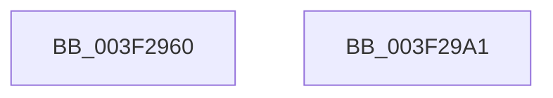

# FsRtlCheckOplockEx

- RVA: `0x003F2960`–`0x003F29A2` (길이 `66` bytes)
- VA: `0x00000001403F2960`
- 실행 섹션: `.text`
- PDB 이름 있음: `예`; PDB Function 태그: `아니요`
- unwind 정보 RVA: `0x0006C2A4`
- 디코드: `15`개 명령, `66/66` bytes 표시
- 미해석 바이트: `0` (있으면 어셈블리에 `.byte`로 보존)

> 이 문서는 커널 이미지의 기계어와 PDB 기호를 분석해 생성했습니다. 4번과 5번은 함수 원형과 자료형을 바이너리 사용 방식에서 추정한 C 해석이며 원본 소스 복구 결과는 아닙니다.

## 1. Dependencies

- 직접 호출 지점: **1**; 고유 호출 대상: **1**
- 직접 호출자로 확인된 함수: **1**
- RIP 상대 이미지 참조: **0**

### Outgoing calls
- `0x003F2997` → [FsRtlCheckOplockEx2](FsRtlCheckOplockEx2_function_003F2BC0.md) (function, `0x003F2BC0`)

### Direct callers
- [FsRtlpOplockFsctrlInternal](../../page/9F/FsRtlpOplockFsctrlInternal_function_009F1640.md) at `0x009F1848`

### Static image references
- 디코드된 RIP-relative 메모리 참조가 없습니다.

## 2. Other-region calls and transfers

- 다른 실행 섹션으로 향하는 call: **0**
- 별도 외부 분기/꼬리 이동을 확인하지 못했습니다.

## 3. Assembly (complete function range)

```asm
003F2960  48 83 EC 58                     sub rsp, 0x58
003F2964  33 C0                           xor eax, eax
003F2966  48 89 44 24 48                  mov qword ptr [rsp + 0x48], rax
003F296B  48 89 44 24 40                  mov qword ptr [rsp + 0x40], rax
003F2970  48 89 44 24 38                  mov qword ptr [rsp + 0x38], rax
003F2975  48 8B 84 24 88 00 00 00         mov rax, qword ptr [rsp + 0x88]
003F297D  48 89 44 24 30                  mov qword ptr [rsp + 0x30], rax
003F2982  48 8B 84 24 80 00 00 00         mov rax, qword ptr [rsp + 0x80]
003F298A  48 89 44 24 28                  mov qword ptr [rsp + 0x28], rax
003F298F  4C 89 4C 24 20                  mov qword ptr [rsp + 0x20], r9
003F2994  45 33 C9                        xor r9d, r9d
003F2997  E8 24 02 00 00                  call 0x1403f2bc0
003F299C  48 83 C4 58                     add rsp, 0x58
003F29A0  C3                              ret
003F29A1  CC                              int3
```

## 4. C-style interpretation (structured pseudocode)

```c
__int64 __fastcall FsRtlCheckOplockEx(__int64 a1, __int64 a2, __int64 a3, __int64 a4, __int64 a5, __int64 a6)
{
    __int64 result;
    __int64 v_rsp;
    unsigned __int64 v_stack_m10;
    unsigned __int64 v_stack_m18;
    unsigned __int64 v_stack_m20;
    unsigned __int64 v_stack_m28;
    unsigned __int64 v_stack_m30;
    unsigned __int64 v_stack_m38;

    v_rsp = (v_rsp) - (88);
    result = 0;
    v_stack_m10 = 0;
    v_stack_m18 = 0;
    v_stack_m20 = 0;
    v_stack_m28 = a6;
    v_stack_m30 = a5;
    v_stack_m38 = a4;
    a4 = 0;
    result = FsRtlCheckOplockEx2(a1, a2, a3, a4);
    v_rsp = (v_rsp) + (88);
    return result;
}
```

## 5. (Beta) C Style

```c
int64_t FsRtlCheckOplockEx(int64_t Arg1, int64_t Arg2, int64_t Arg3, int64_t Arg4, int64_t Arg5, int64_t Arg6)
{
    int64_t result;
    int64_t local_rsp;
    uint64_t v_stack_m10;
    uint64_t v_stack_m18;
    uint64_t v_stack_m20;
    uint64_t v_stack_m28;
    uint64_t v_stack_m30;
    uint64_t v_stack_m38;

    local_rsp = (local_rsp) - (88);
    result = 0;
    v_stack_m10 = 0;
    v_stack_m18 = 0;
    v_stack_m20 = 0;
    v_stack_m28 = Arg6;
    v_stack_m30 = Arg5;
    v_stack_m38 = Arg4;
    Arg4 = 0;
    result = FsRtlCheckOplockEx2(Arg1, Arg2, Arg3, Arg4);
    local_rsp = (local_rsp) + (88);
    return result;
}
```

## 6. Execution-region graph

[열기: 2D/3D 그래프와 함수 탐색 컨트롤 패널](../../../control-panel.html?section=text&rva=0x003F2960&view=graph)

- 2D 그래프는 위에서 아래로 흐르고, 3D 그래프는 빈 공간을 드래그해 회전합니다. Shift+드래그는 이동, 휠은 확대·축소, 함수 노드 선택은 대상 보고서 이동입니다.

### Static fallback


