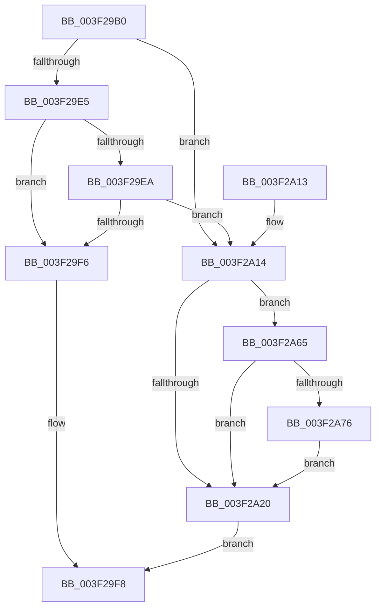

# FsRtlCheckOplock

- RVA: `0x003F29B0`–`0x003F2A7C` (길이 `204` bytes)
- VA: `0x00000001403F29B0`
- 실행 섹션: `.text`
- PDB 이름 있음: `예`; PDB Function 태그: `아니요`
- unwind 정보 RVA: `0x0009702C`
- 디코드: `53`개 명령, `204/204` bytes 표시
- 미해석 바이트: `0` (있으면 어셈블리에 `.byte`로 보존)

> 이 문서는 커널 이미지의 기계어와 PDB 기호를 분석해 생성했습니다. 4번과 5번은 함수 원형과 자료형을 바이너리 사용 방식에서 추정한 C 해석이며 원본 소스 복구 결과는 아닙니다.

## 1. Dependencies

- 직접 호출 지점: **2**; 고유 호출 대상: **2**
- 직접 호출자로 확인된 함수: **0**
- RIP 상대 이미지 참조: **0**

### Outgoing calls
- `0x003F29DB` → [FsRtlpOplockStoreKeyForDeleteOperation](FsRtlpOplockStoreKeyForDeleteOperation_function_003F2A90.md) (function, `0x003F2A90`)
- `0x003F2A5E` → [FsRtlCheckOplockEx2](FsRtlCheckOplockEx2_function_003F2BC0.md) (function, `0x003F2BC0`)

### Direct callers
- 이 함수 시작 RVA로 연결되는 직접 call은 확인되지 않았습니다. 간접 호출은 완전히 역산할 수 없습니다.

### Static image references
- 디코드된 RIP-relative 메모리 참조가 없습니다.

## 2. Other-region calls and transfers

- 다른 실행 섹션으로 향하는 call: **0**
- 별도 외부 분기/꼬리 이동을 확인하지 못했습니다.

## 3. Assembly (complete function range)

```asm
003F29B0  48 89 5C 24 08                  mov qword ptr [rsp + 8], rbx
003F29B5  48 89 6C 24 10                  mov qword ptr [rsp + 0x10], rbp
003F29BA  48 89 74 24 18                  mov qword ptr [rsp + 0x18], rsi
003F29BF  48 89 7C 24 20                  mov qword ptr [rsp + 0x20], rdi
003F29C4  41 56                           push r14
003F29C6  48 83 EC 50                     sub rsp, 0x50
003F29CA  4D 8B F0                        mov r14, r8
003F29CD  49 8B E9                        mov rbp, r9
003F29D0  45 33 C0                        xor r8d, r8d
003F29D3  48 8B DA                        mov rbx, rdx
003F29D6  48 8B F9                        mov rdi, rcx
003F29D9  33 F6                           xor esi, esi
003F29DB  E8 B0 00 00 00                  call 0x1403f2a90
003F29E0  48 39 37                        cmp qword ptr [rdi], rsi
003F29E3  75 2F                           jne 0x1403f2a14
003F29E5  48 85 DB                        test rbx, rbx
003F29E8  74 0C                           je 0x1403f29f6
003F29EA  48 8B 83 B8 00 00 00            mov rax, qword ptr [rbx + 0xb8]
003F29F1  40 38 30                        cmp byte ptr [rax], sil
003F29F4  74 1E                           je 0x1403f2a14
003F29F6  33 C0                           xor eax, eax
003F29F8  48 8B 5C 24 60                  mov rbx, qword ptr [rsp + 0x60]
003F29FD  48 8B 6C 24 68                  mov rbp, qword ptr [rsp + 0x68]
003F2A02  48 8B 74 24 70                  mov rsi, qword ptr [rsp + 0x70]
003F2A07  48 8B 7C 24 78                  mov rdi, qword ptr [rsp + 0x78]
003F2A0C  48 83 C4 50                     add rsp, 0x50
003F2A10  41 5E                           pop r14
003F2A12  C3                              ret
003F2A13  CC                              int3
003F2A14  48 8B 83 B8 00 00 00            mov rax, qword ptr [rbx + 0xb8]
003F2A1B  40 38 30                        cmp byte ptr [rax], sil
003F2A1E  74 45                           je 0x1403f2a65
003F2A20  48 8B 84 24 80 00 00 00         mov rax, qword ptr [rsp + 0x80]
003F2A28  45 33 C9                        xor r9d, r9d
003F2A2B  48 C7 44 24 48 00 00 00 00      mov qword ptr [rsp + 0x48], 0
003F2A34  44 8B C6                        mov r8d, esi
003F2A37  48 C7 44 24 40 00 00 00 00      mov qword ptr [rsp + 0x40], 0
003F2A40  48 8B D3                        mov rdx, rbx
003F2A43  48 C7 44 24 38 00 00 00 00      mov qword ptr [rsp + 0x38], 0
003F2A4C  48 8B CF                        mov rcx, rdi
003F2A4F  48 89 44 24 30                  mov qword ptr [rsp + 0x30], rax
003F2A54  48 89 6C 24 28                  mov qword ptr [rsp + 0x28], rbp
003F2A59  4C 89 74 24 20                  mov qword ptr [rsp + 0x20], r14
003F2A5E  E8 5D 01 00 00                  call 0x1403f2bc0
003F2A63  EB 93                           jmp 0x1403f29f8
003F2A65  8B 40 10                        mov eax, dword ptr [rax + 0x10]
003F2A68  8B F0                           mov esi, eax
003F2A6A  C1 EE 08                        shr esi, 8
003F2A6D  83 E6 01                        and esi, 1
003F2A70  0F BA E0 10                     bt eax, 0x10
003F2A74  73 AA                           jae 0x1403f2a20
003F2A76  0F BA EE 1C                     bts esi, 0x1c
003F2A7A  EB A4                           jmp 0x1403f2a20
```

## 4. C-style interpretation (structured pseudocode)

```c
__int64 __fastcall FsRtlCheckOplock(__int64 a1, __int64 a2, __int64 a3, __int64 a4, __int64 a5)
{
    __int64 result;
    __int64 v_rsi;
    __int64 v_rsp;
    unsigned __int64 v_stack_p10;
    unsigned __int64 v_stack_p18;
    unsigned __int64 v_stack_p20;
    unsigned __int64 v_stack_p28;
    unsigned __int64 v_stack_p30;
    unsigned __int64 v_stack_p38;
    unsigned __int64 v_stack_p40;
    unsigned __int64 v_stack_p48;
    unsigned __int64 v_stack_p8;

    v_stack_p8 = v_rbx;
    v_stack_p10 = v_rbp;
    v_stack_p18 = v_rsi;
    v_stack_p20 = v_rdi;
    v_rsp = (v_rsp) - (80);
    a3 = 0;
    v_rsi = 0;
    result = FsRtlpOplockStoreKeyForDeleteOperation(a1, a2, a3, a4);
    if ((*(unsigned __int64 *)(a1)) != 0) goto loc_003F2A14;
    if (a2 == 0) goto loc_003F29F6;
    if ((*(unsigned __int8 *)(*(unsigned __int64 *)(a2 + 184))) == 0) goto loc_003F2A14;
loc_003F29F6:
    result = 0;
loc_003F29F8:
    v_rsp = (v_rsp) + (80);
    return result;
loc_003F2A14:
    if ((*(unsigned __int8 *)(*(unsigned __int64 *)(v_stack_p8 + 184))) == ((unsigned __int8)(v_stack_p18))) goto loc_003F2A65;
loc_003F2A20:
    a4 = 0;
    v_stack_p48 = 0;
    v_stack_p40 = 0;
    v_stack_p38 = 0;
    v_stack_p30 = a5;
    v_stack_p28 = v_stack_p10;
    v_stack_p20 = 0;
    result = FsRtlCheckOplockEx2(v_stack_p20, v_stack_p8, (unsigned int)((unsigned int)(v_stack_p18)), a4);
    goto loc_003F29F8;
loc_003F2A65:
    v_rsi = (unsigned int)(((unsigned int)((unsigned int)((unsigned int)(*(unsigned int *)(result + 16))))) >> (8));
    v_rsi = (unsigned int)((v_rsi) & (1));
    if (condition_is_above_or_equal) goto loc_003F2A20;
    goto loc_003F2A20;
}
```

## 5. (Beta) C Style

```c
int64_t FsRtlCheckOplock(void *Arg1, int64_t Arg2, int64_t Arg3, int64_t Arg4, int64_t Arg5)
{
    uint8_t *arg1 = (uint8_t *)Arg1;

    int64_t result;
    int64_t local_rsi;
    int64_t local_rsp;
    uint64_t v_stack_p10;
    uint64_t v_stack_p18;
    uint64_t v_stack_p20;
    uint64_t v_stack_p28;
    uint64_t v_stack_p30;
    uint64_t v_stack_p38;
    uint64_t v_stack_p40;
    uint64_t v_stack_p48;
    uint64_t v_stack_p8;

    v_stack_p8 = local_rbx;
    v_stack_p10 = local_rbp;
    v_stack_p18 = local_rsi;
    v_stack_p20 = local_rdi;
    local_rsp = (local_rsp) - (80);
    Arg3 = 0;
    local_rsi = 0;
    result = FsRtlpOplockStoreKeyForDeleteOperation(Arg1, Arg2, Arg3, Arg4);
    if ((*(uint64_t *)(arg1)) != 0) goto loc_003F2A14;
    if (Arg2 == 0) goto loc_003F29F6;
    if ((*(uint8_t *)(*(uint64_t *)(Arg2 + 0xB8))) == 0) goto loc_003F2A14;
loc_003F29F6:
    result = 0;
loc_003F29F8:
    local_rsp = (local_rsp) + (80);
    return result;
loc_003F2A14:
    if ((*(uint8_t *)(*(uint64_t *)(v_stack_p8 + 0xB8))) == ((uint8_t)(v_stack_p18))) goto loc_003F2A65;
loc_003F2A20:
    Arg4 = 0;
    v_stack_p48 = 0;
    v_stack_p40 = 0;
    v_stack_p38 = 0;
    v_stack_p30 = Arg5;
    v_stack_p28 = v_stack_p10;
    v_stack_p20 = 0;
    result = FsRtlCheckOplockEx2(v_stack_p20, v_stack_p8, (uint32_t)((uint32_t)(v_stack_p18)), Arg4);
    goto loc_003F29F8;
loc_003F2A65:
    local_rsi = (uint32_t)(((uint32_t)((uint32_t)((uint32_t)(*(uint32_t *)(result + 0x10))))) >> (8));
    local_rsi = (uint32_t)((local_rsi) & (1));
    if (condition_is_above_or_equal) goto loc_003F2A20;
    goto loc_003F2A20;
}
```

### 관측된 메모리 오프셋

구조체 형식이 확인되지 않은 접근은 인자 기준의 오프셋으로만 기록했습니다.

| 기준 인자 | 오프셋 표현 | 폭 (bit) | 접근 |
|---|---:|---:|---|
| `Arg1` | `+ 0x0` | `64` | `R` |

## 6. Execution-region graph

[열기: 2D/3D 그래프와 함수 탐색 컨트롤 패널](../../../control-panel.html?section=text&rva=0x003F29B0&view=graph)

- 2D 그래프는 위에서 아래로 흐르고, 3D 그래프는 빈 공간을 드래그해 회전합니다. Shift+드래그는 이동, 휠은 확대·축소, 함수 노드 선택은 대상 보고서 이동입니다.

### Static fallback


