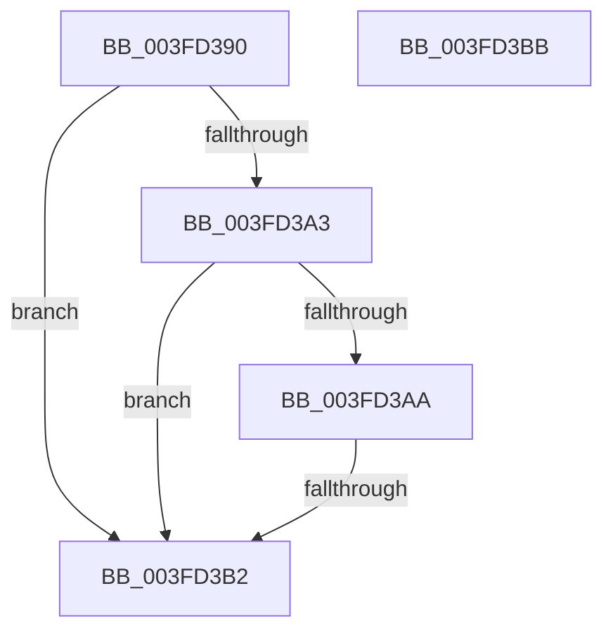

# FsRtlFastCheckLockForRead

- RVA: `0x003FD390`–`0x003FD3BC` (길이 `44` bytes)
- VA: `0x00000001403FD390`
- 실행 섹션: `.text`
- PDB 이름 있음: `예`; PDB Function 태그: `아니요`
- unwind 정보 RVA: `0x000999CC`
- 디코드: `18`개 명령, `44/44` bytes 표시
- 미해석 바이트: `0` (있으면 어셈블리에 `.byte`로 보존)

> 이 문서는 커널 이미지의 기계어와 PDB 기호를 분석해 생성했습니다. 4번과 5번은 함수 원형과 자료형을 바이너리 사용 방식에서 추정한 C 해석이며 원본 소스 복구 결과는 아닙니다.

## 1. Dependencies

- 직접 호출 지점: **0**; 고유 호출 대상: **0**
- 직접 호출자로 확인된 함수: **1**
- RIP 상대 이미지 참조: **0**

### Outgoing calls
- 직접 디코드된 call 명령이 없습니다.

### Direct callers
- [FsRtlCheckLockForReadAccess](FsRtlCheckLockForReadAccess_function_003FD300.md) at `0x003FD37F`

### Static image references
- 디코드된 RIP-relative 메모리 참조가 없습니다.

## 2. Other-region calls and transfers

- 다른 실행 섹션으로 향하는 call: **0**
- call이 아닌 외부 분기/꼬리 이동: **1**
  - `0x003FD3B0` → [sub_003FD3BC](Unknown_function_003FD3BC.md) (`tail-transfer`)

## 3. Assembly (complete function range)

```asm
003FD390  40 53                           push rbx
003FD392  57                              push rdi
003FD393  48 83 EC 48                     sub rsp, 0x48
003FD397  48 8B 59 18                     mov rbx, qword ptr [rcx + 0x18]
003FD39B  41 8B F9                        mov edi, r9d
003FD39E  48 85 DB                        test rbx, rbx
003FD3A1  74 0F                           je 0x1403fd3b2
003FD3A3  48 83 7B 28 00                  cmp qword ptr [rbx + 0x28], 0
003FD3A8  74 08                           je 0x1403fd3b2
003FD3AA  49 8B 00                        mov rax, qword ptr [r8]
003FD3AD  48 85 C0                        test rax, rax
003FD3B0  75 0A                           jne 0x1403fd3bc
003FD3B2  B0 01                           mov al, 1
003FD3B4  48 83 C4 48                     add rsp, 0x48
003FD3B8  5F                              pop rdi
003FD3B9  5B                              pop rbx
003FD3BA  C3                              ret
003FD3BB  CC                              int3
```

## 4. C-style interpretation (structured pseudocode)

```c
__int64 __fastcall FsRtlFastCheckLockForRead(__int64 a1, __int64 a2, __int64 a3, int a4)
{
    __int64 v_rsp;

    v_rsp = (v_rsp) - (72);
    if (*(unsigned __int64 *)(a1 + 24) == 0) goto loc_003FD3B2;
    if ((*(unsigned __int64 *)(*(unsigned __int64 *)(a1 + 24) + 40)) == 0) goto loc_003FD3B2;
loc_003FD3B2:
    v_rsp = (v_rsp) + (72);
    return 1;
}
```

## 5. (Beta) C Style

```c
int64_t FsRtlFastCheckLockForRead(void *Arg1, int64_t Arg2, void *Arg3, int32_t Arg4)
{
    uint8_t *arg1 = (uint8_t *)Arg1;
    uint8_t *arg3 = (uint8_t *)Arg3;

    int64_t local_rsp;

    local_rsp = (local_rsp) - (72);
    if (*(uint64_t *)(arg1 + 0x18) == 0) goto loc_003FD3B2;
    if ((*(uint64_t *)(*(uint64_t *)(arg1 + 0x18) + 0x28)) == 0) goto loc_003FD3B2;
loc_003FD3B2:
    local_rsp = (local_rsp) + (72);
    return 1;
}
```

### 관측된 메모리 오프셋

구조체 형식이 확인되지 않은 접근은 인자 기준의 오프셋으로만 기록했습니다.

| 기준 인자 | 오프셋 표현 | 폭 (bit) | 접근 |
|---|---:|---:|---|
| `Arg1` | `+ 0x18` | `64` | `R` |
| `Arg3` | `+ 0x0` | `64` | `R` |

## 6. Execution-region graph

[열기: 2D/3D 그래프와 함수 탐색 컨트롤 패널](../../../control-panel.html?section=text&rva=0x003FD390&view=graph)

- 2D 그래프는 위에서 아래로 흐르고, 3D 그래프는 빈 공간을 드래그해 회전합니다. Shift+드래그는 이동, 휠은 확대·축소, 함수 노드 선택은 대상 보고서 이동입니다.

### Static fallback


