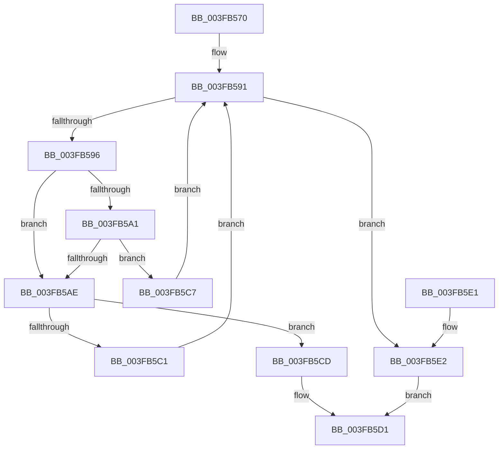

# FsRtlFindLargeIndex

- RVA: `0x003FB570`–`0x003FB5E8` (길이 `120` bytes)
- VA: `0x00000001403FB570`
- 실행 섹션: `.text`
- PDB 이름 있음: `예`; PDB Function 태그: `아니요`
- unwind 정보 RVA: `0x000985B8`
- 디코드: `40`개 명령, `120/120` bytes 표시
- 미해석 바이트: `0` (있으면 어셈블리에 `.byte`로 보존)

> 이 문서는 커널 이미지의 기계어와 PDB 기호를 분석해 생성했습니다. 4번과 5번은 함수 원형과 자료형을 바이너리 사용 방식에서 추정한 C 해석이며 원본 소스 복구 결과는 아닙니다.

## 1. Dependencies

- 직접 호출 지점: **0**; 고유 호출 대상: **0**
- 직접 호출자로 확인된 함수: **2**
- RIP 상대 이미지 참조: **0**

### Outgoing calls
- 직접 디코드된 call 명령이 없습니다.

### Direct callers
- [FsRtlTruncateBaseMcb](FsRtlTruncateBaseMcb_function_003FB460.md) at `0x003FB4B6`
- [FsRtlSplitBaseMcb](../58/FsRtlSplitBaseMcb_function_005813E0.md) at `0x0058140A`

### Static image references
- 디코드된 RIP-relative 메모리 참조가 없습니다.

## 2. Other-region calls and transfers

- 다른 실행 섹션으로 향하는 call: **0**
- 별도 외부 분기/꼬리 이동을 확인하지 못했습니다.

## 3. Assembly (complete function range)

```asm
003FB570  48 89 5C 24 08                  mov qword ptr [rsp + 8], rbx
003FB575  48 89 74 24 10                  mov qword ptr [rsp + 0x10], rsi
003FB57A  48 89 7C 24 18                  mov qword ptr [rsp + 0x18], rdi
003FB57F  8B 71 04                        mov esi, dword ptr [rcx + 4]
003FB582  49 8B F8                        mov rdi, r8
003FB585  8B DA                           mov ebx, edx
003FB587  4C 8B D9                        mov r11, rcx
003FB58A  45 33 C9                        xor r9d, r9d
003FB58D  44 8D 56 FF                     lea r10d, [rsi - 1]
003FB591  45 3B CA                        cmp r9d, r10d
003FB594  7F 4C                           jg 0x1403fb5e2
003FB596  43 8D 04 0A                     lea eax, [r10 + r9]
003FB59A  99                              cdq
003FB59B  2B C2                           sub eax, edx
003FB59D  D1 F8                           sar eax, 1
003FB59F  74 0D                           je 0x1403fb5ae
003FB5A1  49 8B 4B 10                     mov rcx, qword ptr [r11 + 0x10]
003FB5A5  48 63 D0                        movsxd rdx, eax
003FB5A8  3B 5C D1 F8                     cmp ebx, dword ptr [rcx + rdx*8 - 8]
003FB5AC  72 19                           jb 0x1403fb5c7
003FB5AE  49 8B 4B 10                     mov rcx, qword ptr [r11 + 0x10]
003FB5B2  48 63 D0                        movsxd rdx, eax
003FB5B5  44 8B 04 D1                     mov r8d, dword ptr [rcx + rdx*8]
003FB5B9  41 FF C8                        dec r8d
003FB5BC  41 3B D8                        cmp ebx, r8d
003FB5BF  76 0C                           jbe 0x1403fb5cd
003FB5C1  44 8D 48 01                     lea r9d, [rax + 1]
003FB5C5  EB CA                           jmp 0x1403fb591
003FB5C7  44 8D 50 FF                     lea r10d, [rax - 1]
003FB5CB  EB C4                           jmp 0x1403fb591
003FB5CD  89 07                           mov dword ptr [rdi], eax
003FB5CF  B0 01                           mov al, 1
003FB5D1  48 8B 5C 24 08                  mov rbx, qword ptr [rsp + 8]
003FB5D6  48 8B 74 24 10                  mov rsi, qword ptr [rsp + 0x10]
003FB5DB  48 8B 7C 24 18                  mov rdi, qword ptr [rsp + 0x18]
003FB5E0  C3                              ret
003FB5E1  CC                              int3
003FB5E2  89 37                           mov dword ptr [rdi], esi
003FB5E4  32 C0                           xor al, al
003FB5E6  EB E9                           jmp 0x1403fb5d1
```

## 4. C-style interpretation (structured pseudocode)

```c
__int64 __fastcall FsRtlFindLargeIndex(__int64 a1, int a2, __int64 a3, int a4)
{
    __int64 result;
    unsigned __int64 v_stack_p10;
    unsigned __int64 v_stack_p18;
    unsigned __int64 v_stack_p8;

    v_stack_p8 = v_rbx;
    v_stack_p10 = v_rsi;
    v_stack_p18 = v_rdi;
    a4 = 0;
loc_003FB591:
    if (0 > ((unsigned int)((unsigned int)(*(unsigned int *)(a1 + 4)) - 1))) goto loc_003FB5E2;
    result = (unsigned int)(((unsigned int)(*(unsigned int *)(a1 + 4)) - 1 + a4 * 1) - (a2));
    result = (unsigned int)((result) >> (1));
    if (condition_is_equal) goto loc_003FB5AE;
    if (((unsigned int)((unsigned int)(a2))) < (*(unsigned int *)(*(unsigned __int64 *)(a1 + 16) + (int)((unsigned int)(result)) * 8 - 8))) goto loc_003FB5C7;
loc_003FB5AE:
    a3 = (unsigned int)(((unsigned int)(*(unsigned int *)(*(unsigned __int64 *)(a1 + 16) + (int)((unsigned int)(result)) * 8))) - 1);
    if (((unsigned int)((unsigned int)(a2))) <= ((unsigned int)(a3))) goto loc_003FB5CD;
    goto loc_003FB591;
loc_003FB5C7:
    goto loc_003FB591;
loc_003FB5CD:
    *(unsigned int *)(a3) = (unsigned int)(result);
loc_003FB5D1:
    return 1;
loc_003FB5E2:
    *(unsigned int *)(v_stack_p18) = (unsigned int)(v_stack_p10);
    result = 0;
    goto loc_003FB5D1;
}
```

## 5. (Beta) C Style

```c
int64_t FsRtlFindLargeIndex(void *Arg1, int32_t Arg2, void *Arg3, int32_t Arg4)
{
    uint8_t *arg1 = (uint8_t *)Arg1;
    uint8_t *arg3 = (uint8_t *)Arg3;

    int64_t result;
    uint64_t v_stack_p10;
    uint64_t v_stack_p18;
    uint64_t v_stack_p8;

    v_stack_p8 = local_rbx;
    v_stack_p10 = local_rsi;
    v_stack_p18 = local_rdi;
    Arg4 = 0;
loc_003FB591:
    if (0 > ((uint32_t)((uint32_t)(*(uint32_t *)(arg1 + 0x4)) - 1))) goto loc_003FB5E2;
    result = (uint32_t)(((uint32_t)(*(uint32_t *)(arg1 + 0x4)) - 1 + Arg4 * 1) - (Arg2));
    result = (uint32_t)((result) >> (1));
    if (condition_is_equal) goto loc_003FB5AE;
    if (((uint32_t)((uint32_t)(Arg2))) < (*(uint32_t *)(*(uint64_t *)(arg1 + 0x10) + (int32_t)((uint32_t)(result)) * 8 - 0x8))) goto loc_003FB5C7;
loc_003FB5AE:
    Arg3 = (uint32_t)(((uint32_t)(*(uint32_t *)(*(uint64_t *)(arg1 + 0x10) + (int32_t)((uint32_t)(result)) * 8))) - 1);
    if (((uint32_t)((uint32_t)(Arg2))) <= ((uint32_t)(Arg3))) goto loc_003FB5CD;
    goto loc_003FB591;
loc_003FB5C7:
    goto loc_003FB591;
loc_003FB5CD:
    *(uint32_t *)(arg3) = (uint32_t)(result);
loc_003FB5D1:
    return 1;
loc_003FB5E2:
    *(uint32_t *)(v_stack_p18) = (uint32_t)(v_stack_p10);
    result = 0;
    goto loc_003FB5D1;
}
```

### 관측된 메모리 오프셋

구조체 형식이 확인되지 않은 접근은 인자 기준의 오프셋으로만 기록했습니다.

| 기준 인자 | 오프셋 표현 | 폭 (bit) | 접근 |
|---|---:|---:|---|
| `Arg1` | `+ 0x4` | `32` | `R` |
| `Arg1` | `+ 0x10` | `64` | `R` |
| `Arg3` | `+ 0x0` | `32` | `W` |

## 6. Execution-region graph

[열기: 2D/3D 그래프와 함수 탐색 컨트롤 패널](../../../control-panel.html?section=text&rva=0x003FB570&view=graph)

- 2D 그래프는 위에서 아래로 흐르고, 3D 그래프는 빈 공간을 드래그해 회전합니다. Shift+드래그는 이동, 휠은 확대·축소, 함수 노드 선택은 대상 보고서 이동입니다.

### Static fallback


