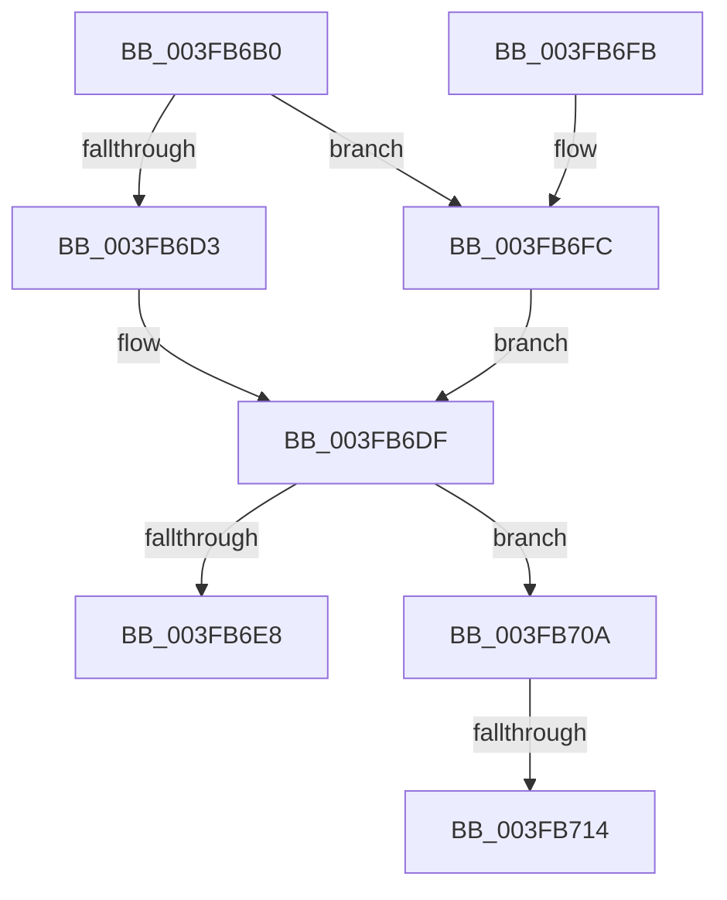

# FsRtlInitializeBaseMcbEx

- RVA: `0x003FB6B0`–`0x003FB71F` (길이 `111` bytes)
- VA: `0x00000001403FB6B0`
- 실행 섹션: `.text`
- PDB 이름 있음: `예`; PDB Function 태그: `예`
- unwind 정보 RVA: `0x000985CC`
- 디코드: `30`개 명령, `111/111` bytes 표시
- 미해석 바이트: `0` (있으면 어셈블리에 `.byte`로 보존)

> 이 문서는 커널 이미지의 기계어와 PDB 기호를 분석해 생성했습니다. 4번과 5번은 함수 원형과 자료형을 바이너리 사용 방식에서 추정한 C 해석이며 원본 소스 복구 결과는 아닙니다.

## 1. Dependencies

- 직접 호출 지점: **3**; 고유 호출 대상: **3**
- 직접 호출자로 확인된 함수: **2**
- RIP 상대 이미지 참조: **2**

### Outgoing calls
- `0x003FB6DA` → [ExAllocateFromPagedLookasideList](ExAllocateFromPagedLookasideList_function_003FB730.md) (function, `0x003FB730`)
- `0x003FB703` → [ExAllocateFromNPagedLookasideList](../38/ExAllocateFromNPagedLookasideList_function_0038E6C0.md) (function, `0x0038E6C0`)
- `0x003FB719` → [RtlRaiseStatus](../2F/RtlRaiseStatus_function_002F6A50.md) (function, `0x002F6A50`)

### Direct callers
- [FsRtlInitializeLargeMcb](FsRtlInitializeLargeMcb_function_003FB640.md) at `0x003FB653`
- [FsRtlInitializeBaseMcb](../58/FsRtlInitializeBaseMcb_function_00581230.md) at `0x0058123A`

### Static image references
- `0x003FB6D3` → RVA `0x00E11E00` (`.data`; read)
- `0x003FB6FC` → RVA `0x00E11D80` (`.data`; read)

## 2. Other-region calls and transfers

- 다른 실행 섹션으로 향하는 call: **0**
- call이 아닌 외부 분기/꼬리 이동: **1**
  - `0x003FB70E` → [sub_006EBCC4](../6E/Unknown_function_006EBCC4.md) (`tail-transfer`)

## 3. Assembly (complete function range)

```asm
003FB6B0  48 89 5C 24 08                  mov qword ptr [rsp + 8], rbx
003FB6B5  57                              push rdi
003FB6B6  48 83 EC 20                     sub rsp, 0x20
003FB6BA  83 61 04 00                     and dword ptr [rcx + 4], 0
003FB6BE  41 0F B7 F8                     movzx edi, r8w
003FB6C2  66 89 51 08                     mov word ptr [rcx + 8], dx
003FB6C6  48 8B D9                        mov rbx, rcx
003FB6C9  66 44 89 41 0A                  mov word ptr [rcx + 0xa], r8w
003FB6CE  83 FA 01                        cmp edx, 1
003FB6D1  75 29                           jne 0x1403fb6fc
003FB6D3  48 8D 0D 26 67 A1 00            lea rcx, [rip + 0xa16726]
003FB6DA  E8 51 00 00 00                  call 0x1403fb730
003FB6DF  48 89 43 10                     mov qword ptr [rbx + 0x10], rax
003FB6E3  48 85 C0                        test rax, rax
003FB6E6  74 22                           je 0x1403fb70a
003FB6E8  C7 03 0F 00 00 00               mov dword ptr [rbx], 0xf
003FB6EE  B0 01                           mov al, 1
003FB6F0  48 8B 5C 24 30                  mov rbx, qword ptr [rsp + 0x30]
003FB6F5  48 83 C4 20                     add rsp, 0x20
003FB6F9  5F                              pop rdi
003FB6FA  C3                              ret
003FB6FB  CC                              int3
003FB6FC  48 8D 0D 7D 66 A1 00            lea rcx, [rip + 0xa1667d]
003FB703  E8 B8 2F F9 FF                  call 0x14038e6c0
003FB708  EB D5                           jmp 0x1403fb6df
003FB70A  40 F6 C7 01                     test dil, 1
003FB70E  0F 84 B0 05 2F 00               je 0x1406ebcc4
003FB714  B9 9A 00 00 C0                  mov ecx, 0xc000009a
003FB719  E8 32 B3 EF FF                  call 0x1402f6a50
003FB71E  CC                              int3
```

## 4. C-style interpretation (structured pseudocode)

```c
__int64 __fastcall FsRtlInitializeBaseMcbEx(__int64 a1, int a2, unsigned __int16 a3)
{
    __int64 result;
    __int64 v_rsp;
    unsigned __int64 v_stack_p8;

    v_stack_p8 = v_rbx;
    v_rsp = (v_rsp) - (32);
    *(unsigned __int16 *)(a1 + 8) = (unsigned __int16)(a2);
    *(unsigned __int16 *)(a1 + 10) = a3;
    if (a2 != 1) goto loc_003FB6FC;
    result = ExAllocateFromPagedLookasideList(v_rip + 10577702, a2, a3, a4);
loc_003FB6DF:
    *(unsigned __int64 *)(a1 + 16) = result;
    if (result == 0) goto loc_003FB70A;
    *(unsigned int *)(a1) = 15;
    v_rsp = (v_rsp) + (32);
    return 1;
loc_003FB6FC:
    result = ExAllocateFromNPagedLookasideList(v_rip + 10577533, a2, a3, a4);
    goto loc_003FB6DF;
loc_003FB70A:
    result = RtlRaiseStatus((unsigned int)(0xC000009AULL), a2, a3, a4);
    return result;
}
```

## 5. (Beta) C Style

```c
int64_t FsRtlInitializeBaseMcbEx(void *Arg1, int32_t Arg2, uint16_t Arg3)
{
    uint8_t *arg1 = (uint8_t *)Arg1;

    int64_t result;
    int64_t local_rsp;
    uint64_t v_stack_p8;

    v_stack_p8 = local_rbx;
    local_rsp = (local_rsp) - (32);
    *(uint16_t *)(arg1 + 0x8) = (uint16_t)(Arg2);
    *(uint16_t *)(arg1 + 0xA) = Arg3;
    if (Arg2 != 1) goto loc_003FB6FC;
    result = ExAllocateFromPagedLookasideList(v_rip + 10577702, Arg2, Arg3, a4);
loc_003FB6DF:
    *(uint64_t *)(arg1 + 0x10) = result;
    if (result == 0) goto loc_003FB70A;
    *(uint32_t *)(arg1) = 15;
    local_rsp = (local_rsp) + (32);
    return 1;
loc_003FB6FC:
    result = ExAllocateFromNPagedLookasideList(v_rip + 10577533, Arg2, Arg3, a4);
    goto loc_003FB6DF;
loc_003FB70A:
    result = RtlRaiseStatus((uint32_t)(0xC000009AULL), Arg2, Arg3, a4);
    return result;
}
```

### 관측된 메모리 오프셋

구조체 형식이 확인되지 않은 접근은 인자 기준의 오프셋으로만 기록했습니다.

| 기준 인자 | 오프셋 표현 | 폭 (bit) | 접근 |
|---|---:|---:|---|
| `Arg1` | `+ 0x0` | `32` | `W` |
| `Arg1` | `+ 0x4` | `32` | `R/W` |
| `Arg1` | `+ 0x8` | `16` | `W` |
| `Arg1` | `+ 0xA` | `16` | `W` |
| `Arg1` | `+ 0x10` | `64` | `W` |

## 6. Execution-region graph

[열기: 2D/3D 그래프와 함수 탐색 컨트롤 패널](../../../control-panel.html?section=text&rva=0x003FB6B0&view=graph)

- 2D 그래프는 위에서 아래로 흐르고, 3D 그래프는 빈 공간을 드래그해 회전합니다. Shift+드래그는 이동, 휠은 확대·축소, 함수 노드 선택은 대상 보고서 이동입니다.

### Static fallback


