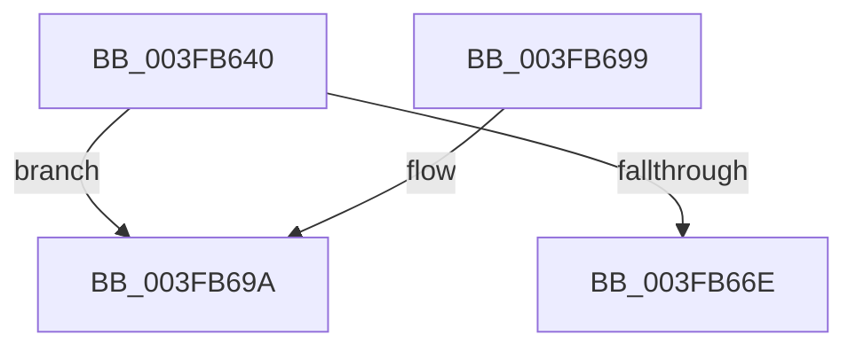

# FsRtlInitializeLargeMcb

- RVA: `0x003FB640`–`0x003FB6A5` (길이 `101` bytes)
- VA: `0x00000001403FB640`
- 실행 섹션: `.text`
- PDB 이름 있음: `예`; PDB Function 태그: `아니요`
- unwind 정보 RVA: `0x0007FBDC`
- 디코드: `28`개 명령, `101/101` bytes 표시
- 미해석 바이트: `0` (있으면 어셈블리에 `.byte`로 보존)

> 이 문서는 커널 이미지의 기계어와 PDB 기호를 분석해 생성했습니다. 4번과 5번은 함수 원형과 자료형을 바이너리 사용 방식에서 추정한 C 해석이며 원본 소스 복구 결과는 아닙니다.

## 1. Dependencies

- 직접 호출 지점: **3**; 고유 호출 대상: **3**
- 직접 호출자로 확인된 함수: **1**
- RIP 상대 이미지 참조: **1**

### Outgoing calls
- `0x003FB653` → [FsRtlInitializeBaseMcbEx](FsRtlInitializeBaseMcbEx_function_003FB6B0.md) (function, `0x003FB6B0`)
- `0x003FB65F` → [ExAllocateFromNPagedLookasideList](../38/ExAllocateFromNPagedLookasideList_function_0038E6C0.md) (function, `0x0038E6C0`)
- `0x003FB69F` → [RtlRaiseStatus](../2F/RtlRaiseStatus_function_002F6A50.md) (function, `0x002F6A50`)

### Direct callers
- [FsRtlInitializeMcb](../../page/71/FsRtlInitializeMcb_function_00713F70.md) at `0x00713F74`

### Static image references
- `0x003FB658` → RVA `0x00E11E80` (`.data`; read)

## 2. Other-region calls and transfers

- 다른 실행 섹션으로 향하는 call: **0**
- 별도 외부 분기/꼬리 이동을 확인하지 못했습니다.

## 3. Assembly (complete function range)

```asm
003FB640  40 53                           push rbx
003FB642  48 83 EC 20                     sub rsp, 0x20
003FB646  48 8B D9                        mov rbx, rcx
003FB649  41 B8 01 00 00 00               mov r8d, 1
003FB64F  48 83 C1 08                     add rcx, 8
003FB653  E8 58 00 00 00                  call 0x1403fb6b0
003FB658  48 8D 0D 21 68 A1 00            lea rcx, [rip + 0xa16821]
003FB65F  E8 5C 30 F9 FF                  call 0x14038e6c0
003FB664  33 C9                           xor ecx, ecx
003FB666  48 89 03                        mov qword ptr [rbx], rax
003FB669  48 85 C0                        test rax, rax
003FB66C  74 2C                           je 0x1403fb69a
003FB66E  C7 00 01 00 00 00               mov dword ptr [rax], 1
003FB674  48 89 48 08                     mov qword ptr [rax + 8], rcx
003FB678  89 48 10                        mov dword ptr [rax + 0x10], ecx
003FB67B  66 C7 40 18 01 00               mov word ptr [rax + 0x18], 1
003FB681  C6 40 1A 06                     mov byte ptr [rax + 0x1a], 6
003FB685  89 48 1C                        mov dword ptr [rax + 0x1c], ecx
003FB688  48 83 C0 20                     add rax, 0x20
003FB68C  48 89 40 08                     mov qword ptr [rax + 8], rax
003FB690  48 89 00                        mov qword ptr [rax], rax
003FB693  48 83 C4 20                     add rsp, 0x20
003FB697  5B                              pop rbx
003FB698  C3                              ret
003FB699  CC                              int3
003FB69A  B9 9A 00 00 C0                  mov ecx, 0xc000009a
003FB69F  E8 AC B3 EF FF                  call 0x1402f6a50
003FB6A4  CC                              int3
```

## 4. C-style interpretation (structured pseudocode)

```c
__int64 __fastcall FsRtlInitializeLargeMcb(__int64 a1)
{
    __int64 result;
    __int64 v_rsp;

    v_rsp = (v_rsp) - (32);
    a1 = (a1) + (8);
    result = FsRtlInitializeBaseMcbEx(a1, a2, 1, a4);
    result = ExAllocateFromNPagedLookasideList(v_rip + 10577953, a2, 1, a4);
    a1 = 0;
    *(unsigned __int64 *)(a1) = result;
    if (result == 0) goto loc_003FB69A;
    *(unsigned int *)(result) = 1;
    *(unsigned __int64 *)(result + 8) = 0;
    *(unsigned int *)(result + 16) = 0;
    *(unsigned __int16 *)(result + 24) = 1;
    *(unsigned __int8 *)(result + 26) = 6;
    *(unsigned int *)(result + 28) = 0;
    result = (result) + (32);
    *(unsigned __int64 *)(result + 8) = result;
    *(unsigned __int64 *)(result) = result;
    v_rsp = (v_rsp) + (32);
    return result;
loc_003FB69A:
    result = RtlRaiseStatus((unsigned int)(0xC000009AULL), a2, 1, a4);
    return result;
}
```

## 5. (Beta) C Style

```c
int64_t FsRtlInitializeLargeMcb(void *Arg1)
{
    uint8_t *arg1 = (uint8_t *)Arg1;

    int64_t result;
    int64_t local_rsp;

    local_rsp = (local_rsp) - (32);
    Arg1 = (Arg1) + (8);
    result = FsRtlInitializeBaseMcbEx(Arg1, a2, 1, a4);
    result = ExAllocateFromNPagedLookasideList(v_rip + 10577953, a2, 1, a4);
    Arg1 = 0;
    *(uint64_t *)(arg1) = result;
    if (result == 0) goto loc_003FB69A;
    *(uint32_t *)(result) = 1;
    *(uint64_t *)(result + 0x8) = 0;
    *(uint32_t *)(result + 0x10) = 0;
    *(uint16_t *)(result + 0x18) = 1;
    *(uint8_t *)(result + 0x1A) = 6;
    *(uint32_t *)(result + 0x1C) = 0;
    result = (result) + (32);
    *(uint64_t *)(result + 0x8) = result;
    *(uint64_t *)(result) = result;
    local_rsp = (local_rsp) + (32);
    return result;
loc_003FB69A:
    result = RtlRaiseStatus((uint32_t)(0xC000009AULL), a2, 1, a4);
    return result;
}
```

### 관측된 메모리 오프셋

구조체 형식이 확인되지 않은 접근은 인자 기준의 오프셋으로만 기록했습니다.

| 기준 인자 | 오프셋 표현 | 폭 (bit) | 접근 |
|---|---:|---:|---|
| `Arg1` | `+ 0x0` | `64` | `W` |

## 6. Execution-region graph

[열기: 2D/3D 그래프와 함수 탐색 컨트롤 패널](../../../control-panel.html?section=text&rva=0x003FB640&view=graph)

- 2D 그래프는 위에서 아래로 흐르고, 3D 그래프는 빈 공간을 드래그해 회전합니다. Shift+드래그는 이동, 휠은 확대·축소, 함수 노드 선택은 대상 보고서 이동입니다.

### Static fallback


