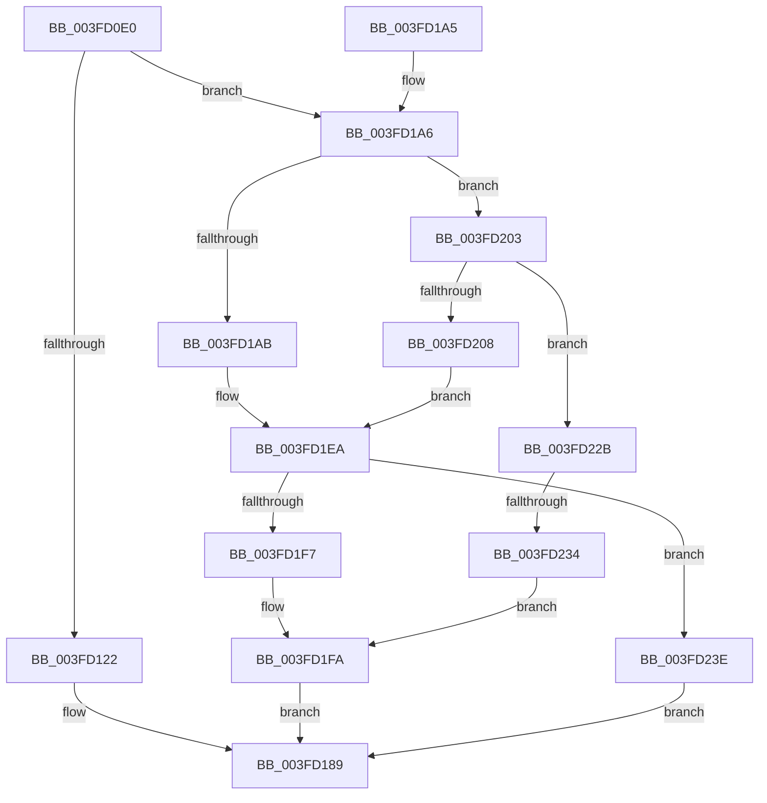

# FsRtlProcessFileLock

- RVA: `0x003FD0E0`–`0x003FD250` (길이 `368` bytes)
- VA: `0x00000001403FD0E0`
- 실행 섹션: `.text`
- PDB 이름 있음: `예`; PDB Function 태그: `예`
- unwind 정보 RVA: `0x0009998C`
- 디코드: `98`개 명령, `368/368` bytes 표시
- 미해석 바이트: `0` (있으면 어셈블리에 `.byte`로 보존)

> 이 문서는 커널 이미지의 기계어와 PDB 기호를 분석해 생성했습니다. 4번과 5번은 함수 원형과 자료형을 바이너리 사용 방식에서 추정한 C 해석이며 원본 소스 복구 결과는 아닙니다.

## 1. Dependencies

- 직접 호출 지점: **8**; 고유 호출 대상: **6**
- 직접 호출자로 확인된 함수: **0**
- RIP 상대 이미지 참조: **0**

### Outgoing calls
- `0x003FD13A` → [IoGetRequestorProcess](IoGetRequestorProcess_function_003FD4E0.md) (function, `0x003FD4E0`)
- `0x003FD180` → [FsRtlPrivateLock](../38/FsRtlPrivateLock_function_0038DF90.md) (function, `0x0038DF90`)
- `0x003FD1B7` → [IoGetRequestorProcess](IoGetRequestorProcess_function_003FD4E0.md) (function, `0x003FD4E0`)
- `0x003FD1E5` → [FsRtlFastUnlockSingle](../38/FsRtlFastUnlockSingle_function_0038CB80.md) (function, `0x0038CB80`)
- `0x003FD1FC` → [IofCompleteRequest](../29/IofCompleteRequest_function_0029B5C0.md) (function, `0x0029B5C0`)
- `0x003FD208` → [IoGetRequestorProcess](IoGetRequestorProcess_function_003FD4E0.md) (function, `0x003FD4E0`)
- `0x003FD224` → [FsRtlPrivateFastUnlockAll](FsRtlPrivateFastUnlockAll_function_003FD554.md) (function, `0x003FD554`)
- `0x003FD244` → [guard_dispatch_icall](../6B/guard_dispatch_icall_function_006BAAD0.md) (function, `0x006BAAD0`)

### Direct callers
- 이 함수 시작 RVA로 연결되는 직접 call은 확인되지 않았습니다. 간접 호출은 완전히 역산할 수 없습니다.

### Static image references
- 디코드된 RIP-relative 메모리 참조가 없습니다.

## 2. Other-region calls and transfers

- 다른 실행 섹션으로 향하는 call: **0**
- call이 아닌 외부 분기/꼬리 이동: **1**
  - `0x003FD22E` → [sub_006EBCF4](../6E/Unknown_function_006EBCF4.md) (`tail-transfer`)

## 3. Assembly (complete function range)

```asm
003FD0E0  4C 8B DC                        mov r11, rsp
003FD0E3  49 89 5B 08                     mov qword ptr [r11 + 8], rbx
003FD0E7  49 89 6B 18                     mov qword ptr [r11 + 0x18], rbp
003FD0EB  49 89 73 20                     mov qword ptr [r11 + 0x20], rsi
003FD0EF  57                              push rdi
003FD0F0  41 56                           push r14
003FD0F2  41 57                           push r15
003FD0F4  48 83 EC 70                     sub rsp, 0x70
003FD0F8  48 8B AA B8 00 00 00            mov rbp, qword ptr [rdx + 0xb8]
003FD0FF  48 8B F2                        mov rsi, rdx
003FD102  49 83 63 D8 00                  and qword ptr [r11 - 0x28], 0
003FD107  4C 8B F9                        mov r15, rcx
003FD10A  49 83 63 E0 00                  and qword ptr [r11 - 0x20], 0
003FD10F  4D 8B F0                        mov r14, r8
003FD112  48 8B CE                        mov rcx, rsi
003FD115  0F B6 55 01                     movzx edx, byte ptr [rbp + 1]
003FD119  83 EA 01                        sub edx, 1
003FD11C  0F 85 84 00 00 00               jne 0x1403fd1a6
003FD122  40 8A 7D 02                     mov dil, byte ptr [rbp + 2]
003FD126  48 8B 45 18                     mov rax, qword ptr [rbp + 0x18]
003FD12A  40 8A DF                        mov bl, dil
003FD12D  D0 EB                           shr bl, 1
003FD12F  40 80 E7 01                     and dil, 1
003FD133  80 E3 01                        and bl, 1
003FD136  49 89 43 10                     mov qword ptr [r11 + 0x10], rax
003FD13A  E8 A1 03 00 00                  call 0x1403fd4e0
003FD13F  4C 8B 4D 08                     mov r9, qword ptr [rbp + 8]
003FD143  48 8D 4C 24 60                  lea rcx, [rsp + 0x60]
003FD148  48 8B 55 30                     mov rdx, qword ptr [rbp + 0x30]
003FD14C  4C 8D 84 24 98 00 00 00         lea r8, [rsp + 0x98]
003FD154  C6 44 24 58 00                  mov byte ptr [rsp + 0x58], 0
003FD159  4C 89 74 24 50                  mov qword ptr [rsp + 0x50], r14
003FD15E  48 89 74 24 48                  mov qword ptr [rsp + 0x48], rsi
003FD163  48 89 4C 24 40                  mov qword ptr [rsp + 0x40], rcx
003FD168  8B 4D 10                        mov ecx, dword ptr [rbp + 0x10]
003FD16B  88 5C 24 38                     mov byte ptr [rsp + 0x38], bl
003FD16F  40 88 7C 24 30                  mov byte ptr [rsp + 0x30], dil
003FD174  89 4C 24 28                     mov dword ptr [rsp + 0x28], ecx
003FD178  49 8B CF                        mov rcx, r15
003FD17B  48 89 44 24 20                  mov qword ptr [rsp + 0x20], rax
003FD180  E8 0B 0E F9 FF                  call 0x14038df90
003FD185  8B 5C 24 60                     mov ebx, dword ptr [rsp + 0x60]
003FD189  4C 8D 5C 24 70                  lea r11, [rsp + 0x70]
003FD18E  8B C3                           mov eax, ebx
003FD190  49 8B 5B 20                     mov rbx, qword ptr [r11 + 0x20]
003FD194  49 8B 6B 30                     mov rbp, qword ptr [r11 + 0x30]
003FD198  49 8B 73 38                     mov rsi, qword ptr [r11 + 0x38]
003FD19C  49 8B E3                        mov rsp, r11
003FD19F  41 5F                           pop r15
003FD1A1  41 5E                           pop r14
003FD1A3  5F                              pop rdi
003FD1A4  C3                              ret
003FD1A5  CC                              int3
003FD1A6  83 EA 01                        sub edx, 1
003FD1A9  75 58                           jne 0x1403fd203
003FD1AB  48 8B 45 18                     mov rax, qword ptr [rbp + 0x18]
003FD1AF  48 89 84 24 98 00 00 00         mov qword ptr [rsp + 0x98], rax
003FD1B7  E8 24 03 00 00                  call 0x1403fd4e0
003FD1BC  8B 4D 10                        mov ecx, dword ptr [rbp + 0x10]
003FD1BF  4C 8D 84 24 98 00 00 00         lea r8, [rsp + 0x98]
003FD1C7  4C 8B 4D 08                     mov r9, qword ptr [rbp + 8]
003FD1CB  48 8B 55 30                     mov rdx, qword ptr [rbp + 0x30]
003FD1CF  C6 44 24 38 00                  mov byte ptr [rsp + 0x38], 0
003FD1D4  4C 89 74 24 30                  mov qword ptr [rsp + 0x30], r14
003FD1D9  89 4C 24 28                     mov dword ptr [rsp + 0x28], ecx
003FD1DD  49 8B CF                        mov rcx, r15
003FD1E0  48 89 44 24 20                  mov qword ptr [rsp + 0x20], rax
003FD1E5  E8 96 F9 F8 FF                  call 0x14038cb80
003FD1EA  8B D8                           mov ebx, eax
003FD1EC  49 8B 07                        mov rax, qword ptr [r15]
003FD1EF  89 5E 30                        mov dword ptr [rsi + 0x30], ebx
003FD1F2  48 85 C0                        test rax, rax
003FD1F5  75 47                           jne 0x1403fd23e
003FD1F7  48 8B CE                        mov rcx, rsi
003FD1FA  B2 01                           mov dl, 1
003FD1FC  E8 BF E3 E9 FF                  call 0x14029b5c0
003FD201  EB 86                           jmp 0x1403fd189
003FD203  83 EA 01                        sub edx, 1
003FD206  75 23                           jne 0x1403fd22b
003FD208  E8 D3 02 00 00                  call 0x1403fd4e0
003FD20D  48 8B 55 30                     mov rdx, qword ptr [rbp + 0x30]
003FD211  45 33 C9                        xor r9d, r9d
003FD214  4C 8B C0                        mov r8, rax
003FD217  4C 89 74 24 28                  mov qword ptr [rsp + 0x28], r14
003FD21C  49 8B CF                        mov rcx, r15
003FD21F  C6 44 24 20 00                  mov byte ptr [rsp + 0x20], 0
003FD224  E8 2B 03 00 00                  call 0x1403fd554
003FD229  EB BF                           jmp 0x1403fd1ea
003FD22B  83 FA 01                        cmp edx, 1
003FD22E  0F 84 C0 EA 2E 00               je 0x1406ebcf4
003FD234  BB 10 00 00 C0                  mov ebx, 0xc0000010
003FD239  89 5E 30                        mov dword ptr [rsi + 0x30], ebx
003FD23C  EB BC                           jmp 0x1403fd1fa
003FD23E  48 8B D6                        mov rdx, rsi
003FD241  49 8B CE                        mov rcx, r14
003FD244  E8 87 D8 2B 00                  call 0x1406baad0
003FD249  8B D8                           mov ebx, eax
003FD24B  E9 39 FF FF FF                  jmp 0x1403fd189
```

## 4. C-style interpretation (structured pseudocode)

```c
__int64 __fastcall FsRtlProcessFileLock(__int64 a1, __int64 a2, __int64 a3)
{
    __int64 result;
    __int64 v_rbx;
    __int64 v_rdi;
    __int64 v_rsp;
    unsigned __int64 v_stack_m18;
    unsigned __int64 v_stack_m28;
    unsigned __int8 v_stack_m30;
    unsigned __int64 v_stack_m38;
    unsigned __int64 v_stack_m40;
    unsigned __int64 v_stack_m48;
    unsigned __int8 v_stack_m50;
    unsigned __int8 v_stack_m58;
    unsigned int v_stack_m60;
    unsigned __int64 v_stack_m68;
    unsigned __int64 v_stack_p10;
    unsigned __int64 v_stack_p28;

    *(unsigned __int64 *)(v_rsp + 8) = v_rbx;
    *(unsigned __int64 *)(v_rsp + 24) = v_rbp;
    *(unsigned __int64 *)(v_rsp + 32) = v_rsi;
    v_rsp = (v_rsp) - (112);
    a2 = (unsigned int)((*(unsigned __int8 *)(*(unsigned __int64 *)(a2 + 184) + 1)) - (1));
    if (condition_is_not_equal) goto loc_003FD1A6;
    v_rbx = (unsigned __int8)(((unsigned __int8)(*(unsigned __int8 *)(*(unsigned __int64 *)(a2 + 184) + 2))) >> (1));
    v_rdi = (unsigned __int8)((*(unsigned __int8 *)(*(unsigned __int64 *)(a2 + 184) + 2)) & (1));
    v_rbx = (unsigned __int8)((v_rbx) & (1));
    *(unsigned __int64 *)(v_rsp + 16) = *(unsigned __int64 *)(*(unsigned __int64 *)(a2 + 184) + 24);
    result = IoGetRequestorProcess(a2, a2, a3, a4);
    v_stack_m30 = 0;
    v_stack_m38 = a3;
    v_stack_m40 = a2;
    v_stack_m48 = v_stack_m28;
    v_stack_m50 = (unsigned __int8)(v_rbx);
    v_stack_m58 = (unsigned __int8)(v_rdi);
    v_stack_m60 = (unsigned int)((unsigned int)(*(unsigned int *)(*(unsigned __int64 *)(a2 + 184) + 16)));
    v_stack_m68 = result;
    result = FsRtlPrivateLock(a1, *(unsigned __int64 *)(*(unsigned __int64 *)(a2 + 184) + 48), v_stack_p10, *(unsigned __int64 *)(*(unsigned __int64 *)(a2 + 184) + 8));
loc_003FD189:
    return (unsigned int)((unsigned int)((unsigned int)(v_stack_m28)));
loc_003FD1A6:
    a2 = (unsigned int)((*(unsigned __int64 *)(*(unsigned __int64 *)(a2 + 184) + 48)) - (1));
    if (condition_is_not_equal) goto loc_003FD203;
    v_stack_p28 = *(unsigned __int64 *)(*(unsigned __int64 *)(v_stack_m18 + 48) + 24);
    result = IoGetRequestorProcess(a1, a2, v_stack_p10, *(unsigned __int64 *)(*(unsigned __int64 *)(a2 + 184) + 8));
    v_stack_m38 = 0;
    v_stack_m40 = a3;
    v_stack_m48 = (unsigned int)((unsigned int)(*(unsigned int *)(*(unsigned __int64 *)(v_stack_m18 + 48) + 16)));
    v_stack_m50 = result;
    result = FsRtlFastUnlockSingle(a1, *(unsigned __int64 *)(*(unsigned __int64 *)(v_stack_m18 + 48) + 48), v_stack_p28, *(unsigned __int64 *)(*(unsigned __int64 *)(v_stack_m18 + 48) + 8));
loc_003FD1EA:
    *(unsigned int *)(*(unsigned __int64 *)(v_stack_m18 + 56) + 48) = (unsigned int)((unsigned int)((unsigned int)(result)));
    if (*(unsigned __int64 *)(a1) != 0) goto loc_003FD23E;
loc_003FD1FA:
    result = IofCompleteRequest(*(unsigned __int64 *)(v_stack_m18 + 56), 1, v_stack_p28, *(unsigned __int64 *)(*(unsigned __int64 *)(v_stack_m18 + 48) + 8));
    goto loc_003FD189;
loc_003FD203:
    a2 = (unsigned int)((1) - (1));
    if (condition_is_not_equal) goto loc_003FD22B;
    result = IoGetRequestorProcess(*(unsigned __int64 *)(v_stack_m18 + 56), a2, v_stack_p28, *(unsigned __int64 *)(*(unsigned __int64 *)(v_stack_m18 + 48) + 8));
    a4 = 0;
    v_stack_m48 = a3;
    v_stack_m50 = 0;
    result = FsRtlPrivateFastUnlockAll(a1, *(unsigned __int64 *)(*(unsigned __int64 *)(v_stack_m18 + 48) + 48), result, a4);
    goto loc_003FD1EA;
loc_003FD22B:
    *(unsigned int *)(*(unsigned __int64 *)(v_stack_m18 + 56) + 48) = (unsigned int)((unsigned int)(0xC0000010ULL));
    goto loc_003FD1FA;
loc_003FD23E:
    result = guard_dispatch_icall(a3, *(unsigned __int64 *)(v_stack_m18 + 56), result, a4);
    goto loc_003FD189;
}
```

## 5. (Beta) C Style

```c
int64_t FsRtlProcessFileLock(void *Arg1, void *Arg2, int64_t Arg3)
{
    uint8_t *arg1 = (uint8_t *)Arg1;
    uint8_t *arg2 = (uint8_t *)Arg2;

    int64_t result;
    int64_t local_rbx;
    int64_t local_rdi;
    int64_t local_rsp;
    uint64_t v_stack_m18;
    uint64_t v_stack_m28;
    uint8_t v_stack_m30;
    uint64_t v_stack_m38;
    uint64_t v_stack_m40;
    uint64_t v_stack_m48;
    uint8_t v_stack_m50;
    uint8_t v_stack_m58;
    uint32_t v_stack_m60;
    uint64_t v_stack_m68;
    uint64_t v_stack_p10;
    uint64_t v_stack_p28;

    *(uint64_t *)(local_rsp + 0x8) = local_rbx;
    *(uint64_t *)(local_rsp + 0x18) = local_rbp;
    *(uint64_t *)(local_rsp + 0x20) = local_rsi;
    local_rsp = (local_rsp) - (112);
    Arg2 = (uint32_t)((*(uint8_t *)(*(uint64_t *)(arg2 + 0xB8) + 0x1)) - (1));
    if (condition_is_not_equal) goto loc_003FD1A6;
    local_rbx = (uint8_t)(((uint8_t)(*(uint8_t *)(*(uint64_t *)(arg2 + 0xB8) + 0x2))) >> (1));
    local_rdi = (uint8_t)((*(uint8_t *)(*(uint64_t *)(arg2 + 0xB8) + 0x2)) & (1));
    local_rbx = (uint8_t)((local_rbx) & (1));
    *(uint64_t *)(local_rsp + 0x10) = *(uint64_t *)(*(uint64_t *)(arg2 + 0xB8) + 0x18);
    result = IoGetRequestorProcess(Arg2, Arg2, Arg3, a4);
    v_stack_m30 = 0;
    v_stack_m38 = Arg3;
    v_stack_m40 = Arg2;
    v_stack_m48 = v_stack_m28;
    v_stack_m50 = (uint8_t)(local_rbx);
    v_stack_m58 = (uint8_t)(local_rdi);
    v_stack_m60 = (uint32_t)((uint32_t)(*(uint32_t *)(*(uint64_t *)(arg2 + 0xB8) + 0x10)));
    v_stack_m68 = result;
    result = FsRtlPrivateLock(Arg1, *(uint64_t *)(*(uint64_t *)(arg2 + 0xB8) + 0x30), v_stack_p10, *(uint64_t *)(*(uint64_t *)(arg2 + 0xB8) + 0x8));
loc_003FD189:
    return (uint32_t)((uint32_t)((uint32_t)(v_stack_m28)));
loc_003FD1A6:
    Arg2 = (uint32_t)((*(uint64_t *)(*(uint64_t *)(arg2 + 0xB8) + 0x30)) - (1));
    if (condition_is_not_equal) goto loc_003FD203;
    v_stack_p28 = *(uint64_t *)(*(uint64_t *)(v_stack_m18 + 0x30) + 0x18);
    result = IoGetRequestorProcess(Arg1, Arg2, v_stack_p10, *(uint64_t *)(*(uint64_t *)(arg2 + 0xB8) + 0x8));
    v_stack_m38 = 0;
    v_stack_m40 = Arg3;
    v_stack_m48 = (uint32_t)((uint32_t)(*(uint32_t *)(*(uint64_t *)(v_stack_m18 + 0x30) + 0x10)));
    v_stack_m50 = result;
    result = FsRtlFastUnlockSingle(Arg1, *(uint64_t *)(*(uint64_t *)(v_stack_m18 + 0x30) + 0x30), v_stack_p28, *(uint64_t *)(*(uint64_t *)(v_stack_m18 + 0x30) + 0x8));
loc_003FD1EA:
    *(uint32_t *)(*(uint64_t *)(v_stack_m18 + 0x38) + 0x30) = (uint32_t)((uint32_t)((uint32_t)(result)));
    if (*(uint64_t *)(arg1) != 0) goto loc_003FD23E;
loc_003FD1FA:
    result = IofCompleteRequest(*(uint64_t *)(v_stack_m18 + 0x38), 1, v_stack_p28, *(uint64_t *)(*(uint64_t *)(v_stack_m18 + 0x30) + 0x8));
    goto loc_003FD189;
loc_003FD203:
    Arg2 = (uint32_t)((1) - (1));
    if (condition_is_not_equal) goto loc_003FD22B;
    result = IoGetRequestorProcess(*(uint64_t *)(v_stack_m18 + 0x38), Arg2, v_stack_p28, *(uint64_t *)(*(uint64_t *)(v_stack_m18 + 0x30) + 0x8));
    a4 = 0;
    v_stack_m48 = Arg3;
    v_stack_m50 = 0;
    result = FsRtlPrivateFastUnlockAll(Arg1, *(uint64_t *)(*(uint64_t *)(v_stack_m18 + 0x30) + 0x30), result, a4);
    goto loc_003FD1EA;
loc_003FD22B:
    *(uint32_t *)(*(uint64_t *)(v_stack_m18 + 0x38) + 0x30) = (uint32_t)((uint32_t)(0xC0000010ULL));
    goto loc_003FD1FA;
loc_003FD23E:
    result = guard_dispatch_icall(Arg3, *(uint64_t *)(v_stack_m18 + 0x38), result, a4);
    goto loc_003FD189;
}
```

### 관측된 메모리 오프셋

구조체 형식이 확인되지 않은 접근은 인자 기준의 오프셋으로만 기록했습니다.

| 기준 인자 | 오프셋 표현 | 폭 (bit) | 접근 |
|---|---:|---:|---|
| `Arg1` | `+ 0x0` | `64` | `R` |
| `Arg2` | `+ 0x30` | `32` | `W` |
| `Arg2` | `+ 0xB8` | `64` | `R` |

## 6. Execution-region graph

[열기: 2D/3D 그래프와 함수 탐색 컨트롤 패널](../../../control-panel.html?section=text&rva=0x003FD0E0&view=graph)

- 2D 그래프는 위에서 아래로 흐르고, 3D 그래프는 빈 공간을 드래그해 회전합니다. Shift+드래그는 이동, 휠은 확대·축소, 함수 노드 선택은 대상 보고서 이동입니다.

### Static fallback


