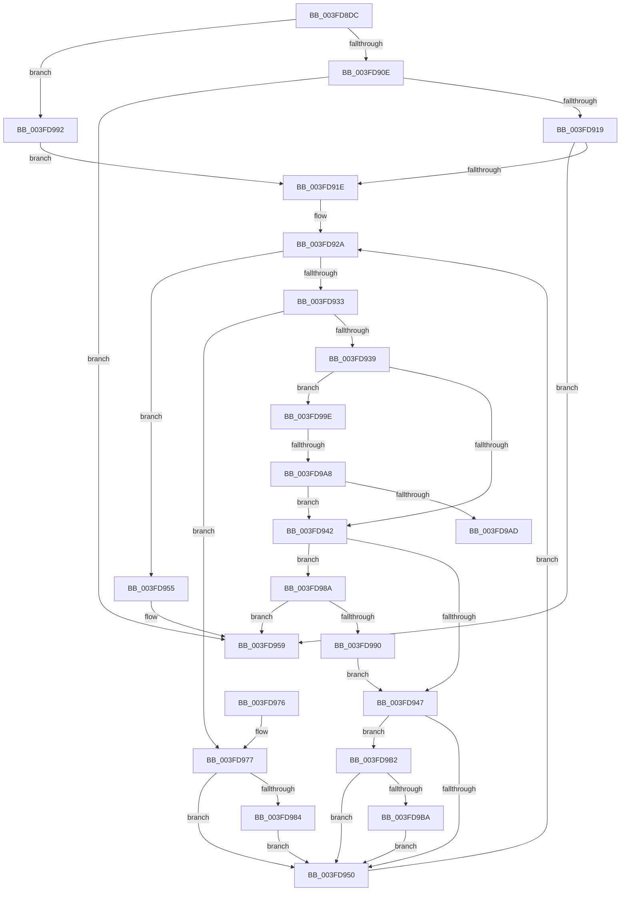

# FsRtlSplitLocks

- RVA: `0x003FD8DC`–`0x003FD9C0` (길이 `228` bytes)
- VA: `0x00000001403FD8DC`
- 실행 섹션: `.text`
- PDB 이름 있음: `예`; PDB Function 태그: `예`
- unwind 정보 RVA: `0x00099A48`
- 디코드: `75`개 명령, `228/228` bytes 표시
- 미해석 바이트: `0` (있으면 어셈블리에 `.byte`로 보존)

> 이 문서는 커널 이미지의 기계어와 PDB 기호를 분석해 생성했습니다. 4번과 5번은 함수 원형과 자료형을 바이너리 사용 방식에서 추정한 C 해석이며 원본 소스 복구 결과는 아닙니다.

## 1. Dependencies

- 직접 호출 지점: **0**; 고유 호출 대상: **0**
- 직접 호출자로 확인된 함수: **3**
- RIP 상대 이미지 참조: **0**

### Outgoing calls
- 직접 디코드된 call 명령이 없습니다.

### Direct callers
- [FsRtlPrivateInsertSharedLock](../38/FsRtlPrivateInsertSharedLock_function_0038E810.md) at `0x0038E9C2`
- [FsRtlPrivateFastUnlockAll](FsRtlPrivateFastUnlockAll_function_003FD554.md) at `0x003FD7A0`
- [sub_006E56AC](../6E/Unknown_function_006E56AC.md) at `0x006E56D6`

### Static image references
- 디코드된 RIP-relative 메모리 참조가 없습니다.

## 2. Other-region calls and transfers

- 다른 실행 섹션으로 향하는 call: **0**
- call이 아닌 외부 분기/꼬리 이동: **2**
  - `0x003FD9A2` → [sub_006EBE5A](../6E/Unknown_function_006EBE5A.md) (`tail-transfer`)
  - `0x003FD9AD` → [sub_006EBE5A](../6E/Unknown_function_006EBE5A.md) (`tail-transfer`)

## 3. Assembly (complete function range)

```asm
003FD8DC  48 89 5C 24 10                  mov qword ptr [rsp + 0x10], rbx
003FD8E1  48 89 6C 24 18                  mov qword ptr [rsp + 0x18], rbp
003FD8E6  48 89 74 24 20                  mov qword ptr [rsp + 0x20], rsi
003FD8EB  57                              push rdi
003FD8EC  41 54                           push r12
003FD8EE  41 55                           push r13
003FD8F0  41 56                           push r14
003FD8F2  41 57                           push r15
003FD8F4  48 83 EC 20                     sub rsp, 0x20
003FD8F8  4C 8B E2                        mov r12, rdx
003FD8FB  48 8B E9                        mov rbp, rcx
003FD8FE  33 D2                           xor edx, edx
003FD900  8B DA                           mov ebx, edx
003FD902  44 8B EA                        mov r13d, edx
003FD905  38 51 08                        cmp byte ptr [rcx + 8], dl
003FD908  0F 85 84 00 00 00               jne 0x1403fd992
003FD90E  49 8B 38                        mov rdi, qword ptr [r8]
003FD911  49 8B 19                        mov rbx, qword ptr [r9]
003FD914  48 39 11                        cmp qword ptr [rcx], rdx
003FD917  74 40                           je 0x1403fd959
003FD919  48 3B FB                        cmp rdi, rbx
003FD91C  76 3B                           jbe 0x1403fd959
003FD91E  48 8B 49 10                     mov rcx, qword ptr [rcx + 0x10]
003FD922  48 8B F2                        mov rsi, rdx
003FD925  48 89 4C 24 50                  mov qword ptr [rsp + 0x50], rcx
003FD92A  4D 8B 34 24                     mov r14, qword ptr [r12]
003FD92E  4D 85 F6                        test r14, r14
003FD931  74 22                           je 0x1403fd955
003FD933  4C 39 75 00                     cmp qword ptr [rbp], r14
003FD937  74 3E                           je 0x1403fd977
003FD939  49 8B 46 08                     mov rax, qword ptr [r14 + 8]
003FD93D  48 3B C3                        cmp rax, rbx
003FD940  77 5C                           ja 0x1403fd99e
003FD942  48 3B CF                        cmp rcx, rdi
003FD945  77 43                           ja 0x1403fd98a
003FD947  49 8B 46 30                     mov rax, qword ptr [r14 + 0x30]
003FD94B  48 3B D8                        cmp rbx, rax
003FD94E  72 62                           jb 0x1403fd9b2
003FD950  4D 8B E6                        mov r12, r14
003FD953  EB D5                           jmp 0x1403fd92a
003FD955  48 89 5D 10                     mov qword ptr [rbp + 0x10], rbx
003FD959  48 8B 5C 24 58                  mov rbx, qword ptr [rsp + 0x58]
003FD95E  48 8B 6C 24 60                  mov rbp, qword ptr [rsp + 0x60]
003FD963  48 8B 74 24 68                  mov rsi, qword ptr [rsp + 0x68]
003FD968  48 83 C4 20                     add rsp, 0x20
003FD96C  41 5F                           pop r15
003FD96E  41 5E                           pop r14
003FD970  41 5D                           pop r13
003FD972  41 5C                           pop r12
003FD974  5F                              pop rdi
003FD975  C3                              ret
003FD976  CC                              int3
003FD977  49 8B 5E 30                     mov rbx, qword ptr [r14 + 0x30]
003FD97B  49 8B 76 08                     mov rsi, qword ptr [r14 + 8]
003FD97F  48 3B CF                        cmp rcx, rdi
003FD982  77 CC                           ja 0x1403fd950
003FD984  48 89 5D 10                     mov qword ptr [rbp + 0x10], rbx
003FD988  EB C6                           jmp 0x1403fd950
003FD98A  49 39 7E 08                     cmp qword ptr [r14 + 8], rdi
003FD98E  77 C9                           ja 0x1403fd959
003FD990  EB B5                           jmp 0x1403fd947
003FD992  48 8B 79 10                     mov rdi, qword ptr [rcx + 0x10]
003FD996  4C 8B E1                        mov r12, rcx
003FD999  88 51 08                        mov byte ptr [rcx + 8], dl
003FD99C  EB 80                           jmp 0x1403fd91e
003FD99E  49 39 56 10                     cmp qword ptr [r14 + 0x10], rdx
003FD9A2  0F 85 B2 E4 2E 00               jne 0x1406ebe5a
003FD9A8  48 3B C6                        cmp rax, rsi
003FD9AB  74 95                           je 0x1403fd942
003FD9AD  E9 A8 E4 2E 00                  jmp 0x1406ebe5a
003FD9B2  48 8B D8                        mov rbx, rax
003FD9B5  48 3B CF                        cmp rcx, rdi
003FD9B8  77 96                           ja 0x1403fd950
003FD9BA  48 89 45 10                     mov qword ptr [rbp + 0x10], rax
003FD9BE  EB 90                           jmp 0x1403fd950
```

## 4. C-style interpretation (structured pseudocode)

```c
__int64 __fastcall FsRtlSplitLocks(__int64 a1, __int64 a2, __int64 a3, __int64 a4)
{
    __int64 v_rsp;
    unsigned __int64 v_stack_p10;
    unsigned __int64 v_stack_p18;
    unsigned __int64 v_stack_p20;
    unsigned __int64 v_stack_p8;

    v_stack_p10 = v_rbx;
    v_stack_p18 = v_rbp;
    v_stack_p20 = v_rsi;
    v_rsp = (v_rsp) - (32);
    a2 = 0;
    if ((*(unsigned __int8 *)(a1 + 8)) != 0) goto loc_003FD992;
    if ((*(unsigned __int64 *)(a1)) == 0) goto loc_003FD959;
    if ((*(unsigned __int64 *)(a3)) <= (*(unsigned __int64 *)(a4))) goto loc_003FD959;
loc_003FD91E:
    v_stack_p8 = *(unsigned __int64 *)(a1 + 16);
loc_003FD92A:
    if (*(unsigned __int64 *)(a2) == 0) goto loc_003FD955;
    if ((*(unsigned __int64 *)(a1)) == (*(unsigned __int64 *)(a2))) goto loc_003FD977;
    if ((*(unsigned __int64 *)(*(unsigned __int64 *)(a2) + 8)) > (*(unsigned __int64 *)(a4))) goto loc_003FD99E;
loc_003FD942:
    if ((*(unsigned __int64 *)(a1 + 16)) > (*(unsigned __int64 *)(a3))) goto loc_003FD98A;
loc_003FD947:
    if ((*(unsigned __int64 *)(a4)) < (*(unsigned __int64 *)(*(unsigned __int64 *)(a2) + 48))) goto loc_003FD9B2;
loc_003FD950:
    goto loc_003FD92A;
loc_003FD955:
    *(unsigned __int64 *)(a1 + 16) = *(unsigned __int64 *)(a4);
loc_003FD959:
    v_rsp = (v_rsp) + (32);
    return *(unsigned __int64 *)(*(unsigned __int64 *)(a2) + 48);
loc_003FD977:
    if ((*(unsigned __int64 *)(a1 + 16)) > (*(unsigned __int64 *)(a3))) goto loc_003FD950;
    *(unsigned __int64 *)(v_stack_p18 + 16) = *(unsigned __int64 *)(*(unsigned __int64 *)(a2) + 48);
    goto loc_003FD950;
loc_003FD98A:
    if ((*(unsigned __int64 *)(*(unsigned __int64 *)(a2) + 8)) > (*(unsigned __int64 *)(a3))) goto loc_003FD959;
    goto loc_003FD947;
loc_003FD992:
    *(unsigned __int8 *)(*(unsigned __int64 *)(a1 + 16) + 8) = 0;
    goto loc_003FD91E;
loc_003FD99E:
    if ((*(unsigned __int64 *)(*(unsigned __int64 *)(a2) + 48)) == (*(unsigned __int64 *)(*(unsigned __int64 *)(a2) + 8))) goto loc_003FD942;
loc_003FD9B2:
    if ((*(unsigned __int64 *)(a1 + 16)) > (*(unsigned __int64 *)(*(unsigned __int64 *)(a1 + 16) + 16))) goto loc_003FD950;
    *(unsigned __int64 *)(v_stack_p18 + 16) = *(unsigned __int64 *)(*(unsigned __int64 *)(a2) + 48);
    goto loc_003FD950;
}
```

## 5. (Beta) C Style

```c
int64_t FsRtlSplitLocks(void *Arg1, int64_t Arg2, void *Arg3, void *Arg4)
{
    uint8_t *arg1 = (uint8_t *)Arg1;
    uint8_t *arg3 = (uint8_t *)Arg3;
    uint8_t *arg4 = (uint8_t *)Arg4;

    int64_t local_rsp;
    uint64_t v_stack_p10;
    uint64_t v_stack_p18;
    uint64_t v_stack_p20;
    uint64_t v_stack_p8;

    v_stack_p10 = local_rbx;
    v_stack_p18 = local_rbp;
    v_stack_p20 = local_rsi;
    local_rsp = (local_rsp) - (32);
    Arg2 = 0;
    if ((*(uint8_t *)(arg1 + 0x8)) != 0) goto loc_003FD992;
    if ((*(uint64_t *)(arg1)) == 0) goto loc_003FD959;
    if ((*(uint64_t *)(arg3)) <= (*(uint64_t *)(arg4))) goto loc_003FD959;
loc_003FD91E:
    v_stack_p8 = *(uint64_t *)(arg1 + 0x10);
loc_003FD92A:
    if (*(uint64_t *)(Arg2) == 0) goto loc_003FD955;
    if ((*(uint64_t *)(arg1)) == (*(uint64_t *)(Arg2))) goto loc_003FD977;
    if ((*(uint64_t *)(*(uint64_t *)(Arg2) + 0x8)) > (*(uint64_t *)(arg4))) goto loc_003FD99E;
loc_003FD942:
    if ((*(uint64_t *)(arg1 + 0x10)) > (*(uint64_t *)(arg3))) goto loc_003FD98A;
loc_003FD947:
    if ((*(uint64_t *)(arg4)) < (*(uint64_t *)(*(uint64_t *)(Arg2) + 0x30))) goto loc_003FD9B2;
loc_003FD950:
    goto loc_003FD92A;
loc_003FD955:
    *(uint64_t *)(arg1 + 0x10) = *(uint64_t *)(arg4);
loc_003FD959:
    local_rsp = (local_rsp) + (32);
    return *(uint64_t *)(*(uint64_t *)(Arg2) + 0x30);
loc_003FD977:
    if ((*(uint64_t *)(arg1 + 0x10)) > (*(uint64_t *)(arg3))) goto loc_003FD950;
    *(uint64_t *)(v_stack_p18 + 0x10) = *(uint64_t *)(*(uint64_t *)(Arg2) + 0x30);
    goto loc_003FD950;
loc_003FD98A:
    if ((*(uint64_t *)(*(uint64_t *)(Arg2) + 0x8)) > (*(uint64_t *)(arg3))) goto loc_003FD959;
    goto loc_003FD947;
loc_003FD992:
    *(uint8_t *)(*(uint64_t *)(arg1 + 0x10) + 0x8) = 0;
    goto loc_003FD91E;
loc_003FD99E:
    if ((*(uint64_t *)(*(uint64_t *)(Arg2) + 0x30)) == (*(uint64_t *)(*(uint64_t *)(Arg2) + 0x8))) goto loc_003FD942;
loc_003FD9B2:
    if ((*(uint64_t *)(arg1 + 0x10)) > (*(uint64_t *)(*(uint64_t *)(arg1 + 0x10) + 0x10))) goto loc_003FD950;
    *(uint64_t *)(v_stack_p18 + 0x10) = *(uint64_t *)(*(uint64_t *)(Arg2) + 0x30);
    goto loc_003FD950;
}
```

### 관측된 메모리 오프셋

구조체 형식이 확인되지 않은 접근은 인자 기준의 오프셋으로만 기록했습니다.

| 기준 인자 | 오프셋 표현 | 폭 (bit) | 접근 |
|---|---:|---:|---|
| `Arg1` | `+ 0x0` | `64` | `R` |
| `Arg1` | `+ 0x8` | `8` | `R` |
| `Arg1` | `+ 0x8` | `8` | `W` |
| `Arg1` | `+ 0x10` | `64` | `R` |
| `Arg1` | `+ 0x10` | `64` | `W` |
| `Arg3` | `+ 0x0` | `64` | `R` |
| `Arg4` | `+ 0x0` | `64` | `R` |

## 6. Execution-region graph

[열기: 2D/3D 그래프와 함수 탐색 컨트롤 패널](../../../control-panel.html?section=text&rva=0x003FD8DC&view=graph)

- 2D 그래프는 위에서 아래로 흐르고, 3D 그래프는 빈 공간을 드래그해 회전합니다. Shift+드래그는 이동, 휠은 확대·축소, 함수 노드 선택은 대상 보고서 이동입니다.

### Static fallback


