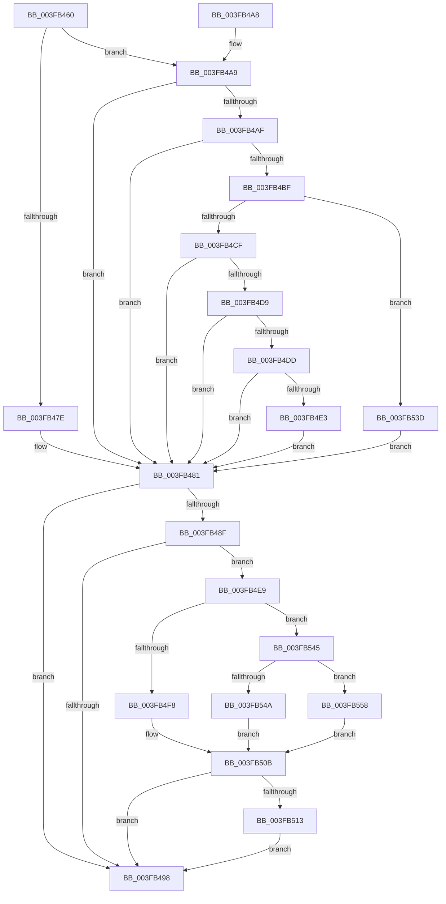

# FsRtlTruncateBaseMcb

- RVA: `0x003FB460`–`0x003FB566` (길이 `262` bytes)
- VA: `0x00000001403FB460`
- 실행 섹션: `.text`
- PDB 이름 있음: `예`; PDB Function 태그: `아니요`
- unwind 정보 RVA: `0x000985A4`
- 디코드: `81`개 명령, `262/262` bytes 표시
- 미해석 바이트: `0` (있으면 어셈블리에 `.byte`로 보존)

> 이 문서는 커널 이미지의 기계어와 PDB 기호를 분석해 생성했습니다. 4번과 5번은 함수 원형과 자료형을 바이너리 사용 방식에서 추정한 C 해석이며 원본 소스 복구 결과는 아닙니다.

## 1. Dependencies

- 직접 호출 지점: **6**; 고유 호출 대상: **6**
- 직접 호출자로 확인된 함수: **1**
- RIP 상대 이미지 참조: **2**

### Outgoing calls
- `0x003FB4B6` → [FsRtlFindLargeIndex](FsRtlFindLargeIndex_function_003FB570.md) (function, `0x003FB570`)
- `0x003FB506` → [ExAllocatePoolWithTag](../../poolcode/B8/ExAllocatePoolWithTag_function_00B82010.md) (function, `0x00B82010`)
- `0x003FB522` → [memcpy](../6C/memcpy_function_006C6840.md) (function, `0x006C6840`)
- `0x003FB52D` → [ExFreePoolWithTag](../../poolcode/B8/ExFreePoolWithTag_function_00B82870.md) (function, `0x00B82870`)
- `0x003FB551` → [ExAllocateFromPagedLookasideList](ExAllocateFromPagedLookasideList_function_003FB730.md) (function, `0x003FB730`)
- `0x003FB55F` → [ExAllocateFromNPagedLookasideList](../38/ExAllocateFromNPagedLookasideList_function_0038E6C0.md) (function, `0x0038E6C0`)

### Direct callers
- [FsRtlTruncateLargeMcb](FsRtlTruncateLargeMcb_function_003FB420.md) at `0x003FB43F`

### Static image references
- `0x003FB54A` → RVA `0x00E11E00` (`.data`; read)
- `0x003FB558` → RVA `0x00E11D80` (`.data`; read)

## 2. Other-region calls and transfers

- 다른 실행 섹션으로 향하는 call: **2**
  - `0x003FB506` → [ExAllocatePoolWithTag](../../poolcode/B8/ExAllocatePoolWithTag_function_00B82010.md) (`.text` → `POOLCODE`)
  - `0x003FB52D` → [ExFreePoolWithTag](../../poolcode/B8/ExFreePoolWithTag_function_00B82870.md) (`.text` → `POOLCODE`)
- 별도 외부 분기/꼬리 이동을 확인하지 못했습니다.

## 3. Assembly (complete function range)

```asm
003FB460  48 89 5C 24 10                  mov qword ptr [rsp + 0x10], rbx
003FB465  48 89 74 24 18                  mov qword ptr [rsp + 0x18], rsi
003FB46A  57                              push rdi
003FB46B  48 83 EC 20                     sub rsp, 0x20
003FB46F  83 64 24 30 00                  and dword ptr [rsp + 0x30], 0
003FB474  48 8B FA                        mov rdi, rdx
003FB477  48 8B D9                        mov rbx, rcx
003FB47A  85 D2                           test edx, edx
003FB47C  75 2B                           jne 0x1403fb4a9
003FB47E  21 51 04                        and dword ptr [rcx + 4], edx
003FB481  8B 0B                           mov ecx, dword ptr [rbx]
003FB483  8B C1                           mov eax, ecx
003FB485  8B 73 04                        mov esi, dword ptr [rbx + 4]
003FB488  C1 E8 02                        shr eax, 2
003FB48B  3B F0                           cmp esi, eax
003FB48D  73 09                           jae 0x1403fb498
003FB48F  BA 0F 00 00 00                  mov edx, 0xf
003FB494  3B CA                           cmp ecx, edx
003FB496  77 51                           ja 0x1403fb4e9
003FB498  48 8B 5C 24 38                  mov rbx, qword ptr [rsp + 0x38]
003FB49D  48 8B 74 24 40                  mov rsi, qword ptr [rsp + 0x40]
003FB4A2  48 83 C4 20                     add rsp, 0x20
003FB4A6  5F                              pop rdi
003FB4A7  C3                              ret
003FB4A8  CC                              int3
003FB4A9  83 79 04 00                     cmp dword ptr [rcx + 4], 0
003FB4AD  76 D2                           jbe 0x1403fb481
003FB4AF  FF CA                           dec edx
003FB4B1  4C 8D 44 24 30                  lea r8, [rsp + 0x30]
003FB4B6  E8 B5 00 00 00                  call 0x1403fb570
003FB4BB  84 C0                           test al, al
003FB4BD  74 C2                           je 0x1403fb481
003FB4BF  8B 44 24 30                     mov eax, dword ptr [rsp + 0x30]
003FB4C3  4C 8B 43 10                     mov r8, qword ptr [rbx + 0x10]
003FB4C7  41 83 7C C0 04 FF               cmp dword ptr [r8 + rax*8 + 4], -1
003FB4CD  74 6E                           je 0x1403fb53d
003FB4CF  8D 48 01                        lea ecx, [rax + 1]
003FB4D2  89 4B 04                        mov dword ptr [rbx + 4], ecx
003FB4D5  3B C1                           cmp eax, ecx
003FB4D7  73 A8                           jae 0x1403fb481
003FB4D9  85 C9                           test ecx, ecx
003FB4DB  74 A4                           je 0x1403fb481
003FB4DD  41 39 3C C0                     cmp dword ptr [r8 + rax*8], edi
003FB4E1  76 9E                           jbe 0x1403fb481
003FB4E3  41 89 3C C0                     mov dword ptr [r8 + rax*8], edi
003FB4E7  EB 98                           jmp 0x1403fb481
003FB4E9  0F B7 43 08                     movzx eax, word ptr [rbx + 8]
003FB4ED  03 F6                           add esi, esi
003FB4EF  3B F2                           cmp esi, edx
003FB4F1  0F 42 F2                        cmovb esi, edx
003FB4F4  3B F2                           cmp esi, edx
003FB4F6  74 4D                           je 0x1403fb545
003FB4F8  8B D6                           mov edx, esi
003FB4FA  8B C8                           mov ecx, eax
003FB4FC  48 C1 E2 03                     shl rdx, 3
003FB500  41 B8 46 53 69 6D               mov r8d, 0x6d695346
003FB506  E8 05 6B 78 00                  call 0x140b82010
003FB50B  48 8B F8                        mov rdi, rax
003FB50E  48 85 C0                        test rax, rax
003FB511  74 85                           je 0x1403fb498
003FB513  44 8B 43 04                     mov r8d, dword ptr [rbx + 4]
003FB517  48 8B C8                        mov rcx, rax
003FB51A  48 8B 53 10                     mov rdx, qword ptr [rbx + 0x10]
003FB51E  49 C1 E0 03                     shl r8, 3
003FB522  E8 19 B3 2C 00                  call 0x1406c6840
003FB527  48 8B 4B 10                     mov rcx, qword ptr [rbx + 0x10]
003FB52B  33 D2                           xor edx, edx
003FB52D  E8 3E 73 78 00                  call 0x140b82870
003FB532  48 89 7B 10                     mov qword ptr [rbx + 0x10], rdi
003FB536  89 33                           mov dword ptr [rbx], esi
003FB538  E9 5B FF FF FF                  jmp 0x1403fb498
003FB53D  89 43 04                        mov dword ptr [rbx + 4], eax
003FB540  E9 3C FF FF FF                  jmp 0x1403fb481
003FB545  83 F8 01                        cmp eax, 1
003FB548  75 0E                           jne 0x1403fb558
003FB54A  48 8D 0D AF 68 A1 00            lea rcx, [rip + 0xa168af]
003FB551  E8 DA 01 00 00                  call 0x1403fb730
003FB556  EB B3                           jmp 0x1403fb50b
003FB558  48 8D 0D 21 68 A1 00            lea rcx, [rip + 0xa16821]
003FB55F  E8 5C 31 F9 FF                  call 0x14038e6c0
003FB564  EB A5                           jmp 0x1403fb50b
```

## 4. C-style interpretation (structured pseudocode)

```c
__int64 __fastcall FsRtlTruncateBaseMcb(__int64 a1, __int64 a2)
{
    __int64 result;
    __int64 v_rsi;
    __int64 v_rsp;
    unsigned __int64 v_stack_p10;
    unsigned __int64 v_stack_p18;
    unsigned __int64 v_stack_p30;
    unsigned int v_stack_p8;

    v_stack_p10 = v_rbx;
    v_stack_p18 = v_rsi;
    v_rsp = (v_rsp) - (32);
    if ((unsigned int)(a2) != 0) goto loc_003FB4A9;
loc_003FB481:
    result = (unsigned int)(((unsigned int)((unsigned int)((unsigned int)(*(unsigned int *)(a1))))) >> (2));
    if (((unsigned int)((unsigned int)(*(unsigned int *)(a1 + 4)))) >= ((unsigned int)(result))) goto loc_003FB498;
    if (((unsigned int)((unsigned int)(*(unsigned int *)(a1)))) > 15) goto loc_003FB4E9;
loc_003FB498:
    v_rsp = (v_rsp) + (32);
    return result;
loc_003FB4A9:
    if ((*(unsigned int *)((unsigned int)(*(unsigned int *)(a1)) + 4)) <= 0) goto loc_003FB481;
    a2 = (unsigned int)((15) - 1);
    result = FsRtlFindLargeIndex((unsigned int)(*(unsigned int *)(a1)), a2, v_stack_p30, a4);
    if ((unsigned __int8)(result) == 0) goto loc_003FB481;
    if ((*(unsigned int *)(*(unsigned __int64 *)(v_stack_p10 + 16) + (unsigned int)(v_stack_p30) * 8 + 4)) == -1) goto loc_003FB53D;
    *(unsigned int *)(v_stack_p10 + 4) = (unsigned int)((unsigned int)(v_stack_p30) + 1);
    if (((unsigned int)((unsigned int)(v_stack_p30))) >= ((unsigned int)((unsigned int)(v_stack_p30) + 1))) goto loc_003FB481;
    if ((unsigned int)((unsigned int)(v_stack_p30) + 1) == 0) goto loc_003FB481;
    if ((*(unsigned int *)(*(unsigned __int64 *)(v_stack_p10 + 16) + (unsigned int)(v_stack_p30) * 8)) <= ((unsigned int)(a2))) goto loc_003FB481;
    *(unsigned int *)(*(unsigned __int64 *)(v_stack_p10 + 16) + (unsigned int)(v_stack_p30) * 8) = (unsigned int)(a2);
    goto loc_003FB481;
loc_003FB4E9:
    v_rsi = (unsigned int)((v_stack_p18) + ((unsigned int)(v_stack_p18)));
    if (((unsigned int)(v_rsi)) < ((unsigned int)(a2))) { v_rsi = (unsigned int)(a2); }
    if (((unsigned int)(v_rsi)) == ((unsigned int)(a2))) goto loc_003FB545;
    a2 = ((unsigned int)((unsigned int)(v_rsi))) << (3);
    result = ExAllocatePoolWithTag((unsigned int)((unsigned int)(*(unsigned __int16 *)(v_stack_p10 + 8))), a2, (unsigned int)(0x6D695346ULL), a4);
loc_003FB50B:
    if (result == 0) goto loc_003FB498;
    a3 = ((unsigned int)(*(unsigned int *)(v_stack_p10 + 4))) << (3);
    result = memcpy(result, *(unsigned __int64 *)(v_stack_p10 + 16), a3, a4);
    a2 = 0;
    result = ExFreePoolWithTag(*(unsigned __int64 *)(v_stack_p10 + 16), a2, a3, a4);
    *(unsigned __int64 *)(v_stack_p10 + 16) = result;
    *(unsigned int *)(v_stack_p10) = (unsigned int)(v_rsi);
    goto loc_003FB498;
loc_003FB53D:
    *(unsigned int *)(v_stack_p10 + 4) = (unsigned int)(result);
    goto loc_003FB481;
loc_003FB545:
    if (((unsigned int)(result)) != 1) goto loc_003FB558;
    result = ExAllocateFromPagedLookasideList(v_rip + 10578095, a2, a3, a4);
    goto loc_003FB50B;
loc_003FB558:
    result = ExAllocateFromNPagedLookasideList(v_rip + 10577953, a2, a3, a4);
    goto loc_003FB50B;
}
```

## 5. (Beta) C Style

```c
int64_t FsRtlTruncateBaseMcb(void *Arg1, int64_t Arg2)
{
    uint8_t *arg1 = (uint8_t *)Arg1;

    int64_t result;
    int64_t local_rsi;
    int64_t local_rsp;
    uint64_t v_stack_p10;
    uint64_t v_stack_p18;
    uint64_t v_stack_p30;
    uint32_t v_stack_p8;

    v_stack_p10 = local_rbx;
    v_stack_p18 = local_rsi;
    local_rsp = (local_rsp) - (32);
    if ((uint32_t)(Arg2) != 0) goto loc_003FB4A9;
loc_003FB481:
    result = (uint32_t)(((uint32_t)((uint32_t)((uint32_t)(*(uint32_t *)(arg1))))) >> (2));
    if (((uint32_t)((uint32_t)(*(uint32_t *)(arg1 + 0x4)))) >= ((uint32_t)(result))) goto loc_003FB498;
    if (((uint32_t)((uint32_t)(*(uint32_t *)(arg1)))) > 15) goto loc_003FB4E9;
loc_003FB498:
    local_rsp = (local_rsp) + (32);
    return result;
loc_003FB4A9:
    if ((*(uint32_t *)((uint32_t)(*(uint32_t *)(arg1)) + 0x4)) <= 0) goto loc_003FB481;
    Arg2 = (uint32_t)((15) - 1);
    result = FsRtlFindLargeIndex((uint32_t)(*(uint32_t *)(arg1)), Arg2, v_stack_p30, a4);
    if ((uint8_t)(result) == 0) goto loc_003FB481;
    if ((*(uint32_t *)(*(uint64_t *)(v_stack_p10 + 0x10) + (uint32_t)(v_stack_p30) * 8 + 0x4)) == -1) goto loc_003FB53D;
    *(uint32_t *)(v_stack_p10 + 0x4) = (uint32_t)((uint32_t)(v_stack_p30) + 1);
    if (((uint32_t)((uint32_t)(v_stack_p30))) >= ((uint32_t)((uint32_t)(v_stack_p30) + 1))) goto loc_003FB481;
    if ((uint32_t)((uint32_t)(v_stack_p30) + 1) == 0) goto loc_003FB481;
    if ((*(uint32_t *)(*(uint64_t *)(v_stack_p10 + 0x10) + (uint32_t)(v_stack_p30) * 8)) <= ((uint32_t)(Arg2))) goto loc_003FB481;
    *(uint32_t *)(*(uint64_t *)(v_stack_p10 + 0x10) + (uint32_t)(v_stack_p30) * 8) = (uint32_t)(Arg2);
    goto loc_003FB481;
loc_003FB4E9:
    local_rsi = (uint32_t)((v_stack_p18) + ((uint32_t)(v_stack_p18)));
    if (((uint32_t)(local_rsi)) < ((uint32_t)(Arg2))) { local_rsi = (uint32_t)(Arg2); }
    if (((uint32_t)(local_rsi)) == ((uint32_t)(Arg2))) goto loc_003FB545;
    Arg2 = ((uint32_t)((uint32_t)(local_rsi))) << (3);
    result = ExAllocatePoolWithTag((uint32_t)((uint32_t)(*(uint16_t *)(v_stack_p10 + 0x8))), Arg2, (uint32_t)(0x6D695346ULL), a4);
loc_003FB50B:
    if (result == 0) goto loc_003FB498;
    a3 = ((uint32_t)(*(uint32_t *)(v_stack_p10 + 0x4))) << (3);
    result = memcpy(result, *(uint64_t *)(v_stack_p10 + 0x10), a3, a4);
    Arg2 = 0;
    result = ExFreePoolWithTag(*(uint64_t *)(v_stack_p10 + 0x10), Arg2, a3, a4);
    *(uint64_t *)(v_stack_p10 + 0x10) = result;
    *(uint32_t *)(v_stack_p10) = (uint32_t)(local_rsi);
    goto loc_003FB498;
loc_003FB53D:
    *(uint32_t *)(v_stack_p10 + 0x4) = (uint32_t)(result);
    goto loc_003FB481;
loc_003FB545:
    if (((uint32_t)(result)) != 1) goto loc_003FB558;
    result = ExAllocateFromPagedLookasideList(v_rip + 10578095, Arg2, a3, a4);
    goto loc_003FB50B;
loc_003FB558:
    result = ExAllocateFromNPagedLookasideList(v_rip + 10577953, Arg2, a3, a4);
    goto loc_003FB50B;
}
```

### 관측된 메모리 오프셋

구조체 형식이 확인되지 않은 접근은 인자 기준의 오프셋으로만 기록했습니다.

| 기준 인자 | 오프셋 표현 | 폭 (bit) | 접근 |
|---|---:|---:|---|
| `Arg1` | `+ 0x0` | `32` | `R` |
| `Arg1` | `+ 0x0` | `32` | `W` |
| `Arg1` | `+ 0x4` | `32` | `R` |
| `Arg1` | `+ 0x4` | `32` | `R/W` |
| `Arg1` | `+ 0x4` | `32` | `W` |
| `Arg1` | `+ 0x8` | `16` | `R` |
| `Arg1` | `+ 0x10` | `64` | `R` |
| `Arg1` | `+ 0x10` | `64` | `W` |

## 6. Execution-region graph

[열기: 2D/3D 그래프와 함수 탐색 컨트롤 패널](../../../control-panel.html?section=text&rva=0x003FB460&view=graph)

- 2D 그래프는 위에서 아래로 흐르고, 3D 그래프는 빈 공간을 드래그해 회전합니다. Shift+드래그는 이동, 휠은 확대·축소, 함수 노드 선택은 대상 보고서 이동입니다.

### Static fallback


