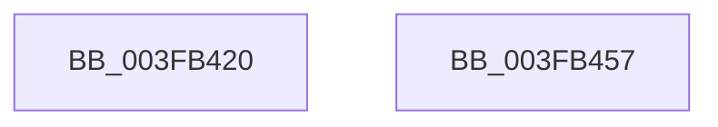

# FsRtlTruncateLargeMcb

- RVA: `0x003FB420`–`0x003FB458` (길이 `56` bytes)
- VA: `0x00000001403FB420`
- 실행 섹션: `.text`
- PDB 이름 있음: `예`; PDB Function 태그: `아니요`
- unwind 정보 RVA: `0x0005CAAC`
- 디코드: `17`개 명령, `56/56` bytes 표시
- 미해석 바이트: `0` (있으면 어셈블리에 `.byte`로 보존)

> 이 문서는 커널 이미지의 기계어와 PDB 기호를 분석해 생성했습니다. 4번과 5번은 함수 원형과 자료형을 바이너리 사용 방식에서 추정한 C 해석이며 원본 소스 복구 결과는 아닙니다.

## 1. Dependencies

- 직접 호출 지점: **3**; 고유 호출 대상: **3**
- 직접 호출자로 확인된 함수: **1**
- RIP 상대 이미지 참조: **0**

### Outgoing calls
- `0x003FB433` → [ExAcquireFastMutex](../20/ExAcquireFastMutex_function_0020E5A0.md) (function, `0x0020E5A0`)
- `0x003FB43F` → [FsRtlTruncateBaseMcb](FsRtlTruncateBaseMcb_function_003FB460.md) (function, `0x003FB460`)
- `0x003FB447` → [ExReleaseFastMutex](../25/ExReleaseFastMutex_function_002519C0.md) (function, `0x002519C0`)

### Direct callers
- [FsRtlTruncateMcb](../58/FsRtlTruncateMcb_function_005815C0.md) at `0x005815C6`

### Static image references
- 디코드된 RIP-relative 메모리 참조가 없습니다.

## 2. Other-region calls and transfers

- 다른 실행 섹션으로 향하는 call: **0**
- 별도 외부 분기/꼬리 이동을 확인하지 못했습니다.

## 3. Assembly (complete function range)

```asm
003FB420  48 89 5C 24 08                  mov qword ptr [rsp + 8], rbx
003FB425  57                              push rdi
003FB426  48 83 EC 20                     sub rsp, 0x20
003FB42A  48 8B F9                        mov rdi, rcx
003FB42D  48 8B DA                        mov rbx, rdx
003FB430  48 8B 09                        mov rcx, qword ptr [rcx]
003FB433  E8 68 31 E1 FF                  call 0x14020e5a0
003FB438  48 8D 4F 08                     lea rcx, [rdi + 8]
003FB43C  48 8B D3                        mov rdx, rbx
003FB43F  E8 1C 00 00 00                  call 0x1403fb460
003FB444  48 8B 0F                        mov rcx, qword ptr [rdi]
003FB447  E8 74 65 E5 FF                  call 0x1402519c0
003FB44C  48 8B 5C 24 30                  mov rbx, qword ptr [rsp + 0x30]
003FB451  48 83 C4 20                     add rsp, 0x20
003FB455  5F                              pop rdi
003FB456  C3                              ret
003FB457  CC                              int3
```

## 4. C-style interpretation (structured pseudocode)

```c
__int64 __fastcall FsRtlTruncateLargeMcb(__int64 a1, __int64 a2)
{
    __int64 result;
    __int64 v_rsp;
    unsigned __int64 v_stack_p8;

    v_stack_p8 = v_rbx;
    v_rsp = (v_rsp) - (32);
    result = ExAcquireFastMutex(*(unsigned __int64 *)(a1), a2, a3, a4);
    result = FsRtlTruncateBaseMcb(a1 + 8, a2, a3, a4);
    result = ExReleaseFastMutex(*(unsigned __int64 *)(a1), a2, a3, a4);
    v_rsp = (v_rsp) + (32);
    return result;
}
```

## 5. (Beta) C Style

```c
int64_t FsRtlTruncateLargeMcb(void *Arg1, int64_t Arg2)
{
    uint8_t *arg1 = (uint8_t *)Arg1;

    int64_t result;
    int64_t local_rsp;
    uint64_t v_stack_p8;

    v_stack_p8 = local_rbx;
    local_rsp = (local_rsp) - (32);
    result = ExAcquireFastMutex(*(uint64_t *)(arg1), Arg2, a3, a4);
    result = FsRtlTruncateBaseMcb(Arg1 + 8, Arg2, a3, a4);
    result = ExReleaseFastMutex(*(uint64_t *)(arg1), Arg2, a3, a4);
    local_rsp = (local_rsp) + (32);
    return result;
}
```

### 관측된 메모리 오프셋

구조체 형식이 확인되지 않은 접근은 인자 기준의 오프셋으로만 기록했습니다.

| 기준 인자 | 오프셋 표현 | 폭 (bit) | 접근 |
|---|---:|---:|---|
| `Arg1` | `+ 0x0` | `64` | `R` |
| `Arg1` | `+ 0x8` | `64` | `R` |

## 6. Execution-region graph

[열기: 2D/3D 그래프와 함수 탐색 컨트롤 패널](../../../control-panel.html?section=text&rva=0x003FB420&view=graph)

- 2D 그래프는 위에서 아래로 흐르고, 3D 그래프는 빈 공간을 드래그해 회전합니다. Shift+드래그는 이동, 휠은 확대·축소, 함수 노드 선택은 대상 보고서 이동입니다.

### Static fallback


