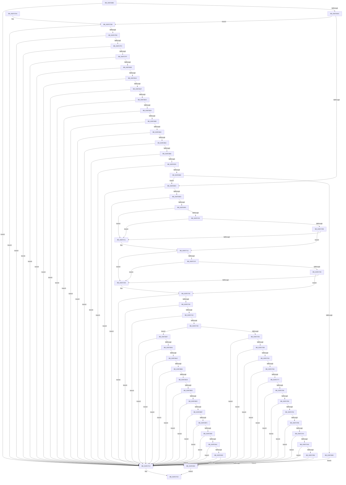

# FsRtlpOplockKeysEqual

- RVA: `0x003F26B0`–`0x003F2937` (길이 `647` bytes)
- VA: `0x00000001403F26B0`
- 실행 섹션: `.text`
- PDB 이름 있음: `예`; PDB Function 태그: `아니요`
- unwind 정보 RVA: `0x00097014`
- 디코드: `172`개 명령, `647/647` bytes 표시
- 미해석 바이트: `0` (있으면 어셈블리에 `.byte`로 보존)

> 이 문서는 커널 이미지의 기계어와 PDB 기호를 분석해 생성했습니다. 4번과 5번은 함수 원형과 자료형을 바이너리 사용 방식에서 추정한 C 해석이며 원본 소스 복구 결과는 아닙니다.

## 1. Dependencies

- 직접 호출 지점: **1**; 고유 호출 대상: **1**
- 직접 호출자로 확인된 함수: **9**
- RIP 상대 이미지 참조: **0**

### Outgoing calls
- `0x003F27F2` → [IoGetOplockKeyContextEx](IoGetOplockKeyContextEx_function_003F36C0.md) (function, `0x003F36C0`)

### Direct callers
- [FsRtlpAcknowledgeOplockBreakByCacheFlags](FsRtlpAcknowledgeOplockBreakByCacheFlags_function_003F1988.md) at `0x003F1C40`
- [FsRtlpAcknowledgeOplockBreakByCacheFlags](FsRtlpAcknowledgeOplockBreakByCacheFlags_function_003F1988.md) at `0x003F1DA4`
- [FsRtlOplockKeysEqual](FsRtlOplockKeysEqual_function_003F2690.md) at `0x003F2697`
- [FsRtlCheckOplockEx2](FsRtlCheckOplockEx2_function_003F2BC0.md) at `0x003F329A`
- [FsRtlCheckOplockEx2](FsRtlCheckOplockEx2_function_003F2BC0.md) at `0x003F3434`
- [FsRtlpRequestExclusiveOplock](FsRtlpRequestExclusiveOplock_function_003F3800.md) at `0x003F3BA8`
- [FsRtlpRequestExclusiveOplock](FsRtlpRequestExclusiveOplock_function_003F3800.md) at `0x003F3CDF`
- [FsRtlpRequestExclusiveOplock](FsRtlpRequestExclusiveOplock_function_003F3800.md) at `0x003F3DD0`
- [FsRtlpRequestExclusiveOplock](FsRtlpRequestExclusiveOplock_function_003F3800.md) at `0x003F3E8F`
- [FsRtlpOplockBreakToII](../4B/FsRtlpOplockBreakToII_function_004BB824.md) at `0x004BB883`
- [FsRtlpOplockBreakByCacheFlags](../4E/FsRtlpOplockBreakByCacheFlags_function_004E4990.md) at `0x004E4C9E`
- [FsRtlpOplockBreakByCacheFlags](../4E/FsRtlpOplockBreakByCacheFlags_function_004E4990.md) at `0x004E500F`
- [FsRtlpOplockBreakByCacheFlags](../4E/FsRtlpOplockBreakByCacheFlags_function_004E4990.md) at `0x004E519D`
- [FsRtlpOplockBreakByCacheFlags](../4E/FsRtlpOplockBreakByCacheFlags_function_004E4990.md) at `0x004E5908`
- [FsRtlpOplockBreakByCacheFlags](../4E/FsRtlpOplockBreakByCacheFlags_function_004E4990.md) at `0x004E5B59`
- [FsRtlpOplockBreakByCacheFlags](../4E/FsRtlpOplockBreakByCacheFlags_function_004E4990.md) at `0x004E5E80`
- [FsRtlpOplockBreakByCacheFlags](../4E/FsRtlpOplockBreakByCacheFlags_function_004E4990.md) at `0x004E5FDB`
- [FsRtlpOplockBreakByCacheFlags](../4E/FsRtlpOplockBreakByCacheFlags_function_004E4990.md) at `0x004E61BF`
- [FsRtlpOplockBreakByCacheFlags](../4E/FsRtlpOplockBreakByCacheFlags_function_004E4990.md) at `0x004E68FA`
- [FsRtlpRequestShareableOplock](../4E/FsRtlpRequestShareableOplock_function_004E6EC8.md) at `0x004E730B`
- [FsRtlpRequestShareableOplock](../4E/FsRtlpRequestShareableOplock_function_004E6EC8.md) at `0x004E7373`
- [FsRtlpRequestShareableOplock](../4E/FsRtlpRequestShareableOplock_function_004E6EC8.md) at `0x004E73E4`
- [FsRtlpRequestShareableOplock](../4E/FsRtlpRequestShareableOplock_function_004E6EC8.md) at `0x004E77B1`
- [FsRtlpRequestShareableOplock](../4E/FsRtlpRequestShareableOplock_function_004E6EC8.md) at `0x004E77E0`
- [FsRtlpRequestShareableOplock](../4E/FsRtlpRequestShareableOplock_function_004E6EC8.md) at `0x004E7854`
- [FsRtlpOplockBreakToNone](../4F/FsRtlpOplockBreakToNone_function_004F8354.md) at `0x004F84B8`
- [sub_006EDC30](../6E/Unknown_function_006EDC30.md) at `0x006EDC55`

### Static image references
- 디코드된 RIP-relative 메모리 참조가 없습니다.

## 2. Other-region calls and transfers

- 다른 실행 섹션으로 향하는 call: **0**
- 별도 외부 분기/꼬리 이동을 확인하지 못했습니다.

## 3. Assembly (complete function range)

```asm
003F26B0  48 89 5C 24 08                  mov qword ptr [rsp + 8], rbx
003F26B5  48 89 6C 24 10                  mov qword ptr [rsp + 0x10], rbp
003F26BA  48 89 74 24 18                  mov qword ptr [rsp + 0x18], rsi
003F26BF  57                              push rdi
003F26C0  48 83 EC 20                     sub rsp, 0x20
003F26C4  41 8B C0                        mov eax, r8d
003F26C7  41 8B F0                        mov esi, r8d
003F26CA  83 E0 40                        and eax, 0x40
003F26CD  48 8B FA                        mov rdi, rdx
003F26D0  48 8B D9                        mov rbx, rcx
003F26D3  48 85 C9                        test rcx, rcx
003F26D6  0F 84 E7 00 00 00               je 0x1403f27c3
003F26DC  85 C0                           test eax, eax
003F26DE  0F 85 F7 00 00 00               jne 0x1403f27db
003F26E4  48 85 FF                        test rdi, rdi
003F26E7  0F 84 D6 00 00 00               je 0x1403f27c3
003F26ED  48 3B DF                        cmp rbx, rdi
003F26F0  0F 84 3A 02 00 00               je 0x1403f2930
003F26F6  48 8B 93 D0 00 00 00            mov rdx, qword ptr [rbx + 0xd0]
003F26FD  48 85 D2                        test rdx, rdx
003F2700  74 0F                           je 0x1403f2711
003F2702  48 8B 52 38                     mov rdx, qword ptr [rdx + 0x38]
003F2706  48 85 D2                        test rdx, rdx
003F2709  74 06                           je 0x1403f2711
003F270B  F6 42 02 03                     test byte ptr [rdx + 2], 3
003F270F  75 02                           jne 0x1403f2713
003F2711  33 D2                           xor edx, edx
003F2713  48 8B 87 D0 00 00 00            mov rax, qword ptr [rdi + 0xd0]
003F271A  48 85 C0                        test rax, rax
003F271D  74 0F                           je 0x1403f272e
003F271F  48 8B 40 38                     mov rax, qword ptr [rax + 0x38]
003F2723  48 85 C0                        test rax, rax
003F2726  74 06                           je 0x1403f272e
003F2728  F6 40 02 03                     test byte ptr [rax + 2], 3
003F272C  75 02                           jne 0x1403f2730
003F272E  33 C0                           xor eax, eax
003F2730  48 85 D2                        test rdx, rdx
003F2733  0F 84 8A 00 00 00               je 0x1403f27c3
003F2739  48 85 C0                        test rax, rax
003F273C  0F 84 81 00 00 00               je 0x1403f27c3
003F2742  F6 40 02 02                     test byte ptr [rax + 2], 2
003F2746  74 7B                           je 0x1403f27c3
003F2748  0F B7 4A 02                     movzx ecx, word ptr [rdx + 2]
003F274C  40 F6 C6 10                     test sil, 0x10
003F2750  0F 85 41 01 00 00               jne 0x1403f2897
003F2756  F6 C1 02                        test cl, 2
003F2759  74 68                           je 0x1403f27c3
003F275B  8B 48 14                        mov ecx, dword ptr [rax + 0x14]
003F275E  39 4A 14                        cmp dword ptr [rdx + 0x14], ecx
003F2761  75 60                           jne 0x1403f27c3
003F2763  0F B7 48 18                     movzx ecx, word ptr [rax + 0x18]
003F2767  66 39 4A 18                     cmp word ptr [rdx + 0x18], cx
003F276B  75 56                           jne 0x1403f27c3
003F276D  0F B7 48 1A                     movzx ecx, word ptr [rax + 0x1a]
003F2771  66 39 4A 1A                     cmp word ptr [rdx + 0x1a], cx
003F2775  75 4C                           jne 0x1403f27c3
003F2777  0F B6 48 1C                     movzx ecx, byte ptr [rax + 0x1c]
003F277B  38 4A 1C                        cmp byte ptr [rdx + 0x1c], cl
003F277E  75 43                           jne 0x1403f27c3
003F2780  0F B6 48 1D                     movzx ecx, byte ptr [rax + 0x1d]
003F2784  38 4A 1D                        cmp byte ptr [rdx + 0x1d], cl
003F2787  75 3A                           jne 0x1403f27c3
003F2789  0F B6 48 1E                     movzx ecx, byte ptr [rax + 0x1e]
003F278D  38 4A 1E                        cmp byte ptr [rdx + 0x1e], cl
003F2790  75 31                           jne 0x1403f27c3
003F2792  0F B6 48 1F                     movzx ecx, byte ptr [rax + 0x1f]
003F2796  38 4A 1F                        cmp byte ptr [rdx + 0x1f], cl
003F2799  75 28                           jne 0x1403f27c3
003F279B  0F B6 48 20                     movzx ecx, byte ptr [rax + 0x20]
003F279F  38 4A 20                        cmp byte ptr [rdx + 0x20], cl
003F27A2  75 1F                           jne 0x1403f27c3
003F27A4  0F B6 48 21                     movzx ecx, byte ptr [rax + 0x21]
003F27A8  38 4A 21                        cmp byte ptr [rdx + 0x21], cl
003F27AB  75 16                           jne 0x1403f27c3
003F27AD  0F B6 48 22                     movzx ecx, byte ptr [rax + 0x22]
003F27B1  38 4A 22                        cmp byte ptr [rdx + 0x22], cl
003F27B4  75 0D                           jne 0x1403f27c3
003F27B6  0F B6 48 23                     movzx ecx, byte ptr [rax + 0x23]
003F27BA  38 4A 23                        cmp byte ptr [rdx + 0x23], cl
003F27BD  0F 84 6D 01 00 00               je 0x1403f2930
003F27C3  32 C0                           xor al, al
003F27C5  48 8B 5C 24 30                  mov rbx, qword ptr [rsp + 0x30]
003F27CA  48 8B 6C 24 38                  mov rbp, qword ptr [rsp + 0x38]
003F27CF  48 8B 74 24 40                  mov rsi, qword ptr [rsp + 0x40]
003F27D4  48 83 C4 20                     add rsp, 0x20
003F27D8  5F                              pop rdi
003F27D9  C3                              ret
003F27DA  CC                              int3
003F27DB  48 8B 41 18                     mov rax, qword ptr [rcx + 0x18]
003F27DF  48 8B 68 58                     mov rbp, qword ptr [rax + 0x58]
003F27E3  48 85 ED                        test rbp, rbp
003F27E6  74 DB                           je 0x1403f27c3
003F27E8  48 83 BD 88 00 00 00 00         cmp qword ptr [rbp + 0x88], 0
003F27F0  74 D1                           je 0x1403f27c3
003F27F2  E8 C9 0E 00 00                  call 0x1403f36c0
003F27F7  48 8B D0                        mov rdx, rax
003F27FA  48 85 C0                        test rax, rax
003F27FD  74 C4                           je 0x1403f27c3
003F27FF  F6 40 02 01                     test byte ptr [rax + 2], 1
003F2803  74 BE                           je 0x1403f27c3
003F2805  4C 8B 85 88 00 00 00            mov r8, qword ptr [rbp + 0x88]
003F280C  41 8B 08                        mov ecx, dword ptr [r8]
003F280F  39 48 04                        cmp dword ptr [rax + 4], ecx
003F2812  75 AF                           jne 0x1403f27c3
003F2814  41 0F B7 48 04                  movzx ecx, word ptr [r8 + 4]
003F2819  66 39 48 08                     cmp word ptr [rax + 8], cx
003F281D  75 A4                           jne 0x1403f27c3
003F281F  41 0F B7 40 06                  movzx eax, word ptr [r8 + 6]
003F2824  66 39 42 0A                     cmp word ptr [rdx + 0xa], ax
003F2828  75 99                           jne 0x1403f27c3
003F282A  41 0F B6 40 08                  movzx eax, byte ptr [r8 + 8]
003F282F  38 42 0C                        cmp byte ptr [rdx + 0xc], al
003F2832  75 8F                           jne 0x1403f27c3
003F2834  41 0F B6 40 09                  movzx eax, byte ptr [r8 + 9]
003F2839  38 42 0D                        cmp byte ptr [rdx + 0xd], al
003F283C  75 85                           jne 0x1403f27c3
003F283E  41 0F B6 40 0A                  movzx eax, byte ptr [r8 + 0xa]
003F2843  38 42 0E                        cmp byte ptr [rdx + 0xe], al
003F2846  0F 85 77 FF FF FF               jne 0x1403f27c3
003F284C  41 0F B6 40 0B                  movzx eax, byte ptr [r8 + 0xb]
003F2851  38 42 0F                        cmp byte ptr [rdx + 0xf], al
003F2854  0F 85 69 FF FF FF               jne 0x1403f27c3
003F285A  41 0F B6 40 0C                  movzx eax, byte ptr [r8 + 0xc]
003F285F  38 42 10                        cmp byte ptr [rdx + 0x10], al
003F2862  0F 85 5B FF FF FF               jne 0x1403f27c3
003F2868  41 0F B6 40 0D                  movzx eax, byte ptr [r8 + 0xd]
003F286D  38 42 11                        cmp byte ptr [rdx + 0x11], al
003F2870  0F 85 4D FF FF FF               jne 0x1403f27c3
003F2876  41 0F B6 40 0E                  movzx eax, byte ptr [r8 + 0xe]
003F287B  38 42 12                        cmp byte ptr [rdx + 0x12], al
003F287E  0F 85 3F FF FF FF               jne 0x1403f27c3
003F2884  41 0F B6 40 0F                  movzx eax, byte ptr [r8 + 0xf]
003F2889  38 42 13                        cmp byte ptr [rdx + 0x13], al
003F288C  0F 84 52 FE FF FF               je 0x1403f26e4
003F2892  E9 2C FF FF FF                  jmp 0x1403f27c3
003F2897  F6 C1 01                        test cl, 1
003F289A  0F 84 23 FF FF FF               je 0x1403f27c3
003F28A0  8B 48 14                        mov ecx, dword ptr [rax + 0x14]
003F28A3  39 4A 04                        cmp dword ptr [rdx + 4], ecx
003F28A6  0F 85 17 FF FF FF               jne 0x1403f27c3
003F28AC  0F B7 48 18                     movzx ecx, word ptr [rax + 0x18]
003F28B0  66 39 4A 08                     cmp word ptr [rdx + 8], cx
003F28B4  0F 85 09 FF FF FF               jne 0x1403f27c3
003F28BA  0F B7 48 1A                     movzx ecx, word ptr [rax + 0x1a]
003F28BE  66 39 4A 0A                     cmp word ptr [rdx + 0xa], cx
003F28C2  0F 85 FB FE FF FF               jne 0x1403f27c3
003F28C8  0F B6 48 1C                     movzx ecx, byte ptr [rax + 0x1c]
003F28CC  38 4A 0C                        cmp byte ptr [rdx + 0xc], cl
003F28CF  0F 85 EE FE FF FF               jne 0x1403f27c3
003F28D5  0F B6 48 1D                     movzx ecx, byte ptr [rax + 0x1d]
003F28D9  38 4A 0D                        cmp byte ptr [rdx + 0xd], cl
003F28DC  0F 85 E1 FE FF FF               jne 0x1403f27c3
003F28E2  0F B6 48 1E                     movzx ecx, byte ptr [rax + 0x1e]
003F28E6  38 4A 0E                        cmp byte ptr [rdx + 0xe], cl
003F28E9  0F 85 D4 FE FF FF               jne 0x1403f27c3
003F28EF  0F B6 48 1F                     movzx ecx, byte ptr [rax + 0x1f]
003F28F3  38 4A 0F                        cmp byte ptr [rdx + 0xf], cl
003F28F6  0F 85 C7 FE FF FF               jne 0x1403f27c3
003F28FC  0F B6 48 20                     movzx ecx, byte ptr [rax + 0x20]
003F2900  38 4A 10                        cmp byte ptr [rdx + 0x10], cl
003F2903  0F 85 BA FE FF FF               jne 0x1403f27c3
003F2909  0F B6 48 21                     movzx ecx, byte ptr [rax + 0x21]
003F290D  38 4A 11                        cmp byte ptr [rdx + 0x11], cl
003F2910  0F 85 AD FE FF FF               jne 0x1403f27c3
003F2916  0F B6 48 22                     movzx ecx, byte ptr [rax + 0x22]
003F291A  38 4A 12                        cmp byte ptr [rdx + 0x12], cl
003F291D  0F 85 A0 FE FF FF               jne 0x1403f27c3
003F2923  0F B6 48 23                     movzx ecx, byte ptr [rax + 0x23]
003F2927  38 4A 13                        cmp byte ptr [rdx + 0x13], cl
003F292A  0F 85 93 FE FF FF               jne 0x1403f27c3
003F2930  B0 01                           mov al, 1
003F2932  E9 8E FE FF FF                  jmp 0x1403f27c5
```

## 4. C-style interpretation (structured pseudocode)

```c
__int64 __fastcall FsRtlpOplockKeysEqual(__int64 a1, __int64 a2, int a3)
{
    __int64 result;
    __int64 v_rsp;
    unsigned __int64 v_stack_p10;
    unsigned __int64 v_stack_p18;
    unsigned __int64 v_stack_p8;

    v_stack_p8 = v_rbx;
    v_stack_p10 = v_rbp;
    v_stack_p18 = v_rsi;
    v_rsp = (v_rsp) - (32);
    result = (unsigned int)(((unsigned int)(a3)) & (64));
    if (a1 == 0) goto loc_003F27C3;
    if ((unsigned int)(result) != 0) goto loc_003F27DB;
loc_003F26E4:
    if (a2 == 0) goto loc_003F27C3;
    if (a1 == a2) goto loc_003F2930;
    if (*(unsigned __int64 *)(a1 + 208) == 0) goto loc_003F2711;
    if (*(unsigned __int64 *)(*(unsigned __int64 *)(a1 + 208) + 56) == 0) goto loc_003F2711;
    if (((*(unsigned __int8 *)(*(unsigned __int64 *)(*(unsigned __int64 *)(a1 + 208) + 56) + 2)) & (3)) == 0) {
        a2 = 0;
    }
    if (*(unsigned __int64 *)(a2 + 208) == 0) goto loc_003F272E;
    if (*(unsigned __int64 *)(*(unsigned __int64 *)(a2 + 208) + 56) == 0) goto loc_003F272E;
    result = *(unsigned __int64 *)(*(unsigned __int64 *)(a2 + 208) + 56);
    if (((*(unsigned __int8 *)(*(unsigned __int64 *)(*(unsigned __int64 *)(a2 + 208) + 56) + 2)) & (3)) == 0) {
        result = 0;
    }
    if (0 == 0) goto loc_003F27C3;
    if (0 == 0) goto loc_003F27C3;
    if (((*(unsigned __int8 *)(result + 2)) & (2)) == 0) goto loc_003F27C3;
    if ((((unsigned __int8)((unsigned int)(a3))) & (16)) != 0) goto loc_003F2897;
    if ((((unsigned __int8)(*(unsigned __int16 *)(a2 + 2))) & (2)) == 0) goto loc_003F27C3;
    if ((*(unsigned int *)(a2 + 20)) != ((unsigned int)((unsigned int)(*(unsigned int *)(result + 20))))) goto loc_003F27C3;
    if ((*(unsigned __int16 *)(a2 + 24)) != ((unsigned __int16)(*(unsigned __int16 *)(result + 24)))) goto loc_003F27C3;
    if ((*(unsigned __int16 *)(a2 + 26)) != ((unsigned __int16)(*(unsigned __int16 *)(result + 26)))) goto loc_003F27C3;
    if ((*(unsigned __int8 *)(a2 + 28)) != ((unsigned __int8)(*(unsigned __int8 *)(result + 28)))) goto loc_003F27C3;
    if ((*(unsigned __int8 *)(a2 + 29)) != ((unsigned __int8)(*(unsigned __int8 *)(result + 29)))) goto loc_003F27C3;
    if ((*(unsigned __int8 *)(a2 + 30)) != ((unsigned __int8)(*(unsigned __int8 *)(result + 30)))) goto loc_003F27C3;
    if ((*(unsigned __int8 *)(a2 + 31)) != ((unsigned __int8)(*(unsigned __int8 *)(result + 31)))) goto loc_003F27C3;
    if ((*(unsigned __int8 *)(a2 + 32)) != ((unsigned __int8)(*(unsigned __int8 *)(result + 32)))) goto loc_003F27C3;
    if ((*(unsigned __int8 *)(a2 + 33)) != ((unsigned __int8)(*(unsigned __int8 *)(result + 33)))) goto loc_003F27C3;
    if ((*(unsigned __int8 *)(a2 + 34)) != ((unsigned __int8)(*(unsigned __int8 *)(result + 34)))) goto loc_003F27C3;
    if ((*(unsigned __int8 *)(a2 + 35)) == ((unsigned __int8)(*(unsigned __int8 *)(result + 35)))) goto loc_003F2930;
loc_003F27C3:
    result = 0;
loc_003F27C5:
    v_rsp = (v_rsp) + (32);
    return result;
loc_003F27DB:
    if (*(unsigned __int64 *)(*(unsigned __int64 *)(*(unsigned __int8 *)(result + 35) + 24) + 88) == 0) goto loc_003F27C3;
    if ((*(unsigned __int64 *)(*(unsigned __int64 *)(*(unsigned __int64 *)(*(unsigned __int8 *)(result + 35) + 24) + 88) + 136)) == 0) goto loc_003F27C3;
    result = IoGetOplockKeyContextEx(*(unsigned __int8 *)(result + 35), a2, a3, a4);
    if (result == 0) goto loc_003F27C3;
    if (((*(unsigned __int8 *)(result + 2)) & (1)) == 0) goto loc_003F27C3;
    if ((*(unsigned int *)(result + 4)) != ((unsigned int)((unsigned int)(*(unsigned int *)(*(unsigned __int64 *)(*(unsigned __int64 *)(*(unsigned __int64 *)(*(unsigned __int8 *)(result + 35) + 24) + 88) + 136)))))) goto loc_003F27C3;
    if ((*(unsigned __int16 *)(result + 8)) != ((unsigned __int16)(*(unsigned __int16 *)(*(unsigned __int64 *)(*(unsigned __int64 *)(*(unsigned __int64 *)(*(unsigned __int8 *)(result + 35) + 24) + 88) + 136) + 4)))) goto loc_003F27C3;
    if ((*(unsigned __int16 *)(result + 10)) != ((unsigned __int16)(*(unsigned __int16 *)(*(unsigned __int64 *)(*(unsigned __int64 *)(*(unsigned __int64 *)(*(unsigned __int8 *)(result + 35) + 24) + 88) + 136) + 6)))) goto loc_003F27C3;
    if ((*(unsigned __int8 *)(result + 12)) != ((unsigned __int8)(*(unsigned __int8 *)(*(unsigned __int64 *)(*(unsigned __int64 *)(*(unsigned __int64 *)(*(unsigned __int8 *)(result + 35) + 24) + 88) + 136) + 8)))) goto loc_003F27C3;
    if ((*(unsigned __int8 *)(result + 13)) != ((unsigned __int8)(*(unsigned __int8 *)(*(unsigned __int64 *)(*(unsigned __int64 *)(*(unsigned __int64 *)(*(unsigned __int8 *)(result + 35) + 24) + 88) + 136) + 9)))) goto loc_003F27C3;
    if ((*(unsigned __int8 *)(result + 14)) != ((unsigned __int8)(*(unsigned __int8 *)(*(unsigned __int64 *)(*(unsigned __int64 *)(*(unsigned __int64 *)(*(unsigned __int8 *)(result + 35) + 24) + 88) + 136) + 10)))) goto loc_003F27C3;
    if ((*(unsigned __int8 *)(result + 15)) != ((unsigned __int8)(*(unsigned __int8 *)(*(unsigned __int64 *)(*(unsigned __int64 *)(*(unsigned __int64 *)(*(unsigned __int8 *)(result + 35) + 24) + 88) + 136) + 11)))) goto loc_003F27C3;
    if ((*(unsigned __int8 *)(result + 16)) != ((unsigned __int8)(*(unsigned __int8 *)(*(unsigned __int64 *)(*(unsigned __int64 *)(*(unsigned __int64 *)(*(unsigned __int8 *)(result + 35) + 24) + 88) + 136) + 12)))) goto loc_003F27C3;
    if ((*(unsigned __int8 *)(result + 17)) != ((unsigned __int8)(*(unsigned __int8 *)(*(unsigned __int64 *)(*(unsigned __int64 *)(*(unsigned __int64 *)(*(unsigned __int8 *)(result + 35) + 24) + 88) + 136) + 13)))) goto loc_003F27C3;
    if ((*(unsigned __int8 *)(result + 18)) != ((unsigned __int8)(*(unsigned __int8 *)(*(unsigned __int64 *)(*(unsigned __int64 *)(*(unsigned __int64 *)(*(unsigned __int8 *)(result + 35) + 24) + 88) + 136) + 14)))) goto loc_003F27C3;
    if ((*(unsigned __int8 *)(result + 19)) == ((unsigned __int8)(*(unsigned __int8 *)(*(unsigned __int64 *)(*(unsigned __int64 *)(*(unsigned __int64 *)(*(unsigned __int8 *)(result + 35) + 24) + 88) + 136) + 15)))) goto loc_003F26E4;
    goto loc_003F27C3;
loc_003F2897:
    if ((((unsigned __int8)(*(unsigned __int16 *)(*(unsigned __int64 *)(*(unsigned __int64 *)(*(unsigned __int64 *)(*(unsigned __int8 *)(result + 35) + 24) + 88) + 136) + 4))) & (1)) == 0) goto loc_003F27C3;
    if ((*(unsigned int *)(result + 4)) != ((unsigned int)((unsigned int)(*(unsigned int *)(*(unsigned __int8 *)(*(unsigned __int64 *)(*(unsigned __int64 *)(*(unsigned __int64 *)(*(unsigned __int8 *)(result + 35) + 24) + 88) + 136) + 15) + 20))))) goto loc_003F27C3;
    if ((*(unsigned __int16 *)(result + 8)) != ((unsigned __int16)(*(unsigned __int16 *)(*(unsigned __int8 *)(*(unsigned __int64 *)(*(unsigned __int64 *)(*(unsigned __int64 *)(*(unsigned __int8 *)(result + 35) + 24) + 88) + 136) + 15) + 24)))) goto loc_003F27C3;
    if ((*(unsigned __int16 *)(result + 10)) != ((unsigned __int16)(*(unsigned __int16 *)(*(unsigned __int8 *)(*(unsigned __int64 *)(*(unsigned __int64 *)(*(unsigned __int64 *)(*(unsigned __int8 *)(result + 35) + 24) + 88) + 136) + 15) + 26)))) goto loc_003F27C3;
    if ((*(unsigned __int8 *)(result + 12)) != ((unsigned __int8)(*(unsigned __int8 *)(*(unsigned __int8 *)(*(unsigned __int64 *)(*(unsigned __int64 *)(*(unsigned __int64 *)(*(unsigned __int8 *)(result + 35) + 24) + 88) + 136) + 15) + 28)))) goto loc_003F27C3;
    if ((*(unsigned __int8 *)(result + 13)) != ((unsigned __int8)(*(unsigned __int8 *)(*(unsigned __int8 *)(*(unsigned __int64 *)(*(unsigned __int64 *)(*(unsigned __int64 *)(*(unsigned __int8 *)(result + 35) + 24) + 88) + 136) + 15) + 29)))) goto loc_003F27C3;
    if ((*(unsigned __int8 *)(result + 14)) != ((unsigned __int8)(*(unsigned __int8 *)(*(unsigned __int8 *)(*(unsigned __int64 *)(*(unsigned __int64 *)(*(unsigned __int64 *)(*(unsigned __int8 *)(result + 35) + 24) + 88) + 136) + 15) + 30)))) goto loc_003F27C3;
    if ((*(unsigned __int8 *)(result + 15)) != ((unsigned __int8)(*(unsigned __int8 *)(*(unsigned __int8 *)(*(unsigned __int64 *)(*(unsigned __int64 *)(*(unsigned __int64 *)(*(unsigned __int8 *)(result + 35) + 24) + 88) + 136) + 15) + 31)))) goto loc_003F27C3;
    if ((*(unsigned __int8 *)(result + 16)) != ((unsigned __int8)(*(unsigned __int8 *)(*(unsigned __int8 *)(*(unsigned __int64 *)(*(unsigned __int64 *)(*(unsigned __int64 *)(*(unsigned __int8 *)(result + 35) + 24) + 88) + 136) + 15) + 32)))) goto loc_003F27C3;
    if ((*(unsigned __int8 *)(result + 17)) != ((unsigned __int8)(*(unsigned __int8 *)(*(unsigned __int8 *)(*(unsigned __int64 *)(*(unsigned __int64 *)(*(unsigned __int64 *)(*(unsigned __int8 *)(result + 35) + 24) + 88) + 136) + 15) + 33)))) goto loc_003F27C3;
    if ((*(unsigned __int8 *)(result + 18)) != ((unsigned __int8)(*(unsigned __int8 *)(*(unsigned __int8 *)(*(unsigned __int64 *)(*(unsigned __int64 *)(*(unsigned __int64 *)(*(unsigned __int8 *)(result + 35) + 24) + 88) + 136) + 15) + 34)))) goto loc_003F27C3;
    if ((*(unsigned __int8 *)(result + 19)) != ((unsigned __int8)(*(unsigned __int8 *)(*(unsigned __int8 *)(*(unsigned __int64 *)(*(unsigned __int64 *)(*(unsigned __int64 *)(*(unsigned __int8 *)(result + 35) + 24) + 88) + 136) + 15) + 35)))) goto loc_003F27C3;
loc_003F2930:
    goto loc_003F27C5;
}
```

## 5. (Beta) C Style

```c
int64_t FsRtlpOplockKeysEqual(int64_t Arg1, int64_t Arg2, int32_t Arg3)
{
    int64_t result;
    int64_t local_rsp;
    uint64_t v_stack_p10;
    uint64_t v_stack_p18;
    uint64_t v_stack_p8;

    v_stack_p8 = local_rbx;
    v_stack_p10 = local_rbp;
    v_stack_p18 = local_rsi;
    local_rsp = (local_rsp) - (32);
    result = (uint32_t)(((uint32_t)(Arg3)) & (64));
    if (Arg1 == 0) goto loc_003F27C3;
    if ((uint32_t)(result) != 0) goto loc_003F27DB;
loc_003F26E4:
    if (Arg2 == 0) goto loc_003F27C3;
    if (Arg1 == Arg2) goto loc_003F2930;
    if (*(uint64_t *)(Arg1 + 0xD0) == 0) goto loc_003F2711;
    if (*(uint64_t *)(*(uint64_t *)(Arg1 + 0xD0) + 0x38) == 0) goto loc_003F2711;
    if (((*(uint8_t *)(*(uint64_t *)(*(uint64_t *)(Arg1 + 0xD0) + 0x38) + 0x2)) & (3)) == 0) {
        Arg2 = 0;
    }
    if (*(uint64_t *)(Arg2 + 0xD0) == 0) goto loc_003F272E;
    if (*(uint64_t *)(*(uint64_t *)(Arg2 + 0xD0) + 0x38) == 0) goto loc_003F272E;
    result = *(uint64_t *)(*(uint64_t *)(Arg2 + 0xD0) + 0x38);
    if (((*(uint8_t *)(*(uint64_t *)(*(uint64_t *)(Arg2 + 0xD0) + 0x38) + 0x2)) & (3)) == 0) {
        result = 0;
    }
    if (0 == 0) goto loc_003F27C3;
    if (0 == 0) goto loc_003F27C3;
    if (((*(uint8_t *)(result + 0x2)) & (2)) == 0) goto loc_003F27C3;
    if ((((uint8_t)((uint32_t)(Arg3))) & (16)) != 0) goto loc_003F2897;
    if ((((uint8_t)(*(uint16_t *)(Arg2 + 0x2))) & (2)) == 0) goto loc_003F27C3;
    if ((*(uint32_t *)(Arg2 + 0x14)) != ((uint32_t)((uint32_t)(*(uint32_t *)(result + 0x14))))) goto loc_003F27C3;
    if ((*(uint16_t *)(Arg2 + 0x18)) != ((uint16_t)(*(uint16_t *)(result + 0x18)))) goto loc_003F27C3;
    if ((*(uint16_t *)(Arg2 + 0x1A)) != ((uint16_t)(*(uint16_t *)(result + 0x1A)))) goto loc_003F27C3;
    if ((*(uint8_t *)(Arg2 + 0x1C)) != ((uint8_t)(*(uint8_t *)(result + 0x1C)))) goto loc_003F27C3;
    if ((*(uint8_t *)(Arg2 + 0x1D)) != ((uint8_t)(*(uint8_t *)(result + 0x1D)))) goto loc_003F27C3;
    if ((*(uint8_t *)(Arg2 + 0x1E)) != ((uint8_t)(*(uint8_t *)(result + 0x1E)))) goto loc_003F27C3;
    if ((*(uint8_t *)(Arg2 + 0x1F)) != ((uint8_t)(*(uint8_t *)(result + 0x1F)))) goto loc_003F27C3;
    if ((*(uint8_t *)(Arg2 + 0x20)) != ((uint8_t)(*(uint8_t *)(result + 0x20)))) goto loc_003F27C3;
    if ((*(uint8_t *)(Arg2 + 0x21)) != ((uint8_t)(*(uint8_t *)(result + 0x21)))) goto loc_003F27C3;
    if ((*(uint8_t *)(Arg2 + 0x22)) != ((uint8_t)(*(uint8_t *)(result + 0x22)))) goto loc_003F27C3;
    if ((*(uint8_t *)(Arg2 + 0x23)) == ((uint8_t)(*(uint8_t *)(result + 0x23)))) goto loc_003F2930;
loc_003F27C3:
    result = 0;
loc_003F27C5:
    local_rsp = (local_rsp) + (32);
    return result;
loc_003F27DB:
    if (*(uint64_t *)(*(uint64_t *)(*(uint8_t *)(result + 0x23) + 0x18) + 0x58) == 0) goto loc_003F27C3;
    if ((*(uint64_t *)(*(uint64_t *)(*(uint64_t *)(*(uint8_t *)(result + 0x23) + 0x18) + 0x58) + 0x88)) == 0) goto loc_003F27C3;
    result = IoGetOplockKeyContextEx(*(uint8_t *)(result + 0x23), Arg2, Arg3, a4);
    if (result == 0) goto loc_003F27C3;
    if (((*(uint8_t *)(result + 0x2)) & (1)) == 0) goto loc_003F27C3;
    if ((*(uint32_t *)(result + 0x4)) != ((uint32_t)((uint32_t)(*(uint32_t *)(*(uint64_t *)(*(uint64_t *)(*(uint64_t *)(*(uint8_t *)(result + 0x23) + 0x18) + 0x58) + 0x88)))))) goto loc_003F27C3;
    if ((*(uint16_t *)(result + 0x8)) != ((uint16_t)(*(uint16_t *)(*(uint64_t *)(*(uint64_t *)(*(uint64_t *)(*(uint8_t *)(result + 0x23) + 0x18) + 0x58) + 0x88) + 0x4)))) goto loc_003F27C3;
    if ((*(uint16_t *)(result + 0xA)) != ((uint16_t)(*(uint16_t *)(*(uint64_t *)(*(uint64_t *)(*(uint64_t *)(*(uint8_t *)(result + 0x23) + 0x18) + 0x58) + 0x88) + 0x6)))) goto loc_003F27C3;
    if ((*(uint8_t *)(result + 0xC)) != ((uint8_t)(*(uint8_t *)(*(uint64_t *)(*(uint64_t *)(*(uint64_t *)(*(uint8_t *)(result + 0x23) + 0x18) + 0x58) + 0x88) + 0x8)))) goto loc_003F27C3;
    if ((*(uint8_t *)(result + 0xD)) != ((uint8_t)(*(uint8_t *)(*(uint64_t *)(*(uint64_t *)(*(uint64_t *)(*(uint8_t *)(result + 0x23) + 0x18) + 0x58) + 0x88) + 0x9)))) goto loc_003F27C3;
    if ((*(uint8_t *)(result + 0xE)) != ((uint8_t)(*(uint8_t *)(*(uint64_t *)(*(uint64_t *)(*(uint64_t *)(*(uint8_t *)(result + 0x23) + 0x18) + 0x58) + 0x88) + 0xA)))) goto loc_003F27C3;
    if ((*(uint8_t *)(result + 0xF)) != ((uint8_t)(*(uint8_t *)(*(uint64_t *)(*(uint64_t *)(*(uint64_t *)(*(uint8_t *)(result + 0x23) + 0x18) + 0x58) + 0x88) + 0xB)))) goto loc_003F27C3;
    if ((*(uint8_t *)(result + 0x10)) != ((uint8_t)(*(uint8_t *)(*(uint64_t *)(*(uint64_t *)(*(uint64_t *)(*(uint8_t *)(result + 0x23) + 0x18) + 0x58) + 0x88) + 0xC)))) goto loc_003F27C3;
    if ((*(uint8_t *)(result + 0x11)) != ((uint8_t)(*(uint8_t *)(*(uint64_t *)(*(uint64_t *)(*(uint64_t *)(*(uint8_t *)(result + 0x23) + 0x18) + 0x58) + 0x88) + 0xD)))) goto loc_003F27C3;
    if ((*(uint8_t *)(result + 0x12)) != ((uint8_t)(*(uint8_t *)(*(uint64_t *)(*(uint64_t *)(*(uint64_t *)(*(uint8_t *)(result + 0x23) + 0x18) + 0x58) + 0x88) + 0xE)))) goto loc_003F27C3;
    if ((*(uint8_t *)(result + 0x13)) == ((uint8_t)(*(uint8_t *)(*(uint64_t *)(*(uint64_t *)(*(uint64_t *)(*(uint8_t *)(result + 0x23) + 0x18) + 0x58) + 0x88) + 0xF)))) goto loc_003F26E4;
    goto loc_003F27C3;
loc_003F2897:
    if ((((uint8_t)(*(uint16_t *)(*(uint64_t *)(*(uint64_t *)(*(uint64_t *)(*(uint8_t *)(result + 0x23) + 0x18) + 0x58) + 0x88) + 0x4))) & (1)) == 0) goto loc_003F27C3;
    if ((*(uint32_t *)(result + 0x4)) != ((uint32_t)((uint32_t)(*(uint32_t *)(*(uint8_t *)(*(uint64_t *)(*(uint64_t *)(*(uint64_t *)(*(uint8_t *)(result + 0x23) + 0x18) + 0x58) + 0x88) + 0xF) + 0x14))))) goto loc_003F27C3;
    if ((*(uint16_t *)(result + 0x8)) != ((uint16_t)(*(uint16_t *)(*(uint8_t *)(*(uint64_t *)(*(uint64_t *)(*(uint64_t *)(*(uint8_t *)(result + 0x23) + 0x18) + 0x58) + 0x88) + 0xF) + 0x18)))) goto loc_003F27C3;
    if ((*(uint16_t *)(result + 0xA)) != ((uint16_t)(*(uint16_t *)(*(uint8_t *)(*(uint64_t *)(*(uint64_t *)(*(uint64_t *)(*(uint8_t *)(result + 0x23) + 0x18) + 0x58) + 0x88) + 0xF) + 0x1A)))) goto loc_003F27C3;
    if ((*(uint8_t *)(result + 0xC)) != ((uint8_t)(*(uint8_t *)(*(uint8_t *)(*(uint64_t *)(*(uint64_t *)(*(uint64_t *)(*(uint8_t *)(result + 0x23) + 0x18) + 0x58) + 0x88) + 0xF) + 0x1C)))) goto loc_003F27C3;
    if ((*(uint8_t *)(result + 0xD)) != ((uint8_t)(*(uint8_t *)(*(uint8_t *)(*(uint64_t *)(*(uint64_t *)(*(uint64_t *)(*(uint8_t *)(result + 0x23) + 0x18) + 0x58) + 0x88) + 0xF) + 0x1D)))) goto loc_003F27C3;
    if ((*(uint8_t *)(result + 0xE)) != ((uint8_t)(*(uint8_t *)(*(uint8_t *)(*(uint64_t *)(*(uint64_t *)(*(uint64_t *)(*(uint8_t *)(result + 0x23) + 0x18) + 0x58) + 0x88) + 0xF) + 0x1E)))) goto loc_003F27C3;
    if ((*(uint8_t *)(result + 0xF)) != ((uint8_t)(*(uint8_t *)(*(uint8_t *)(*(uint64_t *)(*(uint64_t *)(*(uint64_t *)(*(uint8_t *)(result + 0x23) + 0x18) + 0x58) + 0x88) + 0xF) + 0x1F)))) goto loc_003F27C3;
    if ((*(uint8_t *)(result + 0x10)) != ((uint8_t)(*(uint8_t *)(*(uint8_t *)(*(uint64_t *)(*(uint64_t *)(*(uint64_t *)(*(uint8_t *)(result + 0x23) + 0x18) + 0x58) + 0x88) + 0xF) + 0x20)))) goto loc_003F27C3;
    if ((*(uint8_t *)(result + 0x11)) != ((uint8_t)(*(uint8_t *)(*(uint8_t *)(*(uint64_t *)(*(uint64_t *)(*(uint64_t *)(*(uint8_t *)(result + 0x23) + 0x18) + 0x58) + 0x88) + 0xF) + 0x21)))) goto loc_003F27C3;
    if ((*(uint8_t *)(result + 0x12)) != ((uint8_t)(*(uint8_t *)(*(uint8_t *)(*(uint64_t *)(*(uint64_t *)(*(uint64_t *)(*(uint8_t *)(result + 0x23) + 0x18) + 0x58) + 0x88) + 0xF) + 0x22)))) goto loc_003F27C3;
    if ((*(uint8_t *)(result + 0x13)) != ((uint8_t)(*(uint8_t *)(*(uint8_t *)(*(uint64_t *)(*(uint64_t *)(*(uint64_t *)(*(uint8_t *)(result + 0x23) + 0x18) + 0x58) + 0x88) + 0xF) + 0x23)))) goto loc_003F27C3;
loc_003F2930:
    goto loc_003F27C5;
}
```

## 6. Execution-region graph

[열기: 2D/3D 그래프와 함수 탐색 컨트롤 패널](../../../control-panel.html?section=text&rva=0x003F26B0&view=graph)

- 2D 그래프는 위에서 아래로 흐르고, 3D 그래프는 빈 공간을 드래그해 회전합니다. Shift+드래그는 이동, 휠은 확대·축소, 함수 노드 선택은 대상 보고서 이동입니다.

### Static fallback


