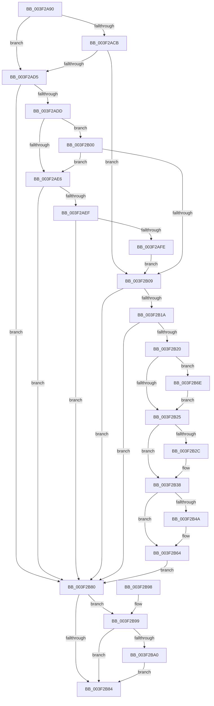

# FsRtlpOplockStoreKeyForDeleteOperation

- RVA: `0x003F2A90`–`0x003F2BAE` (길이 `286` bytes)
- VA: `0x00000001403F2A90`
- 실행 섹션: `.text`
- PDB 이름 있음: `예`; PDB Function 태그: `아니요`
- unwind 정보 RVA: `0x00097048`
- 디코드: `80`개 명령, `286/286` bytes 표시
- 미해석 바이트: `0` (있으면 어셈블리에 `.byte`로 보존)

> 이 문서는 커널 이미지의 기계어와 PDB 기호를 분석해 생성했습니다. 4번과 5번은 함수 원형과 자료형을 바이너리 사용 방식에서 추정한 C 해석이며 원본 소스 복구 결과는 아닙니다.

## 1. Dependencies

- 직접 호출 지점: **5**; 고유 호출 대상: **5**
- 직접 호출자로 확인된 함수: **2**
- RIP 상대 이미지 참조: **0**

### Outgoing calls
- `0x003F2B0D` → [IoGetOplockKeyContextEx](IoGetOplockKeyContextEx_function_003F36C0.md) (function, `0x003F36C0`)
- `0x003F2B33` → [ExAcquireFastMutexUnsafe](ExAcquireFastMutexUnsafe_function_003F3720.md) (function, `0x003F3720`)
- `0x003F2B58` → [ExAllocatePool2](../../poolcode/B8/ExAllocatePool2_function_00B820F0.md) (function, `0x00B820F0`)
- `0x003F2B6E` → [FsRtlpAllocateOplock](../../page/9F/FsRtlpAllocateOplock_function_009F1C74.md) (function, `0x009F1C74`)
- `0x003F2BA7` → [ExReleaseFastMutexUnsafe](../25/ExReleaseFastMutexUnsafe_function_002503A0.md) (function, `0x002503A0`)

### Direct callers
- [FsRtlCheckOplock](FsRtlCheckOplock_function_003F29B0.md) at `0x003F29DB`
- [FsRtlCheckOplockEx2](FsRtlCheckOplockEx2_function_003F2BC0.md) at `0x003F2E89`

### Static image references
- 디코드된 RIP-relative 메모리 참조가 없습니다.

## 2. Other-region calls and transfers

- 다른 실행 섹션으로 향하는 call: **2**
  - `0x003F2B58` → [ExAllocatePool2](../../poolcode/B8/ExAllocatePool2_function_00B820F0.md) (`.text` → `POOLCODE`)
  - `0x003F2B6E` → [FsRtlpAllocateOplock](../../page/9F/FsRtlpAllocateOplock_function_009F1C74.md) (`.text` → `PAGE`)
- 별도 외부 분기/꼬리 이동을 확인하지 못했습니다.

## 3. Assembly (complete function range)

```asm
003F2A90  48 89 5C 24 08                  mov qword ptr [rsp + 8], rbx
003F2A95  48 89 74 24 10                  mov qword ptr [rsp + 0x10], rsi
003F2A9A  44 89 44 24 18                  mov dword ptr [rsp + 0x18], r8d
003F2A9F  57                              push rdi
003F2AA0  41 56                           push r14
003F2AA2  41 57                           push r15
003F2AA4  48 83 EC 30                     sub rsp, 0x30
003F2AA8  45 8B F0                        mov r14d, r8d
003F2AAB  48 8B F9                        mov rdi, rcx
003F2AAE  4C 8B 8A B8 00 00 00            mov r9, qword ptr [rdx + 0xb8]
003F2AB5  48 8B 31                        mov rsi, qword ptr [rcx]
003F2AB8  48 89 74 24 28                  mov qword ptr [rsp + 0x28], rsi
003F2ABD  32 DB                           xor bl, bl
003F2ABF  88 5C 24 20                     mov byte ptr [rsp + 0x20], bl
003F2AC3  41 0F B6 01                     movzx eax, byte ptr [r9]
003F2AC7  84 C0                           test al, al
003F2AC9  75 0A                           jne 0x1403f2ad5
003F2ACB  41 F7 41 10 00 10 00 00         test dword ptr [r9 + 0x10], 0x1000
003F2AD3  75 34                           jne 0x1403f2b09
003F2AD5  3C 06                           cmp al, 6
003F2AD7  0F 85 A3 00 00 00               jne 0x1403f2b80
003F2ADD  41 8B 49 10                     mov ecx, dword ptr [r9 + 0x10]
003F2AE1  83 F9 0D                        cmp ecx, 0xd
003F2AE4  74 1A                           je 0x1403f2b00
003F2AE6  83 F9 40                        cmp ecx, 0x40
003F2AE9  0F 85 91 00 00 00               jne 0x1403f2b80
003F2AEF  48 8B 42 18                     mov rax, qword ptr [rdx + 0x18]
003F2AF3  8B 10                           mov edx, dword ptr [rax]
003F2AF5  F6 C2 01                        test dl, 1
003F2AF8  0F 84 82 00 00 00               je 0x1403f2b80
003F2AFE  EB 09                           jmp 0x1403f2b09
003F2B00  48 8B 42 18                     mov rax, qword ptr [rdx + 0x18]
003F2B04  80 38 00                        cmp byte ptr [rax], 0
003F2B07  74 DD                           je 0x1403f2ae6
003F2B09  49 8B 49 30                     mov rcx, qword ptr [r9 + 0x30]
003F2B0D  E8 AE 0B 00 00                  call 0x1403f36c0
003F2B12  4C 8B F8                        mov r15, rax
003F2B15  48 85 C0                        test rax, rax
003F2B18  74 66                           je 0x1403f2b80
003F2B1A  F6 40 02 01                     test byte ptr [rax + 2], 1
003F2B1E  74 60                           je 0x1403f2b80
003F2B20  48 85 F6                        test rsi, rsi
003F2B23  74 49                           je 0x1403f2b6e
003F2B25  41 0F BA E6 1D                  bt r14d, 0x1d
003F2B2A  72 0C                           jb 0x1403f2b38
003F2B2C  48 8B 8E 98 00 00 00            mov rcx, qword ptr [rsi + 0x98]
003F2B33  E8 E8 0B 00 00                  call 0x1403f3720
003F2B38  B3 01                           mov bl, 1
003F2B3A  88 5C 24 20                     mov byte ptr [rsp + 0x20], bl
003F2B3E  48 8B 86 88 00 00 00            mov rax, qword ptr [rsi + 0x88]
003F2B45  48 85 C0                        test rax, rax
003F2B48  75 1A                           jne 0x1403f2b64
003F2B4A  8D 50 10                        lea edx, [rax + 0x10]
003F2B4D  B9 22 01 00 00                  mov ecx, 0x122
003F2B52  41 B8 46 53 72 6F               mov r8d, 0x6f725346
003F2B58  E8 93 F5 78 00                  call 0x140b820f0
003F2B5D  48 89 86 88 00 00 00            mov qword ptr [rsi + 0x88], rax
003F2B64  41 0F 10 47 04                  movups xmm0, xmmword ptr [r15 + 4]
003F2B69  0F 11 00                        movups xmmword ptr [rax], xmm0
003F2B6C  EB 12                           jmp 0x1403f2b80
003F2B6E  E8 01 F1 5F 00                  call 0x1409f1c74
003F2B73  48 8B F0                        mov rsi, rax
003F2B76  48 89 44 24 28                  mov qword ptr [rsp + 0x28], rax
003F2B7B  48 89 07                        mov qword ptr [rdi], rax
003F2B7E  EB A5                           jmp 0x1403f2b25
003F2B80  84 DB                           test bl, bl
003F2B82  75 15                           jne 0x1403f2b99
003F2B84  48 8B 5C 24 50                  mov rbx, qword ptr [rsp + 0x50]
003F2B89  48 8B 74 24 58                  mov rsi, qword ptr [rsp + 0x58]
003F2B8E  48 83 C4 30                     add rsp, 0x30
003F2B92  41 5F                           pop r15
003F2B94  41 5E                           pop r14
003F2B96  5F                              pop rdi
003F2B97  C3                              ret
003F2B98  CC                              int3
003F2B99  41 0F BA E6 1D                  bt r14d, 0x1d
003F2B9E  72 E4                           jb 0x1403f2b84
003F2BA0  48 8B 8E 98 00 00 00            mov rcx, qword ptr [rsi + 0x98]
003F2BA7  E8 F4 D7 E5 FF                  call 0x1402503a0
003F2BAC  EB D6                           jmp 0x1403f2b84
```

## 4. C-style interpretation (structured pseudocode)

```c
__int64 __fastcall FsRtlpOplockStoreKeyForDeleteOperation(__int64 a1, __int64 a2, int a3)
{
    __int64 result;
    __int64 v_rbx;
    __int64 v_rsp;
    unsigned __int64 v_stack_m20;
    unsigned __int8 v_stack_m28;
    unsigned __int64 v_stack_p10;
    unsigned int v_stack_p18;
    unsigned __int64 v_stack_p8;

    v_stack_p8 = v_rbx;
    v_stack_p10 = v_rsi;
    v_stack_p18 = a3;
    v_rsp = (v_rsp) - (48);
    v_stack_m20 = *(unsigned __int64 *)(a1);
    v_rbx = 0;
    v_stack_m28 = 0;
    if ((unsigned __int8)(*(unsigned __int8 *)(*(unsigned __int64 *)(a2 + 184))) != 0) goto loc_003F2AD5;
    if (((*(unsigned int *)(*(unsigned __int64 *)(a2 + 184) + 16)) & (0x1000ULL)) != 0) goto loc_003F2B09;
loc_003F2AD5:
    if (((unsigned __int8)(*(unsigned __int8 *)(*(unsigned __int64 *)(a2 + 184)))) != 6) goto loc_003F2B80;
    if (((unsigned int)((unsigned int)(*(unsigned int *)(*(unsigned __int64 *)(a2 + 184) + 16)))) == 13) goto loc_003F2B00;
loc_003F2AE6:
    if (((unsigned int)((unsigned int)(*(unsigned int *)(*(unsigned __int64 *)(a2 + 184) + 16)))) != 64) goto loc_003F2B80;
    if ((((unsigned __int8)((unsigned int)(*(unsigned int *)(*(unsigned __int64 *)(a2 + 24))))) & (1)) == 0) goto loc_003F2B80;
    goto loc_003F2B09;
loc_003F2B00:
    if ((*(unsigned __int8 *)(*(unsigned __int64 *)((unsigned int)(*(unsigned int *)(*(unsigned __int64 *)(a2 + 24))) + 24))) == 0) goto loc_003F2AE6;
loc_003F2B09:
    result = IoGetOplockKeyContextEx(*(unsigned __int64 *)(*(unsigned __int64 *)(a2 + 184) + 48), (unsigned int)(*(unsigned int *)(*(unsigned __int64 *)(a2 + 24))), a3, *(unsigned __int64 *)(a2 + 184));
    if (result == 0) goto loc_003F2B80;
    if (((*(unsigned __int8 *)(result + 2)) & (1)) == 0) goto loc_003F2B80;
    if (*(unsigned __int64 *)(a1) == 0) goto loc_003F2B6E;
loc_003F2B25:
    if (!(condition_is_below)) {
        a1 = *(unsigned __int64 *)(*(unsigned __int64 *)(a1) + 152);
        result = ExAcquireFastMutexUnsafe(a1, (unsigned int)(*(unsigned int *)(*(unsigned __int64 *)(a2 + 24))), a3, *(unsigned __int64 *)(a2 + 184));
    }
    v_stack_m28 = 1;
    result = *(unsigned __int64 *)(*(unsigned __int64 *)(a1) + 136);
    if (*(unsigned __int64 *)(*(unsigned __int64 *)(a1) + 136) == 0) {
        a2 = *(unsigned __int64 *)(*(unsigned __int64 *)(a1) + 136) + 16;
        a1 = 290;
        a3 = 0x6F725346ULL;
        result = ExAllocatePool2(a1, a2, a3, *(unsigned __int64 *)(a2 + 184));
        *(unsigned __int64 *)(*(unsigned __int64 *)(a1) + 136) = result;
    }
    *(unsigned __int64 *)(result) = v_xmm0;
    goto loc_003F2B80;
loc_003F2B6E:
    result = FsRtlpAllocateOplock(a1, a2, a3, *(unsigned __int64 *)(a2 + 184));
    v_stack_m20 = result;
    *(unsigned __int64 *)(a1) = result;
    goto loc_003F2B25;
loc_003F2B80:
    if (1 != 0) goto loc_003F2B99;
loc_003F2B84:
    v_rsp = (v_rsp) + (48);
    return result;
loc_003F2B99:
    if (condition_is_below) goto loc_003F2B84;
    result = ExReleaseFastMutexUnsafe(*(unsigned __int64 *)(v_stack_p10 + 152), a2, a3, *(unsigned __int64 *)(a2 + 184));
    goto loc_003F2B84;
}
```

## 5. (Beta) C Style

```c
int64_t FsRtlpOplockStoreKeyForDeleteOperation(void *Arg1, void *Arg2, int32_t Arg3)
{
    uint8_t *arg1 = (uint8_t *)Arg1;
    uint8_t *arg2 = (uint8_t *)Arg2;

    int64_t result;
    int64_t local_rbx;
    int64_t local_rsp;
    uint64_t v_stack_m20;
    uint8_t v_stack_m28;
    uint64_t v_stack_p10;
    uint32_t v_stack_p18;
    uint64_t v_stack_p8;

    v_stack_p8 = local_rbx;
    v_stack_p10 = local_rsi;
    v_stack_p18 = Arg3;
    local_rsp = (local_rsp) - (48);
    v_stack_m20 = *(uint64_t *)(arg1);
    local_rbx = 0;
    v_stack_m28 = 0;
    if ((uint8_t)(*(uint8_t *)(*(uint64_t *)(arg2 + 0xB8))) != 0) goto loc_003F2AD5;
    if (((*(uint32_t *)(*(uint64_t *)(arg2 + 0xB8) + 0x10)) & (0x1000ULL)) != 0) goto loc_003F2B09;
loc_003F2AD5:
    if (((uint8_t)(*(uint8_t *)(*(uint64_t *)(arg2 + 0xB8)))) != 6) goto loc_003F2B80;
    if (((uint32_t)((uint32_t)(*(uint32_t *)(*(uint64_t *)(arg2 + 0xB8) + 0x10)))) == 13) goto loc_003F2B00;
loc_003F2AE6:
    if (((uint32_t)((uint32_t)(*(uint32_t *)(*(uint64_t *)(arg2 + 0xB8) + 0x10)))) != 64) goto loc_003F2B80;
    if ((((uint8_t)((uint32_t)(*(uint32_t *)(*(uint64_t *)(arg2 + 0x18))))) & (1)) == 0) goto loc_003F2B80;
    goto loc_003F2B09;
loc_003F2B00:
    if ((*(uint8_t *)(*(uint64_t *)((uint32_t)(*(uint32_t *)(*(uint64_t *)(arg2 + 0x18))) + 0x18))) == 0) goto loc_003F2AE6;
loc_003F2B09:
    result = IoGetOplockKeyContextEx(*(uint64_t *)(*(uint64_t *)(arg2 + 0xB8) + 0x30), (uint32_t)(*(uint32_t *)(*(uint64_t *)(arg2 + 0x18))), Arg3, *(uint64_t *)(arg2 + 0xB8));
    if (result == 0) goto loc_003F2B80;
    if (((*(uint8_t *)(result + 0x2)) & (1)) == 0) goto loc_003F2B80;
    if (*(uint64_t *)(arg1) == 0) goto loc_003F2B6E;
loc_003F2B25:
    if (!(condition_is_below)) {
        Arg1 = *(uint64_t *)(*(uint64_t *)(arg1) + 0x98);
        result = ExAcquireFastMutexUnsafe(Arg1, (uint32_t)(*(uint32_t *)(*(uint64_t *)(arg2 + 0x18))), Arg3, *(uint64_t *)(arg2 + 0xB8));
    }
    v_stack_m28 = 1;
    result = *(uint64_t *)(*(uint64_t *)(arg1) + 0x88);
    if (*(uint64_t *)(*(uint64_t *)(arg1) + 0x88) == 0) {
        Arg2 = *(uint64_t *)(*(uint64_t *)(arg1) + 0x88) + 16;
        Arg1 = 290;
        Arg3 = 0x6F725346ULL;
        result = ExAllocatePool2(Arg1, Arg2, Arg3, *(uint64_t *)(arg2 + 0xB8));
        *(uint64_t *)(*(uint64_t *)(arg1) + 0x88) = result;
    }
    *(uint64_t *)(result) = v_xmm0;
    goto loc_003F2B80;
loc_003F2B6E:
    result = FsRtlpAllocateOplock(Arg1, Arg2, Arg3, *(uint64_t *)(arg2 + 0xB8));
    v_stack_m20 = result;
    *(uint64_t *)(arg1) = result;
    goto loc_003F2B25;
loc_003F2B80:
    if (1 != 0) goto loc_003F2B99;
loc_003F2B84:
    local_rsp = (local_rsp) + (48);
    return result;
loc_003F2B99:
    if (condition_is_below) goto loc_003F2B84;
    result = ExReleaseFastMutexUnsafe(*(uint64_t *)(v_stack_p10 + 0x98), Arg2, Arg3, *(uint64_t *)(arg2 + 0xB8));
    goto loc_003F2B84;
}
```

### 관측된 메모리 오프셋

구조체 형식이 확인되지 않은 접근은 인자 기준의 오프셋으로만 기록했습니다.

| 기준 인자 | 오프셋 표현 | 폭 (bit) | 접근 |
|---|---:|---:|---|
| `Arg1` | `+ 0x0` | `64` | `R` |
| `Arg1` | `+ 0x0` | `64` | `W` |
| `Arg2` | `+ 0x18` | `64` | `R` |
| `Arg2` | `+ 0xB8` | `64` | `R` |

## 6. Execution-region graph

[열기: 2D/3D 그래프와 함수 탐색 컨트롤 패널](../../../control-panel.html?section=text&rva=0x003F2A90&view=graph)

- 2D 그래프는 위에서 아래로 흐르고, 3D 그래프는 빈 공간을 드래그해 회전합니다. Shift+드래그는 이동, 휠은 확대·축소, 함수 노드 선택은 대상 보고서 이동입니다.

### Static fallback


