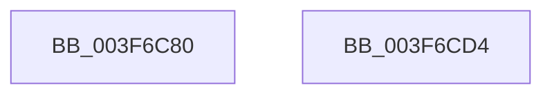

# HalAcpiGetTableDispatch

- RVA: `0x003F6C80`–`0x003F6CD5` (길이 `85` bytes)
- VA: `0x00000001403F6C80`
- 실행 섹션: `.text`
- PDB 이름 있음: `예`; PDB Function 태그: `아니요`
- unwind 정보 RVA: `0x00060BC4`
- 디코드: `24`개 명령, `85/85` bytes 표시
- 미해석 바이트: `0` (있으면 어셈블리에 `.byte`로 보존)

> 이 문서는 커널 이미지의 기계어와 PDB 기호를 분석해 생성했습니다. 4번과 5번은 함수 원형과 자료형을 바이너리 사용 방식에서 추정한 C 해석이며 원본 소스 복구 결과는 아닙니다.

## 1. Dependencies

- 직접 호출 지점: **3**; 고유 호출 대상: **3**
- 직접 호출자로 확인된 함수: **0**
- RIP 상대 이미지 참조: **1**

### Outgoing calls
- `0x003F6C9E` → [ExAcquireFastMutex](../20/ExAcquireFastMutex_function_0020E5A0.md) (function, `0x0020E5A0`)
- `0x003F6CAD` → [HalpAcpiGetTableWork](HalpAcpiGetTableWork_function_003F6CDC.md) (function, `0x003F6CDC`)
- `0x003F6CBC` → [ExReleaseFastMutex](../25/ExReleaseFastMutex_function_002519C0.md) (function, `0x002519C0`)

### Direct callers
- 이 함수 시작 RVA로 연결되는 직접 call은 확인되지 않았습니다. 간접 호출은 완전히 역산할 수 없습니다.

### Static image references
- `0x003F6C94` → RVA `0x00FC3F40` (`.data`; read)

## 2. Other-region calls and transfers

- 다른 실행 섹션으로 향하는 call: **0**
- 별도 외부 분기/꼬리 이동을 확인하지 못했습니다.

## 3. Assembly (complete function range)

```asm
003F6C80  48 89 5C 24 08                  mov qword ptr [rsp + 8], rbx
003F6C85  48 89 74 24 10                  mov qword ptr [rsp + 0x10], rsi
003F6C8A  57                              push rdi
003F6C8B  48 83 EC 20                     sub rsp, 0x20
003F6C8F  8B F1                           mov esi, ecx
003F6C91  49 8B D8                        mov rbx, r8
003F6C94  48 8D 0D A5 D2 BC 00            lea rcx, [rip + 0xbcd2a5]
003F6C9B  48 8B FA                        mov rdi, rdx
003F6C9E  E8 FD 78 E1 FF                  call 0x14020e5a0
003F6CA3  4C 8B CB                        mov r9, rbx
003F6CA6  4C 8B C7                        mov r8, rdi
003F6CA9  8B D6                           mov edx, esi
003F6CAB  33 C9                           xor ecx, ecx
003F6CAD  E8 2A 00 00 00                  call 0x1403f6cdc
003F6CB2  48 8D 0D 87 D2 BC 00            lea rcx, [rip + 0xbcd287]
003F6CB9  48 8B D8                        mov rbx, rax
003F6CBC  E8 FF AC E5 FF                  call 0x1402519c0
003F6CC1  48 8B 74 24 38                  mov rsi, qword ptr [rsp + 0x38]
003F6CC6  48 8B C3                        mov rax, rbx
003F6CC9  48 8B 5C 24 30                  mov rbx, qword ptr [rsp + 0x30]
003F6CCE  48 83 C4 20                     add rsp, 0x20
003F6CD2  5F                              pop rdi
003F6CD3  C3                              ret
003F6CD4  CC                              int3
```

## 4. C-style interpretation (structured pseudocode)

```c
__int64 __fastcall HalAcpiGetTableDispatch(int a1, __int64 a2, __int64 a3)
{
    __int64 result;
    __int64 v_rsp;
    unsigned __int64 v_stack_p10;
    unsigned __int64 v_stack_p8;

    v_stack_p8 = v_rbx;
    v_stack_p10 = v_rsi;
    v_rsp = (v_rsp) - (32);
    result = ExAcquireFastMutex(v_rip + 12374693, a2, a3, a4);
    a1 = 0;
    result = HalpAcpiGetTableWork(a1, (unsigned int)((unsigned int)((unsigned int)(a1))), a2, a3);
    result = ExReleaseFastMutex(v_rip + 12374663, (unsigned int)((unsigned int)((unsigned int)(a1))), a2, a3);
    v_rsp = (v_rsp) + (32);
    return result;
}
```

## 5. (Beta) C Style

```c
int64_t HalAcpiGetTableDispatch(int32_t Arg1, int64_t Arg2, int64_t Arg3)
{
    int64_t result;
    int64_t local_rsp;
    uint64_t v_stack_p10;
    uint64_t v_stack_p8;

    v_stack_p8 = local_rbx;
    v_stack_p10 = local_rsi;
    local_rsp = (local_rsp) - (32);
    result = ExAcquireFastMutex(v_rip + 12374693, Arg2, Arg3, a4);
    Arg1 = 0;
    result = HalpAcpiGetTableWork(Arg1, (uint32_t)((uint32_t)((uint32_t)(Arg1))), Arg2, Arg3);
    result = ExReleaseFastMutex(v_rip + 12374663, (uint32_t)((uint32_t)((uint32_t)(Arg1))), Arg2, Arg3);
    local_rsp = (local_rsp) + (32);
    return result;
}
```

## 6. Execution-region graph

[열기: 2D/3D 그래프와 함수 탐색 컨트롤 패널](../../../control-panel.html?section=text&rva=0x003F6C80&view=graph)

- 2D 그래프는 위에서 아래로 흐르고, 3D 그래프는 빈 공간을 드래그해 회전합니다. Shift+드래그는 이동, 휠은 확대·축소, 함수 노드 선택은 대상 보고서 이동입니다.

### Static fallback


