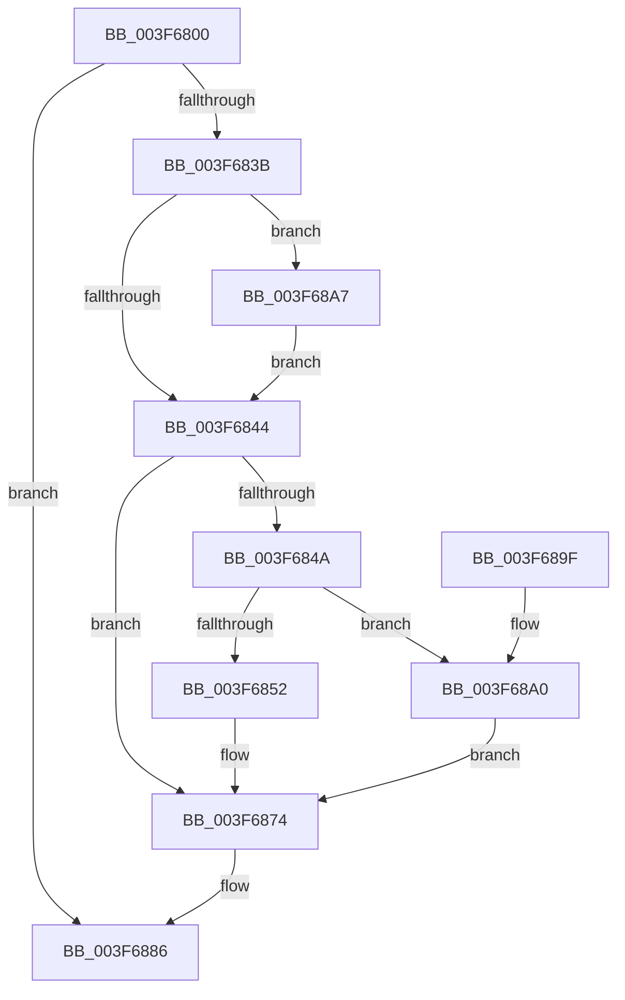

# HalFreeCommonBufferDmaThin

- RVA: `0x003F6800`–`0x003F68CE` (길이 `206` bytes)
- VA: `0x00000001403F6800`
- 실행 섹션: `.text`
- PDB 이름 있음: `예`; PDB Function 태그: `아니요`
- unwind 정보 RVA: `0x000980C8`
- 디코드: `59`개 명령, `206/206` bytes 표시
- 미해석 바이트: `0` (있으면 어셈블리에 `.byte`로 보존)

> 이 문서는 커널 이미지의 기계어와 PDB 기호를 분석해 생성했습니다. 4번과 5번은 함수 원형과 자료형을 바이너리 사용 방식에서 추정한 C 해석이며 원본 소스 복구 결과는 아닙니다.

## 1. Dependencies

- 직접 호출 지점: **8**; 고유 호출 대상: **7**
- 직접 호출자로 확인된 함수: **0**
- RIP 상대 이미지 참조: **1**

### Outgoing calls
- `0x003F682E` → [HalpPopCommonBufferEntry](HalpPopCommonBufferEntry_function_003F68D4.md) (function, `0x003F68D4`)
- `0x003F6855` → [MmUnmapLockedPages](../24/MmUnmapLockedPages_function_00246E60.md) (function, `0x00246E60`)
- `0x003F6865` → [MiFreePagesFromMdl](MiFreePagesFromMdl_function_003F8300.md) (function, `0x003F8300`)
- `0x003F686F` → [ExFreePoolWithTag](../../poolcode/B8/ExFreePoolWithTag_function_00B82870.md) (function, `0x00B82870`)
- `0x003F6879` → [ExFreePoolWithTag](../../poolcode/B8/ExFreePoolWithTag_function_00B82870.md) (function, `0x00B82870`)
- `0x003F6881` → [HalpDmaDereferenceDomainObject](HalpDmaDereferenceDomainObject_function_003F69DC.md) (function, `0x003F69DC`)
- `0x003F68A0` → [MmFreeContiguousMemory](MmFreeContiguousMemory_function_003F6F60.md) (function, `0x003F6F60`)
- `0x003F68C4` → [guard_dispatch_icall](../6B/guard_dispatch_icall_function_006BAAD0.md) (function, `0x006BAAD0`)

### Direct callers
- 이 함수 시작 RVA로 연결되는 직접 call은 확인되지 않았습니다. 간접 호출은 완전히 역산할 수 없습니다.

### Static image references
- `0x003F68A7` → RVA `0x00FC1778` (`.data`; read)

## 2. Other-region calls and transfers

- 다른 실행 섹션으로 향하는 call: **2**
  - `0x003F686F` → [ExFreePoolWithTag](../../poolcode/B8/ExFreePoolWithTag_function_00B82870.md) (`.text` → `POOLCODE`)
  - `0x003F6879` → [ExFreePoolWithTag](../../poolcode/B8/ExFreePoolWithTag_function_00B82870.md) (`.text` → `POOLCODE`)
- 별도 외부 분기/꼬리 이동을 확인하지 못했습니다.

## 3. Assembly (complete function range)

```asm
003F6800  48 89 5C 24 08                  mov qword ptr [rsp + 8], rbx
003F6805  48 89 6C 24 10                  mov qword ptr [rsp + 0x10], rbp
003F680A  48 89 74 24 18                  mov qword ptr [rsp + 0x18], rsi
003F680F  57                              push rdi
003F6810  41 56                           push r14
003F6812  41 57                           push r15
003F6814  48 83 EC 20                     sub rsp, 0x20
003F6818  4C 8B B1 00 02 00 00            mov r14, qword ptr [rcx + 0x200]
003F681F  49 8B E9                        mov rbp, r9
003F6822  44 8B FA                        mov r15d, edx
003F6825  49 8B C9                        mov rcx, r9
003F6828  49 8B D6                        mov rdx, r14
003F682B  49 8B D8                        mov rbx, r8
003F682E  E8 A1 00 00 00                  call 0x1403f68d4
003F6833  48 8B F0                        mov rsi, rax
003F6836  48 85 C0                        test rax, rax
003F6839  74 4B                           je 0x1403f6886
003F683B  48 8B 78 30                     mov rdi, qword ptr [rax + 0x30]
003F683F  48 85 FF                        test rdi, rdi
003F6842  75 63                           jne 0x1403f68a7
003F6844  80 7E 40 00                     cmp byte ptr [rsi + 0x40], 0
003F6848  74 2A                           je 0x1403f6874
003F684A  48 8B CD                        mov rcx, rbp
003F684D  48 85 FF                        test rdi, rdi
003F6850  74 4E                           je 0x1403f68a0
003F6852  48 8B D7                        mov rdx, rdi
003F6855  E8 06 06 E5 FF                  call 0x140246e60
003F685A  45 33 C9                        xor r9d, r9d
003F685D  45 33 C0                        xor r8d, r8d
003F6860  33 D2                           xor edx, edx
003F6862  48 8B CF                        mov rcx, rdi
003F6865  E8 96 1A 00 00                  call 0x1403f8300
003F686A  33 D2                           xor edx, edx
003F686C  48 8B CF                        mov rcx, rdi
003F686F  E8 FC BF 78 00                  call 0x140b82870
003F6874  33 D2                           xor edx, edx
003F6876  48 8B CE                        mov rcx, rsi
003F6879  E8 F2 BF 78 00                  call 0x140b82870
003F687E  49 8B CE                        mov rcx, r14
003F6881  E8 56 01 00 00                  call 0x1403f69dc
003F6886  48 8B 5C 24 40                  mov rbx, qword ptr [rsp + 0x40]
003F688B  48 8B 6C 24 48                  mov rbp, qword ptr [rsp + 0x48]
003F6890  48 8B 74 24 50                  mov rsi, qword ptr [rsp + 0x50]
003F6895  48 83 C4 20                     add rsp, 0x20
003F6899  41 5F                           pop r15
003F689B  41 5E                           pop r14
003F689D  5F                              pop rdi
003F689E  C3                              ret
003F689F  CC                              int3
003F68A0  E8 BB 06 00 00                  call 0x1403f6f60
003F68A5  EB CD                           jmp 0x1403f6874
003F68A7  48 8B 0D CA AE BC 00            mov rcx, qword ptr [rip + 0xbcaeca]
003F68AE  4D 8D 87 FF 0F 00 00            lea r8, [r15 + 0xfff]
003F68B5  49 C1 E8 0C                     shr r8, 0xc
003F68B9  48 8B D3                        mov rdx, rbx
003F68BC  48 8B 41 40                     mov rax, qword ptr [rcx + 0x40]
003F68C0  49 8B 4E 28                     mov rcx, qword ptr [r14 + 0x28]
003F68C4  E8 07 42 2C 00                  call 0x1406baad0
003F68C9  E9 76 FF FF FF                  jmp 0x1403f6844
```

## 4. C-style interpretation (structured pseudocode)

```c
__int64 __fastcall HalFreeCommonBufferDmaThin(__int64 a1, int a2, __int64 a3, __int64 a4)
{
    __int64 result;
    __int64 v_rsp;
    unsigned __int64 v_stack_p10;
    unsigned __int64 v_stack_p18;
    unsigned __int64 v_stack_p8;

    v_stack_p8 = v_rbx;
    v_stack_p10 = v_rbp;
    v_stack_p18 = v_rsi;
    v_rsp = (v_rsp) - (32);
    result = HalpPopCommonBufferEntry(a4, *(unsigned __int64 *)(a1 + 512), a3, a4);
    if (result == 0) goto loc_003F6886;
    if (*(unsigned __int64 *)(result + 48) != 0) goto loc_003F68A7;
loc_003F6844:
    if ((*(unsigned __int8 *)(result + 64)) == 0) goto loc_003F6874;
    if (*(unsigned __int64 *)(result + 48) == 0) goto loc_003F68A0;
    result = MmUnmapLockedPages(a4, *(unsigned __int64 *)(result + 48), a3, a4);
    a4 = 0;
    a3 = 0;
    a2 = 0;
    result = MiFreePagesFromMdl(*(unsigned __int64 *)(result + 48), a2, a3, a4);
    a2 = 0;
    result = ExFreePoolWithTag(*(unsigned __int64 *)(result + 48), a2, a3, a4);
loc_003F6874:
    a2 = 0;
    result = ExFreePoolWithTag(result, a2, a3, a4);
    result = HalpDmaDereferenceDomainObject(*(unsigned __int64 *)(a1 + 512), a2, a3, a4);
loc_003F6886:
    v_rsp = (v_rsp) + (32);
    return result;
loc_003F68A0:
    result = MmFreeContiguousMemory(*(unsigned __int64 *)(a1 + 512), a2, a3, a4);
    goto loc_003F6874;
loc_003F68A7:
    a3 = ((unsigned int)(a2) + 4095) >> (12);
    result = guard_dispatch_icall(*(unsigned __int64 *)(*(unsigned __int64 *)(a1 + 512) + 40), v_stack_p8, a3, a4);
    goto loc_003F6844;
}
```

## 5. (Beta) C Style

```c
int64_t HalFreeCommonBufferDmaThin(void *Arg1, void *Arg2, int64_t Arg3, int64_t Arg4)
{
    uint8_t *arg1 = (uint8_t *)Arg1;
    uint8_t *arg2 = (uint8_t *)Arg2;

    int64_t result;
    int64_t local_rsp;
    uint64_t v_stack_p10;
    uint64_t v_stack_p18;
    uint64_t v_stack_p8;

    v_stack_p8 = local_rbx;
    v_stack_p10 = local_rbp;
    v_stack_p18 = local_rsi;
    local_rsp = (local_rsp) - (32);
    result = HalpPopCommonBufferEntry(Arg4, *(uint64_t *)(arg1 + 0x200), Arg3, Arg4);
    if (result == 0) goto loc_003F6886;
    if (*(uint64_t *)(result + 0x30) != 0) goto loc_003F68A7;
loc_003F6844:
    if ((*(uint8_t *)(result + 0x40)) == 0) goto loc_003F6874;
    if (*(uint64_t *)(result + 0x30) == 0) goto loc_003F68A0;
    result = MmUnmapLockedPages(Arg4, *(uint64_t *)(result + 0x30), Arg3, Arg4);
    Arg4 = 0;
    Arg3 = 0;
    Arg2 = 0;
    result = MiFreePagesFromMdl(*(uint64_t *)(result + 0x30), Arg2, Arg3, Arg4);
    Arg2 = 0;
    result = ExFreePoolWithTag(*(uint64_t *)(result + 0x30), Arg2, Arg3, Arg4);
loc_003F6874:
    Arg2 = 0;
    result = ExFreePoolWithTag(result, Arg2, Arg3, Arg4);
    result = HalpDmaDereferenceDomainObject(*(uint64_t *)(arg1 + 0x200), Arg2, Arg3, Arg4);
loc_003F6886:
    local_rsp = (local_rsp) + (32);
    return result;
loc_003F68A0:
    result = MmFreeContiguousMemory(*(uint64_t *)(arg1 + 0x200), Arg2, Arg3, Arg4);
    goto loc_003F6874;
loc_003F68A7:
    Arg3 = ((uint32_t)(Arg2) + 4095) >> (12);
    result = guard_dispatch_icall(*(uint64_t *)(*(uint64_t *)(arg1 + 0x200) + 0x28), v_stack_p8, Arg3, Arg4);
    goto loc_003F6844;
}
```

### 관측된 메모리 오프셋

구조체 형식이 확인되지 않은 접근은 인자 기준의 오프셋으로만 기록했습니다.

| 기준 인자 | 오프셋 표현 | 폭 (bit) | 접근 |
|---|---:|---:|---|
| `Arg1` | `+ 0x200` | `64` | `R` |
| `Arg2` | `+ 0xFFF` | `64` | `R` |

## 6. Execution-region graph

[열기: 2D/3D 그래프와 함수 탐색 컨트롤 패널](../../../control-panel.html?section=text&rva=0x003F6800&view=graph)

- 2D 그래프는 위에서 아래로 흐르고, 3D 그래프는 빈 공간을 드래그해 회전합니다. Shift+드래그는 이동, 휠은 확대·축소, 함수 노드 선택은 대상 보고서 이동입니다.

### Static fallback


