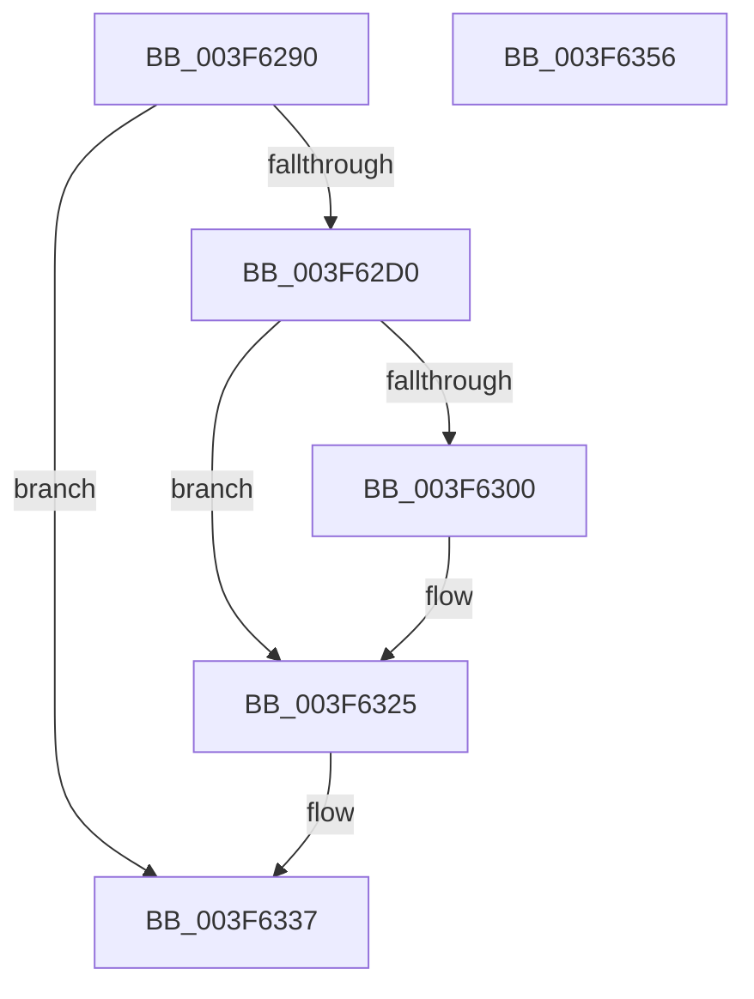

# HalFreeCommonBufferDmarThin

- RVA: `0x003F6290`–`0x003F6357` (길이 `199` bytes)
- VA: `0x00000001403F6290`
- 실행 섹션: `.text`
- PDB 이름 있음: `예`; PDB Function 태그: `아니요`
- unwind 정보 RVA: `0x0005FEF8`
- 디코드: `56`개 명령, `199/199` bytes 표시
- 미해석 바이트: `0` (있으면 어셈블리에 `.byte`로 보존)

> 이 문서는 커널 이미지의 기계어와 PDB 기호를 분석해 생성했습니다. 4번과 5번은 함수 원형과 자료형을 바이너리 사용 방식에서 추정한 C 해석이며 원본 소스 복구 결과는 아닙니다.

## 1. Dependencies

- 직접 호출 지점: **7**; 고유 호출 대상: **6**
- 직접 호출자로 확인된 함수: **0**
- RIP 상대 이미지 참조: **1**

### Outgoing calls
- `0x003F62C3` → [HalpPopCommonBufferEntry](HalpPopCommonBufferEntry_function_003F68D4.md) (function, `0x003F68D4`)
- `0x003F62F6` → [guard_dispatch_icall](../6B/guard_dispatch_icall_function_006BAAD0.md) (function, `0x006BAAD0`)
- `0x003F6306` → [MmUnmapLockedPages](../24/MmUnmapLockedPages_function_00246E60.md) (function, `0x00246E60`)
- `0x003F6316` → [MiFreePagesFromMdl](MiFreePagesFromMdl_function_003F8300.md) (function, `0x003F8300`)
- `0x003F6320` → [ExFreePoolWithTag](../../poolcode/B8/ExFreePoolWithTag_function_00B82870.md) (function, `0x00B82870`)
- `0x003F632A` → [ExFreePoolWithTag](../../poolcode/B8/ExFreePoolWithTag_function_00B82870.md) (function, `0x00B82870`)
- `0x003F6332` → [HalpDmaDereferenceDomainObject](HalpDmaDereferenceDomainObject_function_003F69DC.md) (function, `0x003F69DC`)

### Direct callers
- 이 함수 시작 RVA로 연결되는 직접 call은 확인되지 않았습니다. 간접 호출은 완전히 역산할 수 없습니다.

### Static image references
- `0x003F62D0` → RVA `0x00FC1778` (`.data`; read)

## 2. Other-region calls and transfers

- 다른 실행 섹션으로 향하는 call: **2**
  - `0x003F6320` → [ExFreePoolWithTag](../../poolcode/B8/ExFreePoolWithTag_function_00B82870.md) (`.text` → `POOLCODE`)
  - `0x003F632A` → [ExFreePoolWithTag](../../poolcode/B8/ExFreePoolWithTag_function_00B82870.md) (`.text` → `POOLCODE`)
- 별도 외부 분기/꼬리 이동을 확인하지 못했습니다.

## 3. Assembly (complete function range)

```asm
003F6290  48 8B C4                        mov rax, rsp
003F6293  48 89 58 08                     mov qword ptr [rax + 8], rbx
003F6297  48 89 68 10                     mov qword ptr [rax + 0x10], rbp
003F629B  48 89 70 18                     mov qword ptr [rax + 0x18], rsi
003F629F  48 89 78 20                     mov qword ptr [rax + 0x20], rdi
003F62A3  41 54                           push r12
003F62A5  41 56                           push r14
003F62A7  41 57                           push r15
003F62A9  48 83 EC 20                     sub rsp, 0x20
003F62AD  48 8B A9 00 02 00 00            mov rbp, qword ptr [rcx + 0x200]
003F62B4  4D 8B F9                        mov r15, r9
003F62B7  44 8B E2                        mov r12d, edx
003F62BA  49 8B C9                        mov rcx, r9
003F62BD  48 8B D5                        mov rdx, rbp
003F62C0  49 8B D8                        mov rbx, r8
003F62C3  E8 0C 06 00 00                  call 0x1403f68d4
003F62C8  48 8B F0                        mov rsi, rax
003F62CB  48 85 C0                        test rax, rax
003F62CE  74 67                           je 0x1403f6337
003F62D0  48 8B 0D A1 B4 BC 00            mov rcx, qword ptr [rip + 0xbcb4a1]
003F62D7  4D 8D 84 24 FF 0F 00 00         lea r8, [r12 + 0xfff]
003F62DF  4C 8B 70 30                     mov r14, qword ptr [rax + 0x30]
003F62E3  48 8B D3                        mov rdx, rbx
003F62E6  40 8A 78 40                     mov dil, byte ptr [rax + 0x40]
003F62EA  49 C1 E8 0C                     shr r8, 0xc
003F62EE  48 8B 41 40                     mov rax, qword ptr [rcx + 0x40]
003F62F2  48 8B 4D 28                     mov rcx, qword ptr [rbp + 0x28]
003F62F6  E8 D5 47 2C 00                  call 0x1406baad0
003F62FB  40 84 FF                        test dil, dil
003F62FE  74 25                           je 0x1403f6325
003F6300  49 8B D6                        mov rdx, r14
003F6303  49 8B CF                        mov rcx, r15
003F6306  E8 55 0B E5 FF                  call 0x140246e60
003F630B  45 33 C9                        xor r9d, r9d
003F630E  45 33 C0                        xor r8d, r8d
003F6311  33 D2                           xor edx, edx
003F6313  49 8B CE                        mov rcx, r14
003F6316  E8 E5 1F 00 00                  call 0x1403f8300
003F631B  33 D2                           xor edx, edx
003F631D  49 8B CE                        mov rcx, r14
003F6320  E8 4B C5 78 00                  call 0x140b82870
003F6325  33 D2                           xor edx, edx
003F6327  48 8B CE                        mov rcx, rsi
003F632A  E8 41 C5 78 00                  call 0x140b82870
003F632F  48 8B CD                        mov rcx, rbp
003F6332  E8 A5 06 00 00                  call 0x1403f69dc
003F6337  48 8B 5C 24 40                  mov rbx, qword ptr [rsp + 0x40]
003F633C  48 8B 6C 24 48                  mov rbp, qword ptr [rsp + 0x48]
003F6341  48 8B 74 24 50                  mov rsi, qword ptr [rsp + 0x50]
003F6346  48 8B 7C 24 58                  mov rdi, qword ptr [rsp + 0x58]
003F634B  48 83 C4 20                     add rsp, 0x20
003F634F  41 5F                           pop r15
003F6351  41 5E                           pop r14
003F6353  41 5C                           pop r12
003F6355  C3                              ret
003F6356  CC                              int3
```

## 4. C-style interpretation (structured pseudocode)

```c
__int64 __fastcall HalFreeCommonBufferDmarThin(__int64 a1, int a2, __int64 a3, __int64 a4)
{
    __int64 result;
    __int64 v_rsp;
    unsigned __int64 v_stack_p10;
    unsigned __int64 v_stack_p18;
    unsigned __int64 v_stack_p20;
    unsigned __int64 v_stack_p8;

    *(unsigned __int64 *)(v_rsp + 8) = v_rbx;
    *(unsigned __int64 *)(v_rsp + 16) = v_rbp;
    *(unsigned __int64 *)(v_rsp + 24) = v_rsi;
    *(unsigned __int64 *)(v_rsp + 32) = v_rdi;
    v_rsp = (v_rsp) - (32);
    result = HalpPopCommonBufferEntry(a4, *(unsigned __int64 *)(a1 + 512), a3, a4);
    if (result == 0) goto loc_003F6337;
    a3 = ((unsigned int)(a2) + 4095) >> (12);
    result = guard_dispatch_icall(*(unsigned __int64 *)(*(unsigned __int64 *)(a1 + 512) + 40), a3, a3, a4);
    if ((unsigned __int8)(*(unsigned __int8 *)(result + 64)) != 0) {
        a2 = *(unsigned __int64 *)(result + 48);
        a1 = a4;
        result = MmUnmapLockedPages(a1, a2, a3, a4);
        a4 = 0;
        a3 = 0;
        a2 = 0;
        a1 = *(unsigned __int64 *)(result + 48);
        result = MiFreePagesFromMdl(a1, a2, a3, a4);
        a2 = 0;
        a1 = *(unsigned __int64 *)(result + 48);
        result = ExFreePoolWithTag(a1, a2, a3, a4);
    }
    a2 = 0;
    result = ExFreePoolWithTag(result, a2, a3, a4);
    result = HalpDmaDereferenceDomainObject(*(unsigned __int64 *)(a1 + 512), a2, a3, a4);
loc_003F6337:
    v_rsp = (v_rsp) + (32);
    return result;
}
```

## 5. (Beta) C Style

```c
int64_t HalFreeCommonBufferDmarThin(void *Arg1, void *Arg2, int64_t Arg3, int64_t Arg4)
{
    uint8_t *arg1 = (uint8_t *)Arg1;
    uint8_t *arg2 = (uint8_t *)Arg2;

    int64_t result;
    int64_t local_rsp;
    uint64_t v_stack_p10;
    uint64_t v_stack_p18;
    uint64_t v_stack_p20;
    uint64_t v_stack_p8;

    *(uint64_t *)(local_rsp + 0x8) = local_rbx;
    *(uint64_t *)(local_rsp + 0x10) = local_rbp;
    *(uint64_t *)(local_rsp + 0x18) = local_rsi;
    *(uint64_t *)(local_rsp + 0x20) = local_rdi;
    local_rsp = (local_rsp) - (32);
    result = HalpPopCommonBufferEntry(Arg4, *(uint64_t *)(arg1 + 0x200), Arg3, Arg4);
    if (result == 0) goto loc_003F6337;
    Arg3 = ((uint32_t)(Arg2) + 4095) >> (12);
    result = guard_dispatch_icall(*(uint64_t *)(*(uint64_t *)(arg1 + 0x200) + 0x28), Arg3, Arg3, Arg4);
    if ((uint8_t)(*(uint8_t *)(result + 0x40)) != 0) {
        Arg2 = *(uint64_t *)(result + 0x30);
        Arg1 = Arg4;
        result = MmUnmapLockedPages(Arg1, Arg2, Arg3, Arg4);
        Arg4 = 0;
        Arg3 = 0;
        Arg2 = 0;
        Arg1 = *(uint64_t *)(result + 0x30);
        result = MiFreePagesFromMdl(Arg1, Arg2, Arg3, Arg4);
        Arg2 = 0;
        Arg1 = *(uint64_t *)(result + 0x30);
        result = ExFreePoolWithTag(Arg1, Arg2, Arg3, Arg4);
    }
    Arg2 = 0;
    result = ExFreePoolWithTag(result, Arg2, Arg3, Arg4);
    result = HalpDmaDereferenceDomainObject(*(uint64_t *)(arg1 + 0x200), Arg2, Arg3, Arg4);
loc_003F6337:
    local_rsp = (local_rsp) + (32);
    return result;
}
```

### 관측된 메모리 오프셋

구조체 형식이 확인되지 않은 접근은 인자 기준의 오프셋으로만 기록했습니다.

| 기준 인자 | 오프셋 표현 | 폭 (bit) | 접근 |
|---|---:|---:|---|
| `Arg1` | `+ 0x200` | `64` | `R` |
| `Arg2` | `+ 0xFFF` | `64` | `R` |

## 6. Execution-region graph

[열기: 2D/3D 그래프와 함수 탐색 컨트롤 패널](../../../control-panel.html?section=text&rva=0x003F6290&view=graph)

- 2D 그래프는 위에서 아래로 흐르고, 3D 그래프는 빈 공간을 드래그해 회전합니다. Shift+드래그는 이동, 휠은 확대·축소, 함수 노드 선택은 대상 보고서 이동입니다.

### Static fallback


