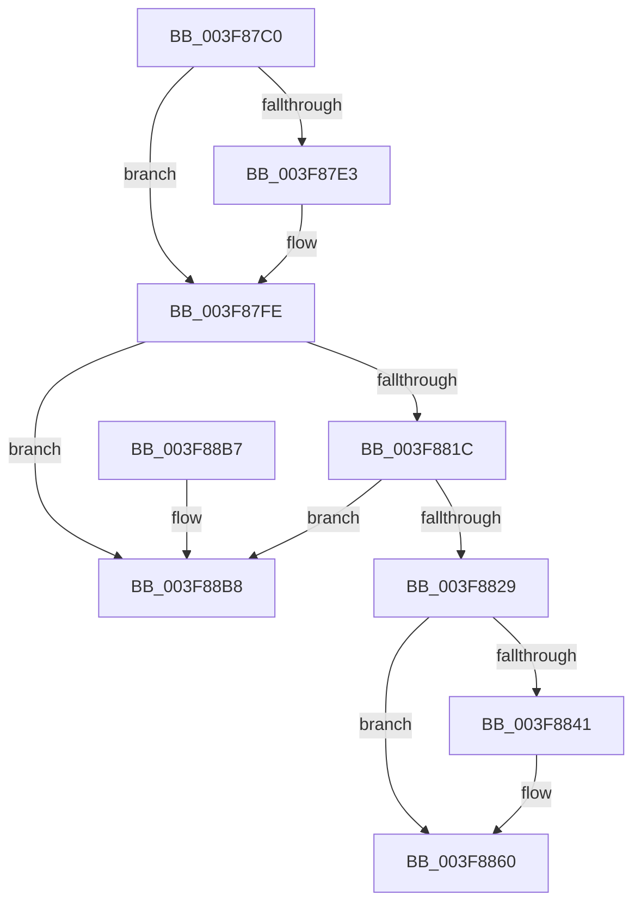

# HalFreeCommonBufferVector

- RVA: `0x003F87C0`–`0x003F88BF` (길이 `255` bytes)
- VA: `0x00000001403F87C0`
- 실행 섹션: `.text`
- PDB 이름 있음: `예`; PDB Function 태그: `아니요`
- unwind 정보 RVA: `0x00085980`
- 디코드: `68`개 명령, `255/255` bytes 표시
- 미해석 바이트: `0` (있으면 어셈블리에 `.byte`로 보존)

> 이 문서는 커널 이미지의 기계어와 PDB 기호를 분석해 생성했습니다. 4번과 5번은 함수 원형과 자료형을 바이너리 사용 방식에서 추정한 C 해석이며 원본 소스 복구 결과는 아닙니다.

## 1. Dependencies

- 직접 호출 지점: **10**; 고유 호출 대상: **9**
- 직접 호출자로 확인된 함수: **0**
- RIP 상대 이미지 참조: **1**

### Outgoing calls
- `0x003F87F8` → [KeBugCheckEx](../4F/KeBugCheckEx_function_004FD660.md) (function, `0x004FD660`)
- `0x003F880A` → [KeAcquireSpinLockRaiseToDpc](../20/KeAcquireSpinLockRaiseToDpc_function_00208470.md) (function, `0x00208470`)
- `0x003F8836` → [KeReleaseSpinLock](../39/KeReleaseSpinLock_function_00392BA0.md) (function, `0x00392BA0`)
- `0x003F885B` → [guard_dispatch_icall](../6B/guard_dispatch_icall_function_006BAAD0.md) (function, `0x006BAAD0`)
- `0x003F8863` → [HalpDmaDereferenceDomainObject](HalpDmaDereferenceDomainObject_function_003F69DC.md) (function, `0x003F69DC`)
- `0x003F8870` → [MmUnmapLockedPages](../24/MmUnmapLockedPages_function_00246E60.md) (function, `0x00246E60`)
- `0x003F8881` → [MiFreePagesFromMdl](MiFreePagesFromMdl_function_003F8300.md) (function, `0x003F8300`)
- `0x003F888C` → [ExFreePoolWithTag](../../poolcode/B8/ExFreePoolWithTag_function_00B82870.md) (function, `0x00B82870`)
- `0x003F8895` → [HalpMmAllocCtxFree](../3E/HalpMmAllocCtxFree_function_003E1904.md) (function, `0x003E1904`)
- `0x003F889D` → [HalpMmAllocCtxFree](../3E/HalpMmAllocCtxFree_function_003E1904.md) (function, `0x003E1904`)

### Direct callers
- 이 함수 시작 RVA로 연결되는 직접 call은 확인되지 않았습니다. 간접 호출은 완전히 역산할 수 없습니다.

### Static image references
- `0x003F8841` → RVA `0x00FC1778` (`.data`; read)

## 2. Other-region calls and transfers

- 다른 실행 섹션으로 향하는 call: **1**
  - `0x003F888C` → [ExFreePoolWithTag](../../poolcode/B8/ExFreePoolWithTag_function_00B82870.md) (`.text` → `POOLCODE`)
- 별도 외부 분기/꼬리 이동을 확인하지 못했습니다.

## 3. Assembly (complete function range)

```asm
003F87C0  4C 8B DC                        mov r11, rsp
003F87C3  49 89 5B 08                     mov qword ptr [r11 + 8], rbx
003F87C7  49 89 6B 10                     mov qword ptr [r11 + 0x10], rbp
003F87CB  49 89 73 18                     mov qword ptr [r11 + 0x18], rsi
003F87CF  57                              push rdi
003F87D0  48 83 EC 30                     sub rsp, 0x30
003F87D4  48 8B 72 20                     mov rsi, qword ptr [rdx + 0x20]
003F87D8  48 8B DA                        mov rbx, rdx
003F87DB  44 0F 20 C0                     mov rax, cr8
003F87DF  3C 02                           cmp al, 2
003F87E1  76 1B                           jbe 0x1403f87fe
003F87E3  49 83 63 E8 00                  and qword ptr [r11 - 0x18], 0
003F87E8  45 33 C9                        xor r9d, r9d
003F87EB  44 0F B6 C0                     movzx r8d, al
003F87EF  B9 DC 01 00 00                  mov ecx, 0x1dc
003F87F4  41 8D 51 01                     lea edx, [r9 + 1]
003F87F8  E8 63 4E 10 00                  call 0x1404fd660
003F87FD  CC                              int3
003F87FE  8B 7A 18                        mov edi, dword ptr [rdx + 0x18]
003F8801  48 8D 4E 68                     lea rcx, [rsi + 0x68]
003F8805  48 0F AF 7A 10                  imul rdi, qword ptr [rdx + 0x10]
003F880A  E8 61 FC E0 FF                  call 0x140208470
003F880F  48 8B 13                        mov rdx, qword ptr [rbx]
003F8812  48 39 5A 08                     cmp qword ptr [rdx + 8], rbx
003F8816  0F 85 9C 00 00 00               jne 0x1403f88b8
003F881C  48 8B 4B 08                     mov rcx, qword ptr [rbx + 8]
003F8820  48 39 19                        cmp qword ptr [rcx], rbx
003F8823  0F 85 8F 00 00 00               jne 0x1403f88b8
003F8829  48 89 11                        mov qword ptr [rcx], rdx
003F882C  48 89 4A 08                     mov qword ptr [rdx + 8], rcx
003F8830  8A D0                           mov dl, al
003F8832  48 8D 4E 68                     lea rcx, [rsi + 0x68]
003F8836  E8 65 A3 F9 FF                  call 0x140392ba0
003F883B  80 7B 48 00                     cmp byte ptr [rbx + 0x48], 0
003F883F  74 1F                           je 0x1403f8860
003F8841  48 8B 05 30 8F BC 00            mov rax, qword ptr [rip + 0xbc8f30]
003F8848  48 8B 53 38                     mov rdx, qword ptr [rbx + 0x38]
003F884C  48 8B 4E 28                     mov rcx, qword ptr [rsi + 0x28]
003F8850  48 C1 EF 0C                     shr rdi, 0xc
003F8854  48 8B 40 40                     mov rax, qword ptr [rax + 0x40]
003F8858  4C 8B C7                        mov r8, rdi
003F885B  E8 70 22 2C 00                  call 0x1406baad0
003F8860  48 8B CE                        mov rcx, rsi
003F8863  E8 74 E1 FF FF                  call 0x1403f69dc
003F8868  48 8B 53 28                     mov rdx, qword ptr [rbx + 0x28]
003F886C  48 8B 4B 30                     mov rcx, qword ptr [rbx + 0x30]
003F8870  E8 EB E5 E4 FF                  call 0x140246e60
003F8875  48 8B 4B 28                     mov rcx, qword ptr [rbx + 0x28]
003F8879  45 33 C9                        xor r9d, r9d
003F887C  45 33 C0                        xor r8d, r8d
003F887F  33 D2                           xor edx, edx
003F8881  E8 7A FA FF FF                  call 0x1403f8300
003F8886  48 8B 4B 28                     mov rcx, qword ptr [rbx + 0x28]
003F888A  33 D2                           xor edx, edx
003F888C  E8 DF 9F 78 00                  call 0x140b82870
003F8891  48 8B 53 40                     mov rdx, qword ptr [rbx + 0x40]
003F8895  E8 6A 90 FE FF                  call 0x1403e1904
003F889A  48 8B D3                        mov rdx, rbx
003F889D  E8 62 90 FE FF                  call 0x1403e1904
003F88A2  48 8B 5C 24 40                  mov rbx, qword ptr [rsp + 0x40]
003F88A7  48 8B 6C 24 48                  mov rbp, qword ptr [rsp + 0x48]
003F88AC  48 8B 74 24 50                  mov rsi, qword ptr [rsp + 0x50]
003F88B1  48 83 C4 30                     add rsp, 0x30
003F88B5  5F                              pop rdi
003F88B6  C3                              ret
003F88B7  CC                              int3
003F88B8  B9 03 00 00 00                  mov ecx, 3
003F88BD  CD 29                           int 0x29
```

## 4. C-style interpretation (structured pseudocode)

```c
__int64 __fastcall HalFreeCommonBufferVector(__int64 a1, __int64 a2, __int64 a3, int a4)
{
    __int64 result;
    __int64 v_rdi;
    __int64 v_rsp;
    unsigned __int64 v_stack_p10;
    unsigned __int64 v_stack_p18;
    unsigned __int64 v_stack_p8;

    *(unsigned __int64 *)(v_rsp + 8) = v_rbx;
    *(unsigned __int64 *)(v_rsp + 16) = v_rbp;
    *(unsigned __int64 *)(v_rsp + 24) = v_rsi;
    v_rsp = (v_rsp) - (48);
    result = v_cr8;
    if (((unsigned __int8)(v_cr8)) >= = 2) {
        a4 = 0;
        a3 = (unsigned __int8)(v_cr8);
        a1 = 476;
        a2 = a4 + 1;
        result = KeBugCheckEx(a1, a2, a3, a4);
    }
    v_rdi = ((unsigned int)(*(unsigned int *)(a2 + 24))) * (*(unsigned __int64 *)(a2 + 16));
    result = KeAcquireSpinLockRaiseToDpc(*(unsigned __int64 *)(a2 + 32) + 104, a2, a3, a4);
    if ((*(unsigned __int64 *)(*(unsigned __int64 *)(a2) + 8)) != a2) goto loc_003F88B8;
    if ((*(unsigned __int64 *)(*(unsigned __int64 *)(a2 + 8))) != a2) goto loc_003F88B8;
    *(unsigned __int64 *)(*(unsigned __int64 *)(a2 + 8)) = *(unsigned __int64 *)(a2);
    *(unsigned __int64 *)(*(unsigned __int64 *)(a2) + 8) = *(unsigned __int64 *)(a2 + 8);
    result = KeReleaseSpinLock(*(unsigned __int64 *)(a2 + 32) + 104, (unsigned __int8)(result), a3, a4);
    if ((*(unsigned __int8 *)(a2 + 72)) != 0) {
        result = *(unsigned __int64 *)(v_rip + 12357424);
        a2 = *(unsigned __int64 *)(a2 + 56);
        a1 = *(unsigned __int64 *)(*(unsigned __int64 *)(a2 + 32) + 40);
        v_rdi = (v_rdi) >> (12);
        result = *(unsigned __int64 *)(result + 64);
        a3 = v_rdi;
        result = guard_dispatch_icall(a1, a2, a3, a4);
    }
    result = HalpDmaDereferenceDomainObject(*(unsigned __int64 *)(a2 + 32), a2, a3, a4);
    result = MmUnmapLockedPages(*(unsigned __int64 *)(a2 + 48), *(unsigned __int64 *)(a2 + 40), a3, a4);
    a4 = 0;
    a3 = 0;
    a2 = 0;
    result = MiFreePagesFromMdl(*(unsigned __int64 *)(a2 + 40), a2, a3, a4);
    a2 = 0;
    result = ExFreePoolWithTag(*(unsigned __int64 *)(a2 + 40), a2, a3, a4);
    result = HalpMmAllocCtxFree(*(unsigned __int64 *)(a2 + 40), *(unsigned __int64 *)(a2 + 64), a3, a4);
    result = HalpMmAllocCtxFree(*(unsigned __int64 *)(a2 + 40), 0, a3, a4);
    v_rsp = (v_rsp) + (48);
    return result;
loc_003F88B8:
    return result;
}
```

## 5. (Beta) C Style

```c
int64_t HalFreeCommonBufferVector(int64_t Arg1, void *Arg2, int64_t Arg3, int32_t Arg4)
{
    uint8_t *arg2 = (uint8_t *)Arg2;

    int64_t result;
    int64_t local_rdi;
    int64_t local_rsp;
    uint64_t v_stack_p10;
    uint64_t v_stack_p18;
    uint64_t v_stack_p8;

    *(uint64_t *)(local_rsp + 0x8) = local_rbx;
    *(uint64_t *)(local_rsp + 0x10) = local_rbp;
    *(uint64_t *)(local_rsp + 0x18) = local_rsi;
    local_rsp = (local_rsp) - (48);
    result = v_cr8;
    if (((uint8_t)(v_cr8)) >= = 2) {
        Arg4 = 0;
        Arg3 = (uint8_t)(v_cr8);
        Arg1 = 476;
        Arg2 = Arg4 + 1;
        result = KeBugCheckEx(Arg1, Arg2, Arg3, Arg4);
    }
    local_rdi = ((uint32_t)(*(uint32_t *)(arg2 + 0x18))) * (*(uint64_t *)(arg2 + 0x10));
    result = KeAcquireSpinLockRaiseToDpc(*(uint64_t *)(arg2 + 0x20) + 104, Arg2, Arg3, Arg4);
    if ((*(uint64_t *)(*(uint64_t *)(arg2) + 0x8)) != Arg2) goto loc_003F88B8;
    if ((*(uint64_t *)(*(uint64_t *)(arg2 + 0x8))) != Arg2) goto loc_003F88B8;
    *(uint64_t *)(*(uint64_t *)(arg2 + 0x8)) = *(uint64_t *)(arg2);
    *(uint64_t *)(*(uint64_t *)(arg2) + 0x8) = *(uint64_t *)(arg2 + 0x8);
    result = KeReleaseSpinLock(*(uint64_t *)(arg2 + 0x20) + 104, (uint8_t)(result), Arg3, Arg4);
    if ((*(uint8_t *)(arg2 + 0x48)) != 0) {
        result = *(uint64_t *)(v_rip + 0xBC8F30);
        Arg2 = *(uint64_t *)(arg2 + 0x38);
        Arg1 = *(uint64_t *)(*(uint64_t *)(arg2 + 0x20) + 0x28);
        local_rdi = (local_rdi) >> (12);
        result = *(uint64_t *)(result + 0x40);
        Arg3 = local_rdi;
        result = guard_dispatch_icall(Arg1, Arg2, Arg3, Arg4);
    }
    result = HalpDmaDereferenceDomainObject(*(uint64_t *)(arg2 + 0x20), Arg2, Arg3, Arg4);
    result = MmUnmapLockedPages(*(uint64_t *)(arg2 + 0x30), *(uint64_t *)(arg2 + 0x28), Arg3, Arg4);
    Arg4 = 0;
    Arg3 = 0;
    Arg2 = 0;
    result = MiFreePagesFromMdl(*(uint64_t *)(arg2 + 0x28), Arg2, Arg3, Arg4);
    Arg2 = 0;
    result = ExFreePoolWithTag(*(uint64_t *)(arg2 + 0x28), Arg2, Arg3, Arg4);
    result = HalpMmAllocCtxFree(*(uint64_t *)(arg2 + 0x28), *(uint64_t *)(arg2 + 0x40), Arg3, Arg4);
    result = HalpMmAllocCtxFree(*(uint64_t *)(arg2 + 0x28), 0, Arg3, Arg4);
    local_rsp = (local_rsp) + (48);
    return result;
loc_003F88B8:
    return result;
}
```

### 관측된 메모리 오프셋

구조체 형식이 확인되지 않은 접근은 인자 기준의 오프셋으로만 기록했습니다.

| 기준 인자 | 오프셋 표현 | 폭 (bit) | 접근 |
|---|---:|---:|---|
| `Arg2` | `+ 0x0` | `64` | `R` |
| `Arg2` | `+ 0x8` | `64` | `R` |
| `Arg2` | `+ 0x20` | `64` | `R` |
| `Arg2` | `+ 0x28` | `64` | `R` |
| `Arg2` | `+ 0x30` | `64` | `R` |
| `Arg2` | `+ 0x38` | `64` | `R` |
| `Arg2` | `+ 0x40` | `64` | `R` |
| `Arg2` | `+ 0x48` | `8` | `R` |

## 6. Execution-region graph

[열기: 2D/3D 그래프와 함수 탐색 컨트롤 패널](../../../control-panel.html?section=text&rva=0x003F87C0&view=graph)

- 2D 그래프는 위에서 아래로 흐르고, 3D 그래프는 빈 공간을 드래그해 회전합니다. Shift+드래그는 이동, 휠은 확대·축소, 함수 노드 선택은 대상 보고서 이동입니다.

### Static fallback


