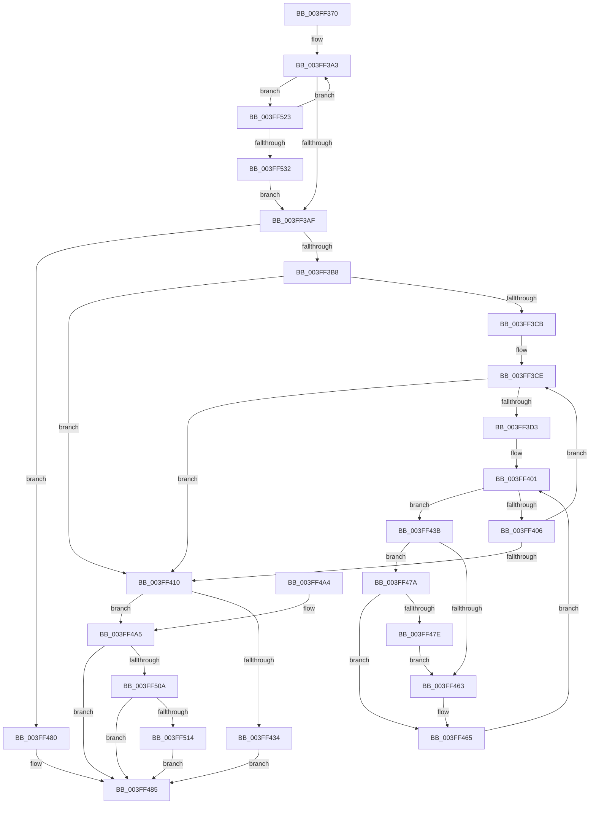

# HalGetScatterGatherListDmaThin

- RVA: `0x003FF370`–`0x003FF537` (길이 `455` bytes)
- VA: `0x00000001403FF370`
- 실행 섹션: `.text`
- PDB 이름 있음: `예`; PDB Function 태그: `아니요`
- unwind 정보 RVA: `0x0006F100`
- 디코드: `132`개 명령, `455/455` bytes 표시
- 미해석 바이트: `0` (있으면 어셈블리에 `.byte`로 보존)

> 이 문서는 커널 이미지의 기계어와 PDB 기호를 분석해 생성했습니다. 4번과 5번은 함수 원형과 자료형을 바이너리 사용 방식에서 추정한 C 해석이며 원본 소스 복구 결과는 아닙니다.

## 1. Dependencies

- 직접 호출 지점: **3**; 고유 호출 대상: **3**
- 직접 호출자로 확인된 함수: **0**
- RIP 상대 이미지 참조: **0**

### Outgoing calls
- `0x003FF427` → [ExAllocatePool2](../../poolcode/B8/ExAllocatePool2_function_00B820F0.md) (function, `0x00B820F0`)
- `0x003FF4FB` → [HalpConstructScatterGatherListDmaThin](HalpConstructScatterGatherListDmaThin_function_003FF540.md) (function, `0x003FF540`)
- `0x003FF519` → [ExFreePoolWithTag](../../poolcode/B8/ExFreePoolWithTag_function_00B82870.md) (function, `0x00B82870`)

### Direct callers
- 이 함수 시작 RVA로 연결되는 직접 call은 확인되지 않았습니다. 간접 호출은 완전히 역산할 수 없습니다.

### Static image references
- 디코드된 RIP-relative 메모리 참조가 없습니다.

## 2. Other-region calls and transfers

- 다른 실행 섹션으로 향하는 call: **2**
  - `0x003FF427` → [ExAllocatePool2](../../poolcode/B8/ExAllocatePool2_function_00B820F0.md) (`.text` → `POOLCODE`)
  - `0x003FF519` → [ExFreePoolWithTag](../../poolcode/B8/ExFreePoolWithTag_function_00B82870.md) (`.text` → `POOLCODE`)
- 별도 외부 분기/꼬리 이동을 확인하지 못했습니다.

## 3. Assembly (complete function range)

```asm
003FF370  48 89 5C 24 08                  mov qword ptr [rsp + 8], rbx
003FF375  48 89 6C 24 10                  mov qword ptr [rsp + 0x10], rbp
003FF37A  48 89 74 24 18                  mov qword ptr [rsp + 0x18], rsi
003FF37F  57                              push rdi
003FF380  41 54                           push r12
003FF382  41 55                           push r13
003FF384  41 56                           push r14
003FF386  41 57                           push r15
003FF388  48 83 EC 20                     sub rsp, 0x20
003FF38C  41 8B 40 2C                     mov eax, dword ptr [r8 + 0x2c]
003FF390  49 8B F1                        mov rsi, r9
003FF393  48 2B F0                        sub rsi, rax
003FF396  49 8B F8                        mov rdi, r8
003FF399  49 2B 70 20                     sub rsi, qword ptr [r8 + 0x20]
003FF39D  4C 8B EA                        mov r13, rdx
003FF3A0  4C 8B E1                        mov r12, rcx
003FF3A3  8B 47 28                        mov eax, dword ptr [rdi + 0x28]
003FF3A6  48 3B F0                        cmp rsi, rax
003FF3A9  0F 83 74 01 00 00               jae 0x1403ff523
003FF3AF  48 85 FF                        test rdi, rdi
003FF3B2  0F 84 C8 00 00 00               je 0x1403ff480
003FF3B8  8B 6C 24 70                     mov ebp, dword ptr [rsp + 0x70]
003FF3BC  33 DB                           xor ebx, ebx
003FF3BE  44 8B CD                        mov r9d, ebp
003FF3C1  48 8B CE                        mov rcx, rsi
003FF3C4  48 8B D7                        mov rdx, rdi
003FF3C7  85 ED                           test ebp, ebp
003FF3C9  74 45                           je 0x1403ff410
003FF3CB  45 33 F6                        xor r14d, r14d
003FF3CE  48 85 D2                        test rdx, rdx
003FF3D1  74 3D                           je 0x1403ff410
003FF3D3  8B 42 28                        mov eax, dword ptr [rdx + 0x28]
003FF3D6  45 8B C1                        mov r8d, r9d
003FF3D9  2B C1                           sub eax, ecx
003FF3DB  41 3B C1                        cmp eax, r9d
003FF3DE  44 0F 46 C0                     cmovbe r8d, eax
003FF3E2  03 4A 2C                        add ecx, dword ptr [rdx + 0x2c]
003FF3E5  44 8B D1                        mov r10d, ecx
003FF3E8  44 8B D9                        mov r11d, ecx
003FF3EB  49 C1 EB 0C                     shr r11, 0xc
003FF3EF  41 81 E2 FF 0F 00 00            and r10d, 0xfff
003FF3F6  45 2B C8                        sub r9d, r8d
003FF3F9  49 83 C3 06                     add r11, 6
003FF3FD  4E 8D 1C DA                     lea r11, [rdx + r11*8]
003FF401  45 85 C0                        test r8d, r8d
003FF404  75 35                           jne 0x1403ff43b
003FF406  48 8B 12                        mov rdx, qword ptr [rdx]
003FF409  33 C9                           xor ecx, ecx
003FF40B  45 85 C9                        test r9d, r9d
003FF40E  75 BE                           jne 0x1403ff3ce
003FF410  4C 8D 3C 5B                     lea r15, [rbx + rbx*2]
003FF414  B9 42 00 00 00                  mov ecx, 0x42
003FF419  4A 8D 14 FD 78 00 00 00         lea rdx, [r15*8 + 0x78]
003FF421  41 B8 48 61 6C 44               mov r8d, 0x446c6148
003FF427  E8 C4 2C 78 00                  call 0x140b820f0
003FF42C  4C 8B F0                        mov r14, rax
003FF42F  48 85 C0                        test rax, rax
003FF432  75 71                           jne 0x1403ff4a5
003FF434  BF 9A 00 00 C0                  mov edi, 0xc000009a
003FF439  EB 4A                           jmp 0x1403ff485
003FF43B  49 8B 0B                        mov rcx, qword ptr [r11]
003FF43E  41 8B C2                        mov eax, r10d
003FF441  48 C1 E1 0C                     shl rcx, 0xc
003FF445  48 03 C8                        add rcx, rax
003FF448  B8 00 10 00 00                  mov eax, 0x1000
003FF44D  41 2B C2                        sub eax, r10d
003FF450  45 8B D0                        mov r10d, r8d
003FF453  41 3B C0                        cmp eax, r8d
003FF456  44 0F 46 D0                     cmovbe r10d, eax
003FF45A  49 8D 46 01                     lea rax, [r14 + 1]
003FF45E  48 3B C8                        cmp rcx, rax
003FF461  74 17                           je 0x1403ff47a
003FF463  FF C3                           inc ebx
003FF465  45 8B F2                        mov r14d, r10d
003FF468  45 2B C2                        sub r8d, r10d
003FF46B  49 FF CE                        dec r14
003FF46E  49 83 C3 08                     add r11, 8
003FF472  4C 03 F1                        add r14, rcx
003FF475  45 33 D2                        xor r10d, r10d
003FF478  EB 87                           jmp 0x1403ff401
003FF47A  85 DB                           test ebx, ebx
003FF47C  75 E7                           jne 0x1403ff465
003FF47E  EB E3                           jmp 0x1403ff463
003FF480  BF 0D 00 00 C0                  mov edi, 0xc000000d
003FF485  48 8B 5C 24 50                  mov rbx, qword ptr [rsp + 0x50]
003FF48A  8B C7                           mov eax, edi
003FF48C  48 8B 6C 24 58                  mov rbp, qword ptr [rsp + 0x58]
003FF491  48 8B 74 24 60                  mov rsi, qword ptr [rsp + 0x60]
003FF496  48 83 C4 20                     add rsp, 0x20
003FF49A  41 5F                           pop r15
003FF49C  41 5E                           pop r14
003FF49E  41 5D                           pop r13
003FF4A0  41 5C                           pop r12
003FF4A2  5F                              pop rdi
003FF4A3  C3                              ret
003FF4A4  CC                              int3
003FF4A5  89 18                           mov dword ptr [rax], ebx
003FF4A7  4A 8D 1C F8                     lea rbx, [rax + r15*8]
003FF4AB  C6 43 71 01                     mov byte ptr [rbx + 0x71], 1
003FF4AF  48 8D 4B 10                     lea rcx, [rbx + 0x10]
003FF4B3  4C 89 63 28                     mov qword ptr [rbx + 0x28], r12
003FF4B7  4C 89 6B 30                     mov qword ptr [rbx + 0x30], r13
003FF4BB  49 8B 45 20                     mov rax, qword ptr [r13 + 0x20]
003FF4BF  48 89 43 38                     mov qword ptr [rbx + 0x38], rax
003FF4C3  48 8B 44 24 78                  mov rax, qword ptr [rsp + 0x78]
003FF4C8  48 89 43 50                     mov qword ptr [rbx + 0x50], rax
003FF4CC  48 8B 84 24 80 00 00 00         mov rax, qword ptr [rsp + 0x80]
003FF4D4  89 73 4C                        mov dword ptr [rbx + 0x4c], esi
003FF4D7  33 F6                           xor esi, esi
003FF4D9  48 89 43 58                     mov qword ptr [rbx + 0x58], rax
003FF4DD  89 6B 48                        mov dword ptr [rbx + 0x48], ebp
003FF4E0  48 89 7B 40                     mov qword ptr [rbx + 0x40], rdi
003FF4E4  4C 89 73 60                     mov qword ptr [rbx + 0x60], r14
003FF4E8  40 88 73 70                     mov byte ptr [rbx + 0x70], sil
003FF4EC  C7 43 20 02 00 00 00            mov dword ptr [rbx + 0x20], 2
003FF4F3  40 88 73 72                     mov byte ptr [rbx + 0x72], sil
003FF4F7  48 89 73 68                     mov qword ptr [rbx + 0x68], rsi
003FF4FB  E8 40 00 00 00                  call 0x1403ff540
003FF500  8B F8                           mov edi, eax
003FF502  85 C0                           test eax, eax
003FF504  0F 89 7B FF FF FF               jns 0x1403ff485
003FF50A  40 38 73 71                     cmp byte ptr [rbx + 0x71], sil
003FF50E  0F 84 71 FF FF FF               je 0x1403ff485
003FF514  33 D2                           xor edx, edx
003FF516  49 8B CE                        mov rcx, r14
003FF519  E8 52 33 78 00                  call 0x140b82870
003FF51E  E9 62 FF FF FF                  jmp 0x1403ff485
003FF523  48 8B 3F                        mov rdi, qword ptr [rdi]
003FF526  48 2B F0                        sub rsi, rax
003FF529  48 85 FF                        test rdi, rdi
003FF52C  0F 85 71 FE FF FF               jne 0x1403ff3a3
003FF532  E9 78 FE FF FF                  jmp 0x1403ff3af
```

## 4. C-style interpretation (structured pseudocode)

```c
__int64 __fastcall HalGetScatterGatherListDmaThin(__int64 a1, __int64 a2, __int64 a3, __int64 a4, unsigned int a5, __int64 a6, __int64 a7)
{
    __int64 result;
    __int64 v_r10;
    __int64 v_r11;
    __int64 v_r14;
    __int64 v_rbx;
    __int64 v_rsi;
    __int64 v_rsp;
    unsigned __int64 v_stack_p10;
    unsigned __int64 v_stack_p18;
    unsigned __int64 v_stack_p8;

    v_stack_p8 = v_rbx;
    v_stack_p10 = v_rbp;
    v_stack_p18 = v_rsi;
    v_rsp = (v_rsp) - (32);
    v_rsi = (a4) - ((unsigned int)(*(unsigned int *)(a3 + 44)));
    v_rsi = (v_rsi) - (*(unsigned __int64 *)(a3 + 32));
loc_003FF3A3:
    if (v_rsi >= ((unsigned int)(*(unsigned int *)(a3 + 40)))) goto loc_003FF523;
loc_003FF3AF:
    if (a3 == 0) goto loc_003FF480;
    v_rbx = 0;
    if ((unsigned int)((unsigned int)(a5)) == 0) goto loc_003FF410;
    v_r14 = 0;
loc_003FF3CE:
    if (a3 == 0) goto loc_003FF410;
    result = (unsigned int)(((unsigned int)(*(unsigned int *)(a3 + 40))) - ((unsigned int)(v_rsi)));
    a3 = (unsigned int)((unsigned int)((unsigned int)((unsigned int)((unsigned int)(a5)))));
    if (((unsigned int)(result)) <= ((unsigned int)((unsigned int)((unsigned int)((unsigned int)(a5)))))) { a3 = (unsigned int)(result); }
    a1 = (unsigned int)((v_rsi) + (*(unsigned int *)(a3 + 44)));
    v_r11 = ((unsigned int)((unsigned int)(a1))) >> (12);
    v_r10 = (unsigned int)(((unsigned int)((unsigned int)(a1))) & (0xFFFULL));
    a4 = (unsigned int)(((unsigned int)((unsigned int)((unsigned int)(a5)))) - ((unsigned int)(a3)));
    v_r11 = (v_r11) + (6);
loc_003FF401:
    if ((unsigned int)(a3) != 0) goto loc_003FF43B;
    a1 = 0;
    if ((unsigned int)(a4) != 0) goto loc_003FF3CE;
loc_003FF410:
    result = ExAllocatePool2(66, v_rbx + v_rbx * 2 * 8 + 120, (unsigned int)(0x446C6148ULL), a4);
    if (result != 0) goto loc_003FF4A5;
    goto loc_003FF485;
loc_003FF43B:
    a1 = (*(unsigned __int64 *)(a3 + v_r11 * 8)) << (12);
    a1 = (a1) + ((unsigned int)((unsigned int)(v_r10)));
    result = (unsigned int)(((unsigned int)(0x1000ULL)) - ((unsigned int)(v_r10)));
    v_r10 = (unsigned int)((unsigned int)((unsigned int)(0x446C6148ULL)));
    if (((unsigned int)(result)) <= ((unsigned int)((unsigned int)(0x446C6148ULL)))) { v_r10 = (unsigned int)(result); }
    if (a1 == (result + 1)) goto loc_003FF47A;
loc_003FF463:
    v_rbx = (unsigned int)((v_rbx) + 1);
loc_003FF465:
    a3 = (unsigned int)(((unsigned int)(0x446C6148ULL)) - ((unsigned int)(v_r10)));
    v_r14 = ((unsigned int)((unsigned int)(v_r10))) - 1;
    v_r11 = (a3 + v_r11 * 8) + (8);
    v_r14 = (v_r14) + (a1);
    v_r10 = 0;
    goto loc_003FF401;
loc_003FF47A:
    if ((unsigned int)(v_rbx) != 0) goto loc_003FF465;
    goto loc_003FF463;
loc_003FF480:
loc_003FF485:
    v_rsp = (v_rsp) + (32);
    return (unsigned int)((unsigned int)((unsigned int)(0xC000000DULL)));
loc_003FF4A5:
    *(unsigned int *)((unsigned int)((unsigned int)((unsigned int)(0xC000000DULL)))) = (unsigned int)(v_stack_p8);
    *(unsigned __int8 *)((unsigned int)((unsigned int)((unsigned int)(0xC000000DULL))) + v_rbx + v_rbx * 2 * 8 + 113) = 1;
    *(unsigned __int64 *)((unsigned int)((unsigned int)((unsigned int)(0xC000000DULL))) + v_rbx + v_rbx * 2 * 8 + 40) = a1;
    *(unsigned __int64 *)((unsigned int)((unsigned int)((unsigned int)(0xC000000DULL))) + v_rbx + v_rbx * 2 * 8 + 48) = a2;
    *(unsigned __int64 *)((unsigned int)((unsigned int)((unsigned int)(0xC000000DULL))) + v_rbx + v_rbx * 2 * 8 + 56) = *(unsigned __int64 *)(a2 + 32);
    *(unsigned __int64 *)((unsigned int)((unsigned int)((unsigned int)(0xC000000DULL))) + v_rbx + v_rbx * 2 * 8 + 80) = a6;
    *(unsigned int *)((unsigned int)((unsigned int)((unsigned int)(0xC000000DULL))) + v_rbx + v_rbx * 2 * 8 + 76) = (unsigned int)(v_stack_p18);
    v_rsi = 0;
    *(unsigned __int64 *)((unsigned int)((unsigned int)((unsigned int)(0xC000000DULL))) + v_rbx + v_rbx * 2 * 8 + 88) = a7;
    *(unsigned int *)((unsigned int)((unsigned int)((unsigned int)(0xC000000DULL))) + v_rbx + v_rbx * 2 * 8 + 72) = (unsigned int)(v_stack_p10);
    *(unsigned __int64 *)((unsigned int)((unsigned int)((unsigned int)(0xC000000DULL))) + v_rbx + v_rbx * 2 * 8 + 64) = (unsigned int)(0xC000000DULL);
    *(unsigned __int64 *)((unsigned int)((unsigned int)((unsigned int)(0xC000000DULL))) + v_rbx + v_rbx * 2 * 8 + 96) = v_r14;
    *(unsigned __int8 *)((unsigned int)((unsigned int)((unsigned int)(0xC000000DULL))) + v_rbx + v_rbx * 2 * 8 + 112) = 0;
    *(unsigned int *)((unsigned int)((unsigned int)((unsigned int)(0xC000000DULL))) + v_rbx + v_rbx * 2 * 8 + 32) = 2;
    *(unsigned __int8 *)((unsigned int)((unsigned int)((unsigned int)(0xC000000DULL))) + v_rbx + v_rbx * 2 * 8 + 114) = 0;
    *(unsigned __int64 *)((unsigned int)((unsigned int)((unsigned int)(0xC000000DULL))) + v_rbx + v_rbx * 2 * 8 + 104) = 0;
    result = HalpConstructScatterGatherListDmaThin((unsigned int)((unsigned int)((unsigned int)(0xC000000DULL))) + v_rbx + v_rbx * 2 * 8 + 16, v_rbx + v_rbx * 2 * 8 + 120, a3, a4);
    if (!sign_flag) goto loc_003FF485;
    if ((*(unsigned __int8 *)((unsigned int)((unsigned int)((unsigned int)(0xC000000DULL))) + v_rbx + v_rbx * 2 * 8 + 113)) == 0) goto loc_003FF485;
    a2 = 0;
    result = ExFreePoolWithTag(v_r14, a2, a3, a4);
    goto loc_003FF485;
loc_003FF523:
    v_rsi = (v_rsi) - (result);
    if (*(unsigned __int64 *)((unsigned int)((unsigned int)(result))) != 0) goto loc_003FF3A3;
    goto loc_003FF3AF;
}
```

## 5. (Beta) C Style

```c
int64_t HalGetScatterGatherListDmaThin(int64_t Arg1, void *Arg2, void *Arg3, int64_t Arg4, uint32_t Arg5, int64_t Arg6, int64_t Arg7)
{
    uint8_t *arg2 = (uint8_t *)Arg2;
    uint8_t *arg3 = (uint8_t *)Arg3;

    int64_t result;
    int64_t local_r10;
    int64_t local_r11;
    int64_t local_r14;
    int64_t local_rbx;
    int64_t local_rsi;
    int64_t local_rsp;
    uint64_t v_stack_p10;
    uint64_t v_stack_p18;
    uint64_t v_stack_p8;

    v_stack_p8 = local_rbx;
    v_stack_p10 = local_rbp;
    v_stack_p18 = local_rsi;
    local_rsp = (local_rsp) - (32);
    local_rsi = (Arg4) - ((uint32_t)(*(uint32_t *)(arg3 + 0x2C)));
    local_rsi = (local_rsi) - (*(uint64_t *)(arg3 + 0x20));
loc_003FF3A3:
    if (local_rsi >= ((uint32_t)(*(uint32_t *)(arg3 + 0x28)))) goto loc_003FF523;
loc_003FF3AF:
    if (Arg3 == NULL) goto loc_003FF480;
    local_rbx = 0;
    if ((uint32_t)((uint32_t)(Arg5)) == 0) goto loc_003FF410;
    local_r14 = 0;
loc_003FF3CE:
    if (Arg3 == NULL) goto loc_003FF410;
    result = (uint32_t)(((uint32_t)(*(uint32_t *)(arg3 + 0x28))) - ((uint32_t)(local_rsi)));
    Arg3 = (uint32_t)((uint32_t)((uint32_t)((uint32_t)((uint32_t)(Arg5)))));
    if (((uint32_t)(result)) <= ((uint32_t)((uint32_t)((uint32_t)((uint32_t)(Arg5)))))) { Arg3 = (uint32_t)(result); }
    Arg1 = (uint32_t)((local_rsi) + (*(uint32_t *)(arg3 + 0x2C)));
    local_r11 = ((uint32_t)((uint32_t)(Arg1))) >> (12);
    local_r10 = (uint32_t)(((uint32_t)((uint32_t)(Arg1))) & (0xFFFULL));
    Arg4 = (uint32_t)(((uint32_t)((uint32_t)((uint32_t)(Arg5)))) - ((uint32_t)(Arg3)));
    local_r11 = (local_r11) + (6);
loc_003FF401:
    if ((uint32_t)(Arg3) != 0) goto loc_003FF43B;
    Arg1 = 0;
    if ((uint32_t)(Arg4) != 0) goto loc_003FF3CE;
loc_003FF410:
    result = ExAllocatePool2(66, local_rbx + local_rbx * 2 * 8 + 120, (uint32_t)(0x446C6148ULL), Arg4);
    if (result != 0) goto loc_003FF4A5;
    goto loc_003FF485;
loc_003FF43B:
    Arg1 = (*(uint64_t *)(arg3 + local_r11 * 8)) << (12);
    Arg1 = (Arg1) + ((uint32_t)((uint32_t)(local_r10)));
    result = (uint32_t)(((uint32_t)(0x1000ULL)) - ((uint32_t)(local_r10)));
    local_r10 = (uint32_t)((uint32_t)((uint32_t)(0x446C6148ULL)));
    if (((uint32_t)(result)) <= ((uint32_t)((uint32_t)(0x446C6148ULL)))) { local_r10 = (uint32_t)(result); }
    if (Arg1 == (result + 1)) goto loc_003FF47A;
loc_003FF463:
    local_rbx = (uint32_t)((local_rbx) + 1);
loc_003FF465:
    Arg3 = (uint32_t)(((uint32_t)(0x446C6148ULL)) - ((uint32_t)(local_r10)));
    local_r14 = ((uint32_t)((uint32_t)(local_r10))) - 1;
    local_r11 = (Arg3 + local_r11 * 8) + (8);
    local_r14 = (local_r14) + (Arg1);
    local_r10 = 0;
    goto loc_003FF401;
loc_003FF47A:
    if ((uint32_t)(local_rbx) != 0) goto loc_003FF465;
    goto loc_003FF463;
loc_003FF480:
loc_003FF485:
    local_rsp = (local_rsp) + (32);
    return (uint32_t)((uint32_t)((uint32_t)(0xC000000DULL)));
loc_003FF4A5:
    *(uint32_t *)((uint32_t)((uint32_t)((uint32_t)(0xC000000DULL)))) = (uint32_t)(v_stack_p8);
    *(uint8_t *)((uint32_t)((uint32_t)((uint32_t)(0xC000000DULL))) + local_rbx + local_rbx * 2 * 8 + 0x71) = 1;
    *(uint64_t *)((uint32_t)((uint32_t)((uint32_t)(0xC000000DULL))) + local_rbx + local_rbx * 2 * 8 + 0x28) = Arg1;
    *(void **)((uint32_t)((uint32_t)((uint32_t)(0xC000000DULL))) + local_rbx + local_rbx * 2 * 8 + 0x30) = Arg2;
    *(uint64_t *)((uint32_t)((uint32_t)((uint32_t)(0xC000000DULL))) + local_rbx + local_rbx * 2 * 8 + 0x38) = *(uint64_t *)(arg2 + 0x20);
    *(uint64_t *)((uint32_t)((uint32_t)((uint32_t)(0xC000000DULL))) + local_rbx + local_rbx * 2 * 8 + 0x50) = Arg6;
    *(uint32_t *)((uint32_t)((uint32_t)((uint32_t)(0xC000000DULL))) + local_rbx + local_rbx * 2 * 8 + 0x4C) = (uint32_t)(v_stack_p18);
    local_rsi = 0;
    *(uint64_t *)((uint32_t)((uint32_t)((uint32_t)(0xC000000DULL))) + local_rbx + local_rbx * 2 * 8 + 0x58) = Arg7;
    *(uint32_t *)((uint32_t)((uint32_t)((uint32_t)(0xC000000DULL))) + local_rbx + local_rbx * 2 * 8 + 0x48) = (uint32_t)(v_stack_p10);
    *(uint64_t *)((uint32_t)((uint32_t)((uint32_t)(0xC000000DULL))) + local_rbx + local_rbx * 2 * 8 + 0x40) = (uint32_t)(0xC000000DULL);
    *(uint64_t *)((uint32_t)((uint32_t)((uint32_t)(0xC000000DULL))) + local_rbx + local_rbx * 2 * 8 + 0x60) = local_r14;
    *(uint8_t *)((uint32_t)((uint32_t)((uint32_t)(0xC000000DULL))) + local_rbx + local_rbx * 2 * 8 + 0x70) = 0;
    *(uint32_t *)((uint32_t)((uint32_t)((uint32_t)(0xC000000DULL))) + local_rbx + local_rbx * 2 * 8 + 0x20) = 2;
    *(uint8_t *)((uint32_t)((uint32_t)((uint32_t)(0xC000000DULL))) + local_rbx + local_rbx * 2 * 8 + 0x72) = 0;
    *(uint64_t *)((uint32_t)((uint32_t)((uint32_t)(0xC000000DULL))) + local_rbx + local_rbx * 2 * 8 + 0x68) = 0;
    result = HalpConstructScatterGatherListDmaThin((uint32_t)((uint32_t)((uint32_t)(0xC000000DULL))) + local_rbx + local_rbx * 2 * 8 + 16, local_rbx + local_rbx * 2 * 8 + 120, Arg3, Arg4);
    if (!sign_flag) goto loc_003FF485;
    if ((*(uint8_t *)((uint32_t)((uint32_t)((uint32_t)(0xC000000DULL))) + local_rbx + local_rbx * 2 * 8 + 0x71)) == 0) goto loc_003FF485;
    Arg2 = 0;
    result = ExFreePoolWithTag(local_r14, Arg2, Arg3, Arg4);
    goto loc_003FF485;
loc_003FF523:
    local_rsi = (local_rsi) - (result);
    if (*(uint64_t *)((uint32_t)((uint32_t)(result))) != 0) goto loc_003FF3A3;
    goto loc_003FF3AF;
}
```

### 관측된 메모리 오프셋

구조체 형식이 확인되지 않은 접근은 인자 기준의 오프셋으로만 기록했습니다.

| 기준 인자 | 오프셋 표현 | 폭 (bit) | 접근 |
|---|---:|---:|---|
| `Arg2` | `+ 0x20` | `64` | `R` |
| `Arg3` | `+ 0x20` | `64` | `R` |
| `Arg3` | `+ 0x2C` | `32` | `R` |

## 6. Execution-region graph

[열기: 2D/3D 그래프와 함수 탐색 컨트롤 패널](../../../control-panel.html?section=text&rva=0x003FF370&view=graph)

- 2D 그래프는 위에서 아래로 흐르고, 3D 그래프는 빈 공간을 드래그해 회전합니다. Shift+드래그는 이동, 휠은 확대·축소, 함수 노드 선택은 대상 보고서 이동입니다.

### Static fallback


