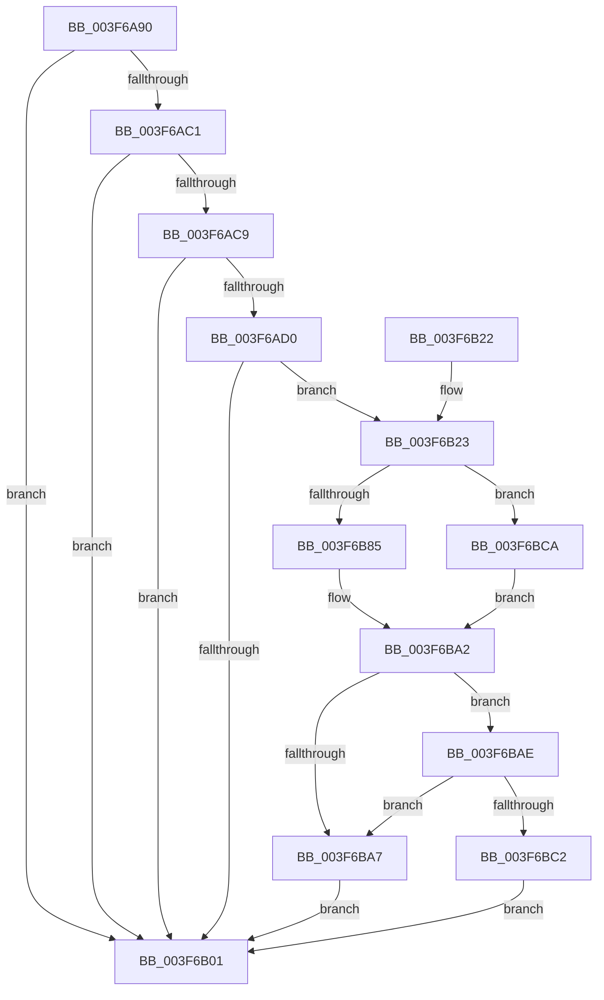

# HalMatchAcpiOemId

- RVA: `0x003F6A90`–`0x003F6BD0` (길이 `320` bytes)
- VA: `0x00000001403F6A90`
- 실행 섹션: `.text`
- PDB 이름 있음: `예`; PDB Function 태그: `아니요`
- unwind 정보 RVA: `0x00098138`
- 디코드: `91`개 명령, `320/320` bytes 표시
- 미해석 바이트: `0` (있으면 어셈블리에 `.byte`로 보존)

> 이 문서는 커널 이미지의 기계어와 PDB 기호를 분석해 생성했습니다. 4번과 5번은 함수 원형과 자료형을 바이너리 사용 방식에서 추정한 C 해석이며 원본 소스 복구 결과는 아닙니다.

## 1. Dependencies

- 직접 호출 지점: **7**; 고유 호출 대상: **6**
- 직접 호출자로 확인된 함수: **1**
- RIP 상대 이미지 참조: **2**

### Outgoing calls
- `0x003F6AD9` → [ExAcquireFastMutex](../20/ExAcquireFastMutex_function_0020E5A0.md) (function, `0x0020E5A0`)
- `0x003F6AE8` → [HalpAcpiGetTableWork](HalpAcpiGetTableWork_function_003F6CDC.md) (function, `0x003F6CDC`)
- `0x003F6AF7` → [ExReleaseFastMutex](../25/ExReleaseFastMutex_function_002519C0.md) (function, `0x002519C0`)
- `0x003F6B0A` → [_security_check_cookie](../6A/_security_check_cookie_function_006AC640.md) (function, `0x006AC640`)
- `0x003F6B50` → [strlen](../6C/strlen_function_006C70D0.md) (function, `0x006C70D0`)
- `0x003F6B85` → [strlen](../6C/strlen_function_006C70D0.md) (function, `0x006C70D0`)
- `0x003F6BB9` → [RtlCompareString](../../page/90/RtlCompareString_function_0090E880.md) (function, `0x0090E880`)

### Direct callers
- [EmpEvaluateNodeLink](../44/EmpEvaluateNodeLink_function_0044313C.md) at `0x0044340F`

### Static image references
- `0x003F6AA5` → RVA `0x00E0A740` (`.data`; read)
- `0x003F6AD2` → RVA `0x00FC3F40` (`.data`; read)

## 2. Other-region calls and transfers

- 다른 실행 섹션으로 향하는 call: **1**
  - `0x003F6BB9` → [RtlCompareString](../../page/90/RtlCompareString_function_0090E880.md) (`.text` → `PAGE`)
- 별도 외부 분기/꼬리 이동을 확인하지 못했습니다.

## 3. Assembly (complete function range)

```asm
003F6A90  48 89 5C 24 08                  mov qword ptr [rsp + 8], rbx
003F6A95  48 89 74 24 10                  mov qword ptr [rsp + 0x10], rsi
003F6A9A  55                              push rbp
003F6A9B  57                              push rdi
003F6A9C  41 57                           push r15
003F6A9E  48 8B EC                        mov rbp, rsp
003F6AA1  48 83 EC 50                     sub rsp, 0x50
003F6AA5  48 8B 05 94 3C A1 00            mov rax, qword ptr [rip + 0xa13c94]
003F6AAC  48 33 C4                        xor rax, rsp
003F6AAF  48 89 45 F8                     mov qword ptr [rbp - 8], rax
003F6AB3  49 8B F0                        mov rsi, r8
003F6AB6  BF 01 00 00 00                  mov edi, 1
003F6ABB  41 83 F9 02                     cmp r9d, 2
003F6ABF  75 40                           jne 0x1403f6b01
003F6AC1  49 8B 18                        mov rbx, qword ptr [r8]
003F6AC4  48 85 DB                        test rbx, rbx
003F6AC7  74 38                           je 0x1403f6b01
003F6AC9  49 83 78 08 00                  cmp qword ptr [r8 + 8], 0
003F6ACE  74 31                           je 0x1403f6b01
003F6AD0  8B 1B                           mov ebx, dword ptr [rbx]
003F6AD2  48 8D 0D 67 D4 BC 00            lea rcx, [rip + 0xbcd467]
003F6AD9  E8 C2 7A E1 FF                  call 0x14020e5a0
003F6ADE  45 33 C9                        xor r9d, r9d
003F6AE1  45 33 C0                        xor r8d, r8d
003F6AE4  8B D3                           mov edx, ebx
003F6AE6  33 C9                           xor ecx, ecx
003F6AE8  E8 EF 01 00 00                  call 0x1403f6cdc
003F6AED  48 8D 0D 4C D4 BC 00            lea rcx, [rip + 0xbcd44c]
003F6AF4  48 8B D8                        mov rbx, rax
003F6AF7  E8 C4 AE E5 FF                  call 0x1402519c0
003F6AFC  48 85 DB                        test rbx, rbx
003F6AFF  75 22                           jne 0x1403f6b23
003F6B01  8B C7                           mov eax, edi
003F6B03  48 8B 4D F8                     mov rcx, qword ptr [rbp - 8]
003F6B07  48 33 CC                        xor rcx, rsp
003F6B0A  E8 31 5B 2B 00                  call 0x1406ac640
003F6B0F  48 8B 5C 24 70                  mov rbx, qword ptr [rsp + 0x70]
003F6B14  48 8B 74 24 78                  mov rsi, qword ptr [rsp + 0x78]
003F6B19  48 83 C4 50                     add rsp, 0x50
003F6B1D  41 5F                           pop r15
003F6B1F  5F                              pop rdi
003F6B20  5D                              pop rbp
003F6B21  C3                              ret
003F6B22  CC                              int3
003F6B23  33 C0                           xor eax, eax
003F6B25  48 8D 4D F0                     lea rcx, [rbp - 0x10]
003F6B29  89 45 F0                        mov dword ptr [rbp - 0x10], eax
003F6B2C  0F 57 C0                        xorps xmm0, xmm0
003F6B2F  66 89 45 F4                     mov word ptr [rbp - 0xc], ax
003F6B33  88 45 F6                        mov byte ptr [rbp - 0xa], al
003F6B36  8B 43 0A                        mov eax, dword ptr [rbx + 0xa]
003F6B39  89 45 F0                        mov dword ptr [rbp - 0x10], eax
003F6B3C  0F B7 43 0E                     movzx eax, word ptr [rbx + 0xe]
003F6B40  66 89 45 F4                     mov word ptr [rbp - 0xc], ax
003F6B44  48 8D 45 F0                     lea rax, [rbp - 0x10]
003F6B48  0F 11 45 E0                     movups xmmword ptr [rbp - 0x20], xmm0
003F6B4C  48 89 45 E8                     mov qword ptr [rbp - 0x18], rax
003F6B50  E8 7B 05 2D 00                  call 0x1406c70d0
003F6B55  48 8B 4E 08                     mov rcx, qword ptr [rsi + 8]
003F6B59  48 3D FF FF 00 00               cmp rax, 0xffff
003F6B5F  48 8B D8                        mov rbx, rax
003F6B62  48 89 4D D8                     mov qword ptr [rbp - 0x28], rcx
003F6B66  41 BF FE FF 00 00               mov r15d, 0xfffe
003F6B6C  49 0F 43 DF                     cmovae rbx, r15
003F6B70  48 83 65 D0 00                  and qword ptr [rbp - 0x30], 0
003F6B75  66 89 5D E0                     mov word ptr [rbp - 0x20], bx
003F6B79  8D 04 1F                        lea eax, [rdi + rbx]
003F6B7C  66 89 45 E2                     mov word ptr [rbp - 0x1e], ax
003F6B80  48 85 C9                        test rcx, rcx
003F6B83  74 45                           je 0x1403f6bca
003F6B85  E8 46 05 2D 00                  call 0x1406c70d0
003F6B8A  48 3D FF FF 00 00               cmp rax, 0xffff
003F6B90  48 8B C8                        mov rcx, rax
003F6B93  49 0F 43 CF                     cmovae rcx, r15
003F6B97  66 89 4D D0                     mov word ptr [rbp - 0x30], cx
003F6B9B  8D 04 0F                        lea eax, [rdi + rcx]
003F6B9E  66 89 45 D2                     mov word ptr [rbp - 0x2e], ax
003F6BA2  66 3B CB                        cmp cx, bx
003F6BA5  74 07                           je 0x1403f6bae
003F6BA7  33 FF                           xor edi, edi
003F6BA9  E9 53 FF FF FF                  jmp 0x1403f6b01
003F6BAE  44 8A C7                        mov r8b, dil
003F6BB1  48 8D 55 E0                     lea rdx, [rbp - 0x20]
003F6BB5  48 8D 4D D0                     lea rcx, [rbp - 0x30]
003F6BB9  E8 C2 7C 51 00                  call 0x14090e880
003F6BBE  85 C0                           test eax, eax
003F6BC0  75 E5                           jne 0x1403f6ba7
003F6BC2  8D 78 02                        lea edi, [rax + 2]
003F6BC5  E9 37 FF FF FF                  jmp 0x1403f6b01
003F6BCA  0F B7 4D D0                     movzx ecx, word ptr [rbp - 0x30]
003F6BCE  EB D2                           jmp 0x1403f6ba2
```

## 4. C-style interpretation (structured pseudocode)

```c
__int64 __fastcall HalMatchAcpiOemId(__int64 a1, __int64 a2, __int64 a3, int a4)
{
    __int64 result;
    __int64 v_rbx;
    __int64 v_rdi;
    __int64 v_rsp;
    unsigned __int64 v_stack_m20;
    unsigned __int8 v_stack_m22;
    unsigned __int16 v_stack_m24;
    unsigned __int64 v_stack_m28;
    unsigned __int64 v_stack_m30;
    unsigned __int16 v_stack_m36;
    unsigned __int64 v_stack_m38;
    unsigned __int64 v_stack_m40;
    unsigned __int16 v_stack_m46;
    unsigned __int64 v_stack_m48;
    unsigned __int64 v_stack_p10;
    unsigned __int64 v_stack_p8;

    v_stack_p8 = v_rbx;
    v_stack_p10 = v_rsi;
    v_rsp = (v_rsp) - (80);
    result = (*(unsigned __int64 *)(v_rip + 10566804)) ^ (v_rsp);
    v_stack_m20 = result;
    if (a4 != 2) goto loc_003F6B01;
    if (*(unsigned __int64 *)(a3) == 0) goto loc_003F6B01;
    if ((*(unsigned __int64 *)(a3 + 8)) == 0) goto loc_003F6B01;
    result = ExAcquireFastMutex(v_rip + 12375143, a2, a3, a4);
    a4 = 0;
    a3 = 0;
    a1 = 0;
    result = HalpAcpiGetTableWork(a1, (unsigned int)((unsigned int)((unsigned int)(*(unsigned int *)(*(unsigned __int64 *)(a3))))), a3, a4);
    result = ExReleaseFastMutex(v_rip + 12375116, (unsigned int)((unsigned int)((unsigned int)(*(unsigned int *)(*(unsigned __int64 *)(a3))))), a3, a4);
    if (result != 0) goto loc_003F6B23;
loc_003F6B01:
    a1 = (v_stack_m20) ^ (v_rsp);
    result = _security_check_cookie(a1, (unsigned int)((unsigned int)((unsigned int)(*(unsigned int *)(*(unsigned __int64 *)(a3))))), a3, a4);
    v_rsp = (v_rsp) + (80);
    return result;
loc_003F6B23:
    result = 0;
    v_stack_m28 = 0;
    v_stack_m24 = 0;
    v_stack_m22 = 0;
    v_stack_m28 = (unsigned int)((unsigned int)(*(unsigned int *)(v_stack_p8 + 10)));
    v_stack_m24 = (unsigned __int16)(*(unsigned __int16 *)(v_stack_p8 + 14));
    v_stack_m38 = v_xmm0;
    v_stack_m30 = v_stack_m28;
    result = strlen(v_stack_m28, (unsigned int)((unsigned int)((unsigned int)(*(unsigned int *)(*(unsigned __int64 *)(a3))))), a3, a4);
    v_stack_m40 = *(unsigned __int64 *)(v_stack_p10 + 8);
    v_rbx = result;
    if (result >= 0xFFFFULL) { v_rbx = (unsigned int)(0xFFFEULL); }
    v_stack_m38 = (unsigned __int16)(v_rbx);
    v_stack_m36 = (unsigned __int16)(1 + v_rbx * 1);
    if (*(unsigned __int64 *)(v_stack_p10 + 8) == 0) goto loc_003F6BCA;
    result = strlen(*(unsigned __int64 *)(v_stack_p10 + 8), (unsigned int)((unsigned int)((unsigned int)(*(unsigned int *)(*(unsigned __int64 *)(a3))))), a3, a4);
    a1 = result;
    if (result >= 0xFFFFULL) { a1 = (unsigned int)(0xFFFEULL); }
    v_stack_m48 = (unsigned __int16)(a1);
    v_stack_m46 = (unsigned __int16)(1 + a1 * 1);
loc_003F6BA2:
    if (((unsigned __int16)(a1)) == ((unsigned __int16)(v_rbx))) goto loc_003F6BAE;
loc_003F6BA7:
    v_rdi = 0;
    goto loc_003F6B01;
loc_003F6BAE:
    result = RtlCompareString(v_stack_m48, v_stack_m38, 0, a4);
    if ((unsigned int)(result) != 0) goto loc_003F6BA7;
    goto loc_003F6B01;
loc_003F6BCA:
    goto loc_003F6BA2;
}
```

## 5. (Beta) C Style

```c
int64_t HalMatchAcpiOemId(int64_t Arg1, int64_t Arg2, void *Arg3, int32_t Arg4)
{
    uint8_t *arg3 = (uint8_t *)Arg3;

    int64_t result;
    int64_t local_rbx;
    int64_t local_rdi;
    int64_t local_rsp;
    uint64_t v_stack_m20;
    uint8_t v_stack_m22;
    uint16_t v_stack_m24;
    uint64_t v_stack_m28;
    uint64_t v_stack_m30;
    uint16_t v_stack_m36;
    uint64_t v_stack_m38;
    uint64_t v_stack_m40;
    uint16_t v_stack_m46;
    uint64_t v_stack_m48;
    uint64_t v_stack_p10;
    uint64_t v_stack_p8;

    v_stack_p8 = local_rbx;
    v_stack_p10 = local_rsi;
    local_rsp = (local_rsp) - (80);
    result = (*(uint64_t *)(v_rip + 0xA13C94)) ^ (local_rsp);
    v_stack_m20 = result;
    if (Arg4 != 2) goto loc_003F6B01;
    if (*(uint64_t *)(arg3) == 0) goto loc_003F6B01;
    if ((*(uint64_t *)(arg3 + 0x8)) == 0) goto loc_003F6B01;
    result = ExAcquireFastMutex(v_rip + 12375143, Arg2, Arg3, Arg4);
    Arg4 = 0;
    Arg3 = 0;
    Arg1 = 0;
    result = HalpAcpiGetTableWork(Arg1, (uint32_t)((uint32_t)((uint32_t)(*(uint32_t *)(*(uint64_t *)(arg3))))), Arg3, Arg4);
    result = ExReleaseFastMutex(v_rip + 12375116, (uint32_t)((uint32_t)((uint32_t)(*(uint32_t *)(*(uint64_t *)(arg3))))), Arg3, Arg4);
    if (result != 0) goto loc_003F6B23;
loc_003F6B01:
    Arg1 = (v_stack_m20) ^ (local_rsp);
    result = _security_check_cookie(Arg1, (uint32_t)((uint32_t)((uint32_t)(*(uint32_t *)(*(uint64_t *)(arg3))))), Arg3, Arg4);
    local_rsp = (local_rsp) + (80);
    return result;
loc_003F6B23:
    result = 0;
    v_stack_m28 = 0;
    v_stack_m24 = 0;
    v_stack_m22 = 0;
    v_stack_m28 = (uint32_t)((uint32_t)(*(uint32_t *)(v_stack_p8 + 0xA)));
    v_stack_m24 = (uint16_t)(*(uint16_t *)(v_stack_p8 + 0xE));
    v_stack_m38 = v_xmm0;
    v_stack_m30 = v_stack_m28;
    result = strlen(v_stack_m28, (uint32_t)((uint32_t)((uint32_t)(*(uint32_t *)(*(uint64_t *)(arg3))))), Arg3, Arg4);
    v_stack_m40 = *(uint64_t *)(v_stack_p10 + 0x8);
    local_rbx = result;
    if (result >= 0xFFFFULL) { local_rbx = (uint32_t)(0xFFFEULL); }
    v_stack_m38 = (uint16_t)(local_rbx);
    v_stack_m36 = (uint16_t)(1 + local_rbx * 1);
    if (*(uint64_t *)(v_stack_p10 + 0x8) == 0) goto loc_003F6BCA;
    result = strlen(*(uint64_t *)(v_stack_p10 + 0x8), (uint32_t)((uint32_t)((uint32_t)(*(uint32_t *)(*(uint64_t *)(arg3))))), Arg3, Arg4);
    Arg1 = result;
    if (result >= 0xFFFFULL) { Arg1 = (uint32_t)(0xFFFEULL); }
    v_stack_m48 = (uint16_t)(Arg1);
    v_stack_m46 = (uint16_t)(1 + Arg1 * 1);
loc_003F6BA2:
    if (((uint16_t)(Arg1)) == ((uint16_t)(local_rbx))) goto loc_003F6BAE;
loc_003F6BA7:
    local_rdi = 0;
    goto loc_003F6B01;
loc_003F6BAE:
    result = RtlCompareString(v_stack_m48, v_stack_m38, 0, Arg4);
    if ((uint32_t)(result) != 0) goto loc_003F6BA7;
    goto loc_003F6B01;
loc_003F6BCA:
    goto loc_003F6BA2;
}
```

### 관측된 메모리 오프셋

구조체 형식이 확인되지 않은 접근은 인자 기준의 오프셋으로만 기록했습니다.

| 기준 인자 | 오프셋 표현 | 폭 (bit) | 접근 |
|---|---:|---:|---|
| `Arg3` | `+ 0x0` | `64` | `R` |
| `Arg3` | `+ 0x8` | `64` | `R` |

## 6. Execution-region graph

[열기: 2D/3D 그래프와 함수 탐색 컨트롤 패널](../../../control-panel.html?section=text&rva=0x003F6A90&view=graph)

- 2D 그래프는 위에서 아래로 흐르고, 3D 그래프는 빈 공간을 드래그해 회전합니다. Shift+드래그는 이동, 휠은 확대·축소, 함수 노드 선택은 대상 보고서 이동입니다.

### Static fallback


