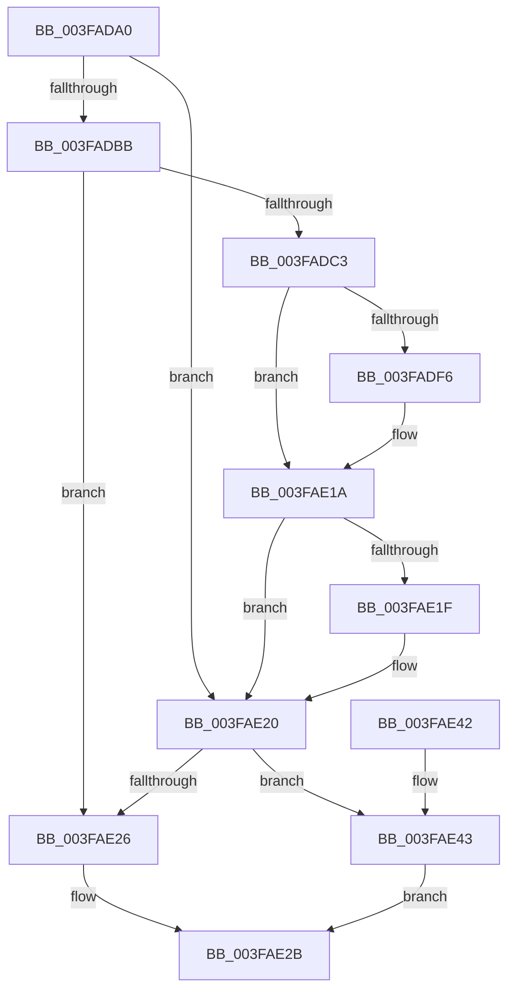

# HalRequestSoftwareInterrupt

- RVA: `0x003FADA0`–`0x003FAE4A` (길이 `170` bytes)
- VA: `0x00000001403FADA0`
- 실행 섹션: `.text`
- PDB 이름 있음: `예`; PDB Function 태그: `아니요`
- unwind 정보 RVA: `0x00082E10`
- 디코드: `44`개 명령, `170/170` bytes 표시
- 미해석 바이트: `0` (있으면 어셈블리에 `.byte`로 보존)

> 이 문서는 커널 이미지의 기계어와 PDB 기호를 분석해 생성했습니다. 4번과 5번은 함수 원형과 자료형을 바이너리 사용 방식에서 추정한 C 해석이며 원본 소스 복구 결과는 아닙니다.

## 1. Dependencies

- 직접 호출 지점: **2**; 고유 호출 대상: **2**
- 직접 호출자로 확인된 함수: **7**
- RIP 상대 이미지 참조: **1**

### Outgoing calls
- `0x003FADCC` → [HalpDisableInterrupts](../25/HalpDisableInterrupts_function_002521A0.md) (function, `0x002521A0`)
- `0x003FAE38` → [HalpInterruptSendIpi](../25/HalpInterruptSendIpi_function_00252310.md) (function, `0x00252310`)

### Direct callers
- [sub_00257608](../25/Unknown_function_00257608.md) at `0x0025760E`
- [sub_0037DDEC](../37/Unknown_function_0037DDEC.md) at `0x0037DDFB`
- [KiUpdateTotalCyclesCurrentThread](../37/KiUpdateTotalCyclesCurrentThread_function_0037DE40.md) at `0x0037E5C4`
- [KeQueryTotalCycleTimeThread](../37/KeQueryTotalCycleTimeThread_function_0037EF20.md) at `0x0037F854`
- [KeUpdateTotalCyclesCurrentThread](KeUpdateTotalCyclesCurrentThread_function_003FA2B0.md) at `0x003FAA16`
- [sub_003FAD1B](Unknown_function_003FAD1B.md) at `0x003FAD4F`
- [SwapContext](../6B/SwapContext_function_006B9820.md) at `0x006B9DFE`

### Static image references
- `0x003FADA9` → RVA `0x00FC6BC5` (`ALMOSTRO`; read)

## 2. Other-region calls and transfers

- 다른 실행 섹션으로 향하는 call: **0**
- 별도 외부 분기/꼬리 이동을 확인하지 못했습니다.

## 3. Assembly (complete function range)

```asm
003FADA0  48 83 EC 48                     sub rsp, 0x48
003FADA4  33 C0                           xor eax, eax
003FADA6  0F 57 C0                        xorps xmm0, xmm0
003FADA9  38 05 16 BE BC 00               cmp byte ptr [rip + 0xbcbe16], al
003FADAF  44 0F B6 C1                     movzx r8d, cl
003FADB3  F3 0F 7F 44 24 24               movdqu xmmword ptr [rsp + 0x24], xmm0
003FADB9  74 65                           je 0x1403fae20
003FADBB  41 8D 40 FF                     lea eax, [r8 - 1]
003FADBF  3C 01                           cmp al, 1
003FADC1  77 63                           ja 0x1403fae26
003FADC3  65 4C 8B 14 25 20 00 00 00      mov r10, qword ptr gs:[0x20]
003FADCC  E8 CF 73 E5 FF                  call 0x1402521a0
003FADD1  45 8B 8A A8 00 00 00            mov r9d, dword ptr [r10 + 0xa8]
003FADD8  41 0F B6 C8                     movzx ecx, r8b
003FADDC  BA 01 00 00 00                  mov edx, 1
003FADE1  44 0F B6 D8                     movzx r11d, al
003FADE5  D3 E2                           shl edx, cl
003FADE7  41 0B D1                        or edx, r9d
003FADEA  41 89 92 A8 00 00 00            mov dword ptr [r10 + 0xa8], edx
003FADF1  45 85 C9                        test r9d, r9d
003FADF4  75 24                           jne 0x1403fae1a
003FADF6  B9 15 00 01 C0                  mov ecx, 0xc0010015
003FADFB  0F 32                           rdmsr
003FADFD  48 C1 E2 20                     shl rdx, 0x20
003FAE01  48 0B C2                        or rax, rdx
003FAE04  48 BA 00 00 00 00 01 00 00 00   movabs rdx, 0x100000000
003FAE0E  48 0B C2                        or rax, rdx
003FAE11  48 8B D0                        mov rdx, rax
003FAE14  48 C1 EA 20                     shr rdx, 0x20
003FAE18  0F 30                           wrmsr
003FAE1A  45 84 DB                        test r11b, r11b
003FAE1D  74 01                           je 0x1403fae20
003FAE1F  FB                              sti
003FAE20  41 80 F8 01                     cmp r8b, 1
003FAE24  74 1D                           je 0x1403fae43
003FAE26  BA 2F 00 00 00                  mov edx, 0x2f
003FAE2B  48 8D 4C 24 20                  lea rcx, [rsp + 0x20]
003FAE30  C7 44 24 20 05 00 00 00         mov dword ptr [rsp + 0x20], 5
003FAE38  E8 D3 74 E5 FF                  call 0x140252310
003FAE3D  48 83 C4 48                     add rsp, 0x48
003FAE41  C3                              ret
003FAE42  CC                              int3
003FAE43  BA 1F 00 00 00                  mov edx, 0x1f
003FAE48  EB E1                           jmp 0x1403fae2b
```

## 4. C-style interpretation (structured pseudocode)

```c
__int64 __fastcall HalRequestSoftwareInterrupt(unsigned __int8 a1)
{
    __int64 result;
    __int64 v_rsp;
    unsigned __int64 v_stack_m24;
    unsigned __int64 v_stack_m28;

    v_rsp = (v_rsp) - (72);
    result = 0;
    v_stack_m24 = v_xmm0;
    if ((*(unsigned __int8 *)(v_rip + 12369430)) == 0) goto loc_003FAE20;
    if (((unsigned __int8)(a1 - 1)) > 1) goto loc_003FAE26;
    result = HalpDisableInterrupts(a1, a2, a1, a4);
    a2 = (unsigned int)((1) << (a1));
    a2 = (unsigned int)((a2) | ((unsigned int)((unsigned int)(*(unsigned int *)(*(unsigned __int64 *)(gs_base + (0 + 32)) + 168)))));
    *(unsigned int *)(*(unsigned __int64 *)(gs_base + (0 + 32)) + 168) = (unsigned int)(a2);
    if ((unsigned int)((unsigned int)(*(unsigned int *)(*(unsigned __int64 *)(gs_base + (0 + 32)) + 168))) == 0) {
        a1 = 0xC0010015ULL;
        a2 = (a2) << (32);
        result = (result) | (a2);
        result = (result) | (a2);
        a2 = result;
        a2 = (a2) >> (32);
    }
    if ((unsigned __int8)((unsigned __int8)(result)) != 0) {
    }
    if (a1 == 1) goto loc_003FAE43;
loc_003FAE26:
loc_003FAE2B:
    v_stack_m28 = 5;
    result = HalpInterruptSendIpi(v_stack_m28, 47, a1, (unsigned int)(*(unsigned int *)(*(unsigned __int64 *)(gs_base + (0 + 32)) + 168)));
    v_rsp = (v_rsp) + (72);
    return result;
loc_003FAE43:
    goto loc_003FAE2B;
}
```

## 5. (Beta) C Style

```c
int64_t HalRequestSoftwareInterrupt(void *Arg1)
{
    uint8_t *arg1 = (uint8_t *)Arg1;

    int64_t result;
    int64_t local_rsp;
    uint64_t v_stack_m24;
    uint64_t v_stack_m28;

    local_rsp = (local_rsp) - (72);
    result = 0;
    v_stack_m24 = v_xmm0;
    if ((*(uint8_t *)(v_rip + 0xBCBE16)) == 0) goto loc_003FAE20;
    if (((uint8_t)(Arg1 - 1)) > 1) goto loc_003FAE26;
    result = HalpDisableInterrupts(Arg1, a2, Arg1, a4);
    a2 = (uint32_t)((1) << (Arg1));
    a2 = (uint32_t)((a2) | ((uint32_t)((uint32_t)(*(uint32_t *)(*(uint64_t *)(gs_base + (0 + 0x20)) + 0xA8)))));
    *(uint32_t *)(*(uint64_t *)(gs_base + (0 + 0x20)) + 0xA8) = (uint32_t)(a2);
    if ((uint32_t)((uint32_t)(*(uint32_t *)(*(uint64_t *)(gs_base + (0 + 0x20)) + 0xA8))) == 0) {
        Arg1 = 0xC0010015ULL;
        a2 = (a2) << (32);
        result = (result) | (a2);
        result = (result) | (a2);
        a2 = result;
        a2 = (a2) >> (32);
    }
    if ((uint8_t)((uint8_t)(result)) != 0) {
    }
    if (Arg1 == 1) goto loc_003FAE43;
loc_003FAE26:
loc_003FAE2B:
    v_stack_m28 = 5;
    result = HalpInterruptSendIpi(v_stack_m28, 47, Arg1, (uint32_t)(*(uint32_t *)(*(uint64_t *)(gs_base + (0 + 0x20)) + 0xA8)));
    local_rsp = (local_rsp) + (72);
    return result;
loc_003FAE43:
    goto loc_003FAE2B;
}
```

### 관측된 메모리 오프셋

구조체 형식이 확인되지 않은 접근은 인자 기준의 오프셋으로만 기록했습니다.

| 기준 인자 | 오프셋 표현 | 폭 (bit) | 접근 |
|---|---:|---:|---|
| `Arg1` | `- 0x1` | `32` | `R` |

## 6. Execution-region graph

[열기: 2D/3D 그래프와 함수 탐색 컨트롤 패널](../../../control-panel.html?section=text&rva=0x003FADA0&view=graph)

- 2D 그래프는 위에서 아래로 흐르고, 3D 그래프는 빈 공간을 드래그해 회전합니다. Shift+드래그는 이동, 휠은 확대·축소, 함수 노드 선택은 대상 보고서 이동입니다.

### Static fallback


