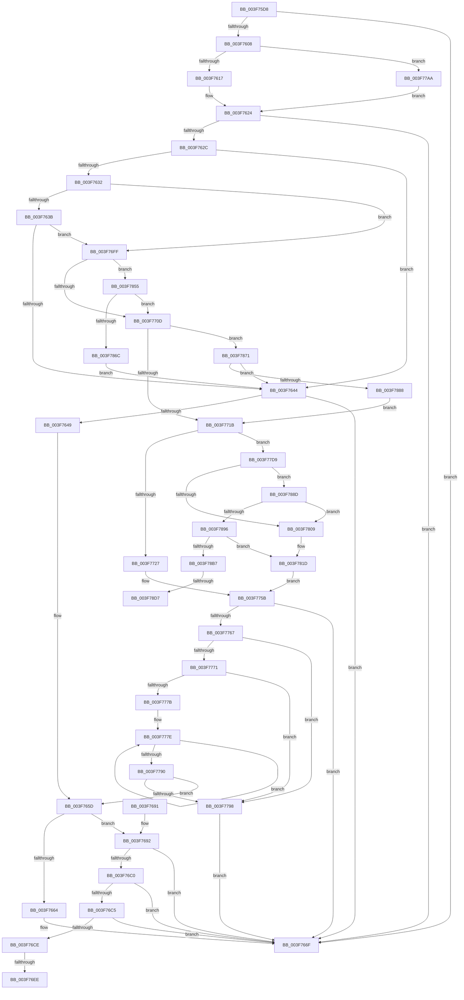

# HalpAcpiCheckAndMapTable

- RVA: `0x003F75D8`–`0x003F78E8` (길이 `784` bytes)
- VA: `0x00000001403F75D8`
- 실행 섹션: `.text`
- PDB 이름 있음: `예`; PDB Function 태그: `예`
- unwind 정보 RVA: `0x00098204`
- 디코드: `188`개 명령, `784/784` bytes 표시
- 미해석 바이트: `0` (있으면 어셈블리에 `.byte`로 보존)

> 이 문서는 커널 이미지의 기계어와 PDB 기호를 분석해 생성했습니다. 4번과 5번은 함수 원형과 자료형을 바이너리 사용 방식에서 추정한 C 해석이며 원본 소스 복구 결과는 아닙니다.

## 1. Dependencies

- 직접 호출 지점: **10**; 고유 호출 대상: **5**
- 직접 호출자로 확인된 함수: **4**
- RIP 상대 이미지 참조: **2**

### Outgoing calls
- `0x003F761F` → [MmMapIoSpaceEx](../32/MmMapIoSpaceEx_function_00327830.md) (function, `0x00327830`)
- `0x003F766A` → [MiUnmapContiguousMemory](MiUnmapContiguousMemory_function_003F7908.md) (function, `0x003F7908`)
- `0x003F76F4` → [memset](../6C/memset_function_006C6C40.md) (function, `0x006C6C40`)
- `0x003F7732` → [MiUnmapContiguousMemory](MiUnmapContiguousMemory_function_003F7908.md) (function, `0x003F7908`)
- `0x003F7742` → [MmMapIoSpaceEx](../32/MmMapIoSpaceEx_function_00327830.md) (function, `0x00327830`)
- `0x003F77CF` → [HalpMap](HalpMap_function_003F88F4.md) (function, `0x003F88F4`)
- `0x003F784B` → [HalpMap](HalpMap_function_003F88F4.md) (function, `0x003F88F4`)
- `0x003F785F` → [strncmp](../6C/strncmp_function_006C6720.md) (function, `0x006C6720`)
- `0x003F787B` → [strncmp](../6C/strncmp_function_006C6720.md) (function, `0x006C6720`)
- `0x003F78DD` → [memset](../6C/memset_function_006C6C40.md) (function, `0x006C6C40`)

### Direct callers
- [HalpAcpiGetTableFromBios](HalpAcpiGetTableFromBios_function_003F7404.md) at `0x003F74F0`
- [HalpAcpiGetTableFromBios](HalpAcpiGetTableFromBios_function_003F7404.md) at `0x003F7596`
- [HalpAcpiGetAllTablesWork](../53/HalpAcpiGetAllTablesWork_function_0053EEE8.md) at `0x0053EFCF`
- [HalpAcpiGetFacsMapping](../53/HalpAcpiGetFacsMapping_function_0053F0F0.md) at `0x0053F17D`
- [sub_006EBA20](../6E/Unknown_function_006EBA20.md) at `0x006EBAD5`

### Static image references
- `0x003F76B7` → RVA `0x00E10210` (`.data`; read)
- `0x003F76C5` → RVA `0x00E10228` (`.data`; read)

## 2. Other-region calls and transfers

- 다른 실행 섹션으로 향하는 call: **0**
- call이 아닌 외부 분기/꼬리 이동: **4**
  - `0x003F76E8` → [sub_006EB9A8 + 0x1E](../6E/Unknown_function_006EB9A8.md) (`tail-transfer`)
  - `0x003F76FA` → [sub_006EB9A8 + 0x1E](../6E/Unknown_function_006EB9A8.md) (`tail-transfer`)
  - `0x003F78D1` → [sub_006EB9A8](../6E/Unknown_function_006EB9A8.md) (`tail-transfer`)
  - `0x003F78E3` → [sub_006EB9A8](../6E/Unknown_function_006EB9A8.md) (`tail-transfer`)

## 3. Assembly (complete function range)

```asm
003F75D8  48 8B C4                        mov rax, rsp
003F75DB  48 89 58 08                     mov qword ptr [rax + 8], rbx
003F75DF  48 89 68 10                     mov qword ptr [rax + 0x10], rbp
003F75E3  48 89 70 18                     mov qword ptr [rax + 0x18], rsi
003F75E7  48 89 78 20                     mov qword ptr [rax + 0x20], rdi
003F75EB  41 54                           push r12
003F75ED  41 56                           push r14
003F75EF  41 57                           push r15
003F75F1  48 83 EC 30                     sub rsp, 0x30
003F75F5  33 F6                           xor esi, esi
003F75F7  45 8B F1                        mov r14d, r9d
003F75FA  45 8B F8                        mov r15d, r8d
003F75FD  48 8B DA                        mov rbx, rdx
003F7600  4C 8B E1                        mov r12, rcx
003F7603  48 85 D2                        test rdx, rdx
003F7606  74 67                           je 0x1403f766f
003F7608  8D 6E 24                        lea ebp, [rsi + 0x24]
003F760B  48 8B CA                        mov rcx, rdx
003F760E  4D 85 E4                        test r12, r12
003F7611  0F 85 93 01 00 00               jne 0x1403f77aa
003F7617  8B D5                           mov edx, ebp
003F7619  41 B8 04 02 00 00               mov r8d, 0x204
003F761F  E8 0C 02 F3 FF                  call 0x140327830
003F7624  48 8B F8                        mov rdi, rax
003F7627  48 85 C0                        test rax, rax
003F762A  74 43                           je 0x1403f766f
003F762C  44 39 78 04                     cmp dword ptr [rax + 4], r15d
003F7630  72 12                           jb 0x1403f7644
003F7632  45 85 F6                        test r14d, r14d
003F7635  0F 84 C4 00 00 00               je 0x1403f76ff
003F763B  44 39 30                        cmp dword ptr [rax], r14d
003F763E  0F 84 BB 00 00 00               je 0x1403f76ff
003F7644  48 85 FF                        test rdi, rdi
003F7647  74 26                           je 0x1403f766f
003F7649  49 BE 00 00 00 00 80 F6 FF FF   movabs r14, 0xfffff68000000000
003F7653  49 BF FF FF FF FF 0F 00 00 00   movabs r15, 0xfffffffff
003F765D  8B D5                           mov edx, ebp
003F765F  4D 85 E4                        test r12, r12
003F7662  75 2E                           jne 0x1403f7692
003F7664  41 B0 01                        mov r8b, 1
003F7667  48 8B CF                        mov rcx, rdi
003F766A  E8 99 02 00 00                  call 0x1403f7908
003F766F  48 8B 5C 24 50                  mov rbx, qword ptr [rsp + 0x50]
003F7674  48 8B C6                        mov rax, rsi
003F7677  48 8B 74 24 60                  mov rsi, qword ptr [rsp + 0x60]
003F767C  48 8B 6C 24 58                  mov rbp, qword ptr [rsp + 0x58]
003F7681  48 8B 7C 24 68                  mov rdi, qword ptr [rsp + 0x68]
003F7686  48 83 C4 30                     add rsp, 0x30
003F768A  41 5F                           pop r15
003F768C  41 5E                           pop r14
003F768E  41 5C                           pop r12
003F7690  C3                              ret
003F7691  CC                              int3
003F7692  48 81 C2 FF 0F 00 00            add rdx, 0xfff
003F7699  48 8B C7                        mov rax, rdi
003F769C  25 FF 0F 00 00                  and eax, 0xfff
003F76A1  48 03 D0                        add rdx, rax
003F76A4  48 C1 EA 0C                     shr rdx, 0xc
003F76A8  8B CA                           mov ecx, edx
003F76AA  48 C1 E1 0C                     shl rcx, 0xc
003F76AE  48 FF C9                        dec rcx
003F76B1  44 8B C2                        mov r8d, edx
003F76B4  48 03 CF                        add rcx, rdi
003F76B7  48 3B 3D 52 8B A1 00            cmp rdi, qword ptr [rip + 0xa18b52]
003F76BE  72 AF                           jb 0x1403f766f
003F76C0  48 3B CF                        cmp rcx, rdi
003F76C3  72 AA                           jb 0x1403f766f
003F76C5  48 3B 0D 5C 8B A1 00            cmp rcx, qword ptr [rip + 0xa18b5c]
003F76CC  77 A1                           ja 0x1403f766f
003F76CE  48 81 E7 00 F0 FF FF            and rdi, 0xfffffffffffff000
003F76D5  48 8B CF                        mov rcx, rdi
003F76D8  48 C1 E9 0C                     shr rcx, 0xc
003F76DC  49 23 CF                        and rcx, r15
003F76DF  49 8B C6                        mov rax, r14
003F76E2  48 8D 0C C8                     lea rcx, [rax + rcx*8]
003F76E6  85 D2                           test edx, edx
003F76E8  0F 84 D8 42 2F 00               je 0x1406eb9c6
003F76EE  49 C1 E0 03                     shl r8, 3
003F76F2  33 D2                           xor edx, edx
003F76F4  E8 47 F5 2C 00                  call 0x1406c6c40
003F76F9  90                              nop
003F76FA  E9 C7 42 2F 00                  jmp 0x1406eb9c6
003F76FF  48 8B 4C 24 70                  mov rcx, qword ptr [rsp + 0x70]
003F7704  48 85 C9                        test rcx, rcx
003F7707  0F 85 48 01 00 00               jne 0x1403f7855
003F770D  48 8B 4C 24 78                  mov rcx, qword ptr [rsp + 0x78]
003F7712  48 85 C9                        test rcx, rcx
003F7715  0F 85 56 01 00 00               jne 0x1403f7871
003F771B  8B 6F 04                        mov ebp, dword ptr [rdi + 4]
003F771E  4D 85 E4                        test r12, r12
003F7721  0F 85 B2 00 00 00               jne 0x1403f77d9
003F7727  41 B0 01                        mov r8b, 1
003F772A  41 8D 54 24 24                  lea edx, [r12 + 0x24]
003F772F  48 8B CF                        mov rcx, rdi
003F7732  E8 D1 01 00 00                  call 0x1403f7908
003F7737  8B D5                           mov edx, ebp
003F7739  41 B8 04 02 00 00               mov r8d, 0x204
003F773F  48 8B CB                        mov rcx, rbx
003F7742  E8 E9 00 F3 FF                  call 0x140327830
003F7747  49 BE 00 00 00 00 80 F6 FF FF   movabs r14, 0xfffff68000000000
003F7751  49 BF FF FF FF FF 0F 00 00 00   movabs r15, 0xfffffffff
003F775B  48 8B F8                        mov rdi, rax
003F775E  48 85 C0                        test rax, rax
003F7761  0F 84 08 FF FF FF               je 0x1403f766f
003F7767  40 38 B4 24 80 00 00 00         cmp byte ptr [rsp + 0x80], sil
003F776F  74 27                           je 0x1403f7798
003F7771  8B 48 04                        mov ecx, dword ptr [rax + 4]
003F7774  44 8B C6                        mov r8d, esi
003F7777  85 C9                           test ecx, ecx
003F7779  74 1D                           je 0x1403f7798
003F777B  48 8B D0                        mov rdx, rax
003F777E  0F B6 02                        movzx eax, byte ptr [rdx]
003F7781  48 FF C2                        inc rdx
003F7784  41 03 C0                        add eax, r8d
003F7787  44 0F B6 C0                     movzx r8d, al
003F778B  83 C1 FF                        add ecx, -1
003F778E  75 EE                           jne 0x1403f777e
003F7790  84 C0                           test al, al
003F7792  0F 85 C5 FE FF FF               jne 0x1403f765d
003F7798  48 8B 84 24 88 00 00 00         mov rax, qword ptr [rsp + 0x88]
003F77A0  48 8B F7                        mov rsi, rdi
003F77A3  89 28                           mov dword ptr [rax], ebp
003F77A5  E9 C5 FE FF FF                  jmp 0x1403f766f
003F77AA  81 E2 FF 0F 00 00               and edx, 0xfff
003F77B0  48 89 74 24 28                  mov qword ptr [rsp + 0x28], rsi
003F77B5  45 33 C9                        xor r9d, r9d
003F77B8  C7 44 24 20 04 00 00 00         mov dword ptr [rsp + 0x20], 4
003F77C0  48 81 C2 23 10 00 00            add rdx, 0x1023
003F77C7  48 C1 EA 0C                     shr rdx, 0xc
003F77CB  45 8D 41 01                     lea r8d, [r9 + 1]
003F77CF  E8 20 11 00 00                  call 0x1403f88f4
003F77D4  E9 4B FE FF FF                  jmp 0x1403f7624
003F77D9  48 8B D7                        mov rdx, rdi
003F77DC  81 E2 FF 0F 00 00               and edx, 0xfff
003F77E2  48 81 C2 23 10 00 00            add rdx, 0x1023
003F77E9  48 C1 EA 0C                     shr rdx, 0xc
003F77ED  8B CA                           mov ecx, edx
003F77EF  48 C1 E1 0C                     shl rcx, 0xc
003F77F3  48 FF C9                        dec rcx
003F77F6  44 8B C2                        mov r8d, edx
003F77F9  48 03 CF                        add rcx, rdi
003F77FC  48 3B 3D 0D 8A A1 00            cmp rdi, qword ptr [rip + 0xa18a0d]
003F7803  0F 83 84 00 00 00               jae 0x1403f788d
003F7809  49 BF FF FF FF FF 0F 00 00 00   movabs r15, 0xfffffffff
003F7813  49 BE 00 00 00 00 80 F6 FF FF   movabs r14, 0xfffff68000000000
003F781D  48 8B D3                        mov rdx, rbx
003F7820  48 89 74 24 28                  mov qword ptr [rsp + 0x28], rsi
003F7825  81 E2 FF 0F 00 00               and edx, 0xfff
003F782B  C7 44 24 20 04 00 00 00         mov dword ptr [rsp + 0x20], 4
003F7833  48 81 C2 FF 0F 00 00            add rdx, 0xfff
003F783A  45 33 C9                        xor r9d, r9d
003F783D  48 03 D5                        add rdx, rbp
003F7840  48 8B CB                        mov rcx, rbx
003F7843  48 C1 EA 0C                     shr rdx, 0xc
003F7847  45 8D 41 01                     lea r8d, [r9 + 1]
003F784B  E8 A4 10 00 00                  call 0x1403f88f4
003F7850  E9 06 FF FF FF                  jmp 0x1403f775b
003F7855  48 8D 57 0A                     lea rdx, [rdi + 0xa]
003F7859  41 B8 06 00 00 00               mov r8d, 6
003F785F  E8 BC EE 2C 00                  call 0x1406c6720
003F7864  85 C0                           test eax, eax
003F7866  0F 84 A1 FE FF FF               je 0x1403f770d
003F786C  E9 D3 FD FF FF                  jmp 0x1403f7644
003F7871  48 8D 57 10                     lea rdx, [rdi + 0x10]
003F7875  41 B8 08 00 00 00               mov r8d, 8
003F787B  E8 A0 EE 2C 00                  call 0x1406c6720
003F7880  85 C0                           test eax, eax
003F7882  0F 85 BC FD FF FF               jne 0x1403f7644
003F7888  E9 8E FE FF FF                  jmp 0x1403f771b
003F788D  48 3B CF                        cmp rcx, rdi
003F7890  0F 82 73 FF FF FF               jb 0x1403f7809
003F7896  48 3B 0D 8B 89 A1 00            cmp rcx, qword ptr [rip + 0xa1898b]
003F789D  49 BF FF FF FF FF 0F 00 00 00   movabs r15, 0xfffffffff
003F78A7  49 BE 00 00 00 00 80 F6 FF FF   movabs r14, 0xfffff68000000000
003F78B1  0F 87 66 FF FF FF               ja 0x1403f781d
003F78B7  48 81 E7 00 F0 FF FF            and rdi, 0xfffffffffffff000
003F78BE  48 8B CF                        mov rcx, rdi
003F78C1  48 C1 E9 0C                     shr rcx, 0xc
003F78C5  49 23 CF                        and rcx, r15
003F78C8  49 8B C6                        mov rax, r14
003F78CB  48 8D 0C C8                     lea rcx, [rax + rcx*8]
003F78CF  85 D2                           test edx, edx
003F78D1  0F 84 D1 40 2F 00               je 0x1406eb9a8
003F78D7  49 C1 E0 03                     shl r8, 3
003F78DB  33 D2                           xor edx, edx
003F78DD  E8 5E F3 2C 00                  call 0x1406c6c40
003F78E2  90                              nop
003F78E3  E9 C0 40 2F 00                  jmp 0x1406eb9a8
```

## 4. C-style interpretation (structured pseudocode)

```c
__int64 __fastcall HalpAcpiCheckAndMapTable(__int64 a1, __int64 a2, int a3, int a4, __int64 a5, __int64 a6, unsigned __int8 a7, __int64 a8)
{
    __int64 result;
    __int64 v_rdi;
    __int64 v_rsi;
    __int64 v_rsp;
    unsigned __int64 v_stack_p10;
    unsigned __int64 v_stack_p18;
    unsigned __int64 v_stack_p20;
    unsigned __int64 v_stack_p28;
    unsigned __int64 v_stack_p8;

    *(unsigned __int64 *)(v_rsp + 8) = v_rbx;
    *(unsigned __int64 *)(v_rsp + 16) = v_rbp;
    *(unsigned __int64 *)(v_rsp + 24) = v_rsi;
    *(unsigned __int64 *)(v_rsp + 32) = v_rdi;
    v_rsp = (v_rsp) - (48);
    v_rsi = 0;
    if (a2 == 0) goto loc_003F766F;
    if (a1 != 0) goto loc_003F77AA;
    result = MmMapIoSpaceEx(a2, (unsigned int)((unsigned int)(v_rsi + 36)), 516, a4);
loc_003F7624:
    if (result == 0) goto loc_003F766F;
    if ((*(unsigned int *)(result + 4)) < ((unsigned int)((unsigned int)(a3)))) goto loc_003F7644;
    if ((unsigned int)((unsigned int)(a4)) == 0) goto loc_003F76FF;
    if ((*(unsigned int *)(result)) == ((unsigned int)((unsigned int)(a4)))) goto loc_003F76FF;
loc_003F7644:
    if (result == 0) goto loc_003F766F;
loc_003F765D:
    if (a1 != 0) goto loc_003F7692;
    result = MiUnmapContiguousMemory(result, (unsigned int)((unsigned int)(v_rsi + 36)), 1, a4);
loc_003F766F:
    v_rsp = (v_rsp) + (48);
    return 0;
loc_003F7692:
    a2 = ((unsigned int)((unsigned int)(v_rsi + 36))) + (0xFFFULL);
    result = (unsigned int)((v_stack_p20) & (0xFFFULL));
    a2 = (a2) + (result);
    a2 = (a2) >> (12);
    a1 = ((unsigned int)((unsigned int)(a2))) << (12);
    a1 = (a1) - 1;
    a1 = (a1) + (v_stack_p20);
    if (v_stack_p20 < (*(unsigned __int64 *)(v_rip + 10586962))) goto loc_003F766F;
    if (a1 < v_stack_p20) goto loc_003F766F;
    if (a1 > (*(unsigned __int64 *)(v_rip + 10586972))) goto loc_003F766F;
    v_rdi = (v_stack_p20) & (0xFFFFFFFFFFFFF000ULL);
    a1 = (v_rdi) >> (12);
    a1 = (a1) & ((unsigned int)(a3));
    a3 = ((unsigned int)((unsigned int)(a2))) << (3);
    a2 = 0;
    result = memset((unsigned int)(a4) + a1 * 8, a2, a3, a4);
loc_003F76FF:
    if (a5 != 0) goto loc_003F7855;
loc_003F770D:
    if (a6 != 0) goto loc_003F7871;
loc_003F771B:
    if (a1 != 0) goto loc_003F77D9;
    result = MiUnmapContiguousMemory(v_rdi, a1 + 36, 1, a4);
    result = MmMapIoSpaceEx(v_stack_p8, (unsigned int)((unsigned int)((unsigned int)(*(unsigned int *)(v_rdi + 4)))), 516, a4);
loc_003F775B:
    if (result == 0) goto loc_003F766F;
    if (a7 == ((unsigned __int8)(v_stack_p18))) goto loc_003F7798;
    if ((unsigned int)((unsigned int)(*(unsigned int *)(result + 4))) == 0) goto loc_003F7798;
loc_003F777E:
    a2 = (result) + 1;
    result = (unsigned int)((*(unsigned __int8 *)(result)) + ((unsigned int)((unsigned int)((unsigned int)(v_stack_p18)))));
    a1 = (unsigned int)(((unsigned int)(*(unsigned int *)(result + 4))) + (-1));
    if (condition_is_not_equal) goto loc_003F777E;
    if ((unsigned __int8)(result) != 0) goto loc_003F765D;
loc_003F7798:
    *(unsigned int *)(a8) = (unsigned int)((unsigned int)(*(unsigned int *)(v_rdi + 4)));
    goto loc_003F766F;
loc_003F77AA:
    a2 = (unsigned int)((a2) & (0xFFFULL));
    v_stack_p28 = result;
    a4 = 0;
    v_stack_p20 = 4;
    a2 = (a2) + (0x1023ULL);
    a2 = (a2) >> (12);
    result = HalpMap(a1, a2, a4 + 1, a4);
    goto loc_003F7624;
loc_003F77D9:
    a2 = (unsigned int)((result) & (0xFFFULL));
    a2 = (a2) + (0x1023ULL);
    a2 = (a2) >> (12);
    a1 = ((unsigned int)((unsigned int)(a2))) << (12);
    a1 = (a1) - 1;
    a1 = (a1) + (result);
    if (result >= (*(unsigned __int64 *)(v_rip + 10586637))) goto loc_003F788D;
loc_003F7809:
loc_003F781D:
    v_stack_p28 = result;
    a2 = (unsigned int)((v_stack_p8) & (0xFFFULL));
    v_stack_p20 = 4;
    a2 = (a2) + (0xFFFULL);
    a4 = 0;
    a2 = (a2) + ((unsigned int)(*(unsigned int *)(v_rdi + 4)));
    a2 = (a2) >> (12);
    result = HalpMap(v_stack_p8, a2, a4 + 1, a4);
    goto loc_003F775B;
loc_003F7855:
    result = strncmp(v_stack_p8, result + 10, 6, a4);
    if ((unsigned int)(result) == 0) goto loc_003F770D;
    goto loc_003F7644;
loc_003F7871:
    result = strncmp(v_stack_p8, result + 16, 8, a4);
    if ((unsigned int)(result) != 0) goto loc_003F7644;
    goto loc_003F771B;
loc_003F788D:
    if (v_stack_p8 < result) goto loc_003F7809;
    if (v_stack_p8 > (*(unsigned __int64 *)(v_rip + 10586507))) goto loc_003F781D;
    v_rdi = (result) & (0xFFFFFFFFFFFFF000ULL);
    a1 = (v_rdi) >> (12);
    a1 = (a1) & ((unsigned int)(a3));
    a3 = (8) << (3);
    a2 = 0;
    result = memset((unsigned int)(a4) + a1 * 8, a2, a3, a4);
}
```

## 5. (Beta) C Style

```c
int64_t HalpAcpiCheckAndMapTable(int64_t Arg1, int64_t Arg2, int32_t Arg3, int32_t Arg4, int64_t Arg5, int64_t Arg6, uint8_t Arg7, void *Arg8)
{
    uint8_t *arg8 = (uint8_t *)Arg8;

    int64_t result;
    int64_t local_rdi;
    int64_t local_rsi;
    int64_t local_rsp;
    uint64_t v_stack_p10;
    uint64_t v_stack_p18;
    uint64_t v_stack_p20;
    uint64_t v_stack_p28;
    uint64_t v_stack_p8;

    *(uint64_t *)(local_rsp + 0x8) = local_rbx;
    *(uint64_t *)(local_rsp + 0x10) = local_rbp;
    *(uint64_t *)(local_rsp + 0x18) = local_rsi;
    *(uint64_t *)(local_rsp + 0x20) = local_rdi;
    local_rsp = (local_rsp) - (48);
    local_rsi = 0;
    if (Arg2 == 0) goto loc_003F766F;
    if (Arg1 != 0) goto loc_003F77AA;
    result = MmMapIoSpaceEx(Arg2, (uint32_t)((uint32_t)(local_rsi + 36)), 516, Arg4);
loc_003F7624:
    if (result == 0) goto loc_003F766F;
    if ((*(uint32_t *)(result + 0x4)) < ((uint32_t)((uint32_t)(Arg3)))) goto loc_003F7644;
    if ((uint32_t)((uint32_t)(Arg4)) == 0) goto loc_003F76FF;
    if ((*(uint32_t *)(result)) == ((uint32_t)((uint32_t)(Arg4)))) goto loc_003F76FF;
loc_003F7644:
    if (result == 0) goto loc_003F766F;
loc_003F765D:
    if (Arg1 != 0) goto loc_003F7692;
    result = MiUnmapContiguousMemory(result, (uint32_t)((uint32_t)(local_rsi + 36)), 1, Arg4);
loc_003F766F:
    local_rsp = (local_rsp) + (48);
    return 0;
loc_003F7692:
    Arg2 = ((uint32_t)((uint32_t)(local_rsi + 36))) + (0xFFFULL);
    result = (uint32_t)((v_stack_p20) & (0xFFFULL));
    Arg2 = (Arg2) + (result);
    Arg2 = (Arg2) >> (12);
    Arg1 = ((uint32_t)((uint32_t)(Arg2))) << (12);
    Arg1 = (Arg1) - 1;
    Arg1 = (Arg1) + (v_stack_p20);
    if (v_stack_p20 < (*(uint64_t *)(v_rip + 0xA18B52))) goto loc_003F766F;
    if (Arg1 < v_stack_p20) goto loc_003F766F;
    if (Arg1 > (*(uint64_t *)(v_rip + 0xA18B5C))) goto loc_003F766F;
    local_rdi = (v_stack_p20) & (0xFFFFFFFFFFFFF000ULL);
    Arg1 = (local_rdi) >> (12);
    Arg1 = (Arg1) & ((uint32_t)(Arg3));
    Arg3 = ((uint32_t)((uint32_t)(Arg2))) << (3);
    Arg2 = 0;
    result = memset((uint32_t)(Arg4) + Arg1 * 8, Arg2, Arg3, Arg4);
loc_003F76FF:
    if (Arg5 != 0) goto loc_003F7855;
loc_003F770D:
    if (Arg6 != 0) goto loc_003F7871;
loc_003F771B:
    if (Arg1 != 0) goto loc_003F77D9;
    result = MiUnmapContiguousMemory(local_rdi, Arg1 + 36, 1, Arg4);
    result = MmMapIoSpaceEx(v_stack_p8, (uint32_t)((uint32_t)((uint32_t)(*(uint32_t *)(local_rdi + 0x4)))), 516, Arg4);
loc_003F775B:
    if (result == 0) goto loc_003F766F;
    if (Arg7 == ((uint8_t)(v_stack_p18))) goto loc_003F7798;
    if ((uint32_t)((uint32_t)(*(uint32_t *)(result + 0x4))) == 0) goto loc_003F7798;
loc_003F777E:
    Arg2 = (result) + 1;
    result = (uint32_t)((*(uint8_t *)(result)) + ((uint32_t)((uint32_t)((uint32_t)(v_stack_p18)))));
    Arg1 = (uint32_t)(((uint32_t)(*(uint32_t *)(result + 0x4))) + (-1));
    if (condition_is_not_equal) goto loc_003F777E;
    if ((uint8_t)(result) != 0) goto loc_003F765D;
loc_003F7798:
    *(uint32_t *)(arg8) = (uint32_t)((uint32_t)(*(uint32_t *)(local_rdi + 0x4)));
    goto loc_003F766F;
loc_003F77AA:
    Arg2 = (uint32_t)((Arg2) & (0xFFFULL));
    v_stack_p28 = result;
    Arg4 = 0;
    v_stack_p20 = 4;
    Arg2 = (Arg2) + (0x1023ULL);
    Arg2 = (Arg2) >> (12);
    result = HalpMap(Arg1, Arg2, Arg4 + 1, Arg4);
    goto loc_003F7624;
loc_003F77D9:
    Arg2 = (uint32_t)((result) & (0xFFFULL));
    Arg2 = (Arg2) + (0x1023ULL);
    Arg2 = (Arg2) >> (12);
    Arg1 = ((uint32_t)((uint32_t)(Arg2))) << (12);
    Arg1 = (Arg1) - 1;
    Arg1 = (Arg1) + (result);
    if (result >= (*(uint64_t *)(v_rip + 0xA18A0D))) goto loc_003F788D;
loc_003F7809:
loc_003F781D:
    v_stack_p28 = result;
    Arg2 = (uint32_t)((v_stack_p8) & (0xFFFULL));
    v_stack_p20 = 4;
    Arg2 = (Arg2) + (0xFFFULL);
    Arg4 = 0;
    Arg2 = (Arg2) + ((uint32_t)(*(uint32_t *)(local_rdi + 0x4)));
    Arg2 = (Arg2) >> (12);
    result = HalpMap(v_stack_p8, Arg2, Arg4 + 1, Arg4);
    goto loc_003F775B;
loc_003F7855:
    result = strncmp(v_stack_p8, result + 10, 6, Arg4);
    if ((uint32_t)(result) == 0) goto loc_003F770D;
    goto loc_003F7644;
loc_003F7871:
    result = strncmp(v_stack_p8, result + 16, 8, Arg4);
    if ((uint32_t)(result) != 0) goto loc_003F7644;
    goto loc_003F771B;
loc_003F788D:
    if (v_stack_p8 < result) goto loc_003F7809;
    if (v_stack_p8 > (*(uint64_t *)(v_rip + 0xA1898B))) goto loc_003F781D;
    local_rdi = (result) & (0xFFFFFFFFFFFFF000ULL);
    Arg1 = (local_rdi) >> (12);
    Arg1 = (Arg1) & ((uint32_t)(Arg3));
    Arg3 = (8) << (3);
    Arg2 = 0;
    result = memset((uint32_t)(Arg4) + Arg1 * 8, Arg2, Arg3, Arg4);
}
```

### 관측된 메모리 오프셋

구조체 형식이 확인되지 않은 접근은 인자 기준의 오프셋으로만 기록했습니다.

| 기준 인자 | 오프셋 표현 | 폭 (bit) | 접근 |
|---|---:|---:|---|
| `Arg8` | `+ 0x0` | `32` | `W` |

## 6. Execution-region graph

[열기: 2D/3D 그래프와 함수 탐색 컨트롤 패널](../../../control-panel.html?section=text&rva=0x003F75D8&view=graph)

- 2D 그래프는 위에서 아래로 흐르고, 3D 그래프는 빈 공간을 드래그해 회전합니다. Shift+드래그는 이동, 휠은 확대·축소, 함수 노드 선택은 대상 보고서 이동입니다.

### Static fallback


