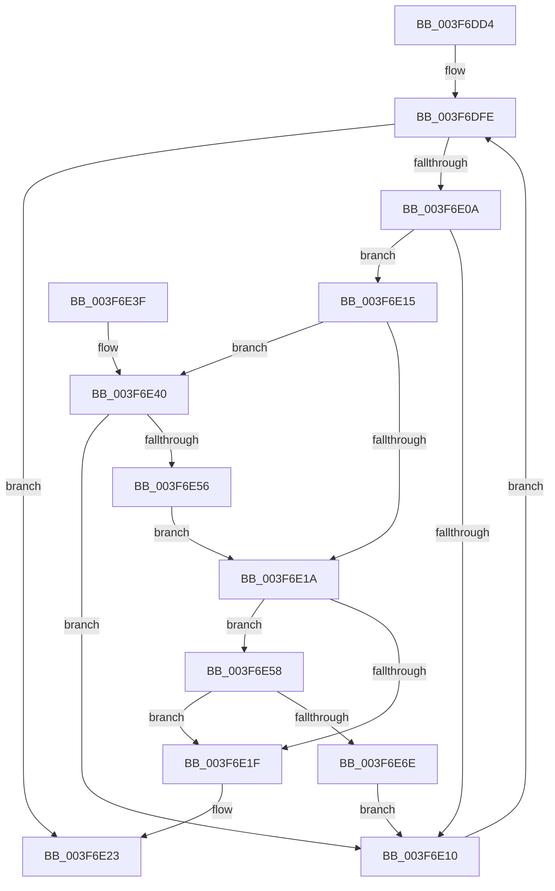

# HalpAcpiGetCachedTable

- RVA: `0x003F6DD4`–`0x003F6E70` (길이 `156` bytes)
- VA: `0x00000001403F6DD4`
- 실행 섹션: `.text`
- PDB 이름 있음: `예`; PDB Function 태그: `아니요`
- unwind 정보 RVA: `0x00098184`
- 디코드: `48`개 명령, `156/156` bytes 표시
- 미해석 바이트: `0` (있으면 어셈블리에 `.byte`로 보존)

> 이 문서는 커널 이미지의 기계어와 PDB 기호를 분석해 생성했습니다. 4번과 5번은 함수 원형과 자료형을 바이너리 사용 방식에서 추정한 C 해석이며 원본 소스 복구 결과는 아닙니다.

## 1. Dependencies

- 직접 호출 지점: **2**; 고유 호출 대상: **1**
- 직접 호출자로 확인된 함수: **3**
- RIP 상대 이미지 참조: **1**

### Outgoing calls
- `0x003F6E4D` → [strncmp](../6C/strncmp_function_006C6720.md) (function, `0x006C6720`)
- `0x003F6E65` → [strncmp](../6C/strncmp_function_006C6720.md) (function, `0x006C6720`)

### Direct callers
- [HalpAcpiGetTableWork](HalpAcpiGetTableWork_function_003F6CDC.md) at `0x003F6D13`
- [HalpAcpiGetRsdt](HalpAcpiGetRsdt_function_003F806C.md) at `0x003F8113`
- [HalpAcpiTableCacheInit](../../init/C7/HalpAcpiTableCacheInit_function_00C77650.md) at `0x00C77764`
- [HalpAcpiTableCacheInit](../../init/C7/HalpAcpiTableCacheInit_function_00C77650.md) at `0x00C7777A`

### Static image references
- `0x003F6DEC` → RVA `0x00E0F660` (`.data`; read)

## 2. Other-region calls and transfers

- 다른 실행 섹션으로 향하는 call: **0**
- 별도 외부 분기/꼬리 이동을 확인하지 못했습니다.

## 3. Assembly (complete function range)

```asm
003F6DD4  48 89 5C 24 08                  mov qword ptr [rsp + 8], rbx
003F6DD9  48 89 6C 24 10                  mov qword ptr [rsp + 0x10], rbp
003F6DDE  48 89 74 24 18                  mov qword ptr [rsp + 0x18], rsi
003F6DE3  57                              push rdi
003F6DE4  41 56                           push r14
003F6DE6  41 57                           push r15
003F6DE8  48 83 EC 20                     sub rsp, 0x20
003F6DEC  48 8B 3D 6D 88 A1 00            mov rdi, qword ptr [rip + 0xa1886d]
003F6DF3  49 8B E8                        mov rbp, r8
003F6DF6  4C 8B F2                        mov r14, rdx
003F6DF9  44 8B F9                        mov r15d, ecx
003F6DFC  33 DB                           xor ebx, ebx
003F6DFE  48 8D 05 5B 88 A1 00            lea rax, [rip + 0xa1885b]
003F6E05  48 3B F8                        cmp rdi, rax
003F6E08  74 19                           je 0x1403f6e23
003F6E0A  44 39 7F 18                     cmp dword ptr [rdi + 0x18], r15d
003F6E0E  74 05                           je 0x1403f6e15
003F6E10  48 8B 3F                        mov rdi, qword ptr [rdi]
003F6E13  EB E9                           jmp 0x1403f6dfe
003F6E15  4D 85 F6                        test r14, r14
003F6E18  75 26                           jne 0x1403f6e40
003F6E1A  48 85 ED                        test rbp, rbp
003F6E1D  75 39                           jne 0x1403f6e58
003F6E1F  48 8D 5F 18                     lea rbx, [rdi + 0x18]
003F6E23  48 8B 6C 24 48                  mov rbp, qword ptr [rsp + 0x48]
003F6E28  48 8B C3                        mov rax, rbx
003F6E2B  48 8B 5C 24 40                  mov rbx, qword ptr [rsp + 0x40]
003F6E30  48 8B 74 24 50                  mov rsi, qword ptr [rsp + 0x50]
003F6E35  48 83 C4 20                     add rsp, 0x20
003F6E39  41 5F                           pop r15
003F6E3B  41 5E                           pop r14
003F6E3D  5F                              pop rdi
003F6E3E  C3                              ret
003F6E3F  CC                              int3
003F6E40  48 8D 57 22                     lea rdx, [rdi + 0x22]
003F6E44  41 B8 06 00 00 00               mov r8d, 6
003F6E4A  49 8B CE                        mov rcx, r14
003F6E4D  E8 CE F8 2C 00                  call 0x1406c6720
003F6E52  85 C0                           test eax, eax
003F6E54  75 BA                           jne 0x1403f6e10
003F6E56  EB C2                           jmp 0x1403f6e1a
003F6E58  48 8D 57 28                     lea rdx, [rdi + 0x28]
003F6E5C  41 B8 08 00 00 00               mov r8d, 8
003F6E62  48 8B CD                        mov rcx, rbp
003F6E65  E8 B6 F8 2C 00                  call 0x1406c6720
003F6E6A  85 C0                           test eax, eax
003F6E6C  74 B1                           je 0x1403f6e1f
003F6E6E  EB A0                           jmp 0x1403f6e10
```

## 4. C-style interpretation (structured pseudocode)

```c
__int64 __fastcall HalpAcpiGetCachedTable(int a1, __int64 a2, __int64 a3)
{
    __int64 result;
    __int64 v_rbx;
    __int64 v_rsp;
    unsigned __int64 v_stack_p10;
    unsigned __int64 v_stack_p18;
    unsigned __int64 v_stack_p8;

    v_stack_p8 = v_rbx;
    v_stack_p10 = v_rbp;
    v_stack_p18 = v_rsi;
    v_rsp = (v_rsp) - (32);
    v_rbx = 0;
loc_003F6DFE:
    if ((*(unsigned __int64 *)(v_rip + 10586221)) == (v_rip + 10586203)) goto loc_003F6E23;
    if ((*(unsigned int *)(*(unsigned __int64 *)(v_rip + 10586221) + 24)) == ((unsigned int)((unsigned int)(a1)))) goto loc_003F6E15;
loc_003F6E10:
    goto loc_003F6DFE;
loc_003F6E15:
    if (a2 != 0) goto loc_003F6E40;
loc_003F6E1A:
    if (a3 != 0) goto loc_003F6E58;
loc_003F6E1F:
loc_003F6E23:
    v_rsp = (v_rsp) + (32);
    return *(unsigned __int64 *)(*(unsigned __int64 *)(v_rip + 10586221)) + 24;
loc_003F6E40:
    result = strncmp(a2, *(unsigned __int64 *)(*(unsigned __int64 *)(v_rip + 10586221)) + 34, 6, a4);
    if ((unsigned int)(result) != 0) goto loc_003F6E10;
    goto loc_003F6E1A;
loc_003F6E58:
    result = strncmp(v_stack_p10, *(unsigned __int64 *)(*(unsigned __int64 *)(v_rip + 10586221)) + 40, 8, a4);
    if ((unsigned int)(result) == 0) goto loc_003F6E1F;
    goto loc_003F6E10;
}
```

## 5. (Beta) C Style

```c
int64_t HalpAcpiGetCachedTable(int32_t Arg1, int64_t Arg2, int64_t Arg3)
{
    int64_t result;
    int64_t local_rbx;
    int64_t local_rsp;
    uint64_t v_stack_p10;
    uint64_t v_stack_p18;
    uint64_t v_stack_p8;

    v_stack_p8 = local_rbx;
    v_stack_p10 = local_rbp;
    v_stack_p18 = local_rsi;
    local_rsp = (local_rsp) - (32);
    local_rbx = 0;
loc_003F6DFE:
    if ((*(uint64_t *)(v_rip + 0xA1886D)) == (v_rip + 10586203)) goto loc_003F6E23;
    if ((*(uint32_t *)(*(uint64_t *)(v_rip + 0xA1886D) + 0x18)) == ((uint32_t)((uint32_t)(Arg1)))) goto loc_003F6E15;
loc_003F6E10:
    goto loc_003F6DFE;
loc_003F6E15:
    if (Arg2 != 0) goto loc_003F6E40;
loc_003F6E1A:
    if (Arg3 != 0) goto loc_003F6E58;
loc_003F6E1F:
loc_003F6E23:
    local_rsp = (local_rsp) + (32);
    return *(uint64_t *)(*(uint64_t *)(v_rip + 0xA1886D)) + 24;
loc_003F6E40:
    result = strncmp(Arg2, *(uint64_t *)(*(uint64_t *)(v_rip + 0xA1886D)) + 34, 6, a4);
    if ((uint32_t)(result) != 0) goto loc_003F6E10;
    goto loc_003F6E1A;
loc_003F6E58:
    result = strncmp(v_stack_p10, *(uint64_t *)(*(uint64_t *)(v_rip + 0xA1886D)) + 40, 8, a4);
    if ((uint32_t)(result) == 0) goto loc_003F6E1F;
    goto loc_003F6E10;
}
```

## 6. Execution-region graph

[열기: 2D/3D 그래프와 함수 탐색 컨트롤 패널](../../../control-panel.html?section=text&rva=0x003F6DD4&view=graph)

- 2D 그래프는 위에서 아래로 흐르고, 3D 그래프는 빈 공간을 드래그해 회전합니다. Shift+드래그는 이동, 휠은 확대·축소, 함수 노드 선택은 대상 보고서 이동입니다.

### Static fallback


