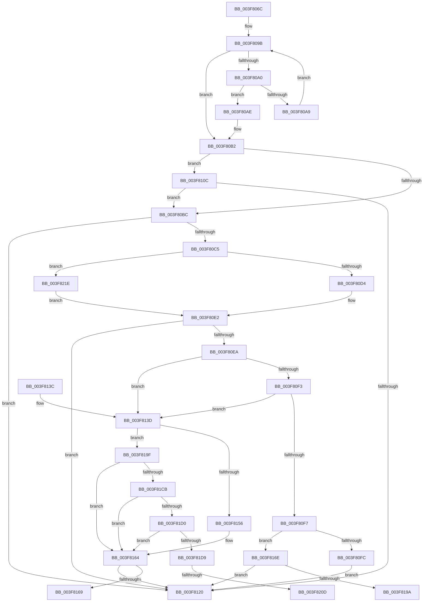

# HalpAcpiGetRsdt

- RVA: `0x003F806C`–`0x003F8251` (길이 `485` bytes)
- VA: `0x00000001403F806C`
- 실행 섹션: `.text`
- PDB 이름 있음: `예`; PDB Function 태그: `예`
- unwind 정보 RVA: `0x000982A4`
- 디코드: `131`개 명령, `485/485` bytes 표시
- 미해석 바이트: `0` (있으면 어셈블리에 `.byte`로 보존)

> 이 문서는 커널 이미지의 기계어와 PDB 기호를 분석해 생성했습니다. 4번과 5번은 함수 원형과 자료형을 바이너리 사용 방식에서 추정한 C 해석이며 원본 소스 복구 결과는 아닙니다.

## 1. Dependencies

- 직접 호출 지점: **7**; 고유 호출 대상: **6**
- 직접 호출자로 확인된 함수: **1**
- RIP 상대 이미지 참조: **3**

### Outgoing calls
- `0x003F80DD` → [MmMapIoSpaceEx](../32/MmMapIoSpaceEx_function_00327830.md) (function, `0x00327830`)
- `0x003F8105` → [MiUnmapContiguousMemory](MiUnmapContiguousMemory_function_003F7908.md) (function, `0x003F7908`)
- `0x003F8113` → [HalpAcpiGetCachedTable](HalpAcpiGetCachedTable_function_003F6DD4.md) (function, `0x003F6DD4`)
- `0x003F8146` → [memcmp](../6C/memcmp_function_006C6B10.md) (function, `0x006C6B10`)
- `0x003F815F` → [MiUnmapContiguousMemory](MiUnmapContiguousMemory_function_003F7908.md) (function, `0x003F7908`)
- `0x003F8213` → [memset](../6C/memset_function_006C6C40.md) (function, `0x006C6C40`)
- `0x003F8247` → [HalpMap](HalpMap_function_003F88F4.md) (function, `0x003F88F4`)

### Direct callers
- [HalpAcpiGetTableFromBios](HalpAcpiGetTableFromBios_function_003F7404.md) at `0x003F7461`

### Static image references
- `0x003F8088` → RVA `0x00E0F660` (`.data`; read)
- `0x003F8191` → RVA `0x00E10210` (`.data`; read)
- `0x003F81D0` → RVA `0x00E10228` (`.data`; read)

## 2. Other-region calls and transfers

- 다른 실행 섹션으로 향하는 call: **0**
- call이 아닌 외부 분기/꼬리 이동: **4**
  - `0x003F8169` → [sub_006EBA20 + 0x8D](../6E/Unknown_function_006EBA20.md) (`tail-transfer`)
  - `0x003F819A` → [sub_006EBA20](../6E/Unknown_function_006EBA20.md) (`tail-transfer`)
  - `0x003F8207` → [sub_006EBA20 + 0x6F](../6E/Unknown_function_006EBA20.md) (`tail-transfer`)
  - `0x003F8219` → [sub_006EBA20 + 0x6F](../6E/Unknown_function_006EBA20.md) (`tail-transfer`)

## 3. Assembly (complete function range)

```asm
003F806C  48 8B C4                        mov rax, rsp
003F806F  48 89 58 08                     mov qword ptr [rax + 8], rbx
003F8073  48 89 68 18                     mov qword ptr [rax + 0x18], rbp
003F8077  48 89 70 20                     mov qword ptr [rax + 0x20], rsi
003F807B  57                              push rdi
003F807C  41 55                           push r13
003F807E  41 57                           push r15
003F8080  48 83 EC 40                     sub rsp, 0x40
003F8084  83 60 10 00                     and dword ptr [rax + 0x10], 0
003F8088  4C 8D 2D D1 75 A1 00            lea r13, [rip + 0xa175d1]
003F808F  48 8B 05 CA 75 A1 00            mov rax, qword ptr [rip + 0xa175ca]
003F8096  33 FF                           xor edi, edi
003F8098  48 8B E9                        mov rbp, rcx
003F809B  49 3B C5                        cmp rax, r13
003F809E  74 12                           je 0x1403f80b2
003F80A0  81 78 18 52 53 44 54            cmp dword ptr [rax + 0x18], 0x54445352
003F80A7  74 05                           je 0x1403f80ae
003F80A9  48 8B 00                        mov rax, qword ptr [rax]
003F80AC  EB ED                           jmp 0x1403f809b
003F80AE  48 8D 78 18                     lea rdi, [rax + 0x18]
003F80B2  BE 58 53 44 54                  mov esi, 0x54445358
003F80B7  48 85 FF                        test rdi, rdi
003F80BA  74 50                           je 0x1403f810c
003F80BC  48 8B 4F F8                     mov rcx, qword ptr [rdi - 8]
003F80C0  48 85 C9                        test rcx, rcx
003F80C3  74 5B                           je 0x1403f8120
003F80C5  41 BF 24 00 00 00               mov r15d, 0x24
003F80CB  48 85 ED                        test rbp, rbp
003F80CE  0F 85 4A 01 00 00               jne 0x1403f821e
003F80D4  41 B8 04 02 00 00               mov r8d, 0x204
003F80DA  41 8B D7                        mov edx, r15d
003F80DD  E8 4E F7 F2 FF                  call 0x140327830
003F80E2  48 8B D8                        mov rbx, rax
003F80E5  48 85 C0                        test rax, rax
003F80E8  74 36                           je 0x1403f8120
003F80EA  8B 00                           mov eax, dword ptr [rax]
003F80EC  3D 52 53 44 54                  cmp eax, 0x54445352
003F80F1  74 4A                           je 0x1403f813d
003F80F3  3B C6                           cmp eax, esi
003F80F5  74 46                           je 0x1403f813d
003F80F7  48 85 ED                        test rbp, rbp
003F80FA  75 72                           jne 0x1403f816e
003F80FC  41 B0 01                        mov r8b, 1
003F80FF  49 8B D7                        mov rdx, r15
003F8102  48 8B CB                        mov rcx, rbx
003F8105  E8 FE F7 FF FF                  call 0x1403f7908
003F810A  EB 14                           jmp 0x1403f8120
003F810C  45 33 C0                        xor r8d, r8d
003F810F  33 D2                           xor edx, edx
003F8111  8B CE                           mov ecx, esi
003F8113  E8 BC EC FF FF                  call 0x1403f6dd4
003F8118  48 8B F8                        mov rdi, rax
003F811B  48 85 C0                        test rax, rax
003F811E  75 9C                           jne 0x1403f80bc
003F8120  48 8B 5C 24 60                  mov rbx, qword ptr [rsp + 0x60]
003F8125  48 8B C7                        mov rax, rdi
003F8128  48 8B 6C 24 70                  mov rbp, qword ptr [rsp + 0x70]
003F812D  48 8B 74 24 78                  mov rsi, qword ptr [rsp + 0x78]
003F8132  48 83 C4 40                     add rsp, 0x40
003F8136  41 5F                           pop r15
003F8138  41 5D                           pop r13
003F813A  5F                              pop rdi
003F813B  C3                              ret
003F813C  CC                              int3
003F813D  4D 8B C7                        mov r8, r15
003F8140  48 8B D3                        mov rdx, rbx
003F8143  48 8B CF                        mov rcx, rdi
003F8146  E8 C5 E9 2C 00                  call 0x1406c6b10
003F814B  85 C0                           test eax, eax
003F814D  40 0F 94 C6                     sete sil
003F8151  48 85 ED                        test rbp, rbp
003F8154  75 49                           jne 0x1403f819f
003F8156  41 B0 01                        mov r8b, 1
003F8159  49 8B D7                        mov rdx, r15
003F815C  48 8B CB                        mov rcx, rbx
003F815F  E8 A4 F7 FF FF                  call 0x1403f7908
003F8164  40 84 F6                        test sil, sil
003F8167  75 B7                           jne 0x1403f8120
003F8169  E9 3F 39 2F 00                  jmp 0x1406ebaad
003F816E  48 8B D3                        mov rdx, rbx
003F8171  81 E2 FF 0F 00 00               and edx, 0xfff
003F8177  48 81 C2 23 10 00 00            add rdx, 0x1023
003F817E  48 C1 EA 0C                     shr rdx, 0xc
003F8182  8B CA                           mov ecx, edx
003F8184  48 C1 E1 0C                     shl rcx, 0xc
003F8188  48 FF C9                        dec rcx
003F818B  44 8B C2                        mov r8d, edx
003F818E  48 03 CB                        add rcx, rbx
003F8191  48 3B 1D 78 80 A1 00            cmp rbx, qword ptr [rip + 0xa18078]
003F8198  72 86                           jb 0x1403f8120
003F819A  E9 81 38 2F 00                  jmp 0x1406eba20
003F819F  48 8B D3                        mov rdx, rbx
003F81A2  81 E2 FF 0F 00 00               and edx, 0xfff
003F81A8  48 81 C2 23 10 00 00            add rdx, 0x1023
003F81AF  48 C1 EA 0C                     shr rdx, 0xc
003F81B3  8B CA                           mov ecx, edx
003F81B5  48 C1 E1 0C                     shl rcx, 0xc
003F81B9  48 FF C9                        dec rcx
003F81BC  44 8B C2                        mov r8d, edx
003F81BF  48 03 CB                        add rcx, rbx
003F81C2  48 3B 1D 47 80 A1 00            cmp rbx, qword ptr [rip + 0xa18047]
003F81C9  72 99                           jb 0x1403f8164
003F81CB  48 3B CB                        cmp rcx, rbx
003F81CE  72 94                           jb 0x1403f8164
003F81D0  48 3B 0D 51 80 A1 00            cmp rcx, qword ptr [rip + 0xa18051]
003F81D7  77 8B                           ja 0x1403f8164
003F81D9  48 B8 FF FF FF FF 0F 00 00 00   movabs rax, 0xfffffffff
003F81E3  48 81 E3 00 F0 FF FF            and rbx, 0xfffffffffffff000
003F81EA  48 8B CB                        mov rcx, rbx
003F81ED  48 C1 E9 0C                     shr rcx, 0xc
003F81F1  48 23 C8                        and rcx, rax
003F81F4  48 B8 00 00 00 00 80 F6 FF FF   movabs rax, 0xfffff68000000000
003F81FE  48 8B C0                        mov rax, rax
003F8201  48 8D 0C C8                     lea rcx, [rax + rcx*8]
003F8205  85 D2                           test edx, edx
003F8207  0F 84 82 38 2F 00               je 0x1406eba8f
003F820D  49 C1 E0 03                     shl r8, 3
003F8211  33 D2                           xor edx, edx
003F8213  E8 28 EA 2C 00                  call 0x1406c6c40
003F8218  90                              nop
003F8219  E9 71 38 2F 00                  jmp 0x1406eba8f
003F821E  48 83 64 24 28 00               and qword ptr [rsp + 0x28], 0
003F8224  48 8B D1                        mov rdx, rcx
003F8227  81 E2 FF 0F 00 00               and edx, 0xfff
003F822D  C7 44 24 20 04 00 00 00         mov dword ptr [rsp + 0x20], 4
003F8235  45 33 C9                        xor r9d, r9d
003F8238  48 81 C2 23 10 00 00            add rdx, 0x1023
003F823F  48 C1 EA 0C                     shr rdx, 0xc
003F8243  45 8D 41 01                     lea r8d, [r9 + 1]
003F8247  E8 A8 06 00 00                  call 0x1403f88f4
003F824C  E9 91 FE FF FF                  jmp 0x1403f80e2
```

## 4. C-style interpretation (structured pseudocode)

```c
__int64 __fastcall HalpAcpiGetRsdt(__int64 a1, __int64 a2, __int64 a3, int a4)
{
    __int64 result;
    __int64 v_rbx;
    __int64 v_rdi;
    __int64 v_rsi;
    __int64 v_rsp;
    unsigned __int64 v_stack_p18;
    unsigned __int64 v_stack_p20;
    unsigned __int64 v_stack_p28;
    unsigned __int64 v_stack_p8;

    *(unsigned __int64 *)(v_rsp + 8) = v_rbx;
    *(unsigned __int64 *)(v_rsp + 24) = v_rbp;
    *(unsigned __int64 *)(v_rsp + 32) = v_rsi;
    v_rsp = (v_rsp) - (64);
    v_rdi = 0;
loc_003F809B:
    if ((*(unsigned __int64 *)(v_rip + 10581450)) == (v_rip + 10581457)) goto loc_003F80B2;
    if ((*(unsigned int *)(*(unsigned __int64 *)(v_rip + 10581450) + 24)) == 0x54445352ULL) goto loc_003F80AE;
    goto loc_003F809B;
loc_003F80AE:
loc_003F80B2:
    if (*(unsigned __int64 *)(*(unsigned __int64 *)(v_rip + 10581450)) + 24 == 0) goto loc_003F810C;
loc_003F80BC:
    if (*(unsigned __int64 *)(*(unsigned __int64 *)(*(unsigned __int64 *)(v_rip + 10581450)) + 24 - 8) == 0) goto loc_003F8120;
    if (a1 != 0) goto loc_003F821E;
    result = MmMapIoSpaceEx(*(unsigned __int64 *)(*(unsigned __int64 *)(*(unsigned __int64 *)(v_rip + 10581450)) + 24 - 8), 36, 516, a4);
loc_003F80E2:
    if (result == 0) goto loc_003F8120;
    if (((unsigned int)((unsigned int)(*(unsigned int *)(result)))) == 0x54445352ULL) goto loc_003F813D;
    if (((unsigned int)((unsigned int)(*(unsigned int *)(result)))) == ((unsigned int)((unsigned int)(0x54445358ULL)))) goto loc_003F813D;
    if (a1 != 0) goto loc_003F816E;
    result = MiUnmapContiguousMemory(result, 36, 1, a4);
    goto loc_003F8120;
loc_003F810C:
    a3 = 0;
    a2 = 0;
    result = HalpAcpiGetCachedTable((unsigned int)((unsigned int)((unsigned int)(0x54445358ULL))), a2, a3, a4);
    if (result != 0) goto loc_003F80BC;
loc_003F8120:
    v_rsp = (v_rsp) + (64);
    return result;
loc_003F813D:
    result = memcmp(result, v_stack_p8, 36, a4);
    v_rsi = ((unsigned int)(result) == 0) ? 1 : 0;
    if (v_stack_p18 != 0) goto loc_003F819F;
    result = MiUnmapContiguousMemory(v_stack_p8, 36, 1, a4);
loc_003F8164:
    if ((unsigned __int8)(v_rsi) != 0) goto loc_003F8120;
loc_003F816E:
    a2 = (unsigned int)((v_stack_p8) & (0xFFFULL));
    a2 = (a2) + (0x1023ULL);
    a2 = (a2) >> (12);
    a1 = ((unsigned int)((unsigned int)(a2))) << (12);
    a1 = (a1) - 1;
    a1 = (a1) + (v_stack_p8);
    if (v_stack_p8 < (*(unsigned __int64 *)(v_rip + 10584184))) goto loc_003F8120;
loc_003F819F:
    a2 = (unsigned int)((v_stack_p8) & (0xFFFULL));
    a2 = (a2) + (0x1023ULL);
    a2 = (a2) >> (12);
    a1 = ((unsigned int)((unsigned int)(a2))) << (12);
    a1 = (a1) - 1;
    a1 = (a1) + (v_stack_p8);
    if (v_stack_p8 < (*(unsigned __int64 *)(v_rip + 10584135))) goto loc_003F8164;
    if (a1 < v_stack_p8) goto loc_003F8164;
    if (a1 > (*(unsigned __int64 *)(v_rip + 10584145))) goto loc_003F8164;
    v_rbx = (v_stack_p8) & (0xFFFFFFFFFFFFF000ULL);
    a1 = (v_rbx) >> (12);
    a1 = (a1) & (result);
    a3 = ((unsigned int)((unsigned int)(a2))) << (3);
    a2 = 0;
    result = memset(result + a1 * 8, a2, a3, a4);
loc_003F821E:
    a2 = (unsigned int)((result + a1 * 8) & (0xFFFULL));
    v_stack_p20 = 4;
    a4 = 0;
    a2 = (a2) + (0x1023ULL);
    a2 = (a2) >> (12);
    result = HalpMap(result + a1 * 8, a2, a4 + 1, a4);
    goto loc_003F80E2;
}
```

## 5. (Beta) C Style

```c
int64_t HalpAcpiGetRsdt(int64_t Arg1, int64_t Arg2, int64_t Arg3, int32_t Arg4)
{
    int64_t result;
    int64_t local_rbx;
    int64_t local_rdi;
    int64_t local_rsi;
    int64_t local_rsp;
    uint64_t v_stack_p18;
    uint64_t v_stack_p20;
    uint64_t v_stack_p28;
    uint64_t v_stack_p8;

    *(uint64_t *)(local_rsp + 0x8) = local_rbx;
    *(uint64_t *)(local_rsp + 0x18) = local_rbp;
    *(uint64_t *)(local_rsp + 0x20) = local_rsi;
    local_rsp = (local_rsp) - (64);
    local_rdi = 0;
loc_003F809B:
    if ((*(uint64_t *)(v_rip + 0xA175CA)) == (v_rip + 10581457)) goto loc_003F80B2;
    if ((*(uint32_t *)(*(uint64_t *)(v_rip + 0xA175CA) + 0x18)) == 0x54445352ULL) goto loc_003F80AE;
    goto loc_003F809B;
loc_003F80AE:
loc_003F80B2:
    if (*(uint64_t *)(*(uint64_t *)(v_rip + 0xA175CA)) + 24 == 0) goto loc_003F810C;
loc_003F80BC:
    if (*(uint64_t *)(*(uint64_t *)(*(uint64_t *)(v_rip + 0xA175CA)) + 0x18 - 0x8) == 0) goto loc_003F8120;
    if (Arg1 != 0) goto loc_003F821E;
    result = MmMapIoSpaceEx(*(uint64_t *)(*(uint64_t *)(*(uint64_t *)(v_rip + 0xA175CA)) + 0x18 - 0x8), 36, 516, Arg4);
loc_003F80E2:
    if (result == 0) goto loc_003F8120;
    if (((uint32_t)((uint32_t)(*(uint32_t *)(result)))) == 0x54445352ULL) goto loc_003F813D;
    if (((uint32_t)((uint32_t)(*(uint32_t *)(result)))) == ((uint32_t)((uint32_t)(0x54445358ULL)))) goto loc_003F813D;
    if (Arg1 != 0) goto loc_003F816E;
    result = MiUnmapContiguousMemory(result, 36, 1, Arg4);
    goto loc_003F8120;
loc_003F810C:
    Arg3 = 0;
    Arg2 = 0;
    result = HalpAcpiGetCachedTable((uint32_t)((uint32_t)((uint32_t)(0x54445358ULL))), Arg2, Arg3, Arg4);
    if (result != 0) goto loc_003F80BC;
loc_003F8120:
    local_rsp = (local_rsp) + (64);
    return result;
loc_003F813D:
    result = memcmp(result, v_stack_p8, 36, Arg4);
    local_rsi = ((uint32_t)(result) == 0) ? 1 : 0;
    if (v_stack_p18 != 0) goto loc_003F819F;
    result = MiUnmapContiguousMemory(v_stack_p8, 36, 1, Arg4);
loc_003F8164:
    if ((uint8_t)(local_rsi) != 0) goto loc_003F8120;
loc_003F816E:
    Arg2 = (uint32_t)((v_stack_p8) & (0xFFFULL));
    Arg2 = (Arg2) + (0x1023ULL);
    Arg2 = (Arg2) >> (12);
    Arg1 = ((uint32_t)((uint32_t)(Arg2))) << (12);
    Arg1 = (Arg1) - 1;
    Arg1 = (Arg1) + (v_stack_p8);
    if (v_stack_p8 < (*(uint64_t *)(v_rip + 0xA18078))) goto loc_003F8120;
loc_003F819F:
    Arg2 = (uint32_t)((v_stack_p8) & (0xFFFULL));
    Arg2 = (Arg2) + (0x1023ULL);
    Arg2 = (Arg2) >> (12);
    Arg1 = ((uint32_t)((uint32_t)(Arg2))) << (12);
    Arg1 = (Arg1) - 1;
    Arg1 = (Arg1) + (v_stack_p8);
    if (v_stack_p8 < (*(uint64_t *)(v_rip + 0xA18047))) goto loc_003F8164;
    if (Arg1 < v_stack_p8) goto loc_003F8164;
    if (Arg1 > (*(uint64_t *)(v_rip + 0xA18051))) goto loc_003F8164;
    local_rbx = (v_stack_p8) & (0xFFFFFFFFFFFFF000ULL);
    Arg1 = (local_rbx) >> (12);
    Arg1 = (Arg1) & (result);
    Arg3 = ((uint32_t)((uint32_t)(Arg2))) << (3);
    Arg2 = 0;
    result = memset(result + Arg1 * 8, Arg2, Arg3, Arg4);
loc_003F821E:
    Arg2 = (uint32_t)((result + Arg1 * 8) & (0xFFFULL));
    v_stack_p20 = 4;
    Arg4 = 0;
    Arg2 = (Arg2) + (0x1023ULL);
    Arg2 = (Arg2) >> (12);
    result = HalpMap(result + Arg1 * 8, Arg2, Arg4 + 1, Arg4);
    goto loc_003F80E2;
}
```

## 6. Execution-region graph

[열기: 2D/3D 그래프와 함수 탐색 컨트롤 패널](../../../control-panel.html?section=text&rva=0x003F806C&view=graph)

- 2D 그래프는 위에서 아래로 흐르고, 3D 그래프는 빈 공간을 드래그해 회전합니다. Shift+드래그는 이동, 휠은 확대·축소, 함수 노드 선택은 대상 보고서 이동입니다.

### Static fallback


