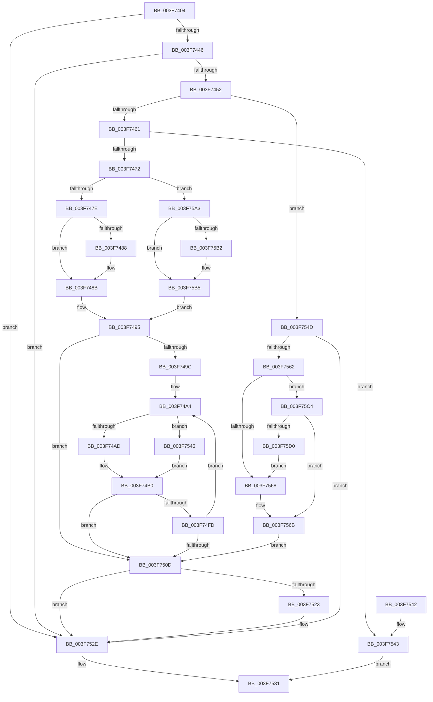

# HalpAcpiGetTableFromBios

- RVA: `0x003F7404`–`0x003F75D2` (길이 `462` bytes)
- VA: `0x00000001403F7404`
- 실행 섹션: `.text`
- PDB 이름 있음: `예`; PDB Function 태그: `아니요`
- unwind 정보 RVA: `0x000981E8`
- 디코드: `128`개 명령, `462/462` bytes 표시
- 미해석 바이트: `0` (있으면 어셈블리에 `.byte`로 보존)

> 이 문서는 커널 이미지의 기계어와 PDB 기호를 분석해 생성했습니다. 4번과 5번은 함수 원형과 자료형을 바이너리 사용 방식에서 추정한 C 해석이며 원본 소스 복구 결과는 아닙니다.

## 1. Dependencies

- 직접 호출 지점: **4**; 고유 호출 대상: **3**
- 직접 호출자로 확인된 함수: **2**
- RIP 상대 이미지 참조: **0**

### Outgoing calls
- `0x003F7461` → [HalpAcpiGetRsdt](HalpAcpiGetRsdt_function_003F806C.md) (function, `0x003F806C`)
- `0x003F74F0` → [HalpAcpiCheckAndMapTable](HalpAcpiCheckAndMapTable_function_003F75D8.md) (function, `0x003F75D8`)
- `0x003F7558` → [HalpAcpiGetTableWork](HalpAcpiGetTableWork_function_003F6CDC.md) (function, `0x003F6CDC`)
- `0x003F7596` → [HalpAcpiCheckAndMapTable](HalpAcpiCheckAndMapTable_function_003F75D8.md) (function, `0x003F75D8`)

### Direct callers
- [HalpAcpiGetTableWork](HalpAcpiGetTableWork_function_003F6CDC.md) at `0x003F6D79`
- [HalpAcpiIsCachedTableCompromised](HalpAcpiIsCachedTableCompromised_function_003F6E78.md) at `0x003F6ED8`

### Static image references
- 디코드된 RIP-relative 메모리 참조가 없습니다.

## 2. Other-region calls and transfers

- 다른 실행 섹션으로 향하는 call: **0**
- 별도 외부 분기/꼬리 이동을 확인하지 못했습니다.

## 3. Assembly (complete function range)

```asm
003F7404  48 8B C4                        mov rax, rsp
003F7407  4C 89 48 20                     mov qword ptr [rax + 0x20], r9
003F740B  4C 89 40 18                     mov qword ptr [rax + 0x18], r8
003F740F  48 89 48 08                     mov qword ptr [rax + 8], rcx
003F7413  53                              push rbx
003F7414  55                              push rbp
003F7415  56                              push rsi
003F7416  57                              push rdi
003F7417  41 54                           push r12
003F7419  41 55                           push r13
003F741B  41 56                           push r14
003F741D  41 57                           push r15
003F741F  48 83 EC 48                     sub rsp, 0x48
003F7423  83 60 10 00                     and dword ptr [rax + 0x10], 0
003F7427  45 33 F6                        xor r14d, r14d
003F742A  33 ED                           xor ebp, ebp
003F742C  33 DB                           xor ebx, ebx
003F742E  49 8B F1                        mov rsi, r9
003F7431  4D 8B F8                        mov r15, r8
003F7434  44 8B EA                        mov r13d, edx
003F7437  48 8B F9                        mov rdi, rcx
003F743A  81 FA 52 53 44 54               cmp edx, 0x54445352
003F7440  0F 84 E8 00 00 00               je 0x1403f752e
003F7446  81 FA 58 53 44 54               cmp edx, 0x54445358
003F744C  0F 84 DC 00 00 00               je 0x1403f752e
003F7452  41 BC 44 53 44 54               mov r12d, 0x54445344
003F7458  41 3B D4                        cmp edx, r12d
003F745B  0F 84 EC 00 00 00               je 0x1403f754d
003F7461  E8 06 0C 00 00                  call 0x1403f806c
003F7466  48 8B F0                        mov rsi, rax
003F7469  48 85 C0                        test rax, rax
003F746C  0F 84 D1 00 00 00               je 0x1403f7543
003F7472  81 38 52 53 44 54               cmp dword ptr [rax], 0x54445352
003F7478  0F 84 25 01 00 00               je 0x1403f75a3
003F747E  8B 40 04                        mov eax, dword ptr [rax + 4]
003F7481  8B C8                           mov ecx, eax
003F7483  83 F8 24                        cmp eax, 0x24
003F7486  72 03                           jb 0x1403f748b
003F7488  8D 4D 24                        lea ecx, [rbp + 0x24]
003F748B  48 8B F8                        mov rdi, rax
003F748E  48 2B F9                        sub rdi, rcx
003F7491  48 C1 EF 03                     shr rdi, 3
003F7495  45 33 E4                        xor r12d, r12d
003F7498  85 FF                           test edi, edi
003F749A  74 71                           je 0x1403f750d
003F749C  49 83 C6 24                     add r14, 0x24
003F74A0  4C 8D 7E 24                     lea r15, [rsi + 0x24]
003F74A4  48 85 F6                        test rsi, rsi
003F74A7  0F 84 98 00 00 00               je 0x1403f7545
003F74AD  49 8B 1F                        mov rbx, qword ptr [r15]
003F74B0  48 8B 8C 24 90 00 00 00         mov rcx, qword ptr [rsp + 0x90]
003F74B8  48 8D 84 24 98 00 00 00         lea rax, [rsp + 0x98]
003F74C0  48 89 44 24 38                  mov qword ptr [rsp + 0x38], rax
003F74C5  45 8B CD                        mov r9d, r13d
003F74C8  48 8B 84 24 A8 00 00 00         mov rax, qword ptr [rsp + 0xa8]
003F74D0  41 B8 24 00 00 00               mov r8d, 0x24
003F74D6  C6 44 24 30 01                  mov byte ptr [rsp + 0x30], 1
003F74DB  48 8B D3                        mov rdx, rbx
003F74DE  48 89 44 24 28                  mov qword ptr [rsp + 0x28], rax
003F74E3  48 8B 84 24 A0 00 00 00         mov rax, qword ptr [rsp + 0xa0]
003F74EB  48 89 44 24 20                  mov qword ptr [rsp + 0x20], rax
003F74F0  E8 E3 00 00 00                  call 0x1403f75d8
003F74F5  48 8B E8                        mov rbp, rax
003F74F8  48 85 C0                        test rax, rax
003F74FB  75 10                           jne 0x1403f750d
003F74FD  41 FF C4                        inc r12d
003F7500  49 83 C6 04                     add r14, 4
003F7504  49 83 C7 08                     add r15, 8
003F7508  44 3B E7                        cmp r12d, edi
003F750B  72 97                           jb 0x1403f74a4
003F750D  48 8B 8C 24 B0 00 00 00         mov rcx, qword ptr [rsp + 0xb0]
003F7515  8B 84 24 98 00 00 00            mov eax, dword ptr [rsp + 0x98]
003F751C  89 01                           mov dword ptr [rcx], eax
003F751E  48 85 ED                        test rbp, rbp
003F7521  74 0B                           je 0x1403f752e
003F7523  48 8B 84 24 B8 00 00 00         mov rax, qword ptr [rsp + 0xb8]
003F752B  48 89 18                        mov qword ptr [rax], rbx
003F752E  48 8B C5                        mov rax, rbp
003F7531  48 83 C4 48                     add rsp, 0x48
003F7535  41 5F                           pop r15
003F7537  41 5E                           pop r14
003F7539  41 5D                           pop r13
003F753B  41 5C                           pop r12
003F753D  5F                              pop rdi
003F753E  5E                              pop rsi
003F753F  5D                              pop rbp
003F7540  5B                              pop rbx
003F7541  C3                              ret
003F7542  CC                              int3
003F7543  EB EC                           jmp 0x1403f7531
003F7545  41 8B 1E                        mov ebx, dword ptr [r14]
003F7548  E9 63 FF FF FF                  jmp 0x1403f74b0
003F754D  45 33 C9                        xor r9d, r9d
003F7550  45 33 C0                        xor r8d, r8d
003F7553  BA 46 41 43 50                  mov edx, 0x50434146
003F7558  E8 7F F7 FF FF                  call 0x1403f6cdc
003F755D  48 85 C0                        test rax, rax
003F7560  74 CC                           je 0x1403f752e
003F7562  80 78 08 03                     cmp byte ptr [rax + 8], 3
003F7566  73 5C                           jae 0x1403f75c4
003F7568  8B 58 28                        mov ebx, dword ptr [rax + 0x28]
003F756B  48 8D 84 24 98 00 00 00         lea rax, [rsp + 0x98]
003F7573  45 8B CC                        mov r9d, r12d
003F7576  48 89 44 24 38                  mov qword ptr [rsp + 0x38], rax
003F757B  41 B8 24 00 00 00               mov r8d, 0x24
003F7581  C6 44 24 30 01                  mov byte ptr [rsp + 0x30], 1
003F7586  48 8B D3                        mov rdx, rbx
003F7589  48 89 74 24 28                  mov qword ptr [rsp + 0x28], rsi
003F758E  48 8B CF                        mov rcx, rdi
003F7591  4C 89 7C 24 20                  mov qword ptr [rsp + 0x20], r15
003F7596  E8 3D 00 00 00                  call 0x1403f75d8
003F759B  48 8B E8                        mov rbp, rax
003F759E  E9 6A FF FF FF                  jmp 0x1403f750d
003F75A3  4C 8B F0                        mov r14, rax
003F75A6  33 F6                           xor esi, esi
003F75A8  8B 40 04                        mov eax, dword ptr [rax + 4]
003F75AB  8B C8                           mov ecx, eax
003F75AD  83 F8 24                        cmp eax, 0x24
003F75B0  72 03                           jb 0x1403f75b5
003F75B2  8D 4E 24                        lea ecx, [rsi + 0x24]
003F75B5  48 8B F8                        mov rdi, rax
003F75B8  48 2B F9                        sub rdi, rcx
003F75BB  48 C1 EF 02                     shr rdi, 2
003F75BF  E9 D1 FE FF FF                  jmp 0x1403f7495
003F75C4  48 8B 98 8C 00 00 00            mov rbx, qword ptr [rax + 0x8c]
003F75CB  48 85 DB                        test rbx, rbx
003F75CE  75 9B                           jne 0x1403f756b
003F75D0  EB 96                           jmp 0x1403f7568
```

## 4. C-style interpretation (structured pseudocode)

```c
__int64 __fastcall HalpAcpiGetTableFromBios(__int64 a1, int a2, __int64 a3, __int64 a4, __int64 a5, __int64 a6)
{
    __int64 result;
    __int64 v_r12;
    __int64 v_r14;
    __int64 v_r15;
    __int64 v_rbp;
    __int64 v_rbx;
    __int64 v_rdi;
    __int64 v_rsi;
    __int64 v_rsp;
    unsigned __int64 v_stack_m50;
    unsigned __int8 v_stack_m58;
    unsigned __int64 v_stack_m60;
    unsigned __int64 v_stack_m68;
    unsigned __int64 v_stack_p10;
    unsigned __int64 v_stack_p18;
    unsigned __int64 v_stack_p20;
    unsigned __int64 v_stack_p28;
    unsigned __int8 v_stack_p30;
    unsigned __int64 v_stack_p38;
    unsigned __int64 v_stack_p8;
    unsigned __int64 v_stack_p98;

    *(unsigned __int64 *)(v_rsp + 32) = a4;
    *(unsigned __int64 *)(v_rsp + 24) = a3;
    *(unsigned __int64 *)(v_rsp + 8) = a1;
    v_rsp = (v_rsp) - (72);
    v_r14 = 0;
    v_rbp = 0;
    v_rbx = 0;
    if (a2 == 0x54445352ULL) goto loc_003F752E;
    if (a2 == 0x54445358ULL) goto loc_003F752E;
    if (a2 == ((unsigned int)((unsigned int)(0x54445344ULL)))) goto loc_003F754D;
    result = HalpAcpiGetRsdt(a1, a2, a3, a4);
    if (result == 0) goto loc_003F7543;
    if ((*(unsigned int *)(result)) == 0x54445352ULL) goto loc_003F75A3;
    if (((unsigned int)((unsigned int)(*(unsigned int *)(result + 4)))) >= 36) {
        a1 = v_rbp + 36;
    }
    v_rdi = ((unsigned int)(*(unsigned int *)(result + 4))) - (a1);
    v_rdi = (v_rdi) >> (3);
loc_003F7495:
    v_r12 = 0;
    if ((unsigned int)(v_rdi) == 0) goto loc_003F750D;
    v_r14 = (v_r14) + (36);
loc_003F74A4:
    if (result == 0) goto loc_003F7545;
loc_003F74B0:
    v_stack_m50 = v_stack_p10;
    v_stack_m58 = 1;
    v_stack_m60 = v_stack_p20;
    v_stack_m68 = v_stack_p18;
    result = HalpAcpiCheckAndMapTable(v_stack_p8, *(unsigned __int64 *)(result + 36), 36, (unsigned int)((unsigned int)((unsigned int)(a2))));
    if (result != 0) goto loc_003F750D;
    v_r12 = (unsigned int)((v_r12) + 1);
    v_r14 = (v_r14) + (4);
    v_r15 = (result + 36) + (8);
    if (((unsigned int)(v_r12)) < ((unsigned int)(v_rdi))) goto loc_003F74A4;
loc_003F750D:
    *(unsigned int *)(a5) = (unsigned int)((unsigned int)(v_stack_p10));
    result = (unsigned int)(v_stack_p10);
    if (result != 0) {
        result = a6;
        *(unsigned __int64 *)(result) = *(unsigned __int64 *)(result + 36);
    }
loc_003F7531:
    v_rsp = (v_rsp) + (72);
    return result;
loc_003F7543:
    goto loc_003F7531;
loc_003F7545:
    goto loc_003F74B0;
loc_003F754D:
    a4 = 0;
    a3 = 0;
    result = HalpAcpiGetTableWork(a5, (unsigned int)(0x50434146ULL), a3, a4);
    if (result == 0) goto loc_003F752E;
    if ((*(unsigned __int8 *)(result + 8)) >= 3) goto loc_003F75C4;
loc_003F7568:
loc_003F756B:
    v_stack_p38 = v_stack_p98;
    v_stack_p30 = 1;
    v_stack_p28 = result;
    v_stack_p20 = v_r15;
    result = HalpAcpiCheckAndMapTable(v_rdi, (unsigned int)(*(unsigned int *)(result + 40)), 36, (unsigned int)((unsigned int)(v_r12)));
    goto loc_003F750D;
loc_003F75A3:
    v_rsi = 0;
    if (((unsigned int)((unsigned int)(*(unsigned int *)(result + 4)))) >= 36) {
        a1 = v_rsi + 36;
    }
    v_rdi = ((unsigned int)(*(unsigned int *)(result + 4))) - (a1);
    v_rdi = (v_rdi) >> (2);
    goto loc_003F7495;
loc_003F75C4:
    if (*(unsigned __int64 *)((unsigned int)(*(unsigned int *)(result + 4)) + 140) != 0) goto loc_003F756B;
    goto loc_003F7568;
}
```

## 5. (Beta) C Style

```c
int64_t HalpAcpiGetTableFromBios(int64_t Arg1, int32_t Arg2, int64_t Arg3, int64_t Arg4, void *Arg5, void *Arg6)
{
    uint8_t *arg5 = (uint8_t *)Arg5;
    uint8_t *arg6 = (uint8_t *)Arg6;

    int64_t result;
    int64_t local_r12;
    int64_t local_r14;
    int64_t local_r15;
    int64_t local_rbp;
    int64_t local_rbx;
    int64_t local_rdi;
    int64_t local_rsi;
    int64_t local_rsp;
    uint64_t v_stack_m50;
    uint8_t v_stack_m58;
    uint64_t v_stack_m60;
    uint64_t v_stack_m68;
    uint64_t v_stack_p10;
    uint64_t v_stack_p18;
    uint64_t v_stack_p20;
    uint64_t v_stack_p28;
    uint8_t v_stack_p30;
    uint64_t v_stack_p38;
    uint64_t v_stack_p8;
    uint64_t v_stack_p98;

    *(uint64_t *)(local_rsp + 0x20) = Arg4;
    *(uint64_t *)(local_rsp + 0x18) = Arg3;
    *(uint64_t *)(local_rsp + 0x8) = Arg1;
    local_rsp = (local_rsp) - (72);
    local_r14 = 0;
    local_rbp = 0;
    local_rbx = 0;
    if (Arg2 == 0x54445352ULL) goto loc_003F752E;
    if (Arg2 == 0x54445358ULL) goto loc_003F752E;
    if (Arg2 == ((uint32_t)((uint32_t)(0x54445344ULL)))) goto loc_003F754D;
    result = HalpAcpiGetRsdt(Arg1, Arg2, Arg3, Arg4);
    if (result == 0) goto loc_003F7543;
    if ((*(uint32_t *)(result)) == 0x54445352ULL) goto loc_003F75A3;
    if (((uint32_t)((uint32_t)(*(uint32_t *)(result + 0x4)))) >= 36) {
        Arg1 = local_rbp + 36;
    }
    local_rdi = ((uint32_t)(*(uint32_t *)(result + 0x4))) - (Arg1);
    local_rdi = (local_rdi) >> (3);
loc_003F7495:
    local_r12 = 0;
    if ((uint32_t)(local_rdi) == 0) goto loc_003F750D;
    local_r14 = (local_r14) + (36);
loc_003F74A4:
    if (result == 0) goto loc_003F7545;
loc_003F74B0:
    v_stack_m50 = v_stack_p10;
    v_stack_m58 = 1;
    v_stack_m60 = v_stack_p20;
    v_stack_m68 = v_stack_p18;
    result = HalpAcpiCheckAndMapTable(v_stack_p8, *(uint64_t *)(result + 0x24), 36, (uint32_t)((uint32_t)((uint32_t)(Arg2))));
    if (result != 0) goto loc_003F750D;
    local_r12 = (uint32_t)((local_r12) + 1);
    local_r14 = (local_r14) + (4);
    local_r15 = (result + 36) + (8);
    if (((uint32_t)(local_r12)) < ((uint32_t)(local_rdi))) goto loc_003F74A4;
loc_003F750D:
    *(uint32_t *)(arg5) = (uint32_t)((uint32_t)(v_stack_p10));
    result = (uint32_t)(v_stack_p10);
    if (result != 0) {
        result = Arg6;
        *(uint64_t *)(result) = *(uint64_t *)(result + 0x24);
    }
loc_003F7531:
    local_rsp = (local_rsp) + (72);
    return result;
loc_003F7543:
    goto loc_003F7531;
loc_003F7545:
    goto loc_003F74B0;
loc_003F754D:
    Arg4 = 0;
    Arg3 = 0;
    result = HalpAcpiGetTableWork(Arg5, (uint32_t)(0x50434146ULL), Arg3, Arg4);
    if (result == 0) goto loc_003F752E;
    if ((*(uint8_t *)(result + 0x8)) >= 3) goto loc_003F75C4;
loc_003F7568:
loc_003F756B:
    v_stack_p38 = v_stack_p98;
    v_stack_p30 = 1;
    v_stack_p28 = result;
    v_stack_p20 = local_r15;
    result = HalpAcpiCheckAndMapTable(local_rdi, (uint32_t)(*(uint32_t *)(result + 0x28)), 36, (uint32_t)((uint32_t)(local_r12)));
    goto loc_003F750D;
loc_003F75A3:
    local_rsi = 0;
    if (((uint32_t)((uint32_t)(*(uint32_t *)(result + 0x4)))) >= 36) {
        Arg1 = local_rsi + 36;
    }
    local_rdi = ((uint32_t)(*(uint32_t *)(result + 0x4))) - (Arg1);
    local_rdi = (local_rdi) >> (2);
    goto loc_003F7495;
loc_003F75C4:
    if (*(uint64_t *)((uint32_t)(*(uint32_t *)(result + 0x4)) + 0x8C) != 0) goto loc_003F756B;
    goto loc_003F7568;
}
```

### 관측된 메모리 오프셋

구조체 형식이 확인되지 않은 접근은 인자 기준의 오프셋으로만 기록했습니다.

| 기준 인자 | 오프셋 표현 | 폭 (bit) | 접근 |
|---|---:|---:|---|
| `Arg5` | `+ 0x0` | `32` | `W` |
| `Arg6` | `+ 0x0` | `64` | `W` |

## 6. Execution-region graph

[열기: 2D/3D 그래프와 함수 탐색 컨트롤 패널](../../../control-panel.html?section=text&rva=0x003F7404&view=graph)

- 2D 그래프는 위에서 아래로 흐르고, 3D 그래프는 빈 공간을 드래그해 회전합니다. Shift+드래그는 이동, 휠은 확대·축소, 함수 노드 선택은 대상 보고서 이동입니다.

### Static fallback


