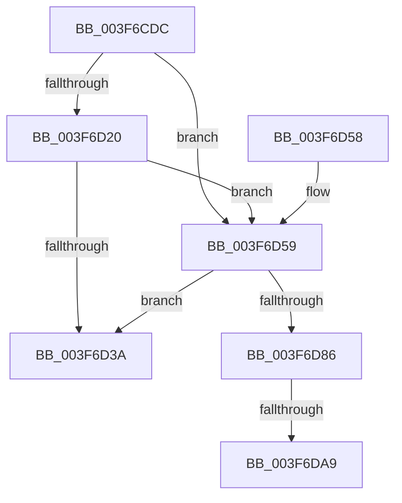

# HalpAcpiGetTableWork

- RVA: `0x003F6CDC`–`0x003F6DCE` (길이 `242` bytes)
- VA: `0x00000001403F6CDC`
- 실행 섹션: `.text`
- PDB 이름 있음: `예`; PDB Function 태그: `예`
- unwind 정보 RVA: `0x00098158`
- 디코드: `67`개 명령, `242/242` bytes 표시
- 미해석 바이트: `0` (있으면 어셈블리에 `.byte`로 보존)

> 이 문서는 커널 이미지의 기계어와 PDB 기호를 분석해 생성했습니다. 4번과 5번은 함수 원형과 자료형을 바이너리 사용 방식에서 추정한 C 해석이며 원본 소스 복구 결과는 아닙니다.

## 1. Dependencies

- 직접 호출 지점: **5**; 고유 호출 대상: **5**
- 직접 호출자로 확인된 함수: **6**
- RIP 상대 이미지 참조: **0**

### Outgoing calls
- `0x003F6D13` → [HalpAcpiGetCachedTable](HalpAcpiGetCachedTable_function_003F6DD4.md) (function, `0x003F6DD4`)
- `0x003F6D31` → [HalpAcpiIsCachedTableCompromised](HalpAcpiIsCachedTableCompromised_function_003F6E78.md) (function, `0x003F6E78`)
- `0x003F6D79` → [HalpAcpiGetTableFromBios](HalpAcpiGetTableFromBios_function_003F7404.md) (function, `0x003F7404`)
- `0x003F6D91` → [HalpAcpiCopyBiosTable](../53/HalpAcpiCopyBiosTable_function_0053EDD0.md) (function, `0x0053EDD0`)
- `0x003F6DC3` → [HalpUnmapVirtualAddress](HalpUnmapVirtualAddress_function_003F8C30.md) (function, `0x003F8C30`)

### Direct callers
- [HalMatchAcpiOemId](HalMatchAcpiOemId_function_003F6A90.md) at `0x003F6AE8`
- [HalpAcpiGetTable](HalpAcpiGetTable_function_003F6BF8.md) at `0x003F6C33`
- [HalAcpiGetTableDispatch](HalAcpiGetTableDispatch_function_003F6C80.md) at `0x003F6CAD`
- [HalpAcpiGetTableFromBios](HalpAcpiGetTableFromBios_function_003F7404.md) at `0x003F7558`
- [HalpAcpiGetAllTablesWork](../53/HalpAcpiGetAllTablesWork_function_0053EEE8.md) at `0x0053EF2B`
- [HalpAcpiGetAllTablesWork](../53/HalpAcpiGetAllTablesWork_function_0053EEE8.md) at `0x0053EF44`
- [HalpAcpiGetFacsMapping](../53/HalpAcpiGetFacsMapping_function_0053F0F0.md) at `0x0053F121`

### Static image references
- 디코드된 RIP-relative 메모리 참조가 없습니다.

## 2. Other-region calls and transfers

- 다른 실행 섹션으로 향하는 call: **0**
- call이 아닌 외부 분기/꼬리 이동: **2**
  - `0x003F6DA3` → [sub_006EB980](../6E/Unknown_function_006EB980.md) (`tail-transfer`)
  - `0x003F6DC9` → [sub_006EB980 + 0x8](../6E/Unknown_function_006EB980.md) (`tail-transfer`)

## 3. Assembly (complete function range)

```asm
003F6CDC  48 8B C4                        mov rax, rsp
003F6CDF  48 89 58 08                     mov qword ptr [rax + 8], rbx
003F6CE3  48 89 68 10                     mov qword ptr [rax + 0x10], rbp
003F6CE7  48 89 70 18                     mov qword ptr [rax + 0x18], rsi
003F6CEB  48 89 78 20                     mov qword ptr [rax + 0x20], rdi
003F6CEF  41 56                           push r14
003F6CF1  48 83 EC 40                     sub rsp, 0x40
003F6CF5  48 83 60 F0 00                  and qword ptr [rax - 0x10], 0
003F6CFA  49 8B E8                        mov rbp, r8
003F6CFD  83 60 E8 00                     and dword ptr [rax - 0x18], 0
003F6D01  44 8B F2                        mov r14d, edx
003F6D04  48 8B F1                        mov rsi, rcx
003F6D07  48 8B D5                        mov rdx, rbp
003F6D0A  41 8B CE                        mov ecx, r14d
003F6D0D  4D 8B C1                        mov r8, r9
003F6D10  49 8B F9                        mov rdi, r9
003F6D13  E8 BC 00 00 00                  call 0x1403f6dd4
003F6D18  48 8B D8                        mov rbx, rax
003F6D1B  48 85 C0                        test rax, rax
003F6D1E  74 39                           je 0x1403f6d59
003F6D20  4C 8B CF                        mov r9, rdi
003F6D23  48 89 44 24 20                  mov qword ptr [rsp + 0x20], rax
003F6D28  4C 8B C5                        mov r8, rbp
003F6D2B  41 8B D6                        mov edx, r14d
003F6D2E  48 8B CE                        mov rcx, rsi
003F6D31  E8 42 01 00 00                  call 0x1403f6e78
003F6D36  84 C0                           test al, al
003F6D38  75 1F                           jne 0x1403f6d59
003F6D3A  48 8B 6C 24 58                  mov rbp, qword ptr [rsp + 0x58]
003F6D3F  48 8B C3                        mov rax, rbx
003F6D42  48 8B 5C 24 50                  mov rbx, qword ptr [rsp + 0x50]
003F6D47  48 8B 74 24 60                  mov rsi, qword ptr [rsp + 0x60]
003F6D4C  48 8B 7C 24 68                  mov rdi, qword ptr [rsp + 0x68]
003F6D51  48 83 C4 40                     add rsp, 0x40
003F6D55  41 5E                           pop r14
003F6D57  C3                              ret
003F6D58  CC                              int3
003F6D59  48 8D 44 24 38                  lea rax, [rsp + 0x38]
003F6D5E  4C 8B CF                        mov r9, rdi
003F6D61  48 89 44 24 28                  mov qword ptr [rsp + 0x28], rax
003F6D66  4C 8B C5                        mov r8, rbp
003F6D69  48 8D 44 24 30                  lea rax, [rsp + 0x30]
003F6D6E  41 8B D6                        mov edx, r14d
003F6D71  48 8B CE                        mov rcx, rsi
003F6D74  48 89 44 24 20                  mov qword ptr [rsp + 0x20], rax
003F6D79  E8 86 06 00 00                  call 0x1403f7404
003F6D7E  48 8B D8                        mov rbx, rax
003F6D81  48 85 C0                        test rax, rax
003F6D84  74 B4                           je 0x1403f6d3a
003F6D86  4C 8B 44 24 38                  mov r8, qword ptr [rsp + 0x38]
003F6D8B  48 8B D0                        mov rdx, rax
003F6D8E  48 8B CE                        mov rcx, rsi
003F6D91  E8 3A 80 14 00                  call 0x14053edd0
003F6D96  8B 54 24 30                     mov edx, dword ptr [rsp + 0x30]
003F6D9A  48 8B F8                        mov rdi, rax
003F6D9D  48 8B CB                        mov rcx, rbx
003F6DA0  48 85 F6                        test rsi, rsi
003F6DA3  0F 84 D7 4B 2F 00               je 0x1406eb980
003F6DA9  81 E1 FF 0F 00 00               and ecx, 0xfff
003F6DAF  48 81 C2 FF 0F 00 00            add rdx, 0xfff
003F6DB6  48 03 D1                        add rdx, rcx
003F6DB9  45 33 C0                        xor r8d, r8d
003F6DBC  48 C1 EA 0C                     shr rdx, 0xc
003F6DC0  48 8B CB                        mov rcx, rbx
003F6DC3  E8 68 1E 00 00                  call 0x1403f8c30
003F6DC8  90                              nop
003F6DC9  E9 BA 4B 2F 00                  jmp 0x1406eb988
```

## 4. C-style interpretation (structured pseudocode)

```c
__int64 __fastcall HalpAcpiGetTableWork(__int64 a1, int a2, __int64 a3, __int64 a4)
{
    __int64 result;
    __int64 v_rsp;
    unsigned __int64 v_stack_m28;
    unsigned __int64 v_stack_p10;
    unsigned __int64 v_stack_p18;
    unsigned __int64 v_stack_p20;
    unsigned __int64 v_stack_p28;
    unsigned __int64 v_stack_p30;
    unsigned __int64 v_stack_p38;
    unsigned __int64 v_stack_p8;

    *(unsigned __int64 *)(v_rsp + 8) = v_rbx;
    *(unsigned __int64 *)(v_rsp + 16) = v_rbp;
    *(unsigned __int64 *)(v_rsp + 24) = v_rsi;
    *(unsigned __int64 *)(v_rsp + 32) = v_rdi;
    v_rsp = (v_rsp) - (64);
    result = HalpAcpiGetCachedTable((unsigned int)((unsigned int)((unsigned int)(a2))), a3, a4, a4);
    if (result == 0) goto loc_003F6D59;
    v_stack_m28 = result;
    result = HalpAcpiIsCachedTableCompromised(a1, (unsigned int)((unsigned int)((unsigned int)(a2))), a3, a4);
    if ((unsigned __int8)(result) != 0) goto loc_003F6D59;
loc_003F6D3A:
    v_rsp = (v_rsp) + (64);
    return result;
loc_003F6D59:
    v_stack_p28 = v_stack_p38;
    v_stack_p20 = v_stack_p30;
    result = HalpAcpiGetTableFromBios(v_stack_p18, (unsigned int)((unsigned int)((unsigned int)(a2))), v_stack_p10, v_stack_p20);
    if (result == 0) goto loc_003F6D3A;
    result = HalpAcpiCopyBiosTable(v_stack_p18, result, v_stack_p38, v_stack_p20);
    a1 = (unsigned int)((result) & (0xFFFULL));
    a2 = ((unsigned int)(v_stack_p30)) + (0xFFFULL);
    a2 = (a2) + (a1);
    a3 = 0;
    a2 = (a2) >> (12);
    result = HalpUnmapVirtualAddress(result, a2, a3, v_stack_p20);
}
```

## 5. (Beta) C Style

```c
int64_t HalpAcpiGetTableWork(int64_t Arg1, int32_t Arg2, int64_t Arg3, int64_t Arg4)
{
    int64_t result;
    int64_t local_rsp;
    uint64_t v_stack_m28;
    uint64_t v_stack_p10;
    uint64_t v_stack_p18;
    uint64_t v_stack_p20;
    uint64_t v_stack_p28;
    uint64_t v_stack_p30;
    uint64_t v_stack_p38;
    uint64_t v_stack_p8;

    *(uint64_t *)(local_rsp + 0x8) = local_rbx;
    *(uint64_t *)(local_rsp + 0x10) = local_rbp;
    *(uint64_t *)(local_rsp + 0x18) = local_rsi;
    *(uint64_t *)(local_rsp + 0x20) = local_rdi;
    local_rsp = (local_rsp) - (64);
    result = HalpAcpiGetCachedTable((uint32_t)((uint32_t)((uint32_t)(Arg2))), Arg3, Arg4, Arg4);
    if (result == 0) goto loc_003F6D59;
    v_stack_m28 = result;
    result = HalpAcpiIsCachedTableCompromised(Arg1, (uint32_t)((uint32_t)((uint32_t)(Arg2))), Arg3, Arg4);
    if ((uint8_t)(result) != 0) goto loc_003F6D59;
loc_003F6D3A:
    local_rsp = (local_rsp) + (64);
    return result;
loc_003F6D59:
    v_stack_p28 = v_stack_p38;
    v_stack_p20 = v_stack_p30;
    result = HalpAcpiGetTableFromBios(v_stack_p18, (uint32_t)((uint32_t)((uint32_t)(Arg2))), v_stack_p10, v_stack_p20);
    if (result == 0) goto loc_003F6D3A;
    result = HalpAcpiCopyBiosTable(v_stack_p18, result, v_stack_p38, v_stack_p20);
    Arg1 = (uint32_t)((result) & (0xFFFULL));
    Arg2 = ((uint32_t)(v_stack_p30)) + (0xFFFULL);
    Arg2 = (Arg2) + (Arg1);
    Arg3 = 0;
    Arg2 = (Arg2) >> (12);
    result = HalpUnmapVirtualAddress(result, Arg2, Arg3, v_stack_p20);
}
```

## 6. Execution-region graph

[열기: 2D/3D 그래프와 함수 탐색 컨트롤 패널](../../../control-panel.html?section=text&rva=0x003F6CDC&view=graph)

- 2D 그래프는 위에서 아래로 흐르고, 3D 그래프는 빈 공간을 드래그해 회전합니다. Shift+드래그는 이동, 휠은 확대·축소, 함수 노드 선택은 대상 보고서 이동입니다.

### Static fallback


